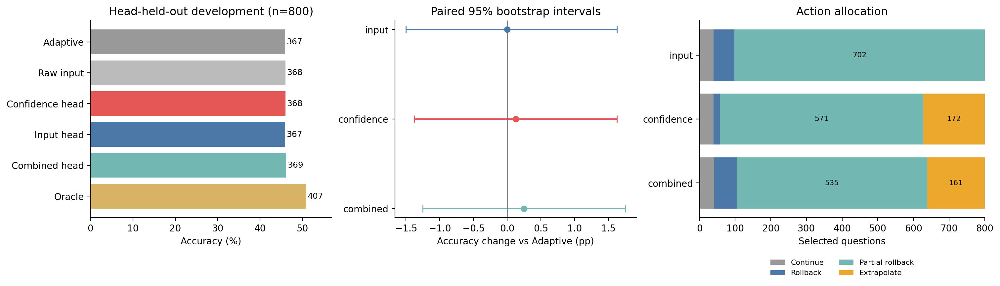
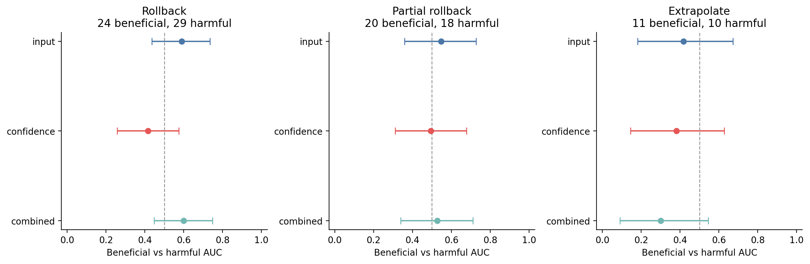
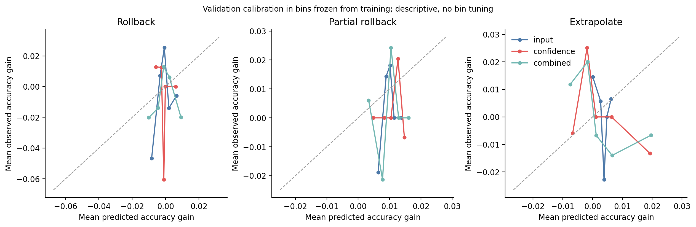

# Frozen-state action-value calibration

**No-Go for this calibrated action family.**

Training used 3,200 OpenBookQA questions; the head-held-out development evaluation used 800 different questions. Both splits were historically exposed in earlier experiments. These results do not establish independent generalization. The frozen selection rule chose `adaptive`.

## What the intermediate variable estimates

At recurrent depth two, the input head maps the changes in known-input token loss on two fixed probe groups into expected final accuracy change for each state action. The target is the final correctness indicator under that action minus the Adaptive correctness indicator. Continue has value zero; the policy chooses the largest positive predicted gain. It runs the remaining recurrent iterations after applying the chosen state action.

The input and confidence heads each contain nine fitted linear coefficients, including intercepts. The combined head contains fifteen. Feature normalization statistics are stored separately. Only the small heads were supervised; Ouro weights were frozen. No evaluation-label threshold or sign search was performed.

## Controller outcomes

| Policy | Correct | Accuracy | Corrections | Degradations | Net | Paired 95% CI (pp) |
| --- | ---: | ---: | ---: | ---: | ---: | --- |
| adaptive | 367/800 | 45.88% | 0 | 0 | +0 | [0.000, 0.000] |
| fixed_-1.0 | 362/800 | 45.25% | 25 | 30 | -5 | [-2.375, 1.125] |
| fixed_-0.5 | 369/800 | 46.12% | 20 | 18 | +2 | [-1.250, 1.750] |
| fixed_0.5 | 369/800 | 46.12% | 12 | 10 | +2 | [-0.875, 1.375] |
| raw_probe | 368/800 | 46.00% | 4 | 3 | +1 | [-0.500, 0.750] |
| raw_confidence | 364/800 | 45.50% | 9 | 12 | -3 | [-1.500, 0.750] |
| best_fixed_train | 369/800 | 46.12% | 20 | 18 | +2 | [-1.250, 1.750] |
| training_mean | 369/800 | 46.12% | 20 | 18 | +2 | [-1.250, 1.750] |
| oracle | 407/800 | 50.88% | 40 | 0 | +40 | [3.500, 6.500] |
| input | 367/800 | 45.88% | 21 | 21 | +0 | [-1.500, 1.625] |
| terminal_input | 364/800 | 45.50% | 23 | 26 | -3 | [-2.000, 1.375] |
| confidence | 368/800 | 46.00% | 19 | 18 | +1 | [-1.375, 1.625] |
| terminal_confidence | 370/800 | 46.25% | 20 | 17 | +3 | [-1.125, 1.875] |
| combined | 369/800 | 46.12% | 19 | 17 | +2 | [-1.250, 1.750] |
| terminal_combined | 370/800 | 46.25% | 21 | 18 | +3 | [-1.125, 1.875] |

Primary admission required at least five net corrections, a positive lower paired interval and Holm-adjusted p<0.05 versus Adaptive, the equally calibrated confidence head and the training-selected best fixed action, plus a significant action-frequency-preserving shuffle comparison. All eight primary p values were adjusted together.

| Primary test | Holm p |
| --- | ---: |
| combined_vs_shuffle | 1 |
| input_vs_best_fixed_train | 1 |
| input_vs_shuffle | 1 |
| combined_vs_adaptive | 1 |
| input_vs_adaptive | 1 |
| input_vs_confidence | 1 |
| combined_vs_confidence | 1 |
| combined_vs_best_fixed_train | 1 |

## Signal evidence and its limits

| Action | Beneficial / harmful events | Input AUC | Confidence AUC | Combined AUC |
| --- | --- | --- | --- | --- |
| Rollback | 24 / 29 | 0.589 [0.435, 0.734] | 0.417 [0.257, 0.575] | 0.599 [0.447, 0.749] |
| Partial rollback | 20 / 18 | 0.547 [0.358, 0.728] | 0.494 [0.311, 0.678] | 0.528 [0.339, 0.711] |
| Extrapolate | 11 / 10 | 0.418 [0.182, 0.673] | 0.382 [0.145, 0.627] | 0.300 [0.091, 0.545] |

These ranking intervals and paired AUC differences are secondary diagnostics. AUC on nonzero accuracy-change events does not prove a useful acceptance policy. Calibration-bin plots, all-row squared error, and the zero/training-mean controls are in the frozen analysis JSON. `ACTION_ACCEPTANCE_EVENTS.csv` reports beneficial operations selected/rejected and harmful operations selected/avoided for every head and action; `LOOPCD_CORRECTION_RETENTION.json` accounts for original Adaptive corrections retained and harms repaired.

## Cost and mechanism

The collection charged 2.4927 GPU-worker hours within this stage. This is exhaustive counterfactual research cost, not deployment cost.

| Head | Serial controller / Adaptive time |
| --- | ---: |
| input | 1.1430 |
| confidence | 1.1431 |
| combined | 1.1436 |

Runtime ratios replay measured branches and include the two-loop decision probe and confidence diagnostics. They do not establish optimized serving latency. All selected branches still execute four recurrent calls; this protocol does not demonstrate early stopping or saved recurrent work. Full rollback of the second homogeneous recurrent state largely behaves like one fewer effective refinement, so rollback alone is not a novelty claim.

Terminal-only selected-action ablations and paired comparisons appear in `VALIDATION_ANALYSIS.json`. Useful state control must be distinguished from a better terminal readout. An equal-compute prompt ensemble and independent benchmarks remain prerequisites for a broad accuracy–compute or generalization claim if a candidate passes this screen.

## Research decision

No head met the frozen development admission rule. Retain Adaptive and do not open an independent final benchmark for this candidate family. The experiment does not establish a reliable continuation/feedback variable, and the full research objective remains unachieved. Increasing head size or tuning thresholds on these outcomes would not repair the evidence.

Training-free evidence for this state-action family was previously negative: the 400-question probe controller obtained 190 correct versus Adaptive 192. This stage tests whether bounded supervision contributes usable calibration; it does not retroactively make that rule training-free.

