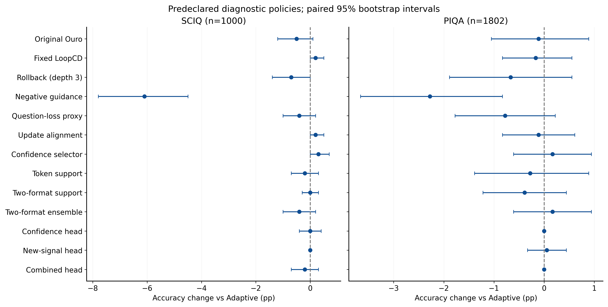
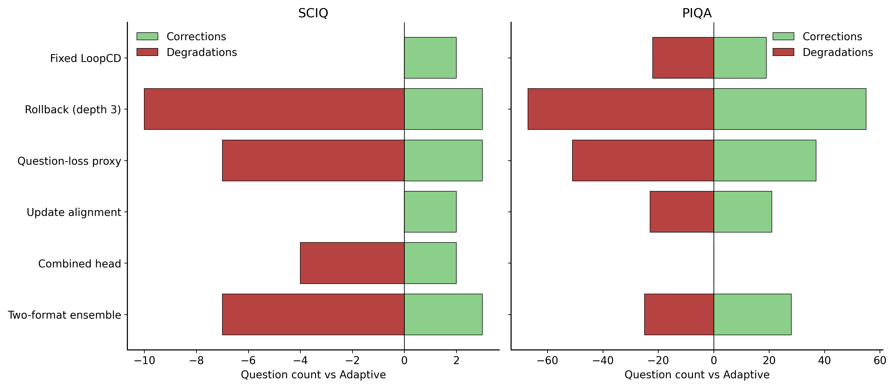
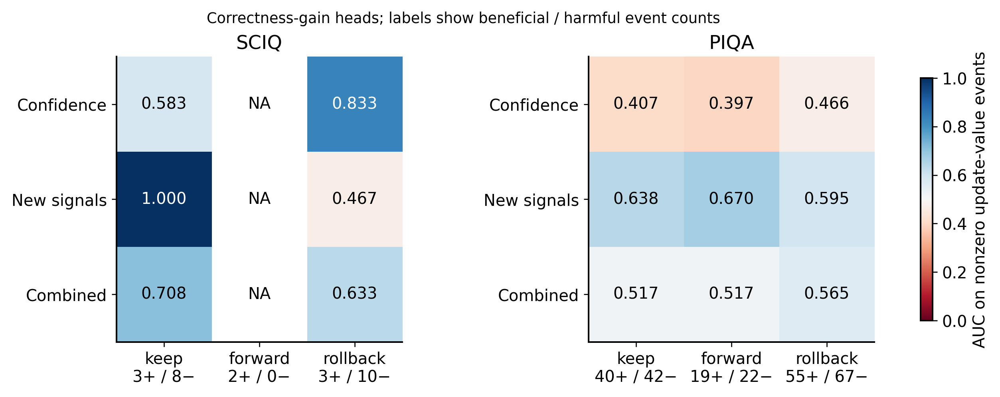
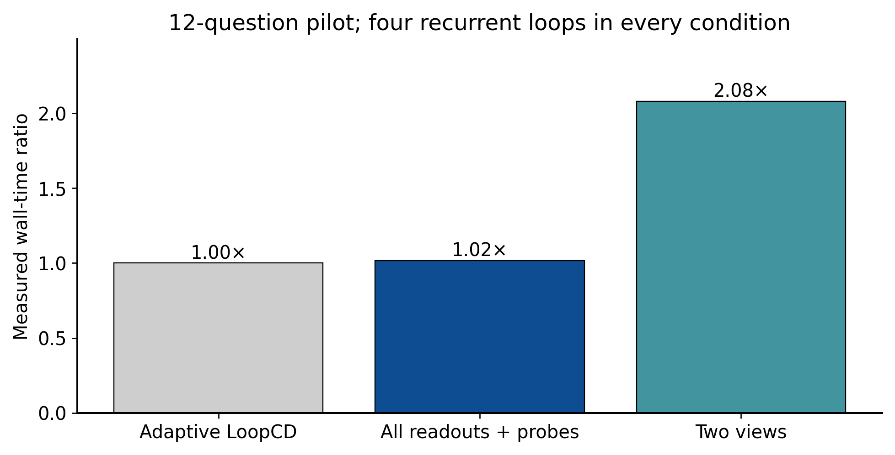

# Frozen update-value experiment: findings

Decision: **No-Go for a method-paper claim from this round**.

Chinese result summary: [FINDINGS_ZH.md](FINDINGS_ZH.md).
Locked policy: `adaptive`. No candidate passed the precommitted validation gate; retain Adaptive, final comparisons of other policies remain diagnostic.

## Scope and evidence

Frozen official Ouro-1.4B, four loops, BF16. Discovery400, supervised-training3200, validation800, and independent final SciQ1000 / PIQA1802. All new tasks are zero-shot; historical ARC25-shot and Qwen600 remain exposed historical evidence. SciQ includes official support paragraphs. PIQA excludes36 duplicate question texts before inference.

The precommitted primary metric, supported by the official harness, is full-candidate character-normalized accuracy; raw accuracy is retained in FINAL_ANALYSIS.json. No final labels were used to choose signs, thresholds, features or models.

Complete paired counts, validation gates, random controls and incremental head AUC intervals are in [STATISTICAL_APPENDIX.md](STATISTICAL_APPENDIX.md).

## Final accuracy

| Policy | SciQ correct /1000 | SciQ % | PIQA correct /1802 | PIQA % |
|---|---:|---:|---:|---:|
| adaptive | 951 | 95.100 | 1425 | 79.079 |
| Original Ouro | 946 | 94.600 | 1423 | 78.968 |
| Fixed LoopCD | 953 | 95.300 | 1422 | 78.912 |
| Rollback (depth 3) | 944 | 94.400 | 1413 | 78.413 |
| Negative guidance | 890 | 89.000 | 1384 | 76.804 |
| Question-loss proxy | 947 | 94.700 | 1411 | 78.302 |
| Update alignment | 953 | 95.300 | 1423 | 78.968 |
| Confidence selector | 954 | 95.400 | 1428 | 79.245 |
| Token support | 949 | 94.900 | 1420 | 78.801 |
| Two-format support | 951 | 95.100 | 1418 | 78.690 |
| Two-format ensemble | 947 | 94.700 | 1428 | 79.245 |
| Confidence head | 951 | 95.100 | 1425 | 79.079 |
| New-signal head | 951 | 95.100 | 1426 | 79.134 |
| Combined head | 949 | 94.900 | 1425 | 79.079 |
| head_controls_logweight | 951 | 95.100 | 1423 | 78.968 |
| head_new_logweight | 951 | 95.100 | 1426 | 79.134 |
| head_combined_logweight | 951 | 95.100 | 1430 | 79.356 |
| depth1 | 523 | 52.300 | 1202 | 66.704 |
| depth2 | 728 | 72.800 | 1369 | 75.971 |
| oracle | 955 | 95.500 | 1490 | 82.686 |

Validation combined accuracy head: 9 corrections and 5 degradations against Adaptive, net +4, 95% CI [-0.375, 1.500] pp. The small number of discordant questions limits power; failure to pass this gate is insufficient evidence for a universal absence of signal.

Oracle is a label-dependent upper bound over the four permitted actions. All non-selected policy comparisons are diagnostics, even if their final point estimate is positive.

## Paired evidence for the locked policy

Validation-selected best fixed depth: `keep`; best fixed action: `keep`. These choices were frozen before final inference.

* final_sciq vs adaptive: net +0 (0 corrections, 0 degradations), +0.000pp, 95%CI [0.000, 0.000], exact McNemar p=1.
* final_sciq vs ensemble: net +4 (7 corrections, 3 degradations), +0.400pp, 95%CI [-0.200, 1.000], exact McNemar p=0.34375.
* final_sciq vs keep: net +5 (8 corrections, 3 degradations), +0.500pp, 95%CI [-0.100, 1.200], exact McNemar p=0.226562.
* final_piqa vs adaptive: net +0 (0 corrections, 0 degradations), +0.000pp, 95%CI [0.000, 0.000], exact McNemar p=1.
* final_piqa vs ensemble: net -3 (25 corrections, 28 degradations), -0.166pp, 95%CI [-0.943, 0.610], exact McNemar p=0.783846.
* final_piqa vs keep: net +2 (42 corrections, 40 degradations), +0.111pp, 95%CI [-0.832, 1.110], exact McNemar p=0.912157.

Primary Holm-adjusted p values: `{"final_sciq/keep": 1.0, "final_sciq/ensemble": 1.0, "final_piqa/ensemble": 1.0, "final_piqa/keep": 1.0, "final_sciq/adaptive": 1.0, "final_piqa/adaptive": 1.0}`.

## Answers to the nine research questions

1. **Signal discovered:** no deployable training-free update-value signal passed the gate. A supervised bundle of actual update directions, fixed projections, question-token loss residuals and token-support features carries some PIQA ranking information. The bundle does not isolate which component is responsible, and it did not produce a validated controller.
2. **Predicting benefit versus harm:** the new-signal correctness head has PIQA AUC keep=0.638 (40 beneficial/42 harmful events), forward=0.670 (19 beneficial/22 harmful events), rollback=0.595 (55 beneficial/67 harmful events). Stratified 95% bootstrap intervals are keep: [0.512, 0.756]; forward: [0.488, 0.828]; rollback: [0.494, 0.700]. These secondary intervals are unadjusted. The transferred confidence-only correctness head has AUC below 0.5 on all three PIQA actions, so an AUC advantage over that control alone does not isolate a new mechanism. Its policy changes accuracy by only +1 question, +0.055 pp, 95% CI [-0.333, 0.444]. On SciQ the same head makes no net accuracy gain; its Keep AUC of 1.0 is based on only 3 beneficial and 8 harmful events, while Forward AUC is undefined because both nonzero events are beneficial. The confidence-bin diagnostic is heterogeneous: PIQA rollback AUC is 0.663 in the lowest-margin quartile and 0.375 in the next quartile; higher bins are sparse. Ranking information is therefore distinct from a useful acceptance decision.
3. **Training-free usefulness:** the question-loss proxy nets -4 / -14 questions on SciQ / PIQA; geometry nets +2 / -2; two-format support nets +0 / -7. No training-free policy passed validation. The confidence selector improves the final point estimate by three questions on each task, but its paired intervals include zero and it remains an exploratory control.
4. **Supervision:** 3200 OpenBookQA training questions provide 276 beneficial and 317 harmful question-action events, with neutral events retained. The six ridge heads have 96, 345 or 435 parameters; Ouro remains frozen. Among the trained heads, the new-signal correctness head has higher PIQA ranking AUC than the confidence-only head, but no usable accuracy gain. This comparison does not prove that learning is essential or identify a single causal feature. Gold candidate log-weight supervision is a separate target and does not establish accuracy improvement. Only one training size and a bounded linear family were tested, so minimal sufficient supervision is not established.
5. **Accuracy–compute trade-off:** no reliable improvement was demonstrated. Adaptive scores 95.100% / 79.079%; the new-signal correctness head scores 95.100% / 79.134%. Even the largest post-test head point estimate on PIQA, the combined log-weight head, nets only +5 questions with 95% CI [-0.610, 1.165] pp and was not selected by validation. The pilot measures 1.018x time for all readouts/probes and 2.080x for two views. The ensemble matches the two-format selector in pass count; one-view policies use fewer passes. All retrospective decisions still execute all four loops.
6. **Rollback identification:** depth3 recovers 4 original-Ouro errors on SciQ and 34 on PIQA, but also degrades 6 and 44 originally correct answers, respectively. Thus rollback opportunities exist, without a validated rule for selecting them. The new-signal PIQA rollback AUC is only a ranking diagnostic; selecting rollback after four completed loops saves no backbone computation.
7. **Generalization:** the held-out tasks expose a distinction: some supervised ranking information transfers from OpenBookQA to PIQA, but no locked controller improves both independent tasks. SciQ has only four oracle-recoverable errors beyond Adaptive within the permitted action set, limiting possible gain to 0.4 pp. PIQA has 65 such errors. No Qwen transfer was launched because the precommitted Ouro controller-success condition failed.
8. **Novelty:** no new method claim is supported. Direction/curvature statistics overlap TAPS, gain supervision overlaps TaH2, and the fixed readout actions come from LoopCD. Freezing the backbone is a scope difference, not sufficient novelty. Readout Feedback and CoDR use different interaction/context mechanisms; the format intervention supplies no new facts. The defensible contribution of this round is the controlled separation of ranking, conservative action selection and actual accuracy.
9. **Research decision:** No-Go for the present controller and a full method-paper claim. Preserve the negative accuracy result and the limited positive ranking observation. Do not tune thresholds on these final tests, reinterpret the oracle as an executable policy, or automatically increase model complexity. This is a bounded research decision, not evidence that every frozen-model update-value mechanism must fail.

| Task | Rollback recovers Keep errors | Any earlier depth recovers Keep errors | Errors unreachable by four-action oracle |
|---|---:|---:|---:|
| final_sciq | 4 | 9 | 45 |
| final_piqa | 34 | 108 | 312 |

## Evidence and cost controls

SciQ Adaptive with support versus without support: +8.700pp, paired95%CI [6.9, 10.6]. This is an evidence-removal diagnostic, not independent verification or a causal-language-model reproduction of CoDR.

Charged additional GPU wall time: **1.6964 hours**. Historical starting charge: 10.0737h; sum: 11.7701h. This includes startup, parity and failed workers. Head fitting used CPU (15.54s total).

## Correctness and limits

Native final logits matched exactly. Harness likelihood errors were within the declared BF16 tolerance and predictions matched. The causal probe was checked against a prefix-only forward pass. Tests verify gold-label invariance and candidate permutation invariance. Complete exit receipts, manifest hashes, action-level paired outputs and source locks are retained.

Operational recoveries are retained: discovery encountered an unavailable input-token probe; PIQA encountered a Windows progress-file sharing violation after 1492 saved records. Completed records were preserved. PIQA resumed with byte-identical frozen scoring code and a boundary replay; see REPRODUCE.md and the recovery receipts.

The sample size of harmful/beneficial events can be much smaller than the question count. Sparse action-specific evidence limits power. A failed linear head does not rule out all nonlinear mechanisms, but this protocol does not respond to a negative result by indefinitely increasing model complexity.

