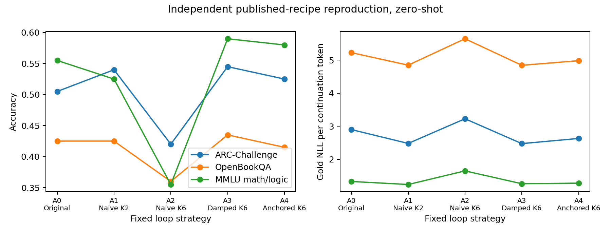
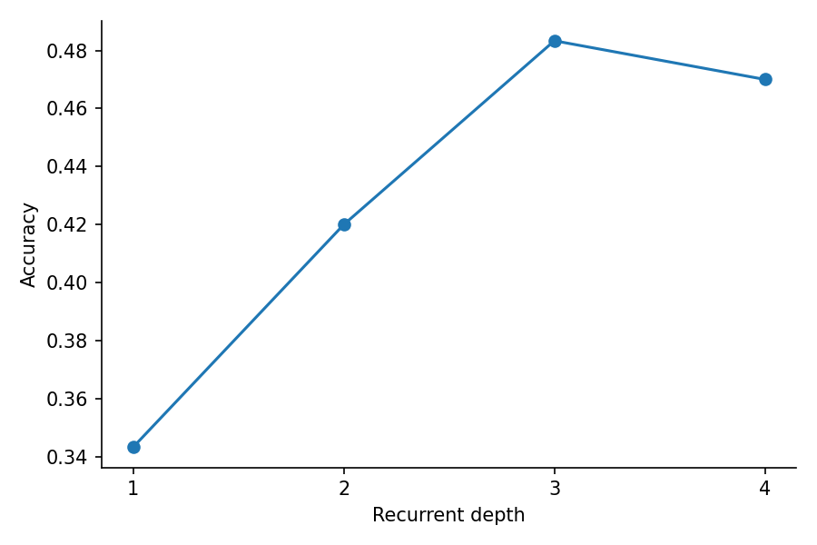
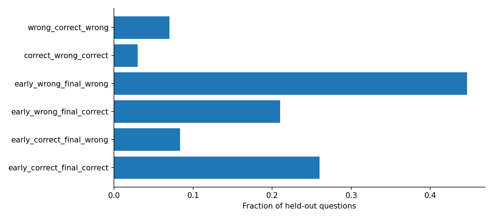
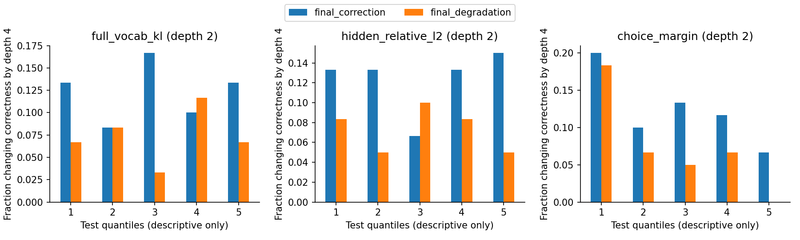
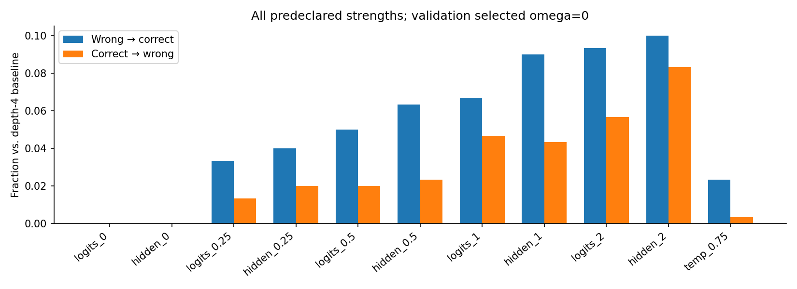
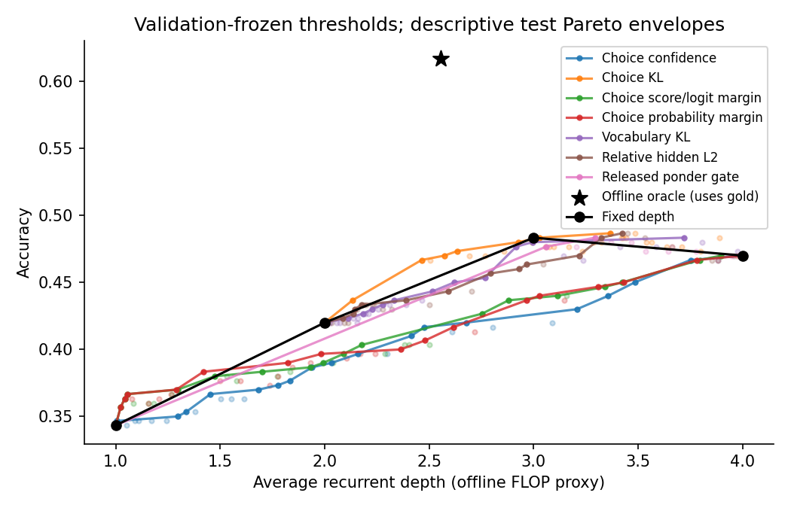

# Looped Transformers Stage 1：研究结论

日期：2026-10-23。Seed 2021。**决策：No-Go，当前证据不足以进入新的 Continuation-Aware / Continuation-Preserving 模型研发。**

循环确实会纠错，也会破坏正确答案；这不是只有概率数值变化。可是，本轮没有建立“全词表预测已经高度稳定，继续循环仍系统性带来有效纠错”的强证据。验证集也没有选择非零 LoopCD 强度。已知的非单调轨迹和不完美停止指标，与近期文献高度重叠，不能直接转化成一个新模型的研究动机。

本轮完成 Qwen 五配置各 600 道独立测试题、各 50 道 pilot，Ouro 100 道验证题及 300 道独立测试题的四轮轨迹，以及独立的 100 道 GSM8K 生成实验。模型没有训练或量化。Qwen 属于**独立公开 recipe 实现的补充复现**；作者仓库 404，不能宣称已与作者补丁直接对齐。选择题采用固定 zero-shot 协议，与 LoopCD 论文的 25-shot ARC 绝对结果分开。

## Q1. Training-Free Loop 是否出现正收益？

| method | accuracy | delta_pp | CI95_pp | wrong_to_correct | correct_to_wrong | gold_NLL_per_token | vocab_entropy |
| --- | --- | --- | --- | --- | --- | --- | --- |
| A0 | 49.50% | +0.00 | [0.00, 0.00] | 0 | 0 | 3.150 | 3.990 |
| A1 | 49.67% | +0.17 | [-2.33, 2.67] | 31 | 30 | 2.854 | 3.745 |
| A2 | 37.83% | -11.67 | [-15.67, -7.67] | 45 | 115 | 3.506 | 4.210 |
| A3 | 52.33% | +2.83 | [0.67, 5.00] | 32 | 15 | 2.859 | 3.879 |
| A4 | 50.67% | +1.17 | [-0.33, 2.83] | 15 | 8 | 2.963 | 3.961 |

单位为准确率；delta 和区间为相对 A0 的百分点。A3 Damped Euler 为 52.33%，净增 +2.83 pp，逐比较 95% CI [0.67, 5.00] pp。主要 Anchored recipe A4 为 50.67%，净增 +1.17 pp，CI [-0.33, 2.83] pp，证据不足以确认其净增益。没有把测试集最优配置改成部署配置，也没有把论文分数当作本轮结果。

| task | A0 | A1 | A2 | A3 | A4 |
| --- | --- | --- | --- | --- | --- |
| arc_challenge | 50.50% | 54.00% | 42.00% | 54.50% | 52.50% |
| mmlu | 55.50% | 52.50% | 35.50% | 59.00% | 58.00% |
| openbookqa | 42.50% | 42.50% | 36.00% | 43.50% | 41.50% |

每个任务组 n=200；MMLU 是五个数学/逻辑子集的汇总。单任务的区间、NLL、熵、全部转移计数均在 `results/qwen_metrics.csv`。A3 的总体正效应不意味着三个任务都显著提升；区间是未作多重比较校正的逐比较区间，不能把策略网格赢家包装成新的确认性发现。

## Q2. Naive 与受控循环的主要差别是什么？

Naive K=2 的净变化只有 +0.17 pp，却同时纠正 31 题、破坏 30 题。只看净准确率会掩盖这些相反变化。Naive K=6 净下降 11.67 pp，其中 115 题从对变错。Damped/Anchored 明显缓解这种退化，但效果不同，不能统称成同一个方法。

| method | mean_relative_L2 | mean_cosine | choice_KL_vs_A0 |
| --- | --- | --- | --- |
| A1 | 0.973 | 0.688 | 0.02145 |
| A2 | 1.742 | 0.516 | 0.11656 |
| A3 | 0.570 | 0.859 | 0.01118 |
| A4 | 0.664 | 0.818 | 0.00276 |

窗口指标取最后一个有效 prompt token；逐步更新幅度保存在每题 `window.steps`。无循环的自然窗口参照由各方法的首次 g(x0) 提供，和原始窗口输入一致。NLL、熵与准确率也不是一个变量：降低 NLL 或提高集中度，不能单独证明获得了更强的多步推理能力。本实验没有干预状态来识别产生纠错的因果机制。

直接相对 Naive K=6，A3 提高 +14.50 pp（95% CI [10.50, 18.50] pp），A4 提高 +12.83 pp（[8.83, 16.83] pp）。全部方法间及任务内的配对比较见 `results/qwen_pairwise_metrics.csv`，仍为未校正的逐比较区间。

## Q3. Ouro 的准确率随深度单调改善吗？

| depth | accuracy | vocab_confidence |
| --- | --- | --- |
| 1 | 34.33% | 0.1012 |
| 2 | 42.00% | 0.2392 |
| 3 | 48.33% | 0.3446 |
| 4 | 47.00% | 0.3545 |

本批数据的点估计在第三轮后下降。r3→r4 的准确率差为 -1.33 pp，95% CI [-4.67, 1.67] pp，不能确认总体末轮退化具有统计稳定性。逐题非单调现象则直接存在，不能用总体均值掩盖。验证集没有因此改为固定第三轮。

独立数学完整生成的 r1/r2/r3/r4 EM 为 24.00% / 65.00% / 77.00% / 80.00%。其 r3→r4 差值为 +3.00 pp，95% CI [-4.00, 10.00] pp。这是相同题目、不同自回归前缀的末答案比较，不能直接当作同前缀隐藏状态的非单调证据，也不与选择题准确率求平均。

## Q4. 有哪些真实纠错、退化及振荡轨迹？

| pattern | count | rate | CI95 |
| --- | --- | --- | --- |
| early_correct_final_correct | 78 | 26.00% | [21.36%, 31.24%] |
| early_correct_final_wrong | 25 | 8.33% | [5.71%, 12.01%] |
| early_wrong_final_correct | 63 | 21.00% | [16.77%, 25.96%] |
| early_wrong_final_wrong | 134 | 44.67% | [39.14%, 50.32%] |
| correct_wrong_correct | 9 | 3.00% | [1.59%, 5.60%] |
| wrong_correct_wrong | 21 | 7.00% | [4.62%, 10.46%] |

前四类互斥；后两类振荡模式可能与前四类重叠，不能把六行比例相加。比例区间采用 Wilson 95% CI。

- Early Correct → Final Wrong: `arc_challenge/test/Mercury_7182210`，gold=B, 预测 B → B → A → A。题目与全部候选见原始 JSONL；案例按 manifest 顺序取第一个匹配项。
- Early Wrong → Final Correct: `arc_challenge/test/MCAS_2004_9_10-v1`，gold=C, 预测 A → C → C → C。题目与全部候选见原始 JSONL；案例按 manifest 顺序取第一个匹配项。

完整案例在 `results/failure_cases.jsonl`，所有未筛选题目在 `trajectories/ouro_test.jsonl`。63 次首错末对与 25 次首对末错表明循环会改变实际选项排名，而不只是保持 argmax 的概率重分配。

初始词表置信度五分位组中，首错末对占各组全部题目的比例范围为 13.33%–30.00%; 题目 prompt token 数五分位组中，首错末对占各组全部题目的比例范围为 14.08%–32.20%。各组计数和 Wilson 区间在 `results/trajectory_strata.csv`；这些是事后描述，不证明长度或置信度造成纠错。按任务的同类轨迹比例在 `results/trajectory_patterns.csv`，不把不同任务混合后的相关性当成一般机制。

## Q5. KL、Margin、Confidence、Hidden L2 能预测后续收益吗？

| metric | AUC_future_correction_given_current_wrong | low_update_or_high_confidence_group | later_corrections |
| --- | --- | --- | --- |
| full_vocab_kl | 0.490 | 39 | 6 |
| choice_kl | 0.609 | 53 | 5 |
| hidden_relative_l2 | 0.480 | 39 | 7 |
| choice_confidence | 0.432 | 94 | 15 |
| choice_margin | 0.588 | 90 | 8 |
| choice_logit_margin | 0.620 | 97 | 7 |

该表固定在 r2，目标是当前答错的题在 r4 是否纠正；AUC 只是本批测试集的描述性估计，不能当作已验证的跨任务预测器。全词表 KL 和相对 Hidden L2 的排序能力接近随机；置信度和 margin 的效果随深度/任务变化。最后一轮平均词表置信度由 0.3446 升至 0.3545，同时准确率点估计下降，说明更自信不等于更正确。

**相对低更新不等于收敛。** r2 的低分位 Hidden L2 阈值约 0.70，不能叫“隐藏状态变化很小”。r3 全词表 KL≤0.05 的 31 题，后续纠错为 0；该比例 Wilson 上限仍为 11.03%。因此本轮没有观测到这个严格稳定组的后续纠错，也不能用有限样本排除稀有事件。r2 没有满足全词表 KL≤0.05 的题。完整绝对阈值审计在 `results/absolute_stability_audit.csv`，这些阈值只用于事后描述，未改变任何部署策略。

全词表 KL 是最后一个 prompt token 的 KL(p_r||p_previous)。Choice KL 则来自长度归一化候选分数的 softmax 权重；二者不能混用。Choice 分布很平或排名间距很近时，小 KL 也可伴随 argmax 变化。该现象可能来自评分粒度，不能直接推出隐藏状态不能继续使用。

数学题还单独保存同一 prompt/官方参考解答前缀的四深度标量诊断。NLL 是完整参考解答的 teacher-forcing NLL；置信度、熵、KL 和 Hidden L2 位于 prompt 末 token。它们不等同于整段生成答案的概率，也不能代替不同生成路径上逐 token 的因果分析。

| Depth | Gold solution NLL/token | Vocab confidence | Entropy | Vocab KL | Relative hidden L2 |
| --- | --- | --- | --- | --- | --- |
| 1 | 0.9215 | 0.0314 | 8.706 | NA | NA |
| 2 | 0.5396 | 0.3413 | 2.9326 | 2.8527 | 1.4768 |
| 3 | 0.4967 | 0.3897 | 2.5406 | 0.1389 | 0.3257 |
| 4 | 0.495 | 0.3715 | 2.5007 | 0.0482 | 0.2153 |

全部四轮数值、预测的下一 token、以及对应固定深度生成答案的链接在 `trajectories/ouro_math_teacherforced.jsonl`；最终深度 readout 通过独立完整 HF 调用核验。该补充没有改变生成参数或主要 EM。

在数学 r3 的 prompt 末 token KL≤0.05 的 25 题中，完整生成答案从错变对为 0、从对变错为 1；阈值放宽为 0.1 后为 60 题、3 次纠错和 4 次退化。完整敏感性表见 `results/math_prompt_stability_audit.csv`。0.05 只是描述性切点，不能视为普遍收敛分界；这里的 KL 描述下一 token，不是整段答案的承诺，也未做状态干预。

## Q6. LoopCD 的收益来自哪里，什么时候强化错误？

验证集独立选择：Logits=logits_0，Hidden=hidden_0，温度控制=temp_0.75。两种主要 LoopCD 选择均退回 ω=0，测试结果与完整四轮相同。

| method | accuracy | delta_pp | CI95_pp | wrong_to_correct | correct_to_wrong |
| --- | --- | --- | --- | --- | --- |
| logits_0 | 47.00% | +0.00 | [0.00, 0.00] | 0 | 0 |
| hidden_0 | 47.00% | +0.00 | [0.00, 0.00] | 0 | 0 |
| logits_0.25 | 49.00% | +2.00 | [-0.33, 4.67] | 10 | 4 |
| hidden_0.25 | 49.00% | +2.00 | [-0.67, 4.67] | 12 | 6 |
| logits_0.5 | 50.00% | +3.00 | [0.00, 6.00] | 15 | 6 |
| hidden_0.5 | 51.00% | +4.00 | [0.67, 7.33] | 19 | 7 |
| logits_1 | 49.00% | +2.00 | [-1.67, 6.00] | 20 | 14 |
| hidden_1 | 51.67% | +4.67 | [0.67, 9.00] | 27 | 13 |
| logits_2 | 50.67% | +3.67 | [-0.67, 8.33] | 28 | 17 |
| hidden_2 | 48.67% | +1.67 | [-3.00, 6.67] | 30 | 25 |

这里保留全部预定强度。部分非零强度在测试上改善，但它们未被验证集选中；这些是未作多重比较校正的网格诊断。不能事后选出测试最佳值并宣称泛化收益。验证集只有 100 题，一题即一个百分点；非零 Logits 得到 47–49 题正确、非零 Hidden 得到 46–48 题，baseline 为 50 题。这个低检验力的选择结果不足以否定 LoopCD。全部验证指标在 `results/ouro_validation_metrics.csv`。

ω=0.25 的 Logits/Hidden 测试准确率均为 49%，与验证集选出的温度控制相同；相对温度控制的配对区间均跨零。没有证据说明这两个固定强度显著优于简单温度调整。

在首轮和末轮均错误的 134 题中，两种 ω=0.25 外推都额外纠正 10 题；在首轮和末轮均正确的 78 题中，两种方法各破坏 4 题。Hidden 还破坏了 2 道已由循环纠正的题。这说明净收益由不同轨迹上的正反作用合成。

在首轮正确、末轮错误的 25 题中，Logits ω=0.25 没有纠正题目，并使 19 题的 gold choice log-weight 进一步下降。Hidden 不能与 Logits 混为一谈：相同强度纠正其中 2 题。各强度、各轨迹组的计数和 gold 权重变化见 `results/loopcd_by_trajectory.csv`。

独立生成结果如下。100 题、相同三条训练示例、greedy、最多 256 新 token，严格提取 #### 数值；不与选择题求平均。

| method | exact_match | numeric_exact_match | delta_pp | CI95_pp | wrong_to_correct | correct_to_wrong | truncated | identity_reused |
| --- | --- | --- | --- | --- | --- | --- | --- | --- |
| baseline | 80.00% | 80.00% | +0.00 | [0.00, 0.00] | 0 | 0 | 3 | 0 |
| depth_1 | 24.00% | 24.00% | -56.00 | [-66.00, -46.00] | 0 | 56 | 22 | 0 |
| depth_2 | 65.00% | 65.00% | -15.00 | [-23.00, -7.00] | 2 | 17 | 7 | 0 |
| depth_3 | 77.00% | 77.00% | -3.00 | [-10.00, 4.00] | 5 | 8 | 5 | 0 |
| hidden | 80.00% | 80.00% | +0.00 | [0.00, 0.00] | 0 | 0 | 3 | 100 |
| hidden_fixed_025 | 85.00% | 85.00% | +5.00 | [-1.00, 12.00] | 8 | 3 | 2 | 0 |
| logits | 80.00% | 80.00% | +0.00 | [0.00, 0.00] | 0 | 0 | 3 | 100 |
| logits_fixed_025 | 82.00% | 82.00% | +2.00 | [-4.00, 8.00] | 6 | 4 | 4 | 0 |

数学非零 Logits 的 +2 pp 区间为 [-4, 8] pp，Hidden 的 +5 pp 区间为 [-1, 12] pp，均跨零。因此 82% 和 85% 不能作为已经确认的泛化优势；也不能据此断言 LoopCD 没有效果。

选中 ω=0 的两种方法复用了数学上相同的 baseline，`identity_reused` 明确标识这些记录；不能称为另两次非零逐 token 实验。`logits_fixed_025` 和 `hidden_fixed_025` 实际在每个新 token 上计算早期/最终状态并对比。0.25 是固定网格中最小的正值，用作补充诊断，既非验证集选中值，也非测试网格最优值；该扩展不能替代主要参数选择结果。这些 full-depth 方法保留四轮对应的 96 层缓存。`depth_1/2/3` 则实际截断循环并分别保留 24/48/72 层缓存，各自完整自回归生成；这些不同前缀的路径不等同于选择题的同前缀四轮轨迹。numeric exact match 仅规范化同值小数，作为格式敏感性的补充检查，主要 EM 不变。没有 #### 可提取答案的数量为 `{"baseline": 3, "depth_1": 24, "depth_2": 7, "depth_3": 5, "hidden": 3, "hidden_fixed_025": 2, "logits": 3, "logits_fixed_025": 4}`。截断和输出格式会影响绝对 EM，不能把这些错误都解释成循环机制失效。

逐题四种固定深度的完整答案比较另存为 `results/math_fixed_depth_paths.csv` 和 `results/math_generation_patterns.csv`。这里比较的是不同自回归路径最终的答案；该路径上的振荡不能直接解释成同一 token 隐藏状态的振荡。

选择题比较候选整段似然，数学比较完整自回归答案的数值 EM；二者的绝对准确率和收益不能直接对等。数学中的正温度缩放在 greedy 下保持逐 token argmax，因而不另起一组重复生成；选择题的多 token 序列分数会受每步归一化影响，温度控制在该协议下则不是恒等变换。

## Q7. 相同计算量下，哪些停止策略有效？

| policy | test_avg_depth | accuracy | delta_CI95_pp | recurrent_work_saved | missed_final_corrections | avoided_final_degradations |
| --- | --- | --- | --- | --- | --- | --- |
| full_vocab_kl | 2.767 | 45.33% | [-5.67, 2.33] | 30.83% | 22 | 17 |
| choice_kl | 3.167 | 47.67% | [-2.33, 3.67] | 20.83% | 10 | 12 |
| choice_confidence | 2.477 | 41.67% | [-9.67, -1.33] | 38.08% | 30 | 14 |
| choice_margin | 2.480 | 40.67% | [-10.33, -2.67] | 38.00% | 27 | 8 |
| choice_logit_margin | 2.500 | 40.33% | [-10.67, -2.67] | 37.50% | 28 | 8 |
| hidden_relative_l2 | 2.500 | 43.33% | [-7.67, 0.33] | 37.50% | 26 | 15 |
| native_gate_cdf | 1.000 | 34.33% | [-18.67, -6.67] | 75.00% | 63 | 25 |

现成 ponder gate 的三轮预算行须谨慎解释：预定正阈值网格最小值 0.05 在验证集平均需 3.07 轮，无法满足 ≤3 的预算，因而该行只能退回负无穷阈值的固定一轮。它不是门控性能普遍失效的证据。在另一个预先固定的验证预算 ≤3.5 下，选择阈值 0.05，测试为 47.67% / 平均 3.060 轮，差值 CI [-2.00, 3.33] pp，与 choice KL 的工作点接近。没有根据测试结果加密阈值网格。其权重来自发布 checkpoint；BF16 CDF 通过直接阈值 readout parity。但这是末 prompt token 上的 sample-level 代理，并非原始 per-token 自适应部署复现。

此表的验证预算约束是平均深度 ≤3，并非强制均值等于 3；在约束内优先选择验证准确率，再选择较低计算量。测试平均深度会漂移，所以表中不同平均深度不能直接当成同算力比较。公平判断应结合 Figure 4 的完整曲线，以及 `results/halting_matched_random.csv` 中具有完全相同退出深度直方图的随机分配对照。各任务在完全相同验证阈值下的结果和配对区间另见 `results/halting_selected_by_task.csv`。接近 2.5 轮时，confidence、margin、Hidden L2 未显示可靠超越随机分配的优势；choice KL 在部分预算点较好。已有 gate 对照单列，其表现不能计作新策略的收益。

离线 gold/future oracle 为 61.67% / 平均 2.553 轮，仅是事后分析参照，不能部署，也不能用它的差距证明存在可学习的停止信号。提前停止的后续纠错损失和避免退化数量同时报告；只看净收益会漏掉这两类成本。节省量是 recurrent-stack 工作量代理，不含额外逐深度 readout、调度与缓存管理开销。没有实现真实停止，不宣称 wall-clock 加速或完整 per-token adaptive decoding。

## Q8. 最近的论文是否已经解释或解决这些问题？

[LoopCD](https://arxiv.org/html/2610.02185v1) 已讨论 sharpening、接近决策边界的重排和过度外推；[Adaptive Depth](https://arxiv.org/html/2607.20519v1) 已区分轨迹形成与 readout，并比较后验置信度策略。把这两类现象重新画出来不构成新问题。

[Monitoring latent reasoning](https://arxiv.org/html/2610.18127v1) 直接研究状态稳定、答案何时决定及末轮是否最好。[TaH2](https://arxiv.org/html/2609.35748v1) 用 lookahead depth supervision 判断额外循环是否改善预测，因此“预测继续计算的价值”本身已有直接先例。[Enabling Dynamic Computation](https://arxiv.org/html/2610.09013v1) 处理实际早退的 KV 缺口；本轮离线模拟没有解决也没有否定该系统问题。

[Per-Token Fixed-Point Convergence](https://arxiv.org/html/2607.14427v1) 在另一种较小模型和更深循环范围研究收敛，不能把它的结论直接搬到 Ouro 的四轮上。[FlashLoop](https://arxiv.org/abs/2609.29812) 针对计算/缓存冗余，区别于本轮的答案正确性诊断。文献结果都没有被计作本轮实测数据。

## Q9. 哪些现象不能推广？

本轮只有两个 checkpoint、一个种子和固定的有限子集；bootstrap 衡量题目采样不确定性，不覆盖模型训练种子差异。MMLU 是纯 held-out 任务，阈值没有在其上拟合，但这也造成验证/测试任务分布差异。Choice-level 权重依赖字符串长度归一化，温度调整可以改变多 token 候选的相对序列分数，即使不引入新信息。未来收益预测只做了单变量排序和阈值诊断，联合非线性预测器尚未检验，因此没有证明未来收益不可识别。

“低分位 KL”不是绝对收敛，“总体第三轮高于第四轮”不是显著的普遍退化，“oracle 很好”不是存在可部署停止器，少量案例不是一般机制。四轮轨迹也不足以检验更深模型的固定点性质。Qwen 缺少作者补丁对齐与原论文完整 few-shot 套件，因此不能据此否定原论文。

## Q10. 是否有足以支持下一阶段的可重复失败模式？

首对末错、首错末对、振荡、非零 LoopCD 破坏部分答案都被原始记录直接支持。它们主要复现了已有诊断。更强的目标——在绝对意义上稳定的状态后仍系统性存在可利用的后续纠错，并且现有方法不能处理——尚未建立。尤其不能将相对 Hidden L2≈0.70 叫作收敛，也不能把 0/31 的严格稳定组改写成正例。

绝对稳定组的负结果限于本轮同前缀选择题样本。数学任务已经比较真实固定深度的完整生成，但没有完成逐生成 token 的稳定性—未来纠错干预，因而不能据此排除数学中的其他稳定失配。

## Q11. 下一步什么问题比改阈值或积分器更有价值？

目前没有证据支持增加新模块。若仍要用最小成本消歧，只值得考虑一个因果问题：**在相同 readout 与一致 KV 上下文下，冻结/恢复 r2 的状态是否改变继续到 r4 的纠错与退化？** 用原轨迹、冻结、恢复及 KV 一致性对照，预先固定 50–100 题与评分，不按结果挑题。

它与现有的未来收益预测区别在于直接干预状态的可继续性；最脆弱假设是状态与缓存可以被独立且一致地恢复。若严格控制 readout 和 KV 后差异消失，或仅由缓存不一致造成，则该问题直接被证伪。最小预算建议上限 0.5–1 GPU-hour，按本轮测得吞吐重新估算。这只是可选的消歧试验，不是本轮已经发现状态不可复用，也不是建议开始架构研发。

## Q12. 最终 Go / No-Go 与依据

**No-Go：不进入新的 Continuation-Aware / Continuation-Preserving 模型研发。** 有真实纠错不等于发现了未解决机制。强稳定状态下的后续纠错没有建立；两种 LoopCD 的验证集选择都是零强度；简单温度控制已有收益；近期工作已经覆盖主要相关现象。下一阶段需要先有因果干预与独立任务验证，不能只靠重命名现有的停止或外推问题。

| 假设 | 本轮判断 | 最直接证据与限制 |
| --- | --- | --- |
| H1 | 支持缓解 Naive 退化；不支持直接推断推理增强 | A2→A3/A4 的准确率与窗口变化；A4 对 A0 区间跨零 |
| H2 | 支持逐题纠错和累积错误并存 | 63 次首错末对、25 次首对末错；末轮总体下降不显著 |
| H3 | 弱排序失配存在；强稳定失配未证实 | r2 KL/L2 AUC 接近随机；绝对低 KL 组无后续纠错 |
| H4 | 非零网格中有支持；主要验证选择没有非零收益 | 轨迹分组与外推破坏；需避免测试强度选择偏差 |
| H5 | 观察到早停损失，但没有建立新的未解决普遍失败 | 离线曲线、匹配随机对照、现有文献重叠 |

## 运行时间、算力和交付范围

| method | time_seconds | mean_seconds_per_question | theoretical_layer_ratio | peak_allocated_GiB |
| --- | --- | --- | --- | --- |
| A0 | 128.5 | 0.214 | 1.000 | 7.60 |
| A1 | 153.2 | 0.255 | 1.111 | 7.60 |
| A2 | 215.8 | 0.360 | 1.556 | 7.60 |
| A3 | 213.1 | 0.355 | 1.556 | 7.60 |
| A4 | 190.2 | 0.317 | 1.556 | 7.60 |

以上时间是带轨迹审计的完整候选评分时间，包含仪器化开销，且服务器有另一个保留的 GPU 作业，不能当作专用卡的纯生产推理延迟。显存是该进程的 PyTorch peak allocated。理论比值只计 layer applications，likelihood 路径不写 KV stash。

Ouro 的正式实验前深度预检如下：每个深度对同一批 20 条短前缀做真实截断 forward，包含初始热身波动。这是固定深度延迟测量，不是动态停止的实测加速。

| actual_depth | n | mean_ms | median_ms | peak_allocated_GiB |
| --- | --- | --- | --- | --- |
| 1 | 20 | 38.09 | 18.67 | 2.68 |
| 2 | 20 | 38.33 | 35.77 | 2.68 |
| 3 | 20 | 64.99 | 56.30 | 2.68 |
| 4 | 20 | 68.00 | 65.22 | 2.68 |

逐 token 生成的每方法总时间、每题平均时间、输出 token 数、截断数和显存记录见 `results/math_paired_metrics.csv`。数学阶段没有按方法清空 peak counter，因此 `process_peak_memory_bytes_upper_bound` 是所在进程累计峰值形成的上界，不能当作每个方法独立测得的显存增量。零强度复用行的时间为零，不能与实际运行行计算速度比。单前缀 LoopCD head/norm 开销另用 20 次重复测量，完整记录在 `results/loopcd_latency_probe.json`；共享 GPU 和 hook 开销限制了它的生产部署解释。

截至报告生成，GPU 进程墙钟累计（包括失败/恢复运行、正确性检查和单独环境 smoke 的保守预留）为 **1.621 GPU-process-hours**，低于 50 小时硬上限。每次运行明细在 `logs/gpu_budget.json`。生成时间与截断逐题记录；离线表图重建不消耗 GPU。

已保存所有配置、不可重叠 manifests、原始 JSONL、checkpoint revision 与全部权重 LFS SHA-256 核验、forward/cache/scoring/generation 对齐检查、统计表和 Figure 1–5 的 PNG/PDF。`python scripts/rebuild_all.py` 可以从原始结果重建全部表格和图。

未完成/未声称完成：作者 Qwen 补丁的直接 parity；原论文完整 few-shot benchmark 套件；真实提前停止的 wall-clock 加速；完整 token-level 自适应策略；Thinking checkpoint 补充；freeze/intervention/restore 因果实验。数学 Base 结果单独保留，没有用另一 checkpoint 替换。工程失败与修复完整见 `ISSUE_LOG.md`，不纳入方法收益。
