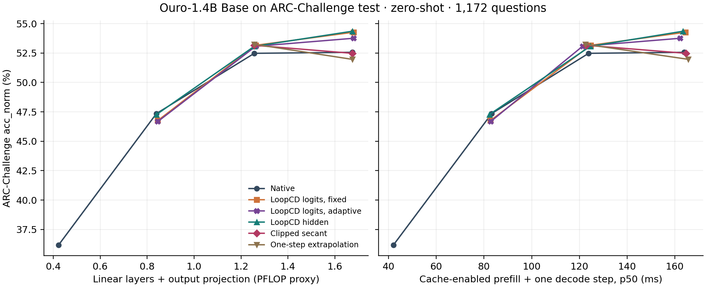

# Ouro-1.4B Base benchmarks

Official ARC-Challenge test, 1,172 items and 4,687 complete continuations. Zero-shot, BF16, SDPA, RTX 4090. Validation selected the same-budget references before the test pass.

| Method | Loops | acc | acc_norm | Prefill p50 ms | Decode p50 ms | Peak MiB | Full split s | Δ acc_norm vs native at K |
|---|---:|---:|---:|---:|---:|---:|---:|---:|
| native_k1 | 1 | 33.45 | 36.18 | 21.68 | 20.43 | 2771 | 8.09 | +0.00 pp |
| native_k2 | 2 | 45.82 | 47.35 | 43.27 | 40.09 | 2792 | 14.95 | +0.00 pp |
| loopcd_fixed_k2 | 2 | 45.56 | 46.76 | 42.83 | 40.06 | 2793 | — | -0.60 pp |
| loopcd_adaptive_k2 | 2 | 45.82 | 46.67 | 42.84 | 40.06 | 2793 | — | -0.68 pp |
| loopcd_hidden_k2 | 2 | 45.39 | 47.27 | 42.63 | 39.95 | 2793 | 14.86 | -0.09 pp |
| native_k3 | 3 | 48.72 | 52.47 | 63.64 | 60.17 | 2814 | 21.55 | +0.00 pp |
| loopcd_fixed_k3 | 3 | 50.43 | 53.16 | 64.61 | 60.09 | 2814 | — | +0.68 pp |
| loopcd_adaptive_k3 | 3 | 51.19 | 53.07 | 62.48 | 59.11 | 2814 | — | +0.60 pp |
| loopcd_hidden_k3 | 3 | 49.91 | 53.07 | 64.20 | 60.47 | 2814 | — | +0.60 pp |
| secant_k3 | 3 | 49.40 | 53.16 | 63.63 | 59.48 | 2814 | — | +0.68 pp |
| laststep_k3 | 3 | 49.57 | 53.24 | 63.59 | 59.18 | 2814 | — | +0.77 pp |
| native_k4 | 4 | 50.26 | 52.56 | 84.34 | 79.06 | 2835 | 28.56 | +0.00 pp |
| loopcd_fixed_k4 | 4 | 51.71 | 54.27 | 84.98 | 78.91 | 2835 | — | +1.71 pp |
| loopcd_adaptive_k4 | 4 | 51.88 | 53.75 | 84.36 | 78.09 | 2835 | — | +1.19 pp |
| loopcd_hidden_k4 | 4 | 50.51 | 54.35 | 84.38 | 79.13 | 2836 | — | +1.79 pp |
| secant_k4 | 4 | 50.34 | 52.47 | 84.54 | 79.60 | 2836 | — | -0.09 pp |
| laststep_k4 | 4 | 49.83 | 51.96 | 85.95 | 80.18 | 2836 | — | -0.60 pp |

Cached timings are synchronized wall-clock measurements of 24 fixed validation prompts at batch size 1. The cache grows at each recurrent layer. Full-split timing uses batch size 16 and teacher-forced answer candidates with no KV cache. A dash means the configuration has cached latency measurements and was scored in the shared sweep, with no standalone full-split timing. Linear FLOP proxies omit attention products, normalization, activations, padding and cache movement.

