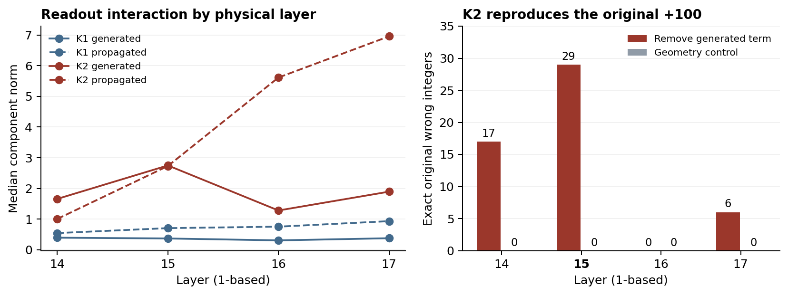

# Ouro-1.4B 原生块中新生成的低位交互

冻结的同一模型在 100 个发现题干和 160 个确认题干上复跑。每个联合借位题都有完整正确答案相同的独立无需借位题。两类四角的数值编辑总量不同，因此另做同向量同剂量对照。

| 原生条件 | K1 完整正解 | K2 完整正解 |
|---|---:|---:|
| 00 | 139/160 | 160/160 |
| 10 | 124/160 | 158/160 |
| 01 | 129/160 | 159/160 |
| 11 | 37/160 | 160/160 |
| safe11 | 127/160 | 160/160 |

原生自然修复共有 60/160，无需借位组为 0/160。其中 48 道的其他三个角点在 K1 已完全正确。配对 +60 例，每目标 +0.750 [+0.588, +0.912]（95%区间）。

## 生成项和传入交互的因果比较

发现数据按 K2 诊断分差锁定物理第 15 层。确认的 60 道原生修复均在分岔位置干预。两类均对齐的题有 60 组，两个原生分差在固定阈值内的同答案安全匹配有 24 组。所有原生块和残差写入做了逐位复放。完整整数自由续写。

| 条件 | K1 完整正解 | K2 精确重现旧错 | 同题双向 | 安全新增 K2 错误 |
|---|---:|---:|---:|---:|
| native | 0/60 | 0/60 | 0/60 | 0/60 |
| generated | 19/60 | 29/60 | 17/60 | 0/60 |
| geometry | 6/60 | 0/60 | 0/60 | 0/60 |
| propagated | 1/60 | 23/60 | 0/60 | 0/60 |
| clipped | 19/60 | 29/60 | 17/60 | 0/60 |
| attention | 2/60 | 0/60 | 0/60 | 0/60 |
| attention_geom | 0/60 | 0/60 | 0/60 | 0/60 |
| mlp | 19/60 | 27/60 | 16/60 | 0/60 |
| mlp_geom | 5/60 | 0/60 | 0/60 | 0/60 |
| phase2 | 37/60 | 29/60 | 21/60 | 0/60 |
| phase2_geom | 20/60 | 0/60 | 0/60 | 0/60 |
| paired_generated | 19/60 | 29/60 | 17/60 | 2/60 |
| paired_geometry | 6/60 | 1/60 | 1/60 | 0/60 |

预设双向门槛通过。K2 单向特异性门槛未通过。

当场生成项对早晚两轮的整答均有因果作用。同剂量几何对照解释不了这些效果。移除上游传入项也能使 K2 回到旧错，当前证据无法把 K2 修复唯一归因于该层当场生成的交互。

generated_vs_geometry 的 K1 / K2 / 双向配对为 +13 例，每目标 +0.289 [+0.111, +0.489] / +29 例，每目标 +0.644 [+0.422, +0.867] / +17 例，每目标 +0.378 [+0.222, +0.556]（97.5%区间）。

generated_vs_propagated 的 K1 / K2 / 双向配对为 +18 例，每目标 +0.400 [+0.222, +0.600] / +6 例，每目标 +0.133 [-0.044, +0.311] / +17 例，每目标 +0.378 [+0.222, +0.556]（97.5%区间）。

attention_vs_attention_geom 的 K1 / K2 / 双向配对为 +2 例，每目标 +0.044 [+0.000, +0.133] / +0 例，每目标 +0.000 [+0.000, +0.000] / +0 例，每目标 +0.000 [+0.000, +0.000]（97.5%区间）。

mlp_vs_mlp_geom 的 K1 / K2 / 双向配对为 +14 例，每目标 +0.311 [+0.156, +0.489] / +27 例，每目标 +0.600 [+0.378, +0.822] / +16 例，每目标 +0.356 [+0.200, +0.533]（97.5%区间）。

phase2_vs_phase2_geom 的 K1 / K2 / 双向配对为 +17 例，每目标 +0.378 [+0.156, +0.600] / +29 例，每目标 +0.644 [+0.422, +0.867] / +21 例，每目标 +0.467 [+0.267, +0.689]（97.5%区间）。

完全相同的借位生成向量在借位受体导致 29/60 个精确旧错，在无需借位受体导致 1/60 个；带两类各自匹配几何的双重配对差为 +27 例，每目标 +0.600 [+0.378, +0.822]（97.5%区间）。

## 第 14–17 层的预定次级逐层比较

在每个物理层单独改动该层输出，由原生后续块及自由整数续写决定完整答案。次级逐层配对区间为 98.75%。

| 层 | 去除生成项重现旧答 | 匹配几何重现旧答 | 配对差 |
|---|---:|---:|---|
| 14 | 17/60 | 0/60 | +17 例，每目标 +0.378 [+0.178, +0.622] |
| 15 | 29/60 | 0/60 | +29 例，每目标 +0.644 [+0.400, +0.911] |
| 16 | 0/60 | 0/60 | +0 例，每目标 +0.000 [+0.000, +0.000] |
| 17 | 6/60 | 0/60 | +6 例，每目标 +0.133 [+0.022, +0.267] |

选定层的 K2 加性参考超出四角全前缀范数包络的 token 比例，中位数为 2.50%；读出 token 单独超出包络 28/60。裁剪变体保留独立结果。

## 按原生运算顺序干预注意力写入

早期改动直接发生在注意力归一化写入处，MLP 可以重算。固定 MLP 对照恢复该位置原生 MLP 写入。该分支的完整生成与晚期仅改动注意力生成分量逐题一致。

| 干预 | K1 完整正解 | K2 精确旧错 | 同题双向 | 无借位新增 K2 错误 |
|---|---:|---:|---:|---:|
| natural | 0/60 | 0/60 | 0/60 | 0/60 |
| early | 0/60 | 0/60 | 0/60 | 0/60 |
| early_geometry | 0/60 | 0/60 | 0/60 | 0/60 |
| early_fixed_mlp | 2/60 | 0/60 | 0/60 | 0/60 |
| late | 2/60 | 0/60 | 0/60 | 0/60 |

early_vs_early_geometry 的 K1 / K2 配对差（每目标，97.5%区间）为 +0.000 [+0.000, +0.000] / +0.000 [+0.000, +0.000]。

early_vs_early_fixed_mlp 的 K1 / K2 配对差（每目标，97.5%区间）为 -0.044 [-0.133, +0.000] / +0.000 [+0.000, +0.000]。

见 METHOD.md 的精确代数、出域诊断和因果对照解释。图表源于逐题输出，完整原始序列、置信度匹配、重算和哈希均随档案。
