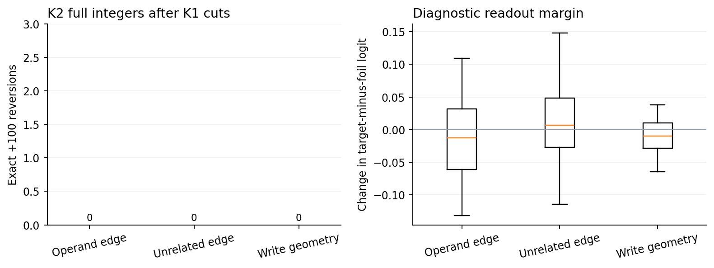

# K1 操作数注意力读边与 K2 借位修复

本轮在冻结的 Ouro-1.4B Base 中，一次只切一个物理头在 B 末位查询 A 低两位的两条读边。保持原生 V、输出投影、归一化与后续算子。对删去概率后的其余键按原注意力比例归一。所有决定性指标均为自由续写的完整整数。

240 个确认题干中，借位联合角由 +100 精确转为正解 34/240，同答案的无需借位对照为 0/240。

| 操作数宽度 | n | 借位精确修复 | 无借位精确修复 | 借位 K1 正解 | 借位 K2 正解 |
|---|---:|---:|---:|---:|---:|
| 3 位 | 120 | 34 | 0 | 20 | 119 |
| 4 位 | 120 | 0 | 0 | 0 | 86 |

开发集从全部 24 层 × 16 头筛选六个候选，用真实 K2 传播和生成变化锁定物理第 8 层第 4 头，选择代码不读取自然答案。独立确认候选 34 个，读出对齐 34 个。

| 条件 | 借位正解 | 借位 +100 | 同题回退后复原 | 无借位新增错误 |
|---|---:|---:|---:|---:|
| native | 34 | 0 | 0 | 0 |
| readcut | 34 | 0 | 0 | 0 |
| matched_read | 34 | 0 | 0 | 0 |
| geometry | 34 | 0 | 0 | 0 |
| restore_p | 34 | 0 | 0 | 0 |
| restore_m | 34 | 0 | 0 | 0 |
| restore_both | 34 | 0 | 0 | 0 |
| restore_geometry | 34 | 0 | 0 | 0 |
| donor_borrow | 34 | 0 | 0 | 0 |
| donor_safe | 34 | 0 | 0 | 0 |
| donor_geometry | 34 | 0 | 0 | 0 |
| self_restore | 34 | 0 | 0 | 0 |

## 锁定规则下的判定

读边支持门槛未通过。联合复位与异题供体的完整链门槛未通过。10% 效应规模排除门槛未通过。

### pooled（34 道）

- cut_vs_matched_read 为 +0 道，+0.0 [+0.0, +0.0] 个百分点（配对 97.5% 区间）。
- cut_vs_geometry 为 +0 道，+0.0 [+0.0, +0.0] 个百分点（配对 97.5% 区间）。
- restore_both_vs_restore_geometry 为 +0 道，+0.0 [+0.0, +0.0] 个百分点（配对 97.5% 区间）。
- donor_borrow_vs_donor_safe 为 +0 道，+0.0 [+0.0, +0.0] 个百分点（配对 97.5% 区间）。
- donor_borrow_vs_donor_geometry 为 +0 道，+0.0 [+0.0, +0.0] 个百分点（配对 97.5% 区间）。
- 相对 matched_read，0/34 个答案簇出现至少一次额外回退，单侧 97.5% 上界为 10.28%。
- 相对 geometry，0/34 个答案簇出现至少一次额外回退，单侧 97.5% 上界为 10.28%。

### three（34 道）

- cut_vs_matched_read 为 +0 道，+0.0 [+0.0, +0.0] 个百分点（配对 97.5% 区间）。
- cut_vs_geometry 为 +0 道，+0.0 [+0.0, +0.0] 个百分点（配对 97.5% 区间）。
- restore_both_vs_restore_geometry 为 +0 道，+0.0 [+0.0, +0.0] 个百分点（配对 97.5% 区间）。
- donor_borrow_vs_donor_safe 为 +0 道，+0.0 [+0.0, +0.0] 个百分点（配对 97.5% 区间）。
- donor_borrow_vs_donor_geometry 为 +0 道，+0.0 [+0.0, +0.0] 个百分点（配对 97.5% 区间）。
- 相对 matched_read，0/34 个答案簇出现至少一次额外回退，单侧 97.5% 上界为 10.28%。
- 相对 geometry，0/34 个答案簇出现至少一次额外回退，单侧 97.5% 上界为 10.28%。

### four（0 道）

- cut_vs_matched_read 为 无样本（配对 97.5% 区间）。
- cut_vs_geometry 为 无样本（配对 97.5% 区间）。
- restore_both_vs_restore_geometry 为 无样本（配对 97.5% 区间）。
- donor_borrow_vs_donor_safe 为 无样本（配对 97.5% 区间）。
- donor_borrow_vs_donor_geometry 为 无样本（配对 97.5% 区间）。
- 相对 matched_read，0/0 个答案簇出现至少一次额外回退，单侧 97.5% 上界为 100.00%。
- 相对 geometry，0/0 个答案簇出现至少一次额外回退，单侧 97.5% 上界为 100.00%。

原生联合角切除概率质量中位数 0.3791，无关边对照 0.3039。成功配平到绝对差 ≤0.001 的题占 58.8%。切边造成 K2 第 15 层传播项和 MLP 生成项的范数变化中位数分别为 0.3002 和 0.1178，原生对应分量范数为 2.8990 和 2.7702。

借位供体干预后直接输出供体真值、供体原错各 0、0 道，仅按输出百位比对分别为 0、10 道。供体选择不共享真值百位或原错百位。

逐题边质量、完整答案、供体编号、原生分差和切边后的三个 K2 项全部保留。效应上界约束这一个事先锁定的头和读边，适用人群由产生预设精确修复的宽度决定。

## 独立三位数增补

主确认集只有 34 个独立精确修复簇。在读取干预结果前，仅据原生样本量固定 100 道额外题。增补照用同一头、供体池和阈值，答案簇和主队列互不重叠。四位数没有符合预设的原生精确修复，因此未进入该合并估计。

| 分组 | 原生自然修复 | 切读边精确回退 | 无关读边精确回退 | 写入几何精确回退 |
|---|---:|---:|---:|---:|
| 增补三位 | 22 | 0 | 0 | 0 |
| 合并三位 | 56 | 0 | 0 | 0 |

合并后相对 matched_read 的额外回退出现于 0/51 个独立答案簇，单侧 97.5% 上界 6.98%。

合并后相对 geometry 的额外回退出现于 0/51 个独立答案簇，单侧 97.5% 上界 6.98%。

合并三位队列的 10% 效应排除门槛通过。
