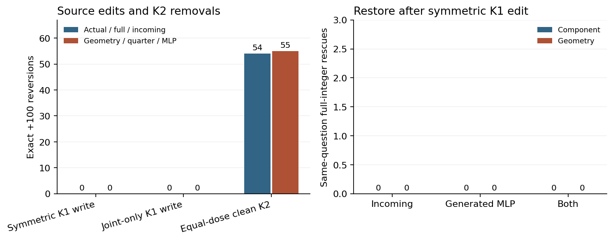

# 第 15 层 K1 MLP 写入对 K2 原生借位纠错的作用

上一轮预先锁定物理第 15 层与 K1 的归一化 MLP 写入。本轮从独立题目取四角，干预一次真实写入，保留后续原生计算。生成结果按完整整数判定。

独立确认 240 个题干。原生 K1 恰好多 100、K2 答对为 104/240，同答案无借位组为 0/240。完整的两轮行为分层见下表。

| 确认条件 | 错→对 | 对→错 | 对→对 | 错→错 |
|---|---:|---:|---:|---:|
| 借位四角 00 | 49 | 0 | 191 | 0 |
| 10 | 80 | 4 | 152 | 4 |
| 01 | 73 | 0 | 167 | 0 |
| 11 | 216 | 0 | 24 | 0 |
| 无借位 11 | 116 | 0 | 120 | 4 |

因果队列有 104 对借位与无借位受体，读出处可对齐 104 对，两个原生分差均在固定匹配阈值内 40 对。无借位受体有 0 道为四位操作数。

| 条件 | 借位整答正确 | 借位精确 +100 | 回退后同题救回 | 无借位精确 +100 | 无借位新增其他错答 |
|---|---:|---:|---:|---:|---:|
| clean | 104 | 0 | 0/0 | 0 | 0 |
| joint | 104 | 0 | 0/0 | 0 | 0 |
| quarter | 104 | 0 | 0/0 | 0 | 0 |
| symmetric | 104 | 0 | 0/0 | 0 | 0 |
| source_geometry | 104 | 0 | 0/0 | 0 | 0 |
| joint_restore_p | 104 | 0 | 0/0 | 0 | 0 |
| joint_restore_p_geometry | 104 | 0 | 0/0 | 0 | 0 |
| symmetric_restore_p | 104 | 0 | 0/0 | 0 | 0 |
| symmetric_restore_p_geometry | 104 | 0 | 0/0 | 0 | 0 |
| symmetric_restore_m | 104 | 0 | 0/0 | 0 | 0 |
| symmetric_restore_m_geometry | 104 | 0 | 0/0 | 0 | 0 |
| symmetric_restore_both | 104 | 0 | 0/0 | 0 | 0 |
| symmetric_restore_both_geometry | 104 | 0 | 0/0 | 0 | 0 |
| clean_remove_p | 33 | 70 | 0/0 | 0 | 0 |
| clean_remove_m | 24 | 79 | 0/0 | 0 | 0 |
| clean_remove_both | 4 | 99 | 0/0 | 0 | 0 |
| symmetric_remove_p | 33 | 70 | 0/0 | 0 | 0 |
| symmetric_remove_m | 24 | 79 | 0/0 | 0 | 0 |
| symmetric_remove_both | 4 | 99 | 0/0 | 0 | 0 |
| clean_dose_p | 49 | 54 | 0/0 | 0 | 0 |
| clean_dose_p_geometry | 104 | 0 | 0/0 | 0 | 0 |
| clean_dose_m | 48 | 55 | 0/0 | 0 | 0 |
| clean_dose_m_geometry | 104 | 0 | 0/0 | 0 | 0 |
| symmetric_dose_p | 49 | 54 | 0/0 | 0 | 0 |
| symmetric_dose_p_geometry | 104 | 0 | 0/0 | 0 | 0 |
| symmetric_dose_m | 47 | 56 | 0/0 | 0 | 0 |
| symmetric_dose_m_geometry | 104 | 0 | 0/0 | 0 | 0 |

## 配对判别与因果边界

所有区间均为按正确答案分组的配对 97.5% bootstrap 区间。指标以题干比例计算。同题救回要求原生正答、改 K1 后精确 +100、复位后再次完整答对。

传入项的 K1 来源门槛未通过。当轮 MLP 生成项的 K1 来源门槛未通过。

symmetric_loss_vs_geometry 为 +0 道，+0.0 [+0.0, +0.0] 个百分点。

joint_loss_vs_quarter 为 +0 道，+0.0 [+0.0, +0.0] 个百分点。

symmetric_loss_vs_quarter 为 +0 道，+0.0 [+0.0, +0.0] 个百分点。

joint_p_vs_geometry 为 +0 道，+0.0 [+0.0, +0.0] 个百分点。

symmetric_same_vector_borrow_minus_safe 为 +0 道，+0.0 [+0.0, +0.0] 个百分点。

symmetric_restore_p_vs_geometry 为 +0 道，+0.0 [+0.0, +0.0] 个百分点。

symmetric_restore_p_vs_m 为 +0 道，+0.0 [+0.0, +0.0] 个百分点。

symmetric_restore_m_vs_geometry 为 +0 道，+0.0 [+0.0, +0.0] 个百分点。

symmetric_restore_m_vs_p 为 +0 道，+0.0 [+0.0, +0.0] 个百分点。

同三位数宽度受体的同向量对照为 +0 道，+0.0 [+0.0, +0.0] 个百分点。

clean 背景的同剂量比较中，传入项占优门槛未通过，当轮 MLP 项占优门槛未通过。
- p_vs_m 为 -1 道，-1.0 [-7.3, +5.7] 个百分点。
- p_vs_geometry 为 +54 道，+51.9 [+37.4, +65.8] 个百分点。
- m_vs_geometry 为 +55 道，+52.9 [+38.0, +67.3] 个百分点。
- discrete_interaction 为 -50 道，-48.1 [-64.2, -30.5] 个百分点。

symmetric 背景的同剂量比较中，传入项占优门槛未通过，当轮 MLP 项占优门槛未通过。
- p_vs_m 为 -2 道，-1.9 [-7.1, +3.3] 个百分点。
- p_vs_geometry 为 +54 道，+51.9 [+37.4, +65.8] 个百分点。
- m_vs_geometry 为 +56 道，+53.8 [+39.2, +67.7] 个百分点。
- discrete_interaction 为 -50 道，-48.1 [-64.2, -30.5] 个百分点。

只改联合角时，另外三角的 K2 输入逐位相同，K2 注意力与 MLP 生成项逐位相同。分摊改动后，多个角进入 K2 的状态变化允许加性参考位移。仅联合角的传播复位在构造上恢复该位置的净差分，不能独立证明唯一中介。四角等范数几何匹配约束联合角的写入轴，其他角的绝对状态仍可以变化。

| K1 源写入 | K2 传入项变化范数中位数 | K2 注意力新生成项 | K2 MLP 新生成项 |
|---|---:|---:|---:|
| joint | 0.1679 | 0.0000 | 0.0000 |
| quarter | 0.0406 | 0.0000 | 0.0000 |
| symmetric | 0.1465 | 0.0064 | 0.0418 |
| source_geometry | 0.1029 | 0.0050 | 0.0201 |

正确首 token 减原错首 token 的 logit 分差只作诊断。相对原生 K2 的逐题分差变化中位数如下。

| 情况 | 分差变化 |
|---|---:|
| joint | -0.112 |
| symmetric | -0.025 |
| source_geometry | -0.002 |
| symmetric_restore_p | +0.007 |
| symmetric_restore_m | -0.019 |
| symmetric_restore_both | +0.004 |
| clean_dose_p | -4.409 |
| clean_dose_m | -4.672 |

此干预只评估筛选出的自然 K1→K2 借位修复。真正的跨任务泛化、K3/K4 迁移和全部 K1 物理写入的来源鉴定仍需另证。

