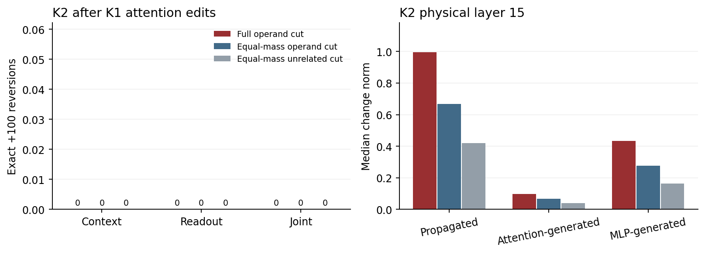

# 跨全部层和头检验 K1 上下文与读出路径

在固定冻结的 Ouro-1.4B Base 上，分别切断第一操作数低两位通往上下文和末位读出的注意力。在 K1 使用 24 层的全部查询头。保留原生 V、投影、归一化与后续运算。第二轮以后运行原生算子。

300 个确认题中，借位题精确从 K1 +100 错答转为 K2 正答 98/300，覆盖 60 个答案簇。原生同答案无借位对照为 0/300。

主分析有 98 对自然修复和同答案无借位受体，对齐 98 对。两轮读出分差配在预设窗口内的敏感性人群为 39 对。

| 干预 | 借位正答 | 借位精确 +100 | 其他新增错误 | 无借位新增错误 | 同题复位成功 |
|---|---:|---:|---:|---:|---:|
| native | 98 | 0 | 0 | 0 | 0 |
| context | 98 | 0 | 0 | 0 | 0 |
| pivot | 98 | 0 | 0 | 0 | 0 |
| joint | 98 | 0 | 0 | 0 | 0 |
| context_capped | 98 | 0 | 0 | 0 | 0 |
| context_matched | 98 | 0 | 0 | 0 | 0 |
| pivot_capped | 98 | 0 | 0 | 0 | 0 |
| pivot_matched | 98 | 0 | 0 | 0 | 0 |
| joint_capped | 98 | 0 | 0 | 0 | 0 |
| joint_matched | 98 | 0 | 0 | 0 | 0 |
| restore_context | 98 | 0 | 0 | 0 | 0 |
| restore_pivot | 98 | 0 | 0 | 0 | 0 |
| restore_joint | 98 | 0 | 0 | 0 | 0 |

## 对照和区间

等量删减在两条前向的每一层、头及查询位置取共同可删去质量，保留各自自然值向量。上下文与读出两臂的查询数及完整切除的总剂量不同。

- context 的查询数中位数 12，等量臂保留完整切除质量的 89.2%。相对于等量无关边，精确回退差为 +0 道，+0.0 [+0.0, +0.0] 个百分点。借位与无借位的新增错误差为 +0 道，+0.0 [+0.0, +0.0] 个百分点。

- pivot 的查询数中位数 1，等量臂保留完整切除质量的 92.2%。相对于等量无关边，精确回退差为 +0 道，+0.0 [+0.0, +0.0] 个百分点。借位与无借位的新增错误差为 +0 道，+0.0 [+0.0, +0.0] 个百分点。

- joint 的查询数中位数 13，等量臂保留完整切除质量的 89.5%。相对于等量无关边，精确回退差为 +0 道，+0.0 [+0.0, +0.0] 个百分点。借位与无借位的新增错误差为 +0 道，+0.0 [+0.0, +0.0] 个百分点。

- factorial_reversion 为 +0 道，+0.0 [+0.0, +0.0] 个百分点。

- pivot_minus_joint 为 +0 道，+0.0 [+0.0, +0.0] 个百分点。

- pivot_minus_context 为 +0 道，+0.0 [+0.0, +0.0] 个百分点。

- restore_context_minus_pivot 为 +0 道，+0.0 [+0.0, +0.0] 个百分点。

以上为按答案簇配对的 97.5% 区间。二元答案的析因差受输出阈值和饱和影响。

联合完整切断在 0/60 个答案簇产生至少一个精确回退，单侧 97.5% 上界 5.96%。

路径支持门槛：上下文 未通过，读出 未通过，联合 未通过。

读出占优门槛未通过。联合精确回退率小于 10% 的排除门槛通过。

分差敏感性队列的联合完整切除为 0 个精确回退；等量联合对照的配对差为 +0 道，+0.0 [+0.0, +0.0] 个百分点。

## 原生第 15 层与更深循环

在固定的 24 道题上，从实际四角状态重算 K2 第 15 层。图中各项描述物理层响应，与自由续写结果分开。

| Loop | 对齐 / 固定子集 | 原生正答 | 上下文切断正答 | 读出切断正答 | 联合切断正答 |
|---|---:|---:|---:|---:|---:|
| K3 | 48/48 | 48 | 48 | 48 | 48 |
| K4 | 48/48 | 48 | 48 | 48 | 48 |

更深结果只对固定抽取的 K1→K2 自然修复题有效。借位表型、原生状态复位与其他任务的外推应分开。
