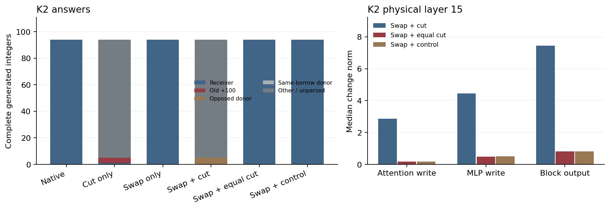

# K1→K2 边界上的上下文状态和操作数读边

全程用冻结的 Ouro-1.4B Base。对同一个受体，在 K2 入轮保留六个操作数位置的真实 K1 状态，替换或保留其余上下文，同时切断或保留 K2 直接读取操作数位置的全部读边。对随后生成的每个 token 重算同一干预。用完整整数区分受体真值、原 +100 错答和供体答案。

300 道确认题中，原生精确 +100→正答为 94/300，涉及 63 个答案簇；同答案的无借位对照为 0/300。

完整生成分析为 94 道原生修复与 94 道同答案无借位对照。分差均进入匹配阈值的敏感性队列为 36 对。翻转借位的供体本身正答数为 K1 72、K2 92。

| 条件 | 受体真值 | 原始 +100 | 翻转借位供体真值 | 同借位供体真值 | 其他整数 | 未解析 | 无借位新增错误 |
|---|---:|---:|---:|---:|---:|---:|---:|
| native | 94 | 0 | 0 | 0 | 0 | 0 | 0 |
| donor_replay | 0 | 0 | 92 | 0 | 2 | 0 | 94 |
| original_full | 1 | 4 | 0 | 0 | 89 | 0 | 94 |
| original_capped | 94 | 0 | 0 | 0 | 0 | 0 | 0 |
| original_matched | 94 | 0 | 0 | 0 | 0 | 0 | 0 |
| opposite_intact | 94 | 0 | 0 | 0 | 0 | 0 | 0 |
| opposite_full | 0 | 0 | 5 | 0 | 89 | 0 | 94 |
| opposite_capped | 94 | 0 | 0 | 0 | 0 | 0 | 2 |
| opposite_matched | 94 | 0 | 0 | 0 | 0 | 0 | 0 |
| same_intact | 94 | 0 | 0 | 0 | 0 | 0 | 0 |
| same_full | 0 | 0 | 0 | 0 | 94 | 0 | 94 |
| same_capped | 94 | 0 | 0 | 0 | 0 | 0 | 2 |
| same_matched | 94 | 0 | 0 | 0 | 0 | 0 | 0 |

将三位输出按百位与低两位拆开作为诊断。供体百位也是原错百位；低两位区分两者。混合答案指受体正确百位与翻转借位供体低两位的拼接。

| 条件 | 三位输出 | 供体或原错百位 | 受体低两位 | 供体低两位 | 混合答案 |
|---|---:|---:|---:|---:|---:|
| native | 94 | 0 | 94 | 0 | 0 |
| original_full | 31 | 12 | 5 | 0 | 0 |
| opposite_intact | 94 | 0 | 94 | 0 | 0 |
| opposite_full | 21 | 12 | 0 | 5 | 0 |
| opposite_capped | 94 | 0 | 94 | 0 | 0 |
| opposite_matched | 94 | 0 | 94 | 0 | 0 |

## 匹配对照和门槛

不同上下文中的原始注意力质量可以变化。等质量读边对照在每头、层及查询位置从两条真实前向取共同可删去质量。完全切除和等质量删减对应不同剂量。对称供体配平数值编辑量，改变方向和借位状态。

original_capped 各自输入中可删去的操作数注意力质量，实际删减比例中位数为 62.5%。

opposite_capped 各自输入中可删去的操作数注意力质量，实际删减比例中位数为 62.4%。

same_capped 各自输入中可删去的操作数注意力质量，实际删减比例中位数为 62.4%。

- donor_unrestricted_vs_intact 为 +5 道，+5.3 [+1.0, +11.1] 个百分点。

- donor_unrestricted_vs_matched 为 +5 道，+5.3 [+1.0, +11.1] 个百分点。

- donor_capped_vs_matched 为 +0 道，+0.0 [+0.0, +0.0] 个百分点。

- receiver_original_vs_opposed_intact 为 +0 道，+0.0 [+0.0, +0.0] 个百分点。

- original_capped_vs_matched_old 为 +0 道，+0.0 [+0.0, +0.0] 个百分点。

- opposite_capped_vs_matched_old 为 +0 道，+0.0 [+0.0, +0.0] 个百分点。

- opposite_full_vs_same_full_old 为 +0 道，+0.0 [+0.0, +0.0] 个百分点。

- original_full_harm_vs_safe 为 -1 道，-1.1 [-4.1, +0.0] 个百分点。

- opposite_full_harm_vs_safe 为 +0 道，+0.0 [+0.0, +0.0] 个百分点。

- opposite_capped_harm_vs_safe 为 -2 道，-2.1 [-8.2, +0.0] 个百分点。

- old_factorial_full 为 -4 道，-4.3 [-10.9, +0.0] 个百分点。

- old_factorial_equal_mass 为 +0 道，+0.0 [+0.0, +0.0] 个百分点。

- donor_factorial_full 为 +5 道，+5.3 [+1.0, +11.1] 个百分点。

- donor_factorial_equal_mass 为 +0 道，+0.0 [+0.0, +0.0] 个百分点。

- symmetric_control_exact_donor_increment 为 +0 道，+0.0 [+0.0, +0.0] 个百分点。

上述比较为按受体答案簇配对的 97.5% 区间。

absolute 的事件答案簇为 0/63，单侧 97.5% 上界 5.69%。

excess 的事件答案簇为 0/63，单侧 97.5% 上界 5.69%。

donor_context 的预设门槛未通过。

operand_reads 的预设门槛未通过。

old_joint_interaction 的预设门槛未通过。

exclude_large_old 的预设门槛通过。

在固定的 24 道题上，另记录原生数字前位置的第 15 层注意力写入、MLP 写入和块输出。范数诊断与整答效果分别判定。

这套干预屏蔽的是 K2 对六个操作数位置的直接读取。替代信息仍可能存在于非操作数位置、残差及未处理的路径。反事实上下文来自自然供体，混合张量本身为干预。
