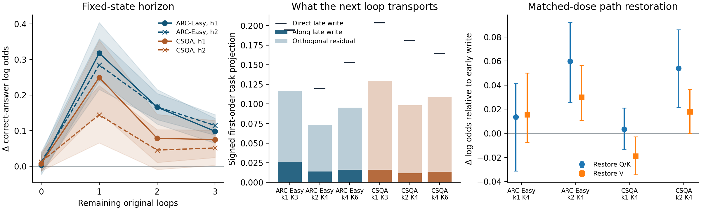

# Ouro-1.4B 的有符号功能传输

## 数学上可证明的关系

计算状态 $H_k$ 是第 $k$ 圈末尾、边界 RMSNorm 之前的完整候选序列。$F=B_\theta\circ N$ 从该状态得到下一圈的同类状态。$N$ 用 Ouro 的逐通道权重和 epsilon，$B_\theta$ 是其原生 24 层。在固定候选序列、预测位置和无缓存协议下，计算图中重复用同一 $F$。$D_k$ 是实际 4,096 参数 Rank-1 控制在该处的写回，包括相对 RMS 0.45 限幅及 BF16 量化。令 $Q_{k|K}$ 表示从边界 $k$ 经过剩余冻结循环和原生评分的任务效用。效用使用正确候选的长度归一化分数减错误候选的 logsumexp。

对可微计算，令 $g_{k|K}=\nabla Q_{k|K}(H_k)$ 和 $A_{k|K}=\langle g_{k|K},D_k\rangle$。由于 $Q_{k|K}=Q_{k+1|K}\circ F$，链式法则给出

$$
g_{k|K}=J_F(H_k)^\top g_{k+1|K},\qquad
\Omega_{k|K}=A_{k|K}-A_{k+1|K}
=\langle g_{k+1|K},J_F(H_k)D_k-D_{k+1}\rangle .
$$

取 $V=J_F(H_k)D_k$、$W=D_{k+1}$。如果 $W\ne0$，定义 $a=\langle V,W\rangle/\|W\|_2^2$ 和 $R_\perp=V-aW$。于是 $A_{k|K}=a A_{k+1|K}+\langle g_{k+1|K},R_\perp\rangle$。向量近似不变要求 $V$ 接近 $W$。任务效用近似保持只要求投影缺陷 $\Omega$ 接近零。可以出现写轴方向几乎完全改变、而剩余分量仍含正任务投影的情况。跨多个边界时，缺陷沿同一个终点 $K$ 望远镜求和。改变 $K$ 会改变完整 adjoint。

稳定正效用还需要动力学条件。给定 $A_{k+1|K}>0$ 和 $a\ge0$，若剩余投影满足 $\langle g_{k+1|K},R_\perp\rangle>-aA_{k+1|K}$，则早写至少保持正的一阶效用。跨样本或跨轮要稳定成立，需要对应的正裕量。对较大剂量，还需要符号裕量大于传播非线性和尾部非线性造成的误差。链式恒等式本身不提供这些下界。

有限剂量对比将 $Y=F(H_k)$ 作为共同接收状态。早写偏移为 $d_E=F(H_k+D_k)-Y$，晚写偏移为 $d_L=D(Y)$。对连续冻结尾部效用 $Q$，有

$$
Q(Y+d_E)-Q(Y+d_L)=
\int_0^1\left[\langle\nabla Q(Y+t d_E),d_E\rangle-
\langle\nabla Q(Y+t d_L),d_L\rangle\right]dt.
$$

用基点梯度拆开，记 $r_F=d_E-J_F D_k$。两条有限路径的效用差等于 $\Omega$ 加上 $\langle g,r_F\rangle$ 和尾部曲率余项之差。自动微分对 BF16 转换使用框架的梯度规则，真实 BF16 中心有限差与工作剂量重放提供独立校验。math SDPA 用于二次反传，默认 SDPA 用于实际生产量化路径测量，两种后端的原生分数差另记。

固定起始边界和 $D_k$，改变剩余圈数 $m$。令 $b_m=\|g^{\mathrm{write}}_{k|k+m}\|$，$c_m=\cos(g^{\mathrm{write}}_{k|k+m},D_k)$，只取实际写回支持。$A_m=\|D_k\|b_mc_m$，相对剩一圈的差可分解为

$$
A_1-A_m=\tfrac12\|D_k\|(b_1-b_m)(c_1+c_m)
+\tfrac12\|D_k\|(b_1+b_m)(c_1-c_m).
$$

第一项来自梯度幅度，第二项来自任务对齐变化。两项是固定写入上的代数分解，不能从中直接读出某个原生模块的因果份额。在同一个下一圈接收状态，传输向量固定，剩余计算对局部效用的影响由该处的任务 adjoint 表达。

## 均值结构与题级耦合

令 $T$ 是所有候选预测 token 数，$N$ 是题数。历史 $M=N^{-1}\sum_tg_th_t^\top$。归档的梯度均值按题数归一，状态均值按 token 总数归一。两者乘积和中心项满足

$$
M=(\mathrm{mean\_gradient})(\mathrm{mean\_state})^\top+
\frac1N\sum_t(g_t-\bar g)(h_t-\bar h)^\top.
$$

均值项能量、中心项能量和两者交叉项相加得到原矩阵能量。检验固定的读写对时，以题总梯度与题均值状态的乘积表示题间项，题内相对预测位置贡献差值。置换保持梯度不动，按题目存在的候选预测位置类型交换接收状态均值。原数据估计的首方向存在选择依赖，独立检验使用封存的旧训练方向在新题上的置换。题级随机化未完全控制候选文字或答案长度，结果限于测量的投影。

路径干预在实际循环中恢复原生 Attention 残差写入、V 投影、Q/K 投影或 MLP 写入。各方向先运行到相同接收张量，按候选匹配全体有效 token 的实际扰动 RMS，再经同一个原生尾部。额外的固定读数符号、跨题换入标量及错标签对照用于分辨题级读数配对与共同写轴的贡献。

## 已验证的机制

### 归档低秩性中有很强的均值项

分解五个来源、45 个归档矩，无需重新计算主模型。对剩一圈的 15 个矩，均值外积的平方 Frobenius 范数约为原矩阵的 46%–100%。例如 ARC 在 $h_1$ 为 71%，CSQA 和 QASC 在 $h_1$ 约为 100% 和 99%。这两项可以干涉，不能把这个比例视为解释方差。中心矩在部分条件仍有能量。15 个训练矩按 BF16 原协议重建，典型相对误差为 $5\times10^{-8}$。

归档 ARC 的 $h_3,m=1$ 在题级、位置类型配对置换中最突出，由同批题估计方向，不能作为独立证据。预封存后在新的 96 道 ARC-Easy 题上，该首方向比位置对照的平均差为 −0.0296，双侧置换 $p=0.448$，未复现。$h_2,m=1$ 有名义差 +0.0717、$p=0.0273$，属于同一检验族内的探索性单点。预先固定的 T1 在这些投影也没有显示跨位置、跨域一致的耦合证据。现有结果支持主要均值结构并允许局部配对依赖，不支持把低秩谱本身解释为广泛的逐题梯度–状态耦合。 [归档分解](results/ARCHIVE_AUDIT.json) · [训练置换](results/E1/E1.json) · [独立 ARC 投影与置换](results/E1_FRESH_arc/SUMMARY.json) · [独立 CSQA 投影与置换](results/E1_FRESH_csqa/SUMMARY.json)

### 原生循环改变写入方向，正效用能留在正交残差

新的 ARC-Easy 64 题、三个固定同时终点条件中，独立 JVP 与 BF16 中心差的平均余弦约为 0.987–0.992。JVP 与原生晚写向量的平均余弦仅 0.055–0.107，相对向量缺陷均值 1.29–2.33。最开始两条路的链式标量核验误差小于 $10^{-4}$。因此可以同时观察到数值上可信的链式恒等式，以及不接近向量保持的真实循环。

以 ARC $h_1\to h_2$、最终 K3 为例，早写的一阶效用为 +0.1161。沿晚写投影重建的贡献仅 +0.0261，正交剩余贡献 +0.0904。相同起始扰动经过一轮并未继续指向晚写轴，任务梯度仍能读取其中的正交分量。工作剂量的早写相对晚写差为 −0.0824，95% 区间 [−0.1315,−0.0279]。源数据中的 QASC 权重不服从统一的晚写优势，独立 ARC $h_2\to h_3$、最终 K4 的早写相对晚写为 +0.0591 [0.0275,0.1044]。这说明功能缺陷的符号必须连同控制器及工作剂量报告。 [独立 ARC 真实图](results/E2_FRESH_arc/k1_K3.json) · [独立 QASC→ARC 反例](results/E2_FRESH_QASC/k2_K4.json)

### 剩余圈数改变同一接收状态上的任务 adjoint

两个域、两处固定起始边界均以剩一圈获得最高平均工作剂量效用。ARC 的 $h_1$ 依次是 +0.0035、+0.3178、+0.1660、+0.0982，CSQA 同一组为 +0.0073、+0.2492、+0.0786、+0.0748。取 ARC $h_1$ 从一圈变成三圈，一阶效用差中梯度幅度项为 +0.0784，对齐项为 +0.0983。受控固定的是实际早期写入与起始张量。相同接收状态上的任务敏感方向随终点变化，不能由原始写入范数推出效用。 [ARC 固定状态时域](results/HORIZON_arc/h1.json) · [CSQA 固定状态时域](results/HORIZON_csqa/h1.json)

### 保留共同写入，打断题干上下文

在独立同题确认中，保留候选文字、候选 token 位置、控制方向以及每个候选的实际 RMS。仅替换成相同 token 长度的其他题干，随后将其控制引起的候选分数变化重放至原真实题的原生分数。剩一圈时，ARC-Easy 83 题的真实效用为 +0.2925，替换题干效应重放后为 +0.0357。CSQA 90 题的对应值为 +0.2381、−0.0292。真实收益一半减去交换重放收益，ARC 95% 配对区间 [0.0360,0.1816]，CSQA [0.0838,0.2141]。所有选项的实际 BF16 剂量均匹配。

这与“同一写轴带来上下文无关的候选输出偏置”相矛盾。结果仍允许共同写轴被真实上下文选择性利用。人工题干对照也会改变原生先验和注意路径，证据限于这种具体的去上下文反事实。 [ARC 上下文交换](results/CONTEXT_arc/SUMMARY.json) · [CSQA 上下文交换](results/CONTEXT_csqa/SUMMARY.json)

### 受控恢复区分原生计算路径

在相同终点 K4、匹配实际剂量后，恢复第二次边界传输中的原生 Attention 写入，使早写效用在 ARC 增加 +0.0652 [0.0397,0.0946]，在 CSQA 增加 +0.0503 [0.0144,0.0857]。恢复原生 MLP 写入的对应影响为 +0.0516 [0.0270,0.0766] 和 +0.0427 [0.0184,0.0686]。原生 Attention 和 MLP 在这两种条件下的变化因此参与了早写收益流失。

Q/K 和 V 必须直接成对比较。ARC 第二个边界的 Q/K 恢复相对 V 的差为 +0.0299，95% 区间 [−0.0248,0.0663]，早边界差为 −0.0019。预测的 ARC 普遍 Q/K 优势没有成立。CSQA 两个边界的同题差为 +0.0221 [0.0019,0.0443] 和 +0.0361 [0.0035,0.0679]。这支持该数据上两个恢复探针有不同效应，恢复 Q/K 或 V 不等同于只隔离一个独立中介。

QASC 控制器的探索性 48 题等剂量试验给出反向 MLP 效应。在 ARC 第二个边界恢复 MLP，早写效用降低 −0.0640 [−0.1322,−0.0194]。在同一实验里，晚写比早写低 −0.0775 [−0.1348,−0.0321]。MLP 对传输收益的贡献依赖控制方向，不能用所有任务共有的“擦除模块”解释。

固定读数符号与换入其他问题的相对标量，在四个 T1 条件都通过预设的 ±0.02 效用区间检验。对照保留了逐候选相同整体 RMS，因此这个结果只排除了等剂量下的细粒度读数配对是必要解释。真实状态的剂量角色仍然开放，也与题干交换所发现的上下文依赖相容。 [ARC 路径对照](results/E3_FRESH_arc/k2_K4.json) · [CSQA 路径对照](results/E3_FRESH_csqa/k2_K4.json) · [QASC 路径反例](results/E3_QASC/k2_K4.json)

### 未见深度可保留正效用

仅在 K2 拟合的冻结控制器，在独立 72 道 ARC-Easy 题上，K6 晚写的工作剂量平均效用为 +0.0699 [0.0477,0.0935]。其 K4→K5 传输余弦为 0.077。沿晚写轴的局部贡献约 +0.006，正交剩余约 +0.043。此前发布的混合检查点在 ARC 和 CSQA 的 K2→K3、K4→K5 四个条件，JVP 与晚写方向余弦为 0.046 至 0.071，正交任务投影均大于沿轴项。也就是说，跨深度复用的共同写轴在下游被重新解释，实际传播中保留下来的主要是有利于当前任务的投影，而非上一圈写回向量的形状。该机制解释了所测条件的正效用如何保留，尚未给出任意循环数的下界。 [K2-only 的 K6](results/E2_FRESH_K2ONLY/k4_K6.json) · [发布混合权重的再检验](results/E2_MIXED_arc/k4_K6.json)

## 工作剂量预测

只用原生基点梯度，即便将真实有限向量代替 JVP，也只在 10 个核心独立条件中的 4 个降低了平均绝对误差。由此改用两条接收状态路径的中点伴随梯度。对已固定的真实 $d_E,d_L$，计算

$$
\widehat{\Delta q}_{\mathrm{mid}}=
\langle\nabla Q(Y+\tfrac12 d_E),d_E\rangle
-\langle\nabla Q(Y+\tfrac12 d_L),d_L\rangle .
$$

在进一步排重、提前封存的两个 48 题集合中，固定第二次边界传输与终点 K4。比较使用相同实际有限偏移、仅替换梯度取值点的基点模型和中点模型。实际目标为真实早写减晚写效用。

| 控制器及确认域 | 实际平均早写减晚写 | 基点 MAE | 中点 MAE | 中点减基点的 MAE 95% 配对区间 | 同题符号正确 |
|---|---:|---:|---:|---:|---:|
| T1→ARC-Easy | −0.0576 | 0.0987 | 0.0472 | [−0.0768,−0.0279] | 36/48→41/48 |
| T1→CSQA | −0.0450 | 0.2057 | 0.1018 | [−0.1513,−0.0560] | 28/48→42/48 |
| QASC→ARC-Easy | +0.0471 | 0.0924 | 0.0253 | [−0.0990,−0.0413] | 29/48→45/48 |

中点测试支持尾部梯度沿真实扰动路径变化是工作剂量误差的重要来源。该离线预测需要题目标签和两次额外的中点梯度，用于解释与诊断，部署控制器仍只使用当前原生状态。这些结果验证了固定 K4 条件下的中点规则。 [事前封存](results/PATH_LOCK.json) · [ARC](results/PATH_arc/SUMMARY.json) · [CSQA](results/PATH_csqa/SUMMARY.json) · [QASC 反例](results/PATH_qasc/SUMMARY.json)

## 被否定的解释与仍待验证的预测

- **低秩谱即广泛的逐题耦合。** 均值外积很强。预封存的晚圈独立置换预测落空，未获得跨位置一致的题级统计证据。
- **共同方向原样传输，或总是越晚写越好。** Jacobian 与真实中心差一致，而传播方向和原生晚写轴接近正交。QASC 的反例在新题上复现。仅用实际扰动范数、固定支路增益，解释不了这种符号变化。
- **输出偏置能解释大部分收益。** 两域的等长度题干交换对照都排除了该归因。细粒度读数在同剂量下可以被置换，说明上下文特异性可以来自下游原生循环。
- **剩一圈的优势完全由梯度幅度引起。** 固定同一状态与写入，梯度方向和幅度都有影响，且实际有限路径需要额外的曲率信息。
- **待验证。** 中点预测能否外推到 K5/K6、其他控制器和不同候选目标。无标签的方法能否估计中点 adjoint 的方向。两套写入在 Attention/MLP 路径上的条件依赖，能否用少数层的可复现实验进一步定位。当前实验只识别了一个完整循环中受控恢复的总效应。

四轮分别完成归档分解、真实 JVP 与路径发现、独立确认、以及同剂量题干交换和中点测量。主要独立样本是两个官方 Train 池的研究留出，和父研究所用题号及归一题干去重。上游预训练暴露未知。中点折与前一确认折再次去重。保留逐题候选分数、失败预测和一次旧检查点载入失败的记录。单张 RTX 4090 D 共计 1,427 秒（23 分 47 秒），全程冻结模型与历史检查点。 [封存预测](results/FORECAST_LOCK.json) · [放行审计](results/DYNAMICAL_AUDIT.json) · [复现](REPRODUCE.md) · [GPU 台账](GPU_LEDGER.tsv)

