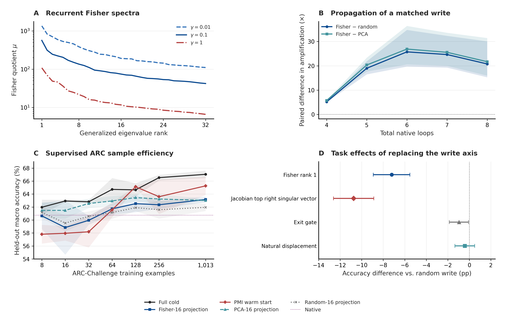
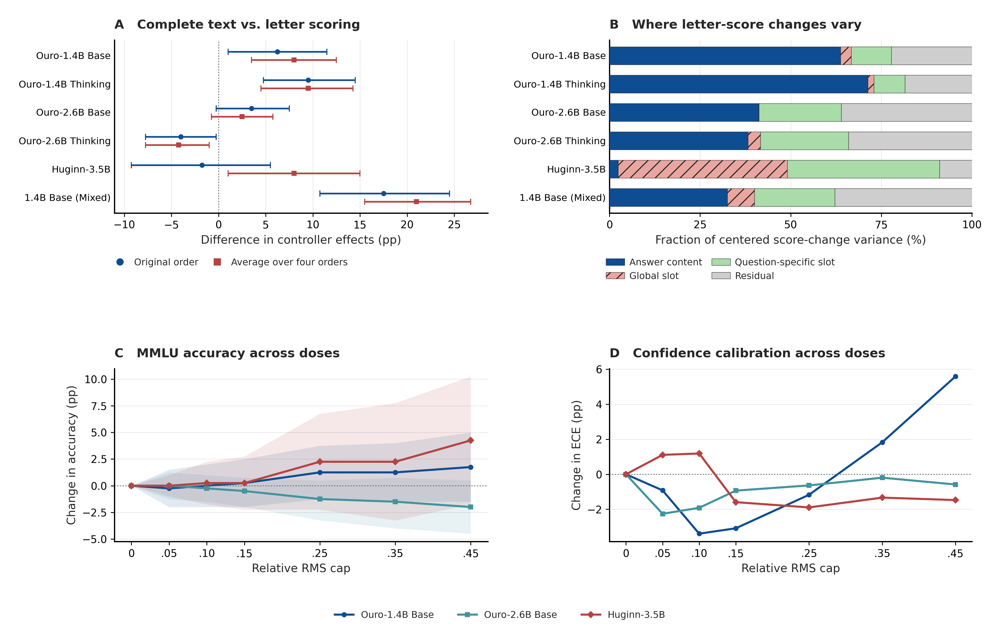

# Ouro 低秩功能可控性 v3 · 阶段性发布

本快照收录已完成的环境与数据审计、E0 析因实验、D2 内禀可控性实验和 D1 协议与剂量实验。另附 D3 已核验的 14 个来源、56 个特征分片和 69,573 条逐题指标，以及 D6 已完成的 6 组 Huginn 训练、1 组 Huginn 固定权重开发评测和 2 组 Ouro-2.6B Base 开发评测。D3 的源训练和因果对照、D6 跨架构结论、D4/D5 模型选型及正式测试仍在后续流程中。本快照的正式 v3 Benchmark 数为 0。

[中文结果摘要](reports/STAGES_0_TO_3_ZH.md) · [E0 报告](stage1_e0/E0_REPORT.md) · [D2 报告](stage2_d2/D2_REPORT.md) · [D1 报告](stage3_d1/D1_REPORT.md) · [逐文件哈希索引](ARTIFACT_INDEX.json)

## 关键结果

- E0 五任务开发面板上，谱方向相对对应析因条件平均 +0.936 个百分点。NLL 与候选排序联合目标平均 −7.076 个百分点，且明显改变了 MMLU-Pro 的可解析率和生成终止行为。
- D2 确认跨 token 的循环传播会大幅改变广义 Fisher 敏感方向。在 1,013 道训练题的同预算对照中，全空间冷启动的五任务开发准确率为 67.04%，Fisher 投影为 63.16%。八个无标签定向都未显示稳健的开发收益。
- D1 同一批 400 道 MMLU 开发题中，控制器效应依赖评分协议及模型。Ouro-1.4B Base 在原始选项顺序下，完整内容评分的 T1 效应比字母评分大 6.25 个百分点。Huginn 的原位字母正确数从 87 升至 95，四序内容对齐后从 127 降至 99。

## 查看与核验

`RELEASE_MANIFEST.json` 列出快照文件、SHA-256、完成计数和发布边界。`ARTIFACT_INDEX.json` 列出压缩包内各原始文件的路径、字节数和 SHA-256。各 `artifacts/*.tar.gz` 是可独立解包的 tar 压缩包，根内相对路径一致。其中包含运行代码、逐题结果、训练权重、数值谱、训练及评测回执。个别文件中的绝对路径记录了原运行位置，可据冻结配置在复现环境中重新映射。

原模型和上游数据缓存按清单中的来源与 SHA-256 获取。多 GB 的原始 Fisher 迭代交换缓存和 D3 矩阵断点保留在实验机；快照提供已封存的谱、子空间、逐题标量指标和重建代码。

