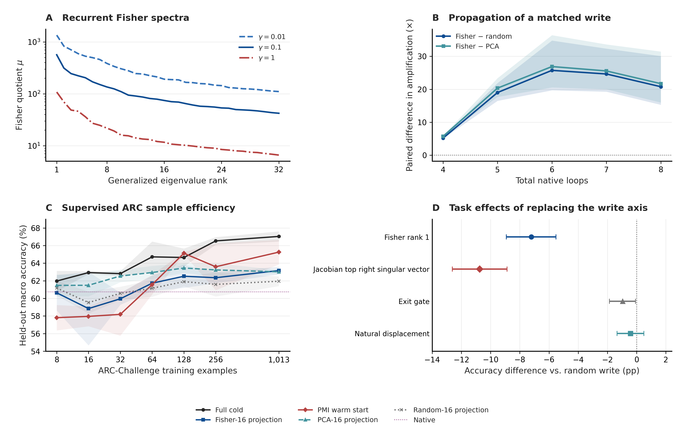
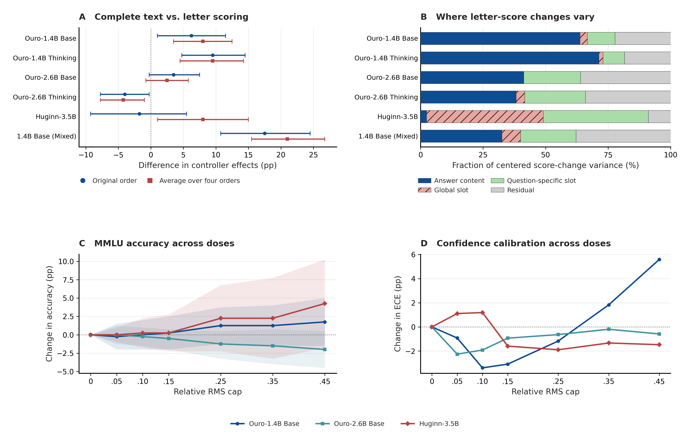

# v3 阶段 0–3 核验要点

## 数据与可比性

主开发面板包含 SciQ 500、ARC-Easy 536、CosmosQA 500、MMLU 658、MMLU-Pro 59，共 2,253 题。普通候选内容评分、MMLU 的锁定候选协议和 MMLU-Pro 的真实生成协议分别按各自预注册指标计算。历史面板继续使用原先封存的八组请求。两面板用途均为开发。正式测试标签和结果在最终模型选择封存前不进入研究流水线。

去污染使用独立冻结的 27 个保留引用源。面板间的一个具体重叠发生在 MMLU 与 MMLU-Pro。MMLU auxiliary 从 285 行经边界去污染保留 217 行，再移除与 MMLU-Pro 共享题干的 59 行，对应 58 个归一化题干，剩余 158 行。无标签 WikiText 的定向和审计分别使用 1,024、512 段，文档和八词片段交集均为零。

实际硬件为两台宿主上的三张卡，一张实体 RTX 4090 D，两张各有 24 GiB 的 vGPU。各 GPU 以独立互斥锁运行。报告按实测记录 GPU 时长与实验墙钟时间，并分别使用两种口径。

## E0　谱方向、尺度、训练目标和训练材料

24 个主训练臂、2 个历史初始化对照及 4 个冻结锚点全部完成了两个面板。主外部面板五任务等权均分为 Native 60.74%、T1 66.31%、T2 66.11%、Mixed 60.12%。

| 外部开发因素 | 平均变化（百分点） |
| --- | ---: |
| 谱方向初始化 | +0.936 |
| 等范数随机方向对照 | −0.784 |
| ARC 加 CommonsenseQA | +0.523 |
| NLL 加候选排序 | −7.076 |

NLL 加候选排序的五任务 95% 区间为 [−8.942, −5.302]。剔除 MMLU-Pro 后仍有 −2.542 pp，95% 区间 [−3.351, −1.763]。在 MMLU-Pro 上，正确率下降 25.212 pp，可解析率下降 60.381 pp，EOS 比例增加 55.932 pp。119 个新增错误中，107 个伴随由可解析转为不可解析。因此生成退化同时涉及输出行为和去除生成任务后仍观察到的性能下降。

历史 Mixed 实际用了 ARC、CommonsenseQA、SQuAD 和 GSM8K。候选样本采用 NLL 加 0.25 倍排序损失，生成样本采用 NLL。历史 T1 使用原始写轴和 1,119 道 ARC 训练题。v3 的历史轴桥接维持清洗后 1,013 题以及 v3 更新预算，用于隔离初始化差别。840 步的两次冷启动分别较 Native 提高 7.855 和 6.792 pp，满足 D3 保留两个初始化体系的原设条件。

## D2　内禀敏感度、有限扰动以及任务收益

广义谱由完整序列的冻结原生循环反传得到，包含 token 间梯度。线性算子、审计输入、谱投影和数值停止证书均有独立文件。三个正则尺度使用共同的双边相对残差门槛，分母为两侧作用量的范数和。匹配的 64 段、每段四个输出位置中，全传播首商为 369.814，逐位置隔离为 149.801。前 16 个方向的平均平方重叠为 0.4496。独立 512 段中，Fisher、PCA 和随机前 16 维的广义商中位数分别为 133.569、0.298 和 0.774。

拟合的低维传播算子满足谱半径 0.701、最大奇异值 4.090、归一化 Henrici 指标 0.938。64 段轨迹的配对测量显示，在 K6，Fisher 相对固定随机轴的状态放大差中位数为 +18.08 倍。对应的输出 KL 差中位数为 3.29×10⁻⁷。单段贡献了 KL 平均差的 86.5%。外部开发的等剂量直接结果呈另一尺度，Fisher 方向比固定随机方向低 7.210 pp，四个比较的同时保护区间为 [−9.376, −5.013]。投影 Jacobian 第一右方向低 10.748 pp，区间为 [−13.145, −8.364]。

八个无标签定向的最佳 NLL 方案仅较 Native 高 0.110 pp，95% 区间 [−0.300, +0.535]。作为后续预注册锚点的无标签 PMI 方案较 Native 低 5.621 pp。其净 PMI 增量受到错配上下文效用下降驱动，匹配上下文在 512/512 审计样本上的效用也下降。105 个监督样本效率实验在每个规模与种子内保持同一题目和 padded token-loops。全空间冷启在七个规模中领先六个，Fisher 投影在七个规模全低于全空间冷启。在 1,013 道题上，两者分别为 67.04% 和 63.16%。PMI 热启动只在 128 题单点达到冷启 256 题的离散目标，未检出普遍 4× 或 8× 节省。

## D1　评分协议与置信剂量

32 个实验臂产出 152,590 条分数。400 道四选项 MMLU 开发题在完整内容和字母评分中显示相同内容，控制槽位并有四次循环置换。锁定原始顺序下，Ouro-1.4B Base 的 T1 在完整内容评分上提升 8.00 pp，在单字母评分上提升 1.75 pp。差值为 +6.25 pp，95% 区间 [+1.00, +11.50]。四次置换对齐的完整内容减字母效应，在 1.4B Base、1.4B Thinking、2.6B Base、2.6B Thinking 分别为 +8.00、+9.50、+2.50、−4.25 pp。方向随模型变化。

Huginn 同一 400 题的原始字母顺序由 87/400 增至 95/400，四序平均概率对齐后的正确数由 127/400 降至 99/400。共享槽位占分数变化方差的 46.68%，合计槽位项占 88.74%。四序对齐多做了四套评分，只用于诊断。剂量实验的紧凑打包另有自己的原生端点，同该端点配对后，.45 的四序对齐效应为 −5.75 pp。

在四项任务 1,835 题上，附加 PMI 后较原 T1 下降 6.872 pp（1.4B）和 8.025 pp（2.6B）。Ouro-1.4B Base 的 128 道高置信 MMLU 题，在七个剂量下始终有 119 正确、9 错误，逐题零转换。全队列 .45 的 ECE 从 .0873 增至 .1431。这些观察未满足预注册的高置信净伤害触发条件。

