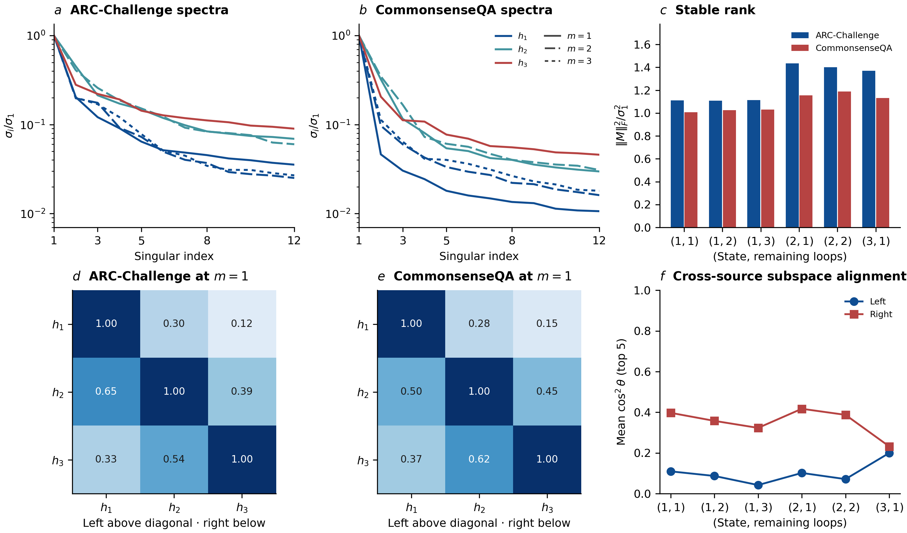

# 功能矩的谱与共同秩一方向

在 ARC-Challenge Train 和 CommonsenseQA Train 各固定抽取 96 道题。每题累计所有完整候选的因果预测位置，并对问题数归一。功能矩为 $M_{D,k,m}=\frac{1}{n}\sum_{x,t}g_{x,k,m,t}h_{x,k,m,t}^{\mathsf T}$。效用为正确候选的字符归一化得分减错误候选分数的 logsumexp。各域使用九个状态与后缀组合，包括三个 $m=0$ 直接读出条件。组合中最长执行 K4，K5/K6 的梯度与任何确认集标签均未用于谱估计或方向拟合。 [训练矩分解](results/moments) · [逐条件谱与主角](results/SPECTRUM/SPECTRUM.json)

## 有效秩与左右子空间



图 2 的前 12 个奇异值以每个条件自己的首奇异值归一化。正后缀长度条件下，首方向在 ARC 上占总 Frobenius 能量的 69.7%–90.3%，在 CSQA 上占 84.1%–99.3%。以 $m=1$ 固定后缀，比较三处真实状态的前五维子空间，ARC 的左／右平均主角余弦平方分别为 0.121–0.391 与 0.326–0.654，CSQA 为 0.147–0.446 与 0.366–0.621。两域每一个状态配对均为右侧读入子空间重叠更高。固定接收状态和后缀长度后跨域比较，在六个条件中左侧为 0.043–0.200、右侧为 0.233–0.417。低有效秩与写出子空间的跨条件偏移同时存在。

热图上三角是左侧写出子空间，下三角是右侧读入子空间。跨域图的指标为前五维主角的平均余弦平方。JSON 同时保留秩 1、3、5、8、12 的每个主角及相应领先算子的带符号余弦。能量分母用完整矩阵 Frobenius 范数，所存领先谱来自固定随机种子的近似 SVD。 [可编辑 PDF](results/SPECTRUM/FIGURE_2_SPECTRUM.pdf) · [可编辑 SVG](results/SPECTRUM/FIGURE_2_SPECTRUM.svg)

## 训练集共同效用界

在每个训练来源的六个正后缀条件上，将每个条件的前五维读写空间合并。用多初值平滑最小值优化求单位范数的读入与写出方向，再在原始矩阵上算每个条件的带符号投影。以下给出可行方向达到的最小投影，为相应训练矩问题的下界。联合条件使用两域共十二个矩。

| 功能矩集合 | 原始投影下界 | 原始 Frobenius 上界 | 除以各条件首奇异值后的下界 |
| --- | ---: | ---: | ---: |
| ARC | 0.5450 | 0.7963 | 0.6477 |
| CSQA | 1.2616 | 1.5559 | 0.6219 |
| ARC 与 CSQA | 0.5276 | 0.7963 | 0.5149 |

按原始最小增益和按首奇异值归一的两种训练代理，ARC 与 CSQA 的次序相反。数据来源之间的分值尺度会影响这个训练指标。联合训练矩存在一个让所有已测条件的一阶平均投影为正的单位秩一方向。此处的优化给出样本内存在性证据。真实部署要经过 RMS 限幅、有限剂量和未见条件，未见深度效用由独立预测与实际干预另行检验。 [可行方向与分条件投影](results/SPECTRUM/SPECTRUM.json) · [单位范数读写因子](results/SPECTRUM/TRAIN_ONLY_GAMMA_DIRECTIONS.pt)

```bash
CUDA_VISIBLE_DEVICES="" OPENBLAS_NUM_THREADS=2 OMP_NUM_THREADS=2 \
    python spectral_analysis.py --manifest data/MANIFEST.json \
    --moments results/moments --out results/SPECTRUM
```
