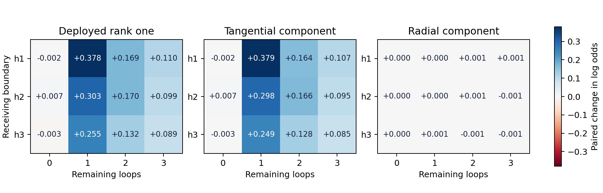

# 实际 RMSNorm 和状态 × 时域响应

固定历史 Rank-1，在 96 道事前哈希抽取的独立确认题上交叉三处真实 pre-RMSNorm 状态和 0–3 圈后缀。候选及各原生预算相同。图 1 显示实际分解，功能谱对照只使用 Train。

| 接收状态 | 后缀圈数 | 已学更新 Δq | 切向 Δq | 径向 Δq | 有限公式/真实向量余弦中位数 | 线性/真实余弦中位数 |
|---|---:|---:|---:|---:|---:|---:|
| h1 | 0 | -0.0023 | -0.0018 | +0.0001 | 1.0000 | 0.9965 |
| h1 | 1 | +0.3778 | +0.3790 | +0.0002 | 1.0000 | 0.9965 |
| h1 | 2 | +0.1690 | +0.1635 | +0.0011 | 1.0000 | 0.9965 |
| h1 | 3 | +0.1105 | +0.1068 | +0.0006 | 1.0000 | 0.9965 |
| h2 | 0 | +0.0069 | +0.0070 | +0.0002 | 1.0000 | 0.9870 |
| h2 | 1 | +0.3026 | +0.2978 | +0.0001 | 1.0000 | 0.9870 |
| h2 | 2 | +0.1699 | +0.1661 | +0.0010 | 1.0000 | 0.9870 |
| h2 | 3 | +0.0987 | +0.0949 | -0.0007 | 1.0000 | 0.9870 |
| h3 | 0 | -0.0032 | -0.0025 | +0.0002 | 1.0000 | 0.9800 |
| h3 | 1 | +0.2547 | +0.2494 | +0.0007 | 1.0000 | 0.9800 |
| h3 | 2 | +0.1323 | +0.1280 | -0.0009 | 1.0000 | 0.9800 |
| h3 | 3 | +0.0887 | +0.0853 | -0.0007 | 1.0000 | 0.9800 |

实际射影与解析结果均加入 Ouro 的 learned RMSNorm 权重、epsilon 和 BF16 写入舍入。径向和切向作为各自独立反事实，二者效用无需相加。后归一化等相对限幅的干预改变真实位置及可用语义，单列完整结果。自然位移使用下一圈的原生状态，仅作研究对照。
[逐条件指标和分片哈希](results/state_horizon/arc_confirm/STATE_HORIZON.json) · [可编辑图 1](results/PREDICTION_AUDIT/FIGURE_1_STATE_HORIZON.pdf)
