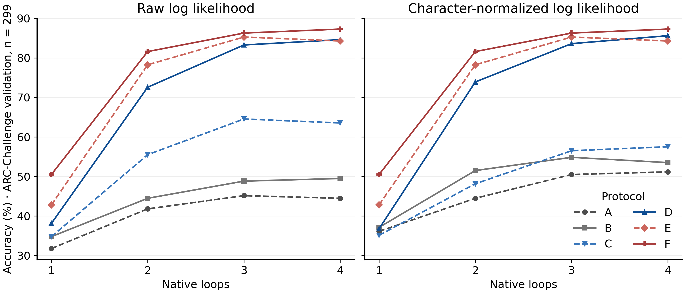
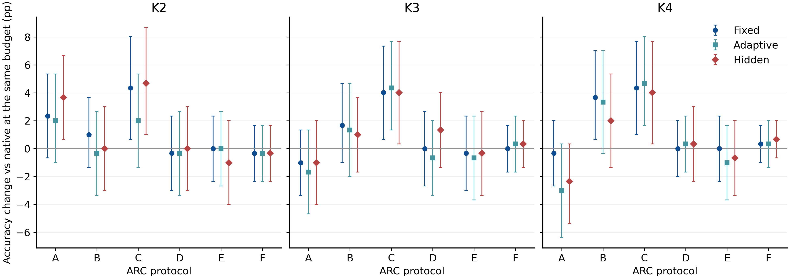

# Ouro-1.4B Base 的六协议匹配比较

在 25-shot 全文评分下，无查询候选的 B 从 111 升到 160 题。展示候选的 D 从 110 升到 256 题。同样长度和查询坐标的 25-shot 遮蔽对照估计 K4 候选可见性的变化为 +35.94 [+20.31, +50.00] 个百分点（n=64）。在完全相同的 0-shot 提示下，全文评分切换到字母评分，K4 的变化为 +26.76 [+20.40, +33.11] 个百分点。前一个比较改变模型的可见输入，后一个比较改变候选续写评分规则。

验证集为 ARC-Challenge 官方 Validation 全部 299 题，此数据在既有研究中用于评测。开发集为官方 Train 中按固定哈希选出的 64 题，排除了 25 个历史示例及与 Validation 题干规范化后重复的题目。六个主条件使用相同候选内容、题干和正确答案。模型冻结在修订 `574fa66cb8bf5abdc979642d01cf2b79b16bfab1`，BF16、SDPA、RTX 4090。六协议分别抽查 K1–K4，官方独立深度前向与统一轨迹的词表 logits 逐项相等。A 的 Validation 分数复用提交 `5557699` 的相同输入和公式，读取时验证题号、选项标签、正确答案、字符数、续写 token 数与实际输入 token 数。

每个候选的原始分数为全词表 FP32 log-softmax 的续写 token 总和。字符归一化除以续写字符数，不计连接空格，字母分母为 1。另计算 token 归一化、金答案长度分层和精确并列。并列以展示顺序首次出现为准。所有结果的分母由表头或 n 列给出。

## 验证集原生轨迹

| 协议 | 示例 / 查询候选 / 目标 | 输入 token 最小/中位数/最大 | 原始正确 K1/K2/K3/K4 | 字符归一化正确 K1/K2/K3/K4 |
|---|---|---:|---:|---:|
| A | 0 / 隐藏 / 全答案 | 11/27/124 | 95/125/135/133 | 108/133/151/153 |
| B | 25 / 隐藏 / 全答案 | 1099/1115/1212 | 104/133/146/148 | 111/154/164/160 |
| C | 0 / 展示 / 全答案 | 28/62/161 | 104/166/193/190 | 105/144/169/172 |
| D | 25 / 展示 / 全答案 | 1985/2019/2118 | 114/217/249/253 | 110/221/250/256 |
| E | 0 / 展示 / 字母 | 28/62/161 | 128/234/255/252 | 128/234/255/252 |
| F | 25 / 展示 / 字母 | 1867/1901/2000 | 151/244/258/261 | 151/244/258/261 |

| 协议 | W→C K1→2 / 2→3 / 3→4 | C→W K1→2 / 2→3 / 3→4 | 首次正确 K1/K2/K3/K4/从未 | 首次正确后出现回退 |
|---|---:|---:|---:|---:|
| A | 39/28/11 | 14/10/9 | 108/39/22/6/124 | 33 |
| B | 57/21/6 | 14/11/10 | 111/57/15/4/112 | 35 |
| C | 50/37/14 | 11/12/11 | 105/50/32/12/100 | 34 |
| D | 120/35/10 | 9/6/4 | 110/120/30/9/30 | 18 |
| E | 127/29/3 | 21/8/6 | 128/127/18/2/24 | 34 |
| F | 100/19/7 | 7/5/4 | 151/100/18/2/28 | 15 |

## 匹配对照

C 与 E 的查询 token 完全相同，差异来自对同一前缀的续写评分和结果解析。25-shot 查询的示例答案和测试目标采用交叉条件。C、D 的遮蔽条件保留候选区域的 token 数、答案位置与 RoPE 坐标。候选区域配成同质 token 并从每层注意力中排除。遮蔽条件固定名义长度，减少了有效可见上下文。25-shot 完整示例与 0-shot 的对比包括示例内容和有效上下文的变化。候选重新排序只用每题固定的一个非零循环移位，预测后映射到原候选内容。

下表为字符归一化准确率变化，单位百分点，附逐题配对重采样 95% 区间。K4−K1 一列比较这段增益在两种条件之间的差值。区间逐对计算。

| 对照（先前→之后） | n | K1 | K4 | K4−K1 增益差 |
|---|---:|---:|---:|---:|
| A→B 无候选 / 全答案 | 299 | +1.00 [-2.68, +4.68] | +2.34 [-2.68, +7.36] | +1.34 |
| A→C 展示查询候选 | 299 | -1.00 [-7.69, +5.69] | +6.35 [-0.33, +13.38] | +7.36 |
| C 遮蔽→C 0-shot，固定位置 | 64 | -4.69 [-15.62, +6.25] | +21.88 [+7.81, +35.94] | +26.56 |
| D 遮蔽→D 25-shot，固定位置 | 64 | -1.56 [-14.06, +10.94] | +35.94 [+20.31, +50.00] | +37.50 |
| C→D 展示候选 / 全答案 | 299 | +1.67 [-4.01, +7.02] | +28.09 [+22.07, +34.11] | +26.42 |
| E→F 展示候选 / 字母 | 299 | +7.69 [+1.67, +13.71] | +3.01 [-0.67, +6.69] | -4.68 |
| C→E 相同输入，目标由全文到字母 | 299 | +7.69 [+0.32, +15.38] | +26.76 [+20.40, +33.11] | +19.06 |
| D→F 交叉，示例为全文答复 | 64 | +9.38 [-6.25, +25.00] | -29.69 [-42.19, -17.19] | -39.06 |
| D 交叉→F，示例为字母答复 | 64 | +12.50 [-1.56, +26.56] | +39.06 [+25.00, +53.12] | +26.56 |
| D→D 交叉，全文目标，改变示例答复 | 64 | +6.25 [-4.69, +17.19] | -39.06 [-53.12, -25.00] | -45.31 |
| F 交叉→F，字母目标，改变示例答复 | 64 | +9.38 [-6.25, +25.00] | +29.69 [+17.19, +42.19] | +20.31 |
| B→D 示例和查询均增加候选 | 299 | -0.33 [-7.36, +6.35] | +32.11 [+25.75, +38.46] | +32.44 |

| 候选次序变化 | n | 两种顺序下预测同一内容 K1/K2/K3/K4 | K4 准确率差 |
|---|---:|---:|---:|
| C | 64 | 50/54/54/50 | +0.00 [-10.94, +10.94] |
| D | 64 | 52/49/53/60 | -1.56 [-6.25, +3.12] |
| E | 64 | 16/46/54/49 | +9.38 [-1.56, +20.31] |
| F | 64 | 34/49/57/59 | +0.00 [-6.25, +6.25] |

另在同一组固定的 32 题上，从注意力可见范围移除全部示例。比较双方保留完全相同的 query token、提示总长度、query 位置及评分目标。这个对照检验相同名义长度下，能否读到示例对准确率的影响。

| 协议 | 遮蔽前缀 token 数 | 可见示例正确 K1/K2/K3/K4 | 遮蔽示例正确 K1/K2/K3/K4 | 遮蔽与实际 0-shot 的预测一致数 |
|---|---:|---:|---:|---:|
| B | 1088 | 12/15/14/15 | 11/14/13/14 | 32/32/32/32 |
| D | 1957 | 10/21/25/25 | 9/17/18/21 | 32/31/31/32 |
| F | 1839 | 14/21/24/24 | 13/21/25/23 | 32/31/32/32 |

## 历史 Test 描述性复核

历史 25-shot Joint-Option 的另一份 A6000 运行已经归档所有 1,172 道题的 K1–K4 预测。这四个预算采用同一运行的逐题轨迹。早期原版公开端点为 634/1172 和 1021/1172。两份历史运行有 36 道题的端点预测发生变化，具体差异见早期的 `historical_joint_comparison.json`。历史 Test 专用于描述性复核。

全轨迹归档正确 K1/K2/K3/K4 为 **626/953/1000/1020 / 1172**。首次正确 K1/K2/K3/K4 和从未正确为 626/378/62/13/93。首次正确后有 93 题回退过。

| 深度变化 | W→C | C→W |
|---|---:|---:|
| 1->2 | 378 | 51 |
| 2->3 | 81 | 34 |
| 3->4 | 33 | 13 |
| 1->4 | 435 | 41 |

## 同协议、同预算的 LoopCD

Fixed 使用最终 logits 加 0.5 倍最终与 K1 的差。Adaptive 依据最终全词表概率前两名的差调节对比系数。Hidden 在读出前混合当轮和 K1 的 Norm 前状态，再运行模型 Norm 和词表头。三个变体使用现有原生循环，教师强制评分时干预均发生在读出，不回写循环状态。K1 没有可对比的早轮，以 Native K1 为共同基准。无约束生成时，读出改选的 token 可以成为下一解码步的新输入。

下表列出 Validation 299 题的字符归一化正确数。完整逐题结果附原始和 token 归一化分数。

| 协议 | K2 Native/Fixed/Adaptive/Hidden | K3 Native/Fixed/Adaptive/Hidden | K4 Native/Fixed/Adaptive/Hidden |
|---|---:|---:|---:|
| A | 133/140/139/144 | 151/148/146/148 | 153/152/144/146 |
| B | 154/157/153/154 | 164/169/168/167 | 160/171/170/166 |
| C | 144/157/150/158 | 169/181/182/181 | 172/185/186/184 |
| D | 221/220/220/221 | 250/250/248/254 | 256/256/257/257 |
| E | 234/234/234/231 | 255/254/253/254 | 252/252/249/250 |
| F | 244/243/243/243 | 258/258/259/259 | 261/262/262/263 |

以下固定报告 K3 的 Fixed 对比。以 Native K3 错题为风险集，计算读出纠正与 Native K4 纠正的交集。其余变体及 K2 对比见机器可读结果。

| 协议 | Fixed K3 纠正 | 其中 Native K1–K3 全错 | Native K4 纠正 | 交集 | 仅 Native K4 纠正 |
|---|---:|---:|---:|---:|---:|
| A | 5 | 5 | 11 | 2 | 9 |
| B | 12 | 8 | 6 | 1 | 5 |
| C | 20 | 18 | 14 | 8 | 6 |
| D | 8 | 7 | 10 | 6 | 4 |
| E | 7 | 5 | 3 | 3 | 0 |
| F | 3 | 2 | 7 | 1 | 6 |

## 候选评分时间和实际生成

在预先哈希选取的同一批 16 道 Validation 题上，独立执行全部协议和相应深度的变体。评分按一题一批，批内按完全相同的输入去重并右填充。生成使用无约束词表贪心，有原生 KV cache，遇到换行或 EOS 停止。只匹配首行的候选全文或独立字母，生成替代表达未做语义判分。以下为 K4 的示例表，所有深度的实际数据都可查询。

| 协议 | K4 生成正确 Native/Fixed/Adaptive/Hidden | 候选评分中位 ms | 生成 prefill 中位 ms |
|---|---:|---:|---:|
| A | 2/2/2/2 | 91.8/94.3/91.2/91.1 | 83.4/82.1/80.6/81.5 |
| B | 2/3/2/3 | 469.3/472.0/469.9/469.7 | 117.8/117.9/117.9/117.6 |
| C | 0/0/0/0 | 91.9/91.8/90.3/93.4 | 81.0/82.9/81.8/84.6 |
| D | 14/14/14/14 | 1048.6/1049.5/1047.5/1047.7 | 196.6/196.3/196.4/196.5 |
| E | 12/10/10/10 | 90.9/89.1/90.2/90.1 | 83.6/81.2/81.2/83.0 |
| F | 13/14/14/14 | 222.2/222.4/222.3/222.1 | 190.6/190.6/190.6/190.4 |

C 与 E 的相同提示对在 208/208 个题目 × 方法条件下生成逐 token 完全相同的续写。两种协议按各自目标格式解析这些输出。

全文候选评分运行成本包含各候选续写的 token work。字母候选共用同一条前向轨迹。批处理评分时间和逐题生成时间分别记录，批处理阶段与因果实验共享 GPU。逐题生成和候选评分诊断在 GPU 空闲后启动。
统一 K1–K4 轨迹的批处理评分与逐题独立深度计时评分有 16/1248 条字符归一化候选预测不一致。六组主准确率采用统一批评分。逐题执行用于延迟和生成诊断。

## 可追溯结果

- [冻结配置、样本 ID、输入和代码哈希](protocol_results/PROTOCOL_FREEZE.json)
- [固定名义长度的示例遮蔽对照](protocol_results/DEMONSTRATION_MASK_METRICS.json)
- [验证集、开发集、历史测试轨迹、配对检验、并列及原始结果的 SHA-256](protocol_results/PROTOCOL_METRICS_WITH_LOOPCD.json)
- [每个协议和方法的候选评分、生成、prefill、decode 执行记录](protocol_results/GENERATION_COST_METRICS.json)
- [逐题执行、候选预测及生成的核查结果](protocol_results/PROTOCOL_GENERATION_AUDIT.json)
- [逐题候选分数和生成输出](protocol_results/)
