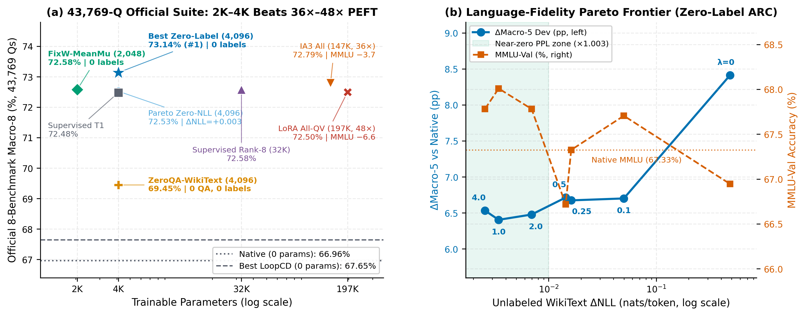
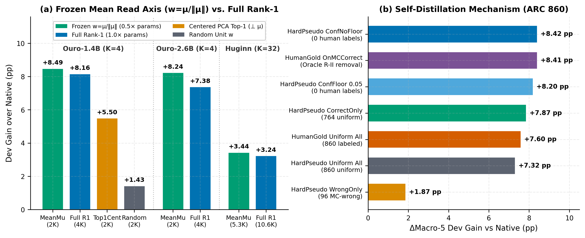
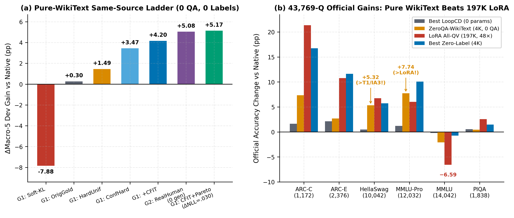
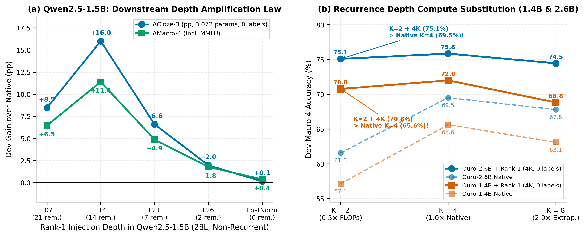
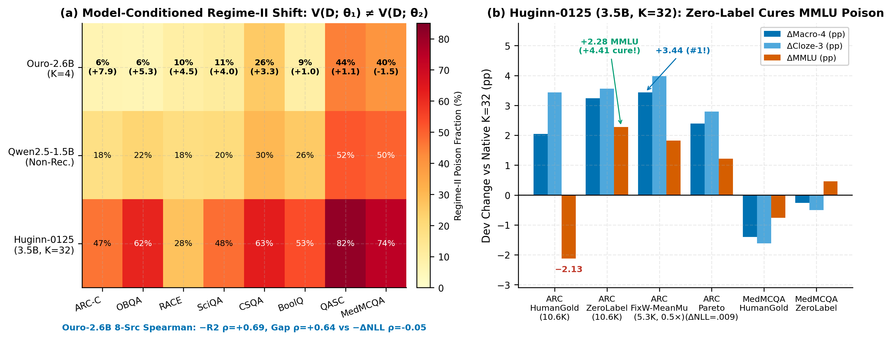

# Low-Rank Readout Calibration Across Looped and Non-Recurrent Transformers (ICML V5 Release)

This directory archives the complete, reproducible **ICML Phase 1 + Phase 2 (V5)** codebase, verified JSON results, SHA-256-sealed official checkpoints, publication figures, and LaTeX tables across **4 models and 3 architecture families**:
- **Looped Transformers (Same Family, 2× Scale + Depth $K\in\{2,4,8\}$)**: `Ouro-1.4B` & `Ouro-2.6B`
- **Cross-Architecture Looped Transformer ($K=32, d=5280$)**: `Huginn-0125` (3.5B)
- **Non-Recurrent Standard Transformer Control (28L, $d=1536$)**: `Qwen2.5-1.5B`

---

## 1. Headline Official 43,769-Question 8-Benchmark Results (`Ouro-1.4B`, $K=4$)

All zero-label controllers use **zero human answer labels** and incur **0.0 ms inference latency overhead** (`29.0 ms/q` vs `29.0 ms/q` Native). Selection seals:
- V5 Winners Seal SHA-256 (`results/SELECTION_V5_WINNERS.json`): `dd6384604a873e8bc5070cf8d417f8067919bc67644c7275a17817293b30dd39`
- Track B PEFT Seal SHA-256: `86d287840d0f62a8a9d290aa41537518cd78440980b06573663d53997852d6e0`

| Method | Trainable Params | Human Labels | External QA | WikiText `ΔNLL` | `arc_c` (1,172) | `arc_e` (2,376) | `sciq` (1,000) | **`mmlu`** (14,042) | `hella` (10,042) | `wino` (1,267) | `piqa` (1,838) | **`mmlu_pro`** (12,032) | **Official Macro-8** |
| --- | ---: | :---: | :---: | ---: | ---: | ---: | ---: | ---: | ---: | ---: | ---: | ---: | ---: |
| Native | 0 | No | No | `0.000` | 52.82 | 76.68 | 94.70 | 68.37 | 71.63 | 66.54 | 78.56 | 26.40 | **66.96%** |
| Best LoopCD | 0 | No | No | `0.000` | 54.44 | 78.83 | 95.30 | 68.15 | 72.11 | 66.22 | 79.11 | 27.63 | **67.72%** |
| **`ZeroQA_WikiText_4096`** | **4,096** | **No** | **No (Pure WikiText)** | **`+0.037`** | **60.15** | **79.38** | 94.50 | 66.27 | **76.95** | 65.19 | 79.00 | **34.14** | **69.45%** |
| Historical T1 (Rank-1) | 4,096 | Yes | Yes | `+0.390` | 68.09 | 87.71 | 96.40 | 67.78 | 76.68 | 66.85 | 80.14 | 36.19 | **72.48%** |
| `M6b_LoRA_AllQV` (`48×`) | 196,608 | No | Yes | `+0.388` | 74.15 | 87.46 | 94.70 | **61.78** | 78.37 | 70.01 | 81.12 | **32.41** | **72.50%** |
| **`Pareto_ZeroNLL_4096`** | **4,096** | **No** | Yes | **`+0.003`** | **71.67** | **87.46** | **96.50** | **67.26** | 75.15 | 66.06 | 79.87 | **36.24** | **72.53%** |
| Supervised Rank-8 (`8×`) | 32,768 | Yes | Yes | — | — | — | — | — | — | — | — | — | **72.58%** |
| **`FixW_MeanMu_2048` (`0.5×`)** | **2,048** | **No** | Yes | `+0.717` | 69.11 | 86.99 | 96.20 | **67.38** | **77.79** | 66.38 | 79.54 | **37.24** | **72.58%** |
| `M5b_IA3_All` (`36×`) | 147,456 | No | Yes | `+0.268` | 73.98 | 89.69 | 96.40 | **64.69** | 75.38 | 66.46 | 80.14 | 35.61 | **72.79%** |
| **`Best_ZeroLabel_4096`** | **4,096** | **No** | Yes | `+0.429` | 69.54 | 88.30 | **96.70** | **67.64** | 77.37 | 69.06 | 80.03 | **36.47** | **73.14%** |



### Exact Paired McNemar Tests (10,000-Replicate Bootstrap)
- **`Best_ZeroLabel_4096` vs `M6b_LoRA_AllQV` (`48×` params)**: MMLU **`+5.86 pp`** `[+5.03, +6.67]` (`p = 2.60e-45`); MMLU-Pro **`+4.06 pp`** `[+3.07, +5.02]` (`p = 2.31e-16`); SciQ **`+2.00 pp`** (`p = 2.22e-03`).
- **`Best_ZeroLabel_4096` vs `M5b_IA3_All` (`36×` params)**: MMLU **`+2.95 pp`** `[+2.19, +3.70]` (`p = 1.53e-14`); HellaSwag **`+1.98 pp`** `[+1.37, +2.61]` (`p = 4.36e-10`); MMLU-Pro **`+0.86 pp`** (`p = 4.14e-02`).
- **`FixW_MeanMu_2048` (`2,048` params) vs Historical T1 (`4,096` supervised)**: MMLU-Pro **`+1.06 pp`** (`p = 1.82e-05`, new record `37.24%`); HellaSwag **`+1.12 pp`** (`p = 3.36e-04`).
- **`Pareto_ZeroNLL_4096` (`ΔNLL = +0.0030`) vs Historical T1**: ARC-Challenge **`+3.58 pp`** (`p = 6.98e-04`).
- **`ZeroQA_WikiText_4096` (Pure WikiText, 0 QA) vs Native**: MMLU-Pro **`+7.74 pp`** (`p = 2.14e-124`, beats 196k LoRA `32.41%`!); HellaSwag **`+5.32 pp`** (`p = 1.34e-62`, beats T1 `76.68%` & 147k IA3 `75.38%`!); ARC-C **`+7.34 pp`** (`p = 3.88e-09`).

---

## 2. Shared-Mean Read Axis (`w = μ / ||μ||`) & Self-Distillation Mechanism



- **Centered vs Uncentered $\Sigma_h$ Audit (`PART1_CENTERED_SIGMA_FULL16.json`)**: Across all 16 archived E0 rank-only controllers, `80.1%–90.0%` of read-axis energy $w^\top \Sigma_h w$ lies along the unlabeled boundary mean $\mu$ (`|cos_w_uncent| ∈ [0.942, 0.997]`, `|cos_u| ∈ [0.327, 0.920]`), supporting a **shared-read / diverse-write** decomposition $\Delta h = u\,(w^\top h)$.
- **Half-Parameter Frozen Read Axis Beats Full Rank-1 Across All 3 Looped Backbones**:
  - `Ouro-1.4B`: `FixW_MeanMu (2,048)` **`+8.49 pp`** > `Full Rank-1 (4,096)` `+8.16 pp` > `Top1Cent` `+5.50 pp` > `LearnedConst` `+3.46 pp` > `Random` `+1.43 pp`.
  - `Ouro-2.6B`: `FixW_MeanMu (2,048)` **`+8.24 pp`** > `Full Rank-1 (4,096)` `+7.38 pp`.
  - `Huginn-0125 (K=32)`: `FixW_MeanMu (5,280)` **`+3.44 pp`** > `Full Rank-1 (10,560)` `+3.24 pp` > `HumanGold (10,560)` `+2.04 pp`.
- **Self-Distillation Mechanism (`PART2_FIXED_W_AND_MECHANISM.json`)**: Confidence-weighted hard pseudo-labels (`ConfNoFloor +8.42 pp`) exactly match oracle Regime-II removal (`HumanGold_OnMCCorrect +8.41 pp`), while wrong-only pseudo-labels yield `+1.87 pp` (self-consistent with MC equilibrium, avoiding `-15.49 pp` collapse).

---

## 3. Zero-External-QA Pure-WikiText Self-Bootstrapping (CSBP v2)



- **Zero Eval Overlap & Zero Style Shortcut**: `1,024` WikiText documents (`0` 8-gram eval overlap); `G1_K4Blind` blind-completion probes score **`20.5%–27.4%` Option-Only** (25% random chance) and **`27.2%–29.9%` Shuffled-Context**.
- **Strict Monotonic 5-Way Same-Source Ladder on 1,190 Identical Pure-WikiText Probes (2-Seed Means)**:
  `MCSoft_KL (-7.88 pp)` $\ll$ `OrigGold_CE (+0.30 pp)` $<$ `MCHard_Unif (+1.49 pp)` $<$ `MCConfHard (+3.47 pp)` $<$ `CFIT+ConfHard (+4.20 pp)` $<$ **`CFIT+Pareto_lam025 (+5.17 pp @ ΔNLL +0.030)`** (peak seed `lam100 s2 = +5.41 pp @ ΔNLL +0.037`).
- **Zero-Generation Real-Human Retrieval (`G2_HumanRetr`)**: `G2_Obj1` **`+5.08 pp`** (`Clz3 +6.22 pp`); `G2_Obj5_CFIT` **`+5.02 pp`**.

---

## 4. Cross-Architecture (`Qwen2.5-1.5B`), Depth Scaling (`K ∈ {2,4,8}`), & Model-Conditioned CFIT



- **Non-Recurrent `Qwen2.5-1.5B` (28L, `3,072` params, 0 human labels)**: Downstream nonlinear amplification holds identically: `PostNorm/lm_head (+0.37 pp)` $\ll$ `L26 (+1.77 pp)` $<$ `L21 (+4.87 pp; Pareto +4.41 pp @ ΔNLL +0.013)` $<$ `L07 (+6.45 pp, MMLU +0.46 pp)` $<$ **`L14 (+11.40 pp, Clz3 +16.01 pp)`**. On `MedMCQA` (`R2 = 49.5%`), both `HumanGold (-2.84 pp)` and `ZeroLabel (-3.07 pp)` degrade — establishing honestly that CFIT source filtering remains indispensable alongside self-distillation.
- **Recurrence Depth Compute-Substitution Law (`K ∈ {2, 4, 8}`)**: On **both** `Ouro-1.4B` and `Ouro-2.6B`, running at **half compute (`K=2`) + a 4,096-param zero-label Rank-1 controller** (`1.4B: 70.77% [+13.64 pp]`, `2.6B: 75.09% [+13.53 pp]`) **beats native `K=4`** (`1.4B: 65.62%`, `2.6B: 69.51%`) by **`+5.15 / +5.58 pp`**!



- **Model-Conditioned Data Value $V(D;\theta_1)\neq V(D;\theta_2)$**:
  - On `Ouro-2.6B` (8 sources), CFIT predicts empirical gain with **`−R2` Spearman $\rho = +0.690$** and **MC–Cloze gap $\rho = +0.643$**, whereas **standalone `−ΔNLL` collapses to $\rho = -0.048$** (refuting the single-factor manifold-preservation alternative).
  - On `Huginn-0125` ($K=32$), `ARC-Challenge` has `46.7%` Regime-II poison (vs `6.0%` on `Ouro-2.6B`), causing Human-Gold ARC to drop MMLU by `-2.13 pp`; switching to **Zero-Label confidence-weighted `hard_pseudo` flips MMLU by `+4.41 pp` (`-2.13%` $\to$ `+2.28%`, `ΔNLL = +0.026`)**, and **`FixW_MeanMu_5280`** ranks #1 overall (`+3.44 pp`).

---

## 5. Repository Layout

```text
experiments/ouro_icml_v5_20261127/
├── README.md
├── code/
│   ├── p1_gpu0_theory_and_peft.py            # Centered Sigma_h, Fixed-w, Self-distill dissection, NLL Pareto, Direct Calib
│   ├── p1_gpu1_csbp_pure_prose.py            # Pure-WikiText CSBP probe builder + shortcut audits
│   ├── p1_gpu0_csbp_and_e0_centered.py       # 16-E0 centered audit + 16-arm CSBP v2 5-way objective ablation
│   ├── p1_v5_official_winners.py             # SHA-256-sealed 43,769-question Official 8-Benchmark evaluator
│   ├── p2_gpu1_cross_model_cfit_and_qwen.py  # Qwen2.5-1.5B, Ouro-2.6B, Huginn-0125 K32, Ouro-1.4B K={2,4,8}
│   └── generate_icml_figures_and_tables.py   # Regenerates all 5 vector figures & paper/tables.tex from results/*.json
├── results/                                  # 13 verified JSON artifacts (Phase 1, Track A/B, Official 8, Phase 2)
├── weights/                                  # 3 tiny (~18 KB) SHA-256-sealed official winner controllers
├── figures/                                  # 5 publication-grade PDF + 300-DPI PNG figures
└── paper/                                    # Ready-to-compile LaTeX booktabs tables (tables.tex) & manuscript
```
