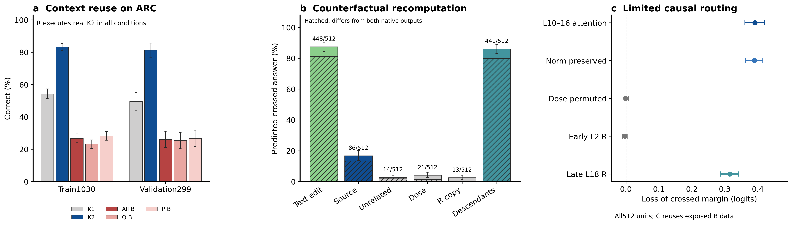

# Ouro K1->K2 computational mechanism

Sol-only bounded study,2026-11-16. [Final mechanism report](FINAL_MECHANISM_REPORT.md) separates established/rejected/unresolved claims. Full ARC Train1094/Validation299; deterministic cross-world160pairs/640units; limited routing512units. Strong compact-interchange gate fails, while68/512 strictly new predicted crossed outputs and matched causal-route effects demonstrate partial semantic influence. This does not solve the entire K1->K2 algorithm.

- [Context reuse](K1_CONTEXT_REUSE_RESULTS.md)
- [Dataset specification](CROSS_WORLD_DATASET_SPEC.md)
- [Intermediate exchange](INTERMEDIATE_VARIABLE_PATCHING.md)
- [Computational abstraction and routing](COMPUTATIONAL_ABSTRACTION.md)
- [Controls and counterexamples](CAUSAL_CONTROLS_AND_COUNTEREXAMPLES.md)
- [ARC structural transfer limits](ARC_MECHANISM_TRANSFER.md)
- [Source and numerical audit](SOURCE_AND_NUMERICAL_AUDIT.md)
- [Freeze and amendments](EXPERIMENT_FREEZE.md)



## Files

`code/`: executable GPU collectors, CPU analyses/reproducer, auditing, figures and packaging. `freeze/`: exact cohorts, semantic graphs/sites, seeds, gates and concurrency amendment. `inputs/`: losslessly gzipped gold-free ARC input IDs, synthetic graphs/prompts/inputs and separate allowed ARC analysis labels. `data/`: every question-level candidate logit/log-probability, prediction, tie, control, dose and selected trajectory hash. `analysis/`: complete group/bootstrap summaries and positive/negative examples. `audits/`: exact numerical receipts, repair/reference amendments, resource costs and raw tensor manifest. `source_versions/`: original collector versions for serialization provenance. `model_source/`: pinned model/config source; pretrained weights/tokenizer files are external.

The stage metadata in public scalar rows is explicitly named `captured_K2_stage_R_sha256`, including beside K1 score rows. K1 endpoint logits/B are separate actual tensors. No generated prose substitutes for per-question evidence.

## CPU reproduction

Use Python3.10 and NumPy1.26.4. No torch/model/GPU is needed for scalar recomputation:

```bash
python code/reproduce_release.py --release .
```

It losslessly expands the scalar archives in a temporary directory, independently re-executes all paired/group/bootstrap calculations, and requires exact equality with A/B/C_SUMMARY.json. The retained-tensor audits additionally check every full49152 endpoint; those large tensors stay on the experiment server and are not in this release.

## GPU execution

Restore the exact external model checkpoint/tokenizer identified by SOURCE_RUNTIME.json. Original execution used the paths in code/core.py, the40321 RTX4090 UUID, Torch2.5.1cu124/transformers4.55.0/NumPy1.26.4, BF16/SDPA,cachefalse. Do not run collectors against existing frozen output paths: use a fresh root and adapt only paths/device binding, preserving frozen input IDs, source hashes, mode/scoring and numerical gates. Rebuild native anchors on a different device/runtime. Run `run_A.py technical` before its development/train_confirmation/validation phases; run `run_B.py technical` before development/heldout; then C technical/heldout under its exposed-cohort extension freeze. Each process runs the entire real2-loop body. `core.py` imports three included original AB1 helper modules; the publication's code directory is self-contained after path/device adaptation. Original `source_versions` retain the serialization implementation; repaired current B uses separate native:: and patch:: keys.

The existing scientific parameters/gates were not refitted. Historical E6/H2 and prior B2 evidence remain at the starting commit e7da5c78676bf18ef5bd74a967788ad9875e9ea9. No ARC Test was opened for this study. Raw tensors and checkpoint remain at /root/ouro-computation-sol-20261116 and the original model directory on the server.
