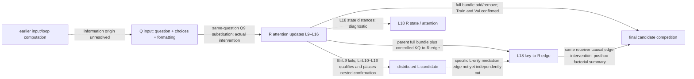

# E3 information-flow evidence graph

Solid labeled intervention arrows concern their fixed receiver and actual manipulated variables; they are not a complete natural causal route. Dashed arrows indicate diagnostics or unresolved mechanisms. The Q region is not a semantic-only question-stem source. The full-bundle edge factorial does not by itself identify a mediator of L-only effects; existing E4/E5 studies use other operators and do not validate that new path.
