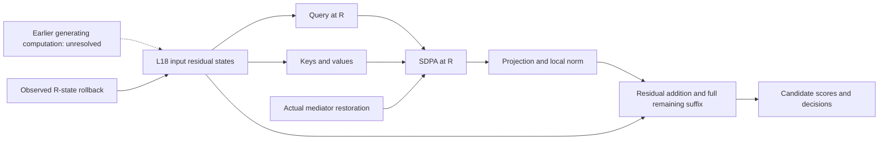

# Causal evidence map

Final closed scope: full 299 KV/Query/R-state experiments, matchedK3/K4 mediation and preregistered128 cross-question confirmation are complete and audited. Original generating-layer causality remains unresolved.

| Edge or claim | Evidence | Boundary |
|---|---|---|
| Native recurrent depth changes ARC decisions | Audited historical2590 trajectories; refreshed299 native baselines | Descriptive; hardware-specific prediction differences retained |
| Later KV can improve a K1 readout | Historical full-cohort eight corners and new299 KV transplantation:57 rescues/3 damages | Fixed recipient; transplant success is not natural-K2 necessity |
| Natural K2 decisions depend on KV in a subset | KV rollback loses 14/104 natural corrections;9 exclude both control losses and native/target ties |90/104 survive; zero no-tie cases meet both forward rescue and reverse loss |
| Natural K2 Query direction matters in a subset | Q rollback loses 10 natural corrections;headnorm-matched direction reproduces effect;temperature-only much weaker |86/104 survive whole-QKV rollback;new Q×jointKV contrast differs from historical K×V |
| L18 input-R state influences candidate scores through paths bypassing this attention mediator | U_restore−N meanwrong−1.375505 on full 299 while native A2 is held exact | Controlled mixed state;does not isolate MLP or original generating layers |
| State-induced change of L18 attention mediates some damaged decisions | U loses 29 natural corrections;A2 restoration recovers 22;15 pass no-tie+two mediator-control criteria,11 also pass input-control specificity | Conditional restoration,not fraction of all natural gains;7 persistent losses and 1 newly damaged natural correction |
| Current-question KV region influences the mixed K1 carrier | Peer E3 source64 region rollback exceeds prefix rollback | Region influence is not semantic origin or natural-K2 producer identification |
| Earlier recurrent computation generates useful R/KV states | Peer completed64 coarse Q/R producer bare replays plus E2/E3 evidence | Same-cut matched controls missing;attention/MLP writer TARGET_UNRESOLVED;next17-condition order has no result |
| Same local mechanism changes with depth | Full299 and 128 state/attention four corners complete;K3/K4 restoration means negative in both | Natural perturbation magnitudes/risk sets vary;no common-size sensitivity or convergence claim |

Plain arrows are inspected architectural relations, not proofs that every edge is independently necessary. The X and M interventions yield a controlled local state-to-attention path. Under X, actual A(U) is measured and differs from natural preceding-loop attention; restoring A2 preserves X. This is stronger than resetting the whole state, but weaker than identifying the original upstream producer. No mediated percentage is assigned to graph edges.

## Cross-question confirmation changes the evidence strength

| Claim | Fixed128 result | Final judgment |
|---|---|---|
| Strict KV natural-correction dependence generalizes |2 natural losses;1 control-specific but tied;0 strict cases;target damage 3 vs unrelated5 |299 nine-case necessity result does not strongly reproduce |
| Query-direction subset dependence |Q-only and joint each 3 strict natural losses;head-magnitude-only weak |Supported for a subset;not complete explanation |
| R-state to actual-attention mediated recovery |K2 loses 9 natural corrections,restores 6;2 strict all-control cases |Local controlled path supported;mean restore gap interval spans0 |
| Residual/suffix effect with native attention fixed |K2 direct meanwrong−1.353923,95% interval[-1.5816,−1.1351] |Continuous local bypass supported;not pure MLP |
| Same positive restoration persists late |K3/K4 mean restoration negative;late natural recoveries0/0;native K4 loses 3 correct |Universal/monotone account not supported |

All graph arrows retain their earlier architectural-versus-interventional distinction. No further experiment is pending within this E4/E5 scope. Final model and limitations are stated in FINAL_MECHANISTIC_MODEL.md.
