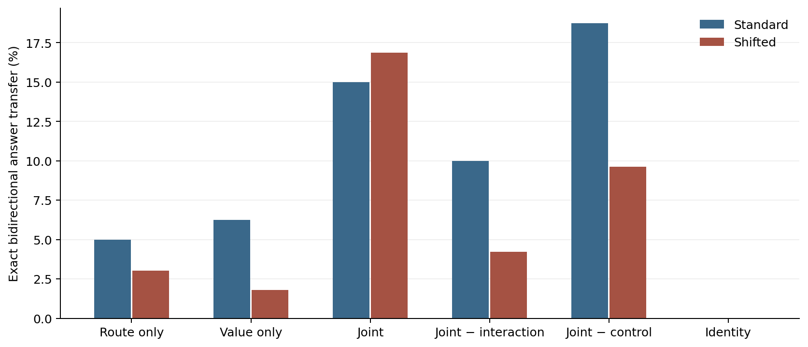

# 查表精确纠正中的注意力路由、内容与乘积

冻结 Ouro-1.4B Base。在同一个生成前缀上捕获两轮原生注意力权重 A 和内容 V，交换第 12–17 层所有有效位置的对应因子。直接在投影后的注意力向量上移除交互或匹配向量，随后模型原生归一化、MLP 和后缀自由重算。用同一题在 K1 生成真值、K2 重现原错表值作双向整答指标。

| 格式 | 题数 | 错→错 | 错→对 | 对→错 | 对→对 | 符合精确纠正条件 |
|---|---:|---:|---:|---:|---:|---:|
| standard | 384 | 96 | 81 | 15 | 192 | 80 |
| shifted | 384 | 21 | 174 | 4 | 185 | 166 |

| 格式 | 条件 | n | K1 正答 | K2 原错复现 | K2 保持正答 | 双向整答 |
|---|---|---:|---:|---:|---:|---:|
| standard | 仅路由 A | 80 | 31 | 6 | 68 | 4 |
| standard | 仅内容 V | 80 | 49 | 8 | 61 | 5 |
| standard | 联合 A/V | 80 | 67 | 17 | 55 | 12 |
| standard | 联合减交互 | 80 | 62 | 13 | 58 | 8 |
| standard | 联合减匹配对照 | 80 | 64 | 20 | 50 | 15 |
| standard | 受体自身 | 80 | 0 | 0 | 80 | 0 |
| shifted | 仅路由 A | 166 | 69 | 14 | 144 | 5 |
| shifted | 仅内容 V | 166 | 93 | 11 | 150 | 3 |
| shifted | 联合 A/V | 166 | 111 | 42 | 103 | 28 |
| shifted | 联合减交互 | 166 | 111 | 18 | 136 | 7 |
| shifted | 联合减匹配对照 | 166 | 99 | 30 | 111 | 16 |
| shifted | 受体自身 | 166 | 0 | 0 | 166 | 0 |

| 格式 | 配对比较 | 多命中 / 少命中 | 效应及区间（百分点） | 用途 |
|---|---|---:|---:|---|
| standard | 联合 − 仅路由 | 10 / 2 | +10.0 [+0.0, +21.2] | 主比较，同时区间 |
| standard | 联合 − 仅内容 | 11 / 4 | +8.8 [-3.8, +21.2] | 主比较，同时区间 |
| standard | 减匹配对照 − 减交互 | 11 / 4 | +8.8 [-3.8, +21.2] | 主比较，同时区间 |
| standard | 仅路由 − 受体自身 | 4 / 0 | +5.0 [+1.2, +10.0] | 描述，逐项区间 |
| standard | 仅内容 − 受体自身 | 5 / 0 | +6.2 [+1.2, +12.5] | 描述，逐项区间 |
| standard | 联合 − 减匹配对照 | 2 / 5 | -3.8 [-10.0, +2.5] | 描述，逐项区间 |
| shifted | 联合 − 仅路由 | 23 / 0 | +13.9 [+7.2, +21.1] | 主比较，同时区间 |
| shifted | 联合 − 仅内容 | 27 / 2 | +15.1 [+7.2, +23.5] | 主比较，同时区间 |
| shifted | 减匹配对照 − 减交互 | 13 / 4 | +5.4 [-0.6, +12.0] | 主比较，同时区间 |
| shifted | 仅路由 − 受体自身 | 5 / 0 | +3.0 [+0.6, +6.0] | 描述，逐项区间 |
| shifted | 仅内容 − 受体自身 | 3 / 0 | +1.8 [+0.0, +4.2] | 描述，逐项区间 |
| shifted | 联合 − 减匹配对照 | 15 / 3 | +7.2 [+2.4, +12.0] | 描述，逐项区间 |

本次干预的交互贡献判据未通过，预设停止条件未达到。标准和新格式中交互额外命中的校正单侧上界为 24.69 和 13.81 个百分点。

消融针对跨轮交换中定义的乘积项。完整路由或内容可携带已形成的答案状态。要确定原生 K2 是否依赖某个分量，需要在未实施联合交换的 K2 上单独验证。

固定 16 道题核验了 1152 个注入点。原生投影重建最大误差 0，因子恒等式最大误差 1.57e-05，独立逐层后缀重算最大误差 0，自身回放末端最大误差 0.000373。所有自身回放均恢复原生自由生成。

先前同题回放已确认第 12–17 层注意力写入的双向作用。更早的四头第 6 层实验用完整候选平均对数似然评估固定路由，其规则乘积效应未通过。本轮覆盖六层所有头，并以不受限生成的完整整数计分。两条实验链分别见[中层写入](../ouro_lookup_midwrites_20261121/REPORT_ZH.md)与[固定路由与受体内容](../ouro_route_content_20261121/REPORT_ZH.md)。
