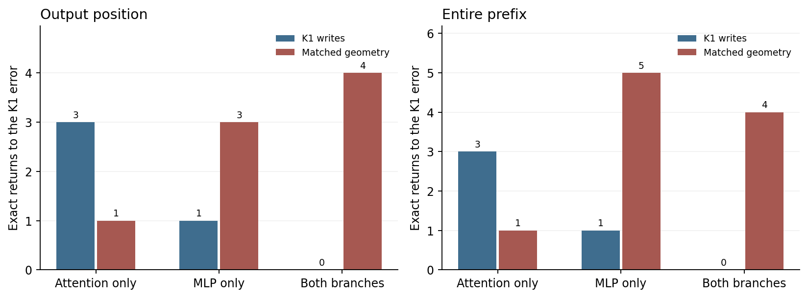

# 自然查表纠错中的后四层注意力和 MLP 写入

冻结 Ouro-1.4B Base。在当前生成前缀的原生 K2 状态上，分别回放同题 K1 的第 21–24 层注意力与 MLP 写入。输出位置和整个有效前缀作为两种范围单独检验。完整生成需重现原题的另一表项值或完整正答。

原表 448 道，原生 K1 / K2 正答分别 244 / 318 道，原错为另一表项且 K2 正确的主队列为 102 道。配对表 K2 正答 90 道，其中同样从错误表项转正答 35 道，K1 已正确 54 道。

## original，102 道

| 回放范围 | 写入来源 | 注意力原错 / 正答 | MLP 原错 / 正答 | 双回放原错 / 正答 |
|---|---|---:|---:|---:|
| local | authentic | 3 / 95 | 1 / 84 | 0 / 94 |
| local | geometry | 1 / 99 | 3 / 81 | 4 / 74 |
| full | authentic | 3 / 95 | 1 / 83 | 0 / 94 |
| full | geometry | 1 / 99 | 5 / 79 | 4 / 74 |

local 的注意力恢复、MLP 恢复和两者任一恢复即足够的计数分别为 0、0、0 道，几何为 1、4、1 道。

- local attention_dual 对几何的配对 97.5% 区间是 +0 道，+0.0 [+0.0, +0.0] 个百分点。额外成功的单侧 97.5% 上界为 3.55%，支持门槛未通过。

- local mlp_dual 对几何的配对 97.5% 区间是 -3 道，-2.9 [-6.9, +0.0] 个百分点。额外成功的单侧 97.5% 上界为 3.55%，支持门槛未通过。

- local joint_only 对几何的配对 97.5% 区间是 +0 道，+0.0 [+0.0, +0.0] 个百分点。额外成功的单侧 97.5% 上界为 3.55%，支持门槛未通过。

有符号整答交互相对几何为 +21 道，+20.6 [+8.8, +33.3] 个百分点。

full 的注意力恢复、MLP 恢复和两者任一恢复即足够的计数分别为 0、0、0 道，几何为 1、4、1 道。

- full attention_dual 对几何的配对 97.5% 区间是 +0 道，+0.0 [+0.0, +0.0] 个百分点。额外成功的单侧 97.5% 上界为 3.55%，支持门槛未通过。

- full mlp_dual 对几何的配对 97.5% 区间是 -3 道，-2.9 [-6.9, +0.0] 个百分点。额外成功的单侧 97.5% 上界为 3.55%，支持门槛未通过。

- full joint_only 对几何的配对 97.5% 区间是 +0 道，+0.0 [+0.0, +0.0] 个百分点。额外成功的单侧 97.5% 上界为 3.55%，支持门槛未通过。

有符号整答交互相对几何为 +20 道，+19.6 [+7.8, +31.4] 个百分点。

## paired_natural_repair，35 道

| 回放范围 | 写入来源 | 注意力原错 / 正答 | MLP 原错 / 正答 | 双回放原错 / 正答 |
|---|---|---:|---:|---:|
| local | authentic | 1 / 34 | 0 / 29 | 1 / 33 |
| local | geometry | 1 / 34 | 2 / 27 | 3 / 22 |
| full | authentic | 1 / 34 | 0 / 29 | 1 / 33 |
| full | geometry | 1 / 34 | 2 / 27 | 3 / 22 |

local 的注意力恢复、MLP 恢复和两者任一恢复即足够的计数分别为 0、0、0 道，几何为 2、2、1 道。

- local attention_dual 对几何的配对 97.5% 区间是 -1 道，-2.9 [-11.4, +0.0] 个百分点。额外成功的单侧 97.5% 上界为 10.00%，支持门槛未通过。

- local mlp_dual 对几何的配对 97.5% 区间是 -1 道，-2.9 [-11.4, +0.0] 个百分点。额外成功的单侧 97.5% 上界为 10.00%，支持门槛未通过。

- local joint_only 对几何的配对 97.5% 区间是 +1 道，+2.9 [+0.0, +11.4] 个百分点。额外成功的单侧 97.5% 上界为 14.92%，支持门槛未通过。

有符号整答交互相对几何为 +9 道，+25.7 [+2.9, +48.6] 个百分点。

full 的注意力恢复、MLP 恢复和两者任一恢复即足够的计数分别为 0、0、0 道，几何为 1、2、1 道。

- full attention_dual 对几何的配对 97.5% 区间是 +0 道，+0.0 [+0.0, +0.0] 个百分点。额外成功的单侧 97.5% 上界为 10.00%，支持门槛未通过。

- full mlp_dual 对几何的配对 97.5% 区间是 -1 道，-2.9 [-11.4, +0.0] 个百分点。额外成功的单侧 97.5% 上界为 10.00%，支持门槛未通过。

- full joint_only 对几何的配对 97.5% 区间是 +0 道，+0.0 [+0.0, +0.0] 个百分点。额外成功的单侧 97.5% 上界为 10.00%，支持门槛未通过。

有符号整答交互相对几何为 +9 道，+25.7 [+5.7, +48.6] 个百分点。

## paired_correct_k1，54 道

| 回放范围 | 写入来源 | 注意力原错 / 正答 | MLP 原错 / 正答 | 双回放原错 / 正答 |
|---|---|---:|---:|---:|
| local | authentic | 0 / 54 | 0 / 44 | 0 / 52 |
| local | geometry | 0 / 54 | 0 / 44 | 0 / 44 |
| full | authentic | 0 / 54 | 0 / 44 | 0 / 52 |
| full | geometry | 0 / 54 | 0 / 47 | 0 / 44 |

## paired_other_k1_error，1 道

| 回放范围 | 写入来源 | 注意力原错 / 正答 | MLP 原错 / 正答 | 双回放原错 / 正答 |
|---|---|---:|---:|---:|
| local | authentic | 0 / 1 | 0 / 1 | 0 / 1 |
| local | geometry | 0 / 1 | 0 / 1 | 0 / 0 |
| full | authentic | 0 / 1 | 0 / 1 | 0 / 1 |
| full | geometry | 0 / 1 | 0 / 1 | 0 / 0 |

## 物理回放核对

固定 24 道原表诊断题验证无改动回放及末层预归一化残差的加法恒等式，最大绝对误差 3.58e-06。原表两个空间范围的三项 10% 门槛均通过。该判定只约束预设的整答模式及后四层回放。

