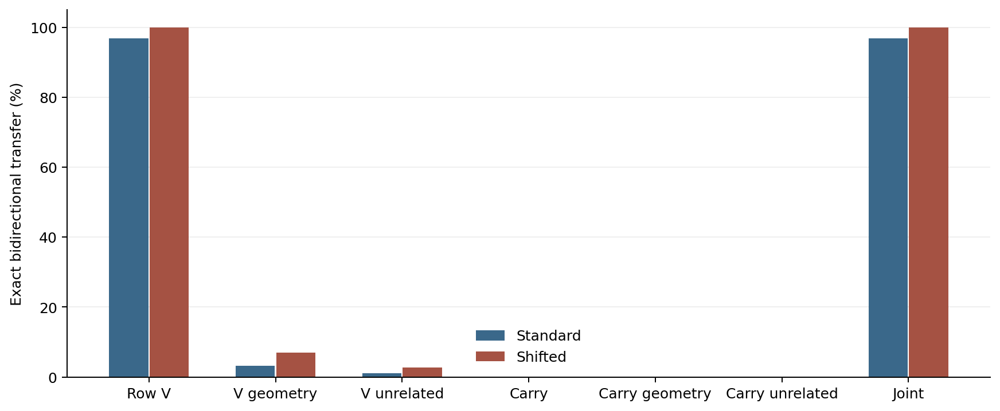

# 目标表项 V 与入轮答前残差的冲突

冻结 Ouro-1.4B Base。两张表只交换目标值与一个合法替代值，保留查询键。在当前生成前缀，从另一表移入 K2 各层目标行数字位置的 V，或移入 K2 起点的最后位置残差。单项交换让两个来源分别指向不同值。K2 的 Q、K、注意力权重和其余计算随干预状态重算。主终点要求同一题两个方向的自由生成均输出完整供体表值。

| 格式 | 原始题数 | 精确自然纠正 | 纠正对齐 / 合格 | 稳定题样本 | 稳定对齐 / 合格 |
|---|---:|---:|---:|---:|---:|
| standard | 448 | 112 | 112 / 95 | 64 | 64 / 52 |
| shifted | 448 | 205 | 205 / 185 | 64 | 64 / 57 |

| 格式 | 题组 | 干预 | 原表供体 / 受体 / 其他 | 交换表供体 / 受体 / 其他 | 双向供体 |
|---|---|---|---:|---:|---:|
| standard | 纠正 | 目标行 V | 94 / 0 / 1 | 93 / 0 / 2 | 92 |
| standard | 纠正 | V 几何 | 23 / 35 / 37 | 10 / 49 / 36 | 3 |
| standard | 纠正 | V 无关行 | 8 / 73 / 14 | 5 / 82 / 8 | 1 |
| standard | 纠正 | 入轮残差 | 0 / 95 / 0 | 0 / 95 / 0 | 0 |
| standard | 纠正 | 残差几何 | 0 / 95 / 0 | 0 / 93 / 2 | 0 |
| standard | 纠正 | 残差无关行 | 0 / 95 / 0 | 0 / 95 / 0 | 0 |
| standard | 纠正 | 共同交换 | 94 / 0 / 1 | 93 / 0 / 2 | 92 |
| standard | 纠正 | 自身回放 | 0 / 95 / 0 | 0 / 95 / 0 | 0 |
| standard | 稳定 | 目标行 V | 50 / 0 / 2 | 52 / 0 / 0 | 50 |
| standard | 稳定 | V 几何 | 11 / 23 / 18 | 11 / 19 / 22 | 3 |
| standard | 稳定 | V 无关行 | 1 / 50 / 1 | 2 / 47 / 3 | 0 |
| standard | 稳定 | 入轮残差 | 0 / 52 / 0 | 2 / 50 / 0 | 0 |
| standard | 稳定 | 残差几何 | 0 / 50 / 2 | 1 / 49 / 2 | 0 |
| standard | 稳定 | 残差无关行 | 0 / 52 / 0 | 0 / 52 / 0 | 0 |
| standard | 稳定 | 共同交换 | 51 / 0 / 1 | 52 / 0 / 0 | 51 |
| standard | 稳定 | 自身回放 | 0 / 52 / 0 | 0 / 52 / 0 | 0 |
| shifted | 纠正 | 目标行 V | 185 / 0 / 0 | 185 / 0 / 0 | 185 |
| shifted | 纠正 | V 几何 | 63 / 76 / 46 | 30 / 94 / 61 | 13 |
| shifted | 纠正 | V 无关行 | 24 / 141 / 20 | 13 / 159 / 13 | 5 |
| shifted | 纠正 | 入轮残差 | 0 / 185 / 0 | 0 / 185 / 0 | 0 |
| shifted | 纠正 | 残差几何 | 2 / 182 / 1 | 1 / 181 / 3 | 0 |
| shifted | 纠正 | 残差无关行 | 1 / 183 / 1 | 0 / 185 / 0 | 0 |
| shifted | 纠正 | 共同交换 | 185 / 0 / 0 | 185 / 0 / 0 | 185 |
| shifted | 纠正 | 自身回放 | 0 / 185 / 0 | 0 / 185 / 0 | 0 |
| shifted | 稳定 | 目标行 V | 57 / 0 / 0 | 57 / 0 / 0 | 57 |
| shifted | 稳定 | V 几何 | 7 / 33 / 17 | 11 / 33 / 13 | 3 |
| shifted | 稳定 | V 无关行 | 2 / 51 / 4 | 4 / 50 / 3 | 2 |
| shifted | 稳定 | 入轮残差 | 1 / 56 / 0 | 0 / 56 / 1 | 0 |
| shifted | 稳定 | 残差几何 | 0 / 55 / 2 | 0 / 55 / 2 | 0 |
| shifted | 稳定 | 残差无关行 | 0 / 57 / 0 | 0 / 56 / 1 | 0 |
| shifted | 稳定 | 共同交换 | 57 / 0 / 0 | 57 / 0 / 0 | 57 |
| shifted | 稳定 | 自身回放 | 0 / 57 / 0 | 0 / 57 / 0 | 0 |

| 格式 | 路径 | 对照 | 多 / 少双向命中 | 同时区间（百分点） | 校正上界（百分点） |
|---|---|---|---:|---:|---:|
| standard | 目标行 V | V 几何 | 89 / 0 | +93.7 [+86.3, +98.9] | 98.50 |
| standard | 目标行 V | V 无关行 | 91 / 0 | +95.8 [+89.5, +100.0] | 99.37 |
| standard | 入轮残差 | 残差几何 | 0 / 0 | +0.0 [+0.0, +0.0] | 5.89 |
| standard | 入轮残差 | 残差无关行 | 0 / 0 | +0.0 [+0.0, +0.0] | 5.89 |
| shifted | 目标行 V | V 几何 | 172 / 0 | +93.0 [+87.6, +97.3] | 97.10 |
| shifted | 目标行 V | V 无关行 | 180 / 0 | +97.3 [+93.5, +100.0] | 99.48 |
| shifted | 入轮残差 | 残差几何 | 0 / 0 | +0.0 [+0.0, +0.0] | 3.07 |
| shifted | 入轮残差 | 残差无关行 | 0 / 0 | +0.0 [+0.0, +0.0] | 3.07 |

两种格式均通过定向双向转移门槛的路径为 目标行 V。两种格式均排除相对对照达 10 个百分点的路径为 入轮残差。
standard 中目标行 V 减入轮残差的双向效果差为 +96.8 [+92.6, +100.0] 个百分点，使用描述性逐项区间。
shifted 中目标行 V 减入轮残差的双向效果差为 +100.0 [+100.0, +100.0] 个百分点，使用描述性逐项区间。

无关行位移为零时回退到几何控制。V 有 1,005,696/5,377,536 个头与位置回退，残差有 0/4,668 个位置回退。
固定 16 个题对核验 3840 次 V 安装、160 次残差安装和 256 次生成位置上的实际 AV。仅改最后位置残差时，较早目标行 V 的最大偏差为 1.61e-05，实际 AV 独立核算最大偏差 2.86e-06。所有自身回放均复现干净整答。

按实际生成前缀反复移植可检验携带内容的可用性。几何匹配在每条路径内部完成。目标行操作覆盖多层多位置，入轮残差操作只覆盖一个位置，因此两路径间的整答率差是本实验条件下的比较。原生必要性和贡献比例需另证。

先前跨表残差实验在固定后续写入时，第 18 层入口首次同时通过跨轮和跨表标准，新格式在入轮已有单独的跨表信号。本轮后续写入随干预状态重算，并将入轮最后位置与目标行数字位置分开。相关协议与原始数据见[五个层界的残差交换](../ouro_lookup_onset_20261121/REPORT_ZH.md)。
