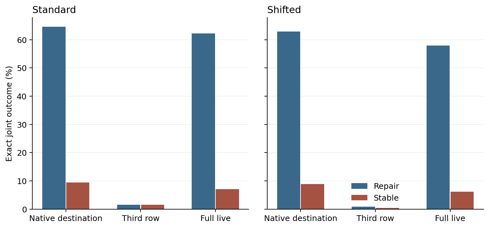

# 查表纠正的全剂量目的行对照

冻结 Ouro-1.4B Base。每个实际生成前缀上，用受体干净前向中四个值行的数字位置建立共同参考。按供体的原生两行分配，从同一源行数字扣除完全相同的向量。原生臂把这份量加到供体指定的目的行，第三行臂沿相同的数字权重加到预先固定的第三行。其他位置保持实时相对权重，并共同缩放到剩余质量。V 和后续运算保持实时计算。上一轮的全实时路由作为单独的诊断。

| 格式 | 原始题数 | 精确纠正 | 两轮均正确 |
|---|---:|---:|---:|
| standard | 512 | 127 | 227 |
| shifted | 512 | 226 | 247 |

| 格式 | 题组 | 条件 | n | K1 正答 / K2 原错 / 同时 | K1 第三行 / K2 第三行 / 同时 |
|---|---|---|---:|---:|---:|
| standard | repair | 原生目的行 | 127 | 116 / 86 / 82 | 2 / 5 / 0 |
| standard | repair | 第三行 | 127 | 26 / 6 / 2 | 86 / 62 / 53 |
| standard | repair | 全实时路由 | 127 | 111 / 87 / 79 | 2 / 4 / 0 |
| standard | repair | 共同参考自身回放 | 127 | 0 / 0 / 0 | 0 / 0 / 0 |
| standard | projected | 原生目的行 | 106 | 98 / 69 / 67 | 2 / 5 / 0 |
| standard | projected | 第三行 | 106 | 18 / 4 / 1 | 75 / 57 / 48 |
| standard | projected | 全实时路由 | 106 | 93 / 69 / 63 | 2 / 4 / 0 |
| standard | projected | 共同参考自身回放 | 106 | 0 / 0 / 0 | 0 / 0 / 0 |
| standard | stable | 原生目的行 | 127 | 119 / 12 / 12 | 2 / 0 / 0 |
| standard | stable | 第三行 | 127 | 103 / 2 / 2 | 19 / 1 / 1 |
| standard | stable | 全实时路由 | 127 | 120 / 9 / 9 | 1 / 0 / 0 |
| standard | stable | 共同参考自身回放 | 127 | 127 / 0 / 0 | 0 / 0 / 0 |
| shifted | repair | 原生目的行 | 226 | 200 / 159 / 142 | 0 / 5 / 0 |
| shifted | repair | 第三行 | 226 | 32 / 23 / 2 | 135 / 110 / 88 |
| shifted | repair | 全实时路由 | 226 | 195 / 150 / 131 | 0 / 2 / 0 |
| shifted | repair | 共同参考自身回放 | 226 | 0 / 0 / 0 | 0 / 0 / 0 |
| shifted | projected | 原生目的行 | 177 | 155 / 120 / 107 | 0 / 5 / 0 |
| shifted | projected | 第三行 | 177 | 23 / 12 / 2 | 117 / 93 / 77 |
| shifted | projected | 全实时路由 | 177 | 151 / 114 / 99 | 0 / 2 / 0 |
| shifted | projected | 共同参考自身回放 | 177 | 0 / 0 / 0 | 0 / 0 / 0 |
| shifted | stable | 原生目的行 | 226 | 215 / 20 / 20 | 4 / 0 / 0 |
| shifted | stable | 第三行 | 226 | 143 / 3 / 1 | 65 / 11 / 6 |
| shifted | stable | 全实时路由 | 226 | 216 / 14 / 14 | 3 / 0 / 0 |
| shifted | stable | 共同参考自身回放 | 226 | 226 / 0 / 0 | 0 / 0 / 0 |

稳定题的同时事件指 K1 保持正答且 K2 输出预选替代值。第三行是同一题实际存在的另一行。匹配子集按干净前向、首个预测前缀的 OV 投影范数筛选，匹配区间为比值 0.8–1.25。后续生成前缀随干预而变化。

| 格式 | 自然纠正差（百分点） | OV 参考匹配差（百分点） | 稳定组配对特异性（百分点） | 方向校正上界 |
|---|---:|---:|---:|---:|
| standard | +63.0 [+51.2, +74.0] | +62.3 [+50.0, +74.5] | +55.1 [+40.9, +68.5] | 72.48 |
| shifted | +61.9 [+53.5, +70.4] | +59.3 [+49.7, +68.9] | +53.5 [+43.8, +63.0] | 69.16 |

跨格式目的行特异性判据通过，预设等效上界判据未达到。
standard 中 106/127 道满足两个方向的 OV 参考剂量匹配。第三行与原生目标的参考比值中位数为 0.986（K1）和 1.019（K2）。
shifted 中 177/226 道满足两个方向的 OV 参考剂量匹配。第三行与原生目标的参考比值中位数为 1.011（K1）和 1.020（K2）。

核验 3072 次物理注意力计算。逐数字源扣减差 0，安装后的平方范数差 7.45e-09，注意力概率总量差 3.58e-07，OV 逐头复算差 3.1e-06。全部自身回放与原生整答一致。

上一轮通过全实时双向诊断发现强效应。本轮用共同路由参考构造精确扣减对照，另保留全实时臂。[前序两行路由研究](../ouro_lookup_routing_20261122/REPORT_ZH.md)
