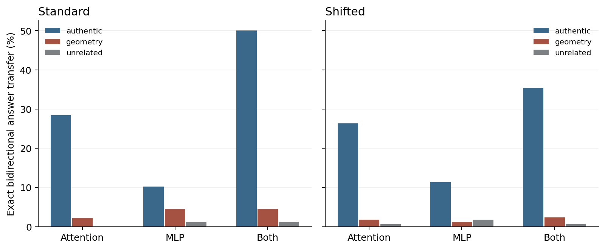

# 第 12–17 层原生写入能否双向改变查表答案

在冻结的 Ouro-1.4B Base 上，两轮都从受体本来的状态运行。只交换第 12–17 层有效前缀中的指定注意力或 MLP 写入，第 18–24 层自由重算。每次生成按各干预实际产生的前缀重新采集供体写入。双向命中要求同一道题的 K1 生成真值，K2 重现原来的错误表值。

| 格式 | 总题数 | 错→错 | 错→对 | 对→错 | 对→对 | 合格自然纠正 |
|---|---:|---:|---:|---:|---:|---:|
| standard | 384 | 87 | 89 | 25 | 183 | 88 |
| shifted | 384 | 23 | 176 | 4 | 181 | 167 |

| 格式 | 写入 | n | 真实恢复 / 回退 / 双向 | 几何恢复 / 回退 / 双向 | 无关恢复 / 回退 / 双向 |
|---|---|---:|---:|---:|---:|
| standard | 注意力 | 88 | 76 / 32 / 25 | 22 / 11 / 2 | 19 / 5 / 0 |
| standard | MLP | 88 | 13 / 23 / 9 | 28 / 11 / 4 | 19 / 13 / 1 |
| standard | 联合 | 88 | 82 / 47 / 44 | 38 / 15 / 4 | 21 / 4 / 1 |
| shifted | 注意力 | 167 | 123 / 58 / 44 | 37 / 5 / 3 | 24 / 6 / 1 |
| shifted | MLP | 167 | 50 / 36 / 19 | 43 / 4 / 2 | 33 / 17 / 3 |
| shifted | 联合 | 167 | 127 / 69 / 59 | 25 / 7 / 4 | 28 / 7 / 1 |

下列计数补全真实写入交换后的 K2 输出分布。
- standard。注意力保留正答 48/88，其他结果 8/88。MLP保留正答 59/88，其他结果 6/88。联合保留正答 34/88，其他结果 7/88。
- shifted。注意力保留正答 100/167，其他结果 9/167。MLP保留正答 121/167，其他结果 10/167。联合保留正答 75/167，其他结果 23/167。

| 格式 | 写入 | 对照 | 多命中 / 少命中 | 净效应〔同时区间〕（百分点） | 单侧上界 / 校正上界（百分点） |
|---|---|---|---:|---:|---:|
| standard | 注意力 | geometry | 23 / 0 | +26.1〔+13.6, +39.8〕 | 36.59 / 41.40 |
| standard | 注意力 | unrelated | 25 / 0 | +28.4〔+14.8, +42.0〕 | 39.02 / 43.86 |
| standard | MLP | geometry | 8 / 3 | +5.7〔-4.5, +17.0〕 | 17.13 / 21.22 |
| standard | MLP | unrelated | 9 / 1 | +9.1〔+0.0, +19.3〕 | 18.53 / 22.71 |
| standard | 联合 | geometry | 41 / 1 | +45.5〔+29.5, +61.4〕 | 57.54 / 62.20 |
| standard | 联合 | unrelated | 43 / 0 | +48.9〔+34.1, +63.6〕 | 59.75 / 64.35 |
| shifted | 注意力 | geometry | 44 / 3 | +24.6〔+14.4, +35.3〕 | 33.71 / 37.13 |
| shifted | 注意力 | unrelated | 43 / 0 | +25.7〔+16.8, +35.9〕 | 33.08 / 36.48 |
| shifted | MLP | geometry | 18 / 1 | +10.2〔+3.6, +18.0〕 | 16.50 / 19.34 |
| shifted | MLP | unrelated | 19 / 3 | +9.6〔+2.4, +18.0〕 | 17.20 / 20.07 |
| shifted | 联合 | geometry | 58 / 3 | +32.9〔+22.2, +44.3〕 | 42.47 / 45.98 |
| shifted | 联合 | unrelated | 58 / 0 | +34.7〔+24.6, +45.5〕 | 42.47 / 45.98 |

两种格式均通过双向判据的写入条件为 注意力、联合。同时校正后的最大单侧上界为 64.35 个百分点。预设的区间回放停止条件未达到。

所有受体原生写入回放都恢复了原生成。固定 16 题核验 1152 个注入点。直接重算后缀时末端残差最大偏差 0；受体自身写入回放最大偏差 0.000107。
无关行控制中，12,449,166/17,835,588 个写入位置缺少可缩放的方向，按预设回退到几何控制。此比例纳入对无关行结果的解释。

## 与状态及候选路由证据的关系

第 18 层入口的残差交换曾在冻结受体后续写入时双向改变整答，本轮检验的是更早的完整分支写入在自由重算下能否产生同样的语义变化。单层 Q 的跨表地址转移和双向判据曾失败。两个实验的处理变量与下游条件不同，不能相加为一个中介比例。相关来源为[五边界残差实验](../ouro_lookup_onset_20261121/REPORT_ZH.md)和[单层 Q 实验](../ouro_lookup_query_20261121/REPORT_ZH.md)。
