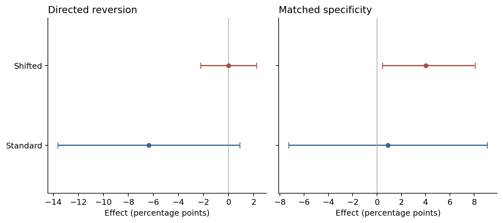

# 原生 K2 注意力交互项删除

固定 Ouro-1.4B Base。每次生成先计算同一前缀的干净 K1、K2，再从重新运行的 K2 第 12–17 层实时注意力投影中减去两轮的路由–内容乘积位移。其他注意力写入、归一化和 MLP 继续随受扰状态计算。几何对照匹配每个位置的投影位移范数与相对干净 K2 投影的径向分量。

| 格式 | 题数 | 错→错 | 错→对 | 对→错 | 对→对 | 精确纠正 |
|---|---:|---:|---:|---:|---:|---:|
| standard | 512 | 136 | 110 | 29 | 237 | 110 |
| shifted | 512 | 22 | 229 | 11 | 250 | 223 |

| 格式 | 题组 | 全部 n | 定向 n | 真实删除，定向 / 任意错 | 几何删除，定向 / 任意错 | 零删除，定向 / 任意错 |
|---|---|---:|---:|---:|---:|---:|
| standard | 自然纠正 | 110 | 110 | 2 / 3 | 9 / 22 | 0 / 0 |
| standard | 原生稳定 | 237 | 237 | 1 / 2 | 19 / 19 | 0 / 0 |
| shifted | 自然纠正 | 223 | 223 | 3 / 4 | 3 / 11 | 0 / 0 |
| shifted | 原生稳定 | 250 | 250 | 1 / 2 | 10 / 11 | 0 / 0 |

自然纠正组的定向终点为同题 K1 实际生成的原错表值。稳定组为干净 K2 最接近的其他表值。按首次数字分歧的干净 K2 logit 差做无放回匹配。

| 格式 | 纠正组额外 / 减少 | 纠正组定向效应（百分点） | 匹配数 | 分差均值 / 最大 | 匹配特异性（百分点） | 定向效应同时上界（百分点） |
|---|---:|---:|---:|---:|---:|---:|
| standard | 2 / 9 | -6.4 [-13.6, +0.9] | 110 | 0.09 / 1.04 | +0.9 [-7.3, +9.1] | 7.18 |
| shifted | 2 / 2 | +0.0 [-2.2, +2.2] | 223 | 0.30 / 1.99 | +4.0 [+0.4, +8.1] | 3.59 |

上表是四项主比较的同时区间。下表为描述性逐项 95% 区间。

| 格式 | 纠正组任意错 | 稳定组任意错 | 稳定组定向 |
|---|---:|---:|---:|
| standard | -17.3 [-25.5, -10.0] | -7.2 [-11.0, -3.8] | -7.6 [-11.0, -4.2] |
| shifted | -3.1 [-6.3, +0.0] | -3.6 [-6.4, -0.8] | -3.6 [-6.4, -1.2] |

按预设标准，原生路径依赖判据未通过，10 个百分点的定向效应可排除。
固定 32 道题核验 576 次现场删除，实时投影差误差 9.54e-07，因子等式误差 1.57e-05，后缀独立重算误差 0。零删除的全体完整生成与干净 K2 一致。

此前联合交换的乘积消融未达到确认门槛。本轮以原生 K2 为起点，并保留受扰状态下实时重算的注意力。前序结果见[注意力因子交换](../ouro_lookup_av_20261121/REPORT_ZH.md)。
