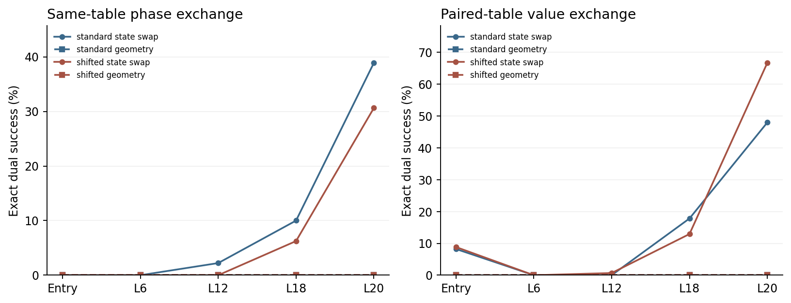

# 冻结后续写入时，查表值在何处变得可用

使用冻结的 Ouro-1.4B Base 与自然完整整数生成。五个位置预先固定。分别交换同题两轮的残差和同轮两表的残差，之后每一层保留受体本来的注意力、MLP 写入。用改变当前末 token 的残差差值与原生 RMSNorm、LM 头得到下一 token，并用物理回放核对。第二分布同时改变键名和表格样式。

| 分布 | 原生 K1 正答 | 原生 K2 正答 | 精确自然纠正 | 合格配对表 |
|---|---:|---:|---:|---:|
| standard | 198/384 | 264/384 | 90 | 73 |
| shifted | 194/384 | 361/384 | 160 | 147 |

## 同题跨轮的完整整数

| 层界 | 分布 | n | 真状态正向 / 反向 / 双向 | 几何双向 | 无关双向 |
|---|---|---:|---:|---:|---:|
| 入轮 | standard | 90 | 15 / 0 / 0 | 0 | — |
| 入轮 | shifted | 160 | 9 / 0 / 0 | 0 | — |
| 第 6 层入口 | standard | 90 | 1 / 0 / 0 | 0 | — |
| 第 6 层入口 | shifted | 160 | 10 / 0 / 0 | 0 | — |
| 第 12 层入口 | standard | 90 | 9 / 3 / 2 | 0 | — |
| 第 12 层入口 | shifted | 160 | 27 / 5 / 0 | 0 | — |
| 第 18 层入口 | standard | 90 | 60 / 13 / 9 | 0 | — |
| 第 18 层入口 | shifted | 160 | 86 / 22 / 10 | 0 | — |
| 第 20 层入口 | standard | 90 | 75 / 40 / 35 | 0 | — |
| 第 20 层入口 | shifted | 160 | 122 / 65 / 49 | 0 | — |

## 同轮跨表的完整整数

| 层界 | 分布 | n | 真状态正向 / 反向 / 双向 | 几何双向 | 无关双向 |
|---|---|---:|---:|---:|---:|
| 入轮 | standard | 73 | 12 / 9 / 6 | 0 | 0 |
| 入轮 | shifted | 147 | 22 / 19 / 13 | 0 | 1 |
| 第 6 层入口 | standard | 73 | 0 / 0 / 0 | 0 | 0 |
| 第 6 层入口 | shifted | 147 | 0 / 0 / 0 | 0 | 0 |
| 第 12 层入口 | standard | 73 | 1 / 0 / 0 | 0 | 0 |
| 第 12 层入口 | shifted | 147 | 3 / 3 / 1 | 0 | 0 |
| 第 18 层入口 | standard | 73 | 30 / 16 / 13 | 0 | 0 |
| 第 18 层入口 | shifted | 147 | 47 / 24 / 19 | 0 | 0 |
| 第 20 层入口 | standard | 73 | 52 / 44 / 35 | 0 | 0 |
| 第 20 层入口 | shifted | 147 | 128 / 103 / 98 | 0 | 0 |

## 预设判定

下表每格为真实双向命中减匹配对照的百分点差及同时区间。区间按 30 项 Bonferroni 家族校正。

- 入轮，standard。跨轮对几何 +0.0 [+0.0, +0.0]。跨表对几何 +8.2 [+0.0, +19.2]，对无关值 +8.2 [+0.0, +19.2]。

- 入轮，shifted。跨轮对几何 +0.0 [+0.0, +0.0]。跨表对几何 +8.8 [+2.0, +17.0]，对无关值 +8.2 [+1.4, +16.3]。

- 第 6 层入口，standard。跨轮对几何 +0.0 [+0.0, +0.0]。跨表对几何 +0.0 [+0.0, +0.0]，对无关值 +0.0 [+0.0, +0.0]。

- 第 6 层入口，shifted。跨轮对几何 +0.0 [+0.0, +0.0]。跨表对几何 +0.0 [+0.0, +0.0]，对无关值 +0.0 [+0.0, +0.0]。

- 第 12 层入口，standard。跨轮对几何 +2.2 [+0.0, +7.8]。跨表对几何 +0.0 [+0.0, +0.0]，对无关值 +0.0 [+0.0, +0.0]。

- 第 12 层入口，shifted。跨轮对几何 +0.0 [+0.0, +0.0]。跨表对几何 +0.7 [+0.0, +3.4]，对无关值 +0.7 [+0.0, +3.4]。

- 第 18 层入口，standard。跨轮对几何 +10.0 [+2.2, +21.1]。跨表对几何 +17.8 [+5.5, +32.9]，对无关值 +17.8 [+5.5, +32.9]。

- 第 18 层入口，shifted。跨轮对几何 +6.2 [+1.2, +13.1]。跨表对几何 +12.9 [+4.8, +22.4]，对无关值 +12.9 [+4.8, +22.4]。

- 第 20 层入口，standard。跨轮对几何 +38.9 [+23.3, +55.6]。跨表对几何 +47.9 [+30.1, +65.8]，对无关值 +47.9 [+30.1, +65.8]。

- 第 20 层入口，shifted。跨轮对几何 +30.6 [+20.0, +42.5]。跨表对几何 +66.7 [+53.7, +78.9]，对无关值 +66.7 [+53.7, +78.9]。

第 20 层配对参照通过。最早通过跨轮与跨表的边界为 第 18 层入口。

前一测试点为 第 12 层入口。其两个分布与各对照的单侧 97.5% 最大上界 7.80%，跨五层保守最大上界 9.90%。预设的联合效应区间判据通过。

新格式在入轮时已达到同轮跨表判据。真状态双向 13/147，几何对照 0/147，无关行对照 1/147。因此区间只定位跨轮纠错与跨表值转移同时通过的边界。单独的跨表信号随层界非单调，且可能依赖锁定的后续写入。

固定 16 个题对执行 320 次实际物理回放，末端残差和加法预测的最大绝对误差为 8.34e-06。结论取决于这组固定读取条件和实际生成；未测试的中间层以及其他读取方式仍可能不同。

