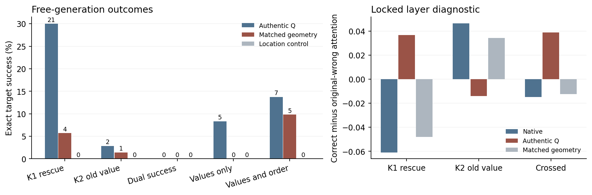

# 查表任务的单层输出查询 Q 双向干预

冻结 Ouro-1.4B Base。保留受体原生的 K 和 V，在一个物理层的当前输出位置替换全部查询头的 Q。每个输出 token 重新执行干预，判分使用完整整数。键值重排保留同一组整数，并将原答案移到另一键。

| 320 道确认题 | K1 正答 | K2 正答 | 错转对 | 其他表值转正答 | 对转错 |
|---|---:|---:|---:|---:|---:|
| original | 163 | 211 | 70 | 70 | 22 |
| values | 162 | 224 | 74 | 74 | 12 |
| crossed | 168 | 225 | 83 | 83 | 26 |

开发集仅按注意力差锁定物理第 20 层。依据为 12 道从其他表项值转正答的题，正确表项减原错表项的平均注意力变化为 +0.0621。

| 终点 | 道数 | 真 Q 命中 | 等角等范数 | 分号位置对照 | 真 Q 命中原供体值 |
|---|---:|---:|---:|---:|---:|
| K1 恢复正确值 | 70 | 21 | 4 | 0 | — |
| K2 重现原错 | 70 | 2 | 1 | 0 | — |
| 同题同时救回及回退 | 70 | 0 | 0 | 0 | — |
| 只换值 | 60 | 5 | 0 | 0 | 25 |
| 换值并换行 | 51 | 7 | 5 | 0 | 12 |

迁移队列与原题自然纠正队列重叠 27（只换值）和 22（换值并换行）道。迁移按新表实际 K1 错、K2 对且源表 K2 正确判定，因此规模可以不同。

## 对照结果

- rescue 对 geometry 的配对 97.5% 区间为 +17 道，+24.3 [+12.9, +37.1] 个百分点。
- rescue 对 location 的配对 97.5% 区间为 +21 道，+30.0 [+18.6, +42.9] 个百分点。
- reversal 对 geometry 的配对 97.5% 区间为 +1 道，+1.4 [+0.0, +5.7] 个百分点。
- reversal 对 location 的配对 97.5% 区间为 +2 道，+2.9 [+0.0, +8.6] 个百分点。
- dual 对 geometry 的配对 97.5% 区间为 +0 道，+0.0 [+0.0, +0.0] 个百分点。
- dual 对 location 的配对 97.5% 区间为 +0 道，+0.0 [+0.0, +0.0] 个百分点。
- values 对 geometry 的配对 97.5% 区间为 +5 道，+8.3 [+1.7, +16.7] 个百分点。
- values 对 location 的配对 97.5% 区间为 +5 道，+8.3 [+1.7, +16.7] 个百分点。
- crossed 对 geometry 的配对 97.5% 区间为 +2 道，+3.9 [-7.8, +15.7] 个百分点。
- crossed 对 location 的配对 97.5% 区间为 +7 道，+13.7 [+3.9, +25.5] 个百分点。

真实 Q 相比 geometry 的额外双向成功为 0/70 个答案簇，单侧 97.5% 上界 5.13%。

真实 Q 相比 location 的额外双向成功为 0/70 个答案簇，单侧 97.5% 上界 5.13%。

bidirectional 未通过。

address_transfer 未通过。

exclude_large_dual 通过。

诊断图按固定子集记录正确表项和原错表项的注意力质量差。该指标只作路由诊断，整答和双向结果分别检验。分号对照匹配位移范数及相对受体 Q 的径向比例，位置不同可拥有不同原始 Q 范数。

本轮约束锁定层的输出查询和该查表协议。原生 K1→K2 增益还可来自表项键值、较早的查询形成、其他层或多处共同计算。
