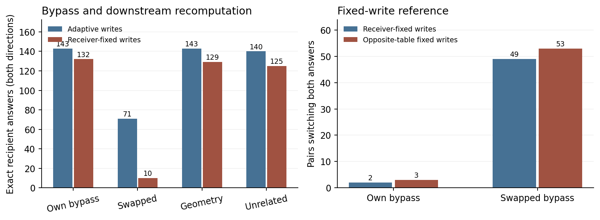

# 从第 20 层残差旁路和后续写入追踪查表答案

在冻结的 Ouro-1.4B Base 中，先把 K2 输出位置的第 20 层 Q 换为同一输入的 K1 Q。在该层完成真实注意力和 MLP 写入后，只加上另一表的第 20 层原始输入与受体原始输入之差，从而单独替换残差旁路。后续四层按条件重算，或回放指定表的原生 A/MLP 写入。

384 道原题的原生 K1 / K2 正答各为 196 和 262，89 道由错误表值转为正答。符合四组 K2 均正确条件的独立表对为 73。

| 干预 | 原表正确 | 原表跟随配对值 | 配对表正确 | 配对表跟随原值 | 同对双向转移 |
|---|---:|---:|---:|---:|---:|
| native | 73 | 0 | 73 | 0 | 0 |
| own_adaptive | 71 | 2 | 72 | 1 | 1 |
| swap_adaptive | 21 | 51 | 50 | 19 | 10 |
| geometry_adaptive | 70 | 2 | 73 | 0 | 0 |
| irrelevant_adaptive | 67 | 2 | 73 | 0 | 0 |
| own_locked | 62 | 8 | 70 | 2 | 2 |
| swap_locked | 2 | 65 | 8 | 53 | 49 |
| geometry_locked | 60 | 10 | 69 | 3 | 2 |
| irrelevant_locked | 60 | 6 | 65 | 3 | 0 |
| own_fixed_other | 53 | 7 | 64 | 3 | 3 |
| swap_fixed_other | 1 | 70 | 13 | 55 | 53 |

## 预设机制判定

在真实旁路互换条件下，允许后续层重算比固定写入多救回 61 个受体方向，也有 0 个方向反转为错误。

- geometry 对照下，双向转移差 +47 次，+64.4 [+50.7, +76.7] 个百分点，后层重算特异效应 +47 次，+32.2 [+21.9, +41.8] 个百分点。

- irrelevant 对照下，双向转移差 +49 次，+67.1 [+54.8, +79.5] 个百分点，后层重算特异效应 +46 次，+31.5 [+20.5, +41.8] 个百分点。

- geometry 的残差转移与后层补偿额外事件率单侧 97.5% 上界分别为 76.47%、82.39%。

- irrelevant 的残差转移与后层补偿额外事件率单侧 97.5% 上界分别为 77.67%、78.87%。

residual 通过。

compensation 通过。

exclude_large_residual 未通过。

exclude_large_compensation 未通过。

## 事后按受体方向分层

配对表有 40/73 道在 K1 已答对。以下分层只描述合并效应来源，保留预设的合并判定。

原表自然纠正方向相对几何、无关换值对照的重算效应，分别为 +9 次，+12.3 [-4.1, +28.8] 个百分点、+12 次，+16.4 [+1.4, +31.5] 个百分点。

配对表方向相对几何、无关换值对照的重算效应，分别为 +38 次，+52.1 [+37.0, +67.1] 个百分点、+34 次，+46.6 [+30.1, +61.6] 个百分点。

## 回放参考与代数校验

- 对 own 旁路，改用另一表的固定写入时，输出转向另一表值的配对变化为 +0 次，+0.0 [-5.5, +6.2] 个百分点。
- 对 swap 旁路，改用另一表的固定写入时，输出转向另一表值的配对变化为 +7 次，+4.8 [-6.2, +15.8] 个百分点。

固定 24 对诊断题的第 20 层 K/V、真实分支写入及最后一层残差均通过检查。固定后续写入时，末层归一化前的实测差与注入旁路差的最大绝对偏差为 3.93e-06。所有干预对每个实际生成 token 重算。

固定写入来自某个正常计算参考，参考状态可携带表值。两种参考都保留在表中。剩余推断限于该确认集、第 20 层答前位置和这类配对交换。
