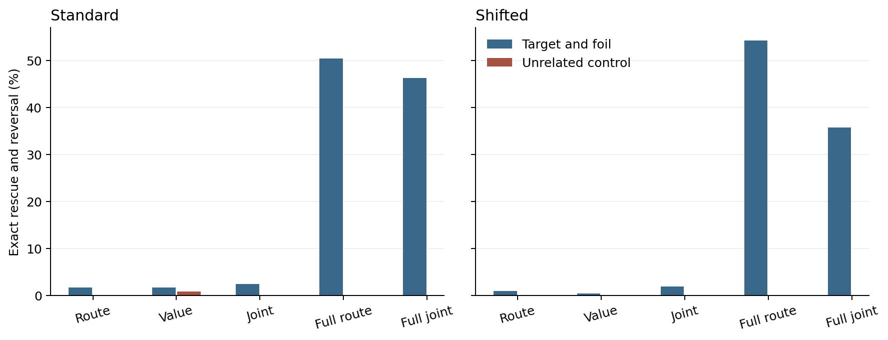

# 查表自然纠正中的两行路由与内容

冻结 Ouro-1.4B Base。在同一前缀上分别交换两轮的注意力分配和 V。路由只在表格完整可见后移动正确行与原错行数字位置之间的注意力质量。V 交换覆盖这两行数字位置的原生值向量。所有层的其余注意力和后续运算接受受扰输入并自由重算。

| 格式 | 原表题数 | 精确自然纠正 | 原生两轮均正确 |
|---|---:|---:|---:|
| standard | 512 | 121 | 241 |
| shifted | 512 | 210 | 254 |

| 格式 | 干预 | 纠正 n | K1 救回 / K2 原错 / 双向 | 匹配稳定 n | K1 保持 / K2 替代 / 双向 |
|---|---|---:|---:|---:|---:|
| standard | 路由 | 121 | 45 / 6 / 2 | 121 | 116 / 1 / 1 |
| standard | 内容 V | 121 | 16 / 13 / 2 | 121 | 100 / 15 / 14 |
| standard | 联合 | 121 | 38 / 18 / 3 | 121 | 98 / 17 / 15 |
| standard | 路由对照 | 121 | 9 / 0 / 0 | 121 | 112 / 0 / 0 |
| standard | V 对照 | 121 | 23 / 6 / 1 | 121 | 115 / 2 / 2 |
| standard | 联合对照 | 121 | 20 / 5 / 0 | 121 | 116 / 1 / 1 |
| standard | 全剂量路由 | 121 | 105 / 70 / 61 | 121 | 112 / 5 / 5 |
| standard | 全剂量联合 | 121 | 93 / 76 / 56 | 121 | 97 / 6 / 6 |
| standard | 自身回放 | 121 | 0 / 0 / 0 | 121 | 121 / 0 / 0 |
| shifted | 路由 | 210 | 112 / 5 / 2 | 210 | 197 / 3 / 3 |
| shifted | 内容 V | 210 | 12 / 21 / 1 | 210 | 106 / 21 / 11 |
| shifted | 联合 | 210 | 62 / 41 / 4 | 210 | 129 / 22 / 10 |
| shifted | 路由对照 | 210 | 7 / 0 / 0 | 210 | 183 / 1 / 1 |
| shifted | V 对照 | 210 | 50 / 9 / 0 | 210 | 197 / 7 / 7 |
| shifted | 联合对照 | 210 | 45 / 6 / 0 | 210 | 197 / 8 / 8 |
| shifted | 全剂量路由 | 210 | 175 / 134 / 114 | 210 | 199 / 13 / 13 |
| shifted | 全剂量联合 | 210 | 122 / 127 / 75 | 210 | 161 / 20 / 19 |
| shifted | 自身回放 | 210 | 0 / 0 / 0 | 210 | 210 / 0 / 0 |

稳定组的同时终点要求 K1 保持正答、K2 输出预先固定的替代表值。完整任意错和方向计数见逐臂 JSON。

| 格式 | 干预 | 方向效应（百分点） | 匹配特异性（百分点） | 方向上界（百分点） |
|---|---|---:|---:|---:|
| standard | 路由 | +1.7 [+0.0, +5.8] | +0.8 [-3.3, +5.0] | 7.61 |
| standard | 内容 V | +0.8 [+0.0, +4.1] | -9.1 [-18.2, -1.7] | 6.14 |
| standard | 联合 | +2.5 [+0.0, +7.4] | -9.1 [-18.2, -1.7] | 8.96 |
| shifted | 路由 | +1.0 [+0.0, +3.3] | +0.0 [-2.9, +2.9] | 4.44 |
| shifted | 内容 V | +0.5 [+0.0, +2.4] | -1.4 [-6.7, +3.3] | 3.58 |
| shifted | 联合 | +1.9 [+0.0, +5.2] | +1.0 [-4.8, +6.7] | 5.99 |

跨格式通过直接效应和稳定组特异性的条件为 无。按预设 10 个百分点阈值可排除的匹配剂量条件为 路由、内容 V、联合。

| 格式 | 方向 | 条件 | 共同可行剂量 / 原请求 | 实际剂量 / 原请求 |
|---|---|---|---:|---:|
| standard | rescue | 路由 | 62.8% | 62.7% |
| standard | rescue | 联合 | 63.3% | 62.2% |
| standard | rescue | 路由对照 | 62.0% | 61.6% |
| standard | rescue | 联合对照 | 62.1% | 58.0% |
| standard | rescue | 全剂量路由 | 63.5% | 104.4% |
| standard | rescue | 全剂量联合 | 63.9% | 100.4% |
| standard | damage | 路由 | 57.4% | 57.4% |
| standard | damage | 联合 | 56.9% | 56.2% |
| standard | damage | 路由对照 | 57.2% | 56.8% |
| standard | damage | 联合对照 | 57.6% | 55.8% |
| standard | damage | 全剂量路由 | 56.1% | 105.7% |
| standard | damage | 全剂量联合 | 55.8% | 171.4% |
| shifted | rescue | 路由 | 65.9% | 65.8% |
| shifted | rescue | 联合 | 69.2% | 67.8% |
| shifted | rescue | 路由对照 | 67.4% | 66.8% |
| shifted | rescue | 联合对照 | 65.5% | 61.2% |
| shifted | rescue | 全剂量路由 | 66.0% | 100.0% |
| shifted | rescue | 全剂量联合 | 67.9% | 101.2% |
| shifted | damage | 路由 | 51.2% | 51.2% |
| shifted | damage | 联合 | 51.4% | 50.9% |
| shifted | damage | 路由对照 | 51.2% | 50.7% |
| shifted | damage | 联合对照 | 53.1% | 51.1% |
| shifted | damage | 全剂量路由 | 52.6% | 101.9% |
| shifted | damage | 全剂量联合 | 52.4% | 152.7% |

实际上限依据每个受扰前缀的源行质量。全剂量臂按实时两行质量重新分配。匹配组按首次数字分歧且干净 K2 logit 差相差不超过两个单位选取。实际两种格式的匹配数分别为 121 和 210。
共核验 6912 次物理注意力计算，所有自身回放恢复原生整答。V 控制 0/36,605,952 个位置与头使用旋转回退。

前序实验已经在跨表冲突中确认目标行 V 的整答传递作用。本轮比较在同一片表格中，仅沿自然 K1/K2 变化方向改变这一内容或读取方式。[前序冲突实验](../ouro_lookup_conflict_20261121/REPORT_ZH.md)
