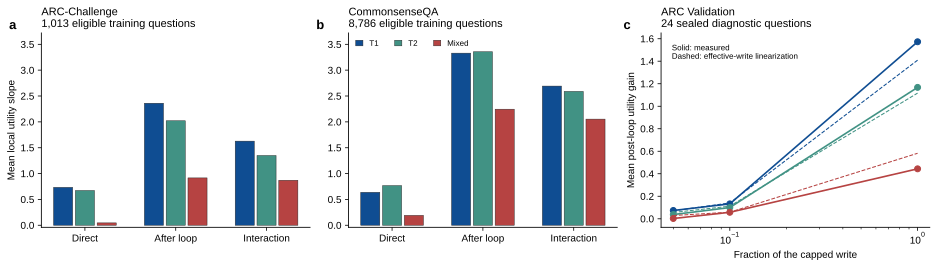
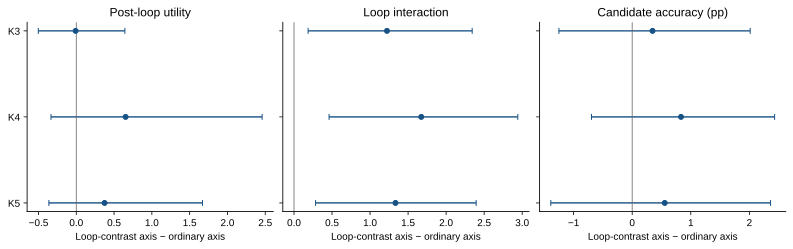

# 当前机制证据

以下比较均在同一前 RMSNorm 接收张量写入，直接分支使用原生归一化和读出，另一分支额外执行一次完整冻结循环。局部斜率使用各历史控制器真实限幅后的写向量。两者的差才是循环交互。

| K4 候选人群 | 既有控制器 | 直接读出 | 循环后绝对斜率 | 循环交互 |
| --- | --- | ---: | ---: | ---: |
| ARC-Challenge 合格 Train 1,013 | T1 | 0.733 | 2.360 | 1.627 |
| ARC-Challenge 合格 Train 1,013 | T2 | 0.672 | 2.021 | 1.349 |
| ARC-Challenge 合格 Train 1,013 | Mixed | 0.046 | 0.916 | 0.870 |
| CommonsenseQA 合格 Train 8,786 | T1 | 0.637 | 3.329 | 2.692 |
| CommonsenseQA 合格 Train 8,786 | T2 | 0.767 | 3.356 | 2.589 |
| CommonsenseQA 合格 Train 8,786 | Mixed | 0.191 | 2.245 | 2.053 |

ARC 本身的 K3→K4 原生变化中，30 道从错转对，23 道从对转错。CSQA 为 279 和 176。它们分别以每道题的字符归一化候选评分判定正确，尚未包含题目干预的训练价值验证。

在预先选定的 24 道 ARC Validation 诊断题上，实际全剂量循环后效用增益均值为 T1 **1.5728**、T2 **1.1676**、Mixed **0.4439**。线性预测的逐题 MAE 在 0.1 剂量分别为 **0.0436、0.0424、0.0419**，全剂量为 **1.0782、0.7645、0.4644**。即使一阶均值有时接近，个体工作剂量的预测错误也很大。全剂量 T2 上有 4/24 题出现交互为正但绝对循环效用下降。

在 16 道梯度检查 ARC 题上，对非预测位置的直接读出梯度平方和为 0，经下一圈回传的对应平方和为 147.29，全部位置为 504.02。该比值表明梯度可跨词元传播，不是某个具体 Attention 分支贡献的因果百分比。验证中一处效用 bitwise 比较失败，复核的原生状态逐元素完全相同，候选归约差为 4.77e−7。随后在小容差下重放，仍要求直接状态与原生停在 K3 的状态逐元素一致。

在相同历史方向下，ARC 上 T1 的后续循环优势强于 Mixed。由于两者的训练来源、目标和历史训练流程都不同，目前还不能把差异归因于数据来源本身。CommonsenseQA 的 T1/T2 排序在绝对效用和交互项上已经反转，纯交互评分的普适排序假设需要在独立数据上检验。

六来源折外干预中，循环交互矩阵第一对方向的折间外积余弦为 0.541–0.990。按其余来源平均方向拟合的相对残差仍为 0.792–1.000。稳定的源内低秩敏感性与能够解释大部分矩阵能量的统一轴是两个独立假设。本次结果只支持前者。实际写入时，以交互矩阵求出的方向相对普通功能矩阵方向，在 K3、K4、K5 的全剂量平均循环后效用差依次为 −0.009、+0.653、+0.374。源内谱稳定性与跨域可转移作用都受到运行深度影响，后者仍须用准确率和训练收益单独确认。

将相同来源、目标题目和剂量配对后，对环境和题目同时重抽样。K4 的交互优势为 +1.673，95% 区间为 [0.461, 2.943]。循环后绝对效用的区间为 [−0.334, 2.459]，相应候选准确率变化为 +0.83 个百分点 [−0.69, +2.43]。K3 和 K5 的绝对效用及候选准确率区间也跨零。交互指标能识别更依赖完整循环的干预，现有六来源证据尚不足以认定它提高最终正确率。该统计以六个环境为重抽样单位，作为探索性不确定性分析。

原版 ARC-Challenge Train 的相同 1,119 题，在 K2、K3、K4 上得到的循环交互矩阵稳定秩分别为 1.027、1.129、1.209。各深度都由首方向主导，但 K2 与 K4 的首秩一矩阵余弦只有 0.224，K3 与 K4 为 0.660。低有效秩并不意味着各深度使用同一个方向。

六个 760 题单源实训权重在独立折上的未限幅局部投影也呈现来源差异。单位 Frobenius 范数下，ARC 和 CommonsenseQA 的平均循环后投影为 0.316、0.301，均匀混合对照为 0.105，BoolQ 为 −0.048。与 T1 的秩一矩阵余弦分别为 0.210、0.095、0.073、约 0.000。该证据衡量局部响应，尚未验证真实剂量下的答题迁移。

### 原生纠错类型与答案偏差

在 ARC、OpenBookQA 与 QASC 中，原生 K3→K4 救回组对 T1 的局部循环后平均斜率最大。CommonsenseQA 和 ScienceQA 的持续失败组反而有最大的斜率。不能把原生救回类别直接当作普遍的数据筛选规则。独立训练对照固定四类转移与题长的样本权重总和，再在每类内部提高或降低循环交互且绝对效用为正的样本权重。

BoolQ 固定候选协议揭示了极端的方向偏差。Native K4 在 7,970 个合格训练样本中有 7,737 个输出选择偏向 Yes。T1 的循环后斜率在 4,963 个原生答对的 Yes 样本中为 +18.449，在 2,774 个原生答错的 No 样本中为 −18.192。这里的效用恰为正确与错误候选的归一化分数差，因此两组大幅度变化对应同一个 Yes 方向。这给出了谱方向稳定却难以迁移的具体例子。

### 候选排序与自由生成的分歧

在同一组 192 道 ARC 开发题上，T1 相对 Native 的完整候选准确率提升 12.50 个百分点，95% 配对区间为 [6.77, 18.75]。自由生成正确率下降 12.50 点 [−18.75, −5.73]，合法答案率降低 15.63 点。候选选对而实际生成无有效选项的题数从 8 增至 32，候选选对而生成了合法错误选项的题数从 8 降至 7。T2 与 Mixed 分别达 78.65% 和 80.73% 的自由生成正确率，高于各自的 61.98% 和 55.73% 候选准确率。两种评测采用各自原有提示，这组同题比较将差异定位到输出有效性，提示与评分方式的影响仍未分离。 [配对生成审计](results/dev/PROTOCOL_GAP.json)

