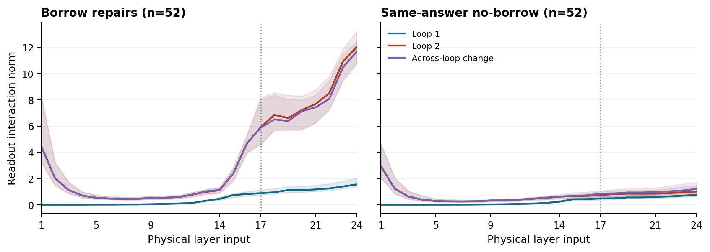

# Ouro-1.4B 原生漏借位中的跨轮交互和路径复位

冻结模型和固定提示，使用实际完整整数和真实生成词元。120 个发现题干和 160 个确认题干的正确联合整数相互分离。每个借位题干的联合角点与安全题干共享完整正确答案。

| 确认条件 | 原生 K1 完整正确 | 原生 K2 完整正确 |
|---|---:|---:|
| 00 | 138/160 | 160/160 |
| 10 | 121/160 | 158/160 |
| 01 | 130/160 | 160/160 |
| 11 | 42/160 | 160/160 |
| safe11 | 129/160 | 160/160 |

自然精确修复为 52/160，同答案无需借位组为 0/160。在这些精确修复中，36 道的其他三个角点在 K1 已经全对。配对 +52 例净差，每目标 +0.650 [+0.487, +0.812]（95%区间）。

## 对第17层原生四角跨轮差分做干预

对齐 52/52。可用供体 41 个，正误百位完全互斥供体匹配 52/52，同百位不同完整答案匹配 48/52。干预是首个自然分歧位置之前的读出状态改动，其后按同一深度续写。

| 干预 | K1 正解 | K2 恢复原 +100 | 同题双向 | 其余三角 K1 全正的双向 | 受体输出等于异数字供体或供体错值 K1/K2 |
|---|---:|---:|---:|---:|---:|
| native | 0/52 | 0/52 | 0/52 | 0/36 | 0/0 |
| whole | 39/52 | 48/52 | 37/52 | 26/36 | 0/0 |
| delta | 16/52 | 46/52 | 14/52 | 10/36 | 1/0 |
| geometry | 29/52 | 3/52 | 1/52 | 1/36 | 0/1 |
| safe_delta | 13/52 | 16/52 | 5/52 | 5/36 | 0/0 |
| I2 | 18/52 | 45/52 | 16/52 | 11/36 | 1/0 |
| distant | 22/52 | 43/52 | 21/52 | 14/36 | 0/0 |
| distant_safe | 15/52 | 13/52 | 6/52 | 5/36 | 0/0 |
| aligned | 16/52 | 40/52 | 16/52 | 12/36 | 0/0 |

delta_vs_geometry 的同题双向配对差为 +13 例净差，每目标 +0.325 [+0.150, +0.525]（97.5%区间），两个单方向结果见原始汇总。

delta_vs_safe_delta 的同题双向配对差为 +9 例净差，每目标 +0.225 [+0.025, +0.450]（97.5%区间），两个单方向结果见原始汇总。

distant_vs_geometry 的同题双向配对差为 +20 例净差，每目标 +0.500 [+0.300, +0.725]（97.5%区间），两个单方向结果见原始汇总。

distant_vs_distant_safe 的同题双向配对差为 +15 例净差，每目标 +0.375 [+0.125, +0.625]（97.5%区间），两个单方向结果见原始汇总。

同题跨轮差分门槛未通过。跨数字供体门槛通过。

## 相同剂量作用于同答案安全受体

两类同答案受体都使用来自借位题的同一个原生跨轮向量，剂量相同。K2 精确多 100 在借位受体为 46/52，在无需借位受体为 2/52；匹配几何对应 4 与 0。安全组新增 K2 错误 6 道。双重配对差为 +40 例净差，每目标 +1.000 [+0.750, +1.225]（97.5%区间）。

## 第14层 A 路径和第17层交互的原生因果检验

| K2 条件 | 正解 | 同题原 +100 | 同答案安全组新增错误 |
|---|---:|---:|---:|
| native | 52/52 | 0/52 | 0/52 |
| cut | 45/52 | 7/52 | 0/52 |
| cut_sham | 52/52 | 0/52 | 0/52 |
| interaction | 52/52 | 0/52 | 0/52 |
| interaction_sham | 52/52 | 0/52 | 0/52 |
| main | 42/52 | 10/52 | 0/52 |
| main_sham | 48/52 | 4/52 | 0/52 |
| full | 52/52 | 0/52 | 0/52 |

在 A 读入回拨后恰好重现原错答的 7 道中，恢复各分量的完整正解数为 {'interaction': 7, 'main': 1, 'full': 7, 'interaction_sham': 7, 'main_sham': 3}。交互分量恢复的配对差为 +0 例净差，每目标 +0.000 [+0.000, +0.000]（97.5%区间）。完整读出恢复是结构校验。路径链门槛未通过。

## 物理层输入上的原生交互几何

曲线为中位数，阴影为四分位范围。第 14 层至第 17 层，K2 交互范数中位数在修复组由 1.10 增至 5.91，安全组由 0.62 增至 0.73。两类数值编辑的总幅度不同，原始交互范数用于描述层间变化。所有完整解码、原生匹配、控制剂量、锁定协议与哈希见 results/。
