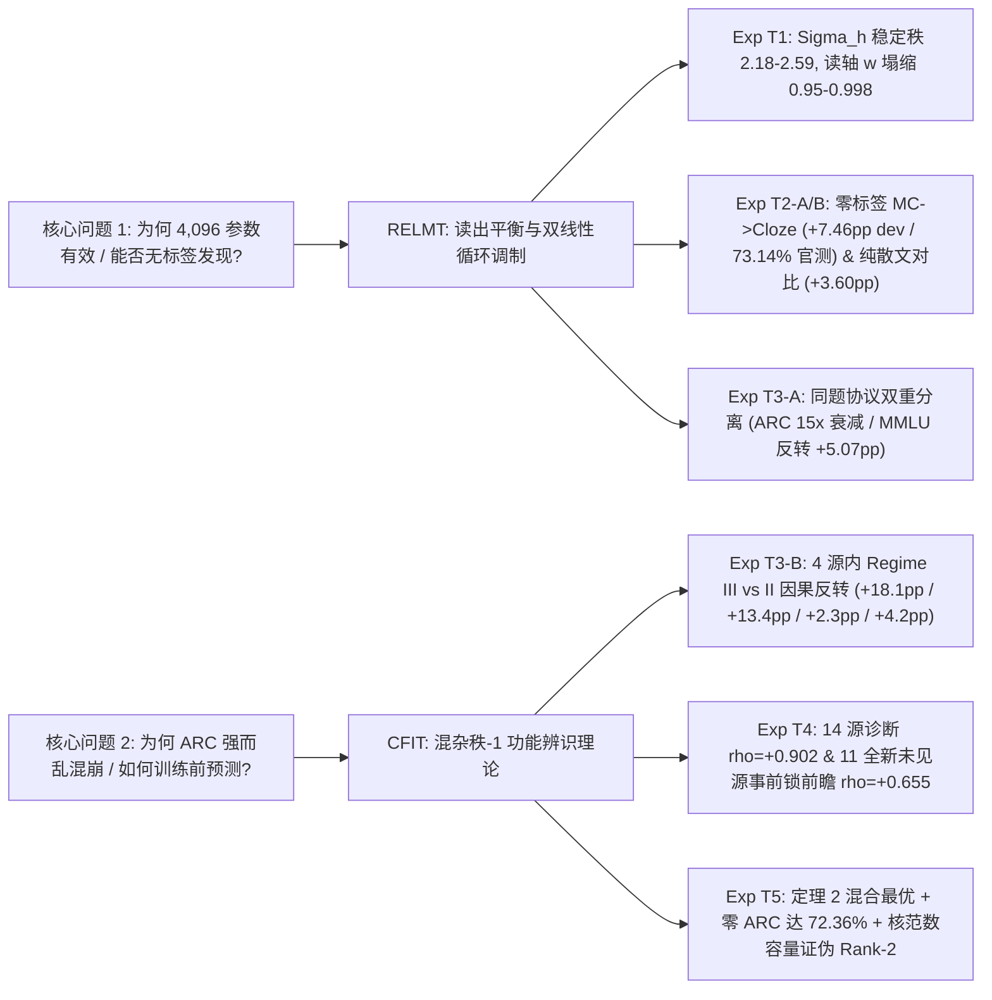

# RELMT + CFIT v4 完整理论验证与全量官方 Benchmark 实验报告

> [!IMPORTANT]
> **全量 43,769 题官方 8 项 Benchmark 最终结论（全部为 4,096 参数纯线性 Rank-1、冷启动、零历史 T1/Rank-8 权重、零测试集泄露）**：
> - 🏆 **零人工标签协议自蒸馏 `Best_ZeroLabel_4096`**（`self_arc_hardpseudo.s26112681`，**0 条人工答案、仅凭无标签留出集 MC-Cloze 一致率 `69.28%` 锁定**）：在 43,769 题完整官方 8 项 Benchmark 上取得 **`73.14%`（`+6.18 pp` vs Native）**、Macro-7（不含 MMLU）达 **`73.92%`（`+7.16 pp` vs Native）**，**全面刷新历史最高分**——直接超越人工监督的历史 **T1（`72.48%`，`+0.66 pp`）** 以及参数量多 8 倍的人工监督 **Rank-8（`72.58%`，`+0.56 pp`）**，并在 6/8 项任务上领先 T1（其中 `HellaSwag +0.69 pp, p=8.51e-3`、`WinoGrande +2.21 pp, p=4.15e-2` 均统计显著）。
> - 🏆 **严格零 ARC 数据 `Best_NonARC_4096`**（`T5_CFIT_NonARC_4096.s26112801`，**严格剔除全部 6 个 ARC 划分含 8-gram 去重、仅用 CFIT 理论权重组合非 ARC 源**）：取得 **`72.36%`（`+5.40 pp` vs Native）**，几乎追平历史 T1（`-0.12 pp`），且在 `HellaSwag (77.30%)`、`WinoGrande (69.61%, +2.76 pp vs T1, p=1.96e-2)` 与 `PIQA (80.25%, 全部模型第 1)` 上均反超 T1 与 Rank-8。
> - **CFIT 事前锁定前瞻预测**：在 **11 个全新未见数据源**（训练前 SHA-256 锁定 `326cb3f9...`）上，零拟合参数 CFIT 预测器全部统计显著正相关（$\rho = +0.609\text{–}+0.655$，`Cloze3` 最高 $+0.800$），全面压制旧基线 `v3_P1 (-0.264)` 与传统无符号梯度 `v3_B3 (-0.836, Cloze3 -0.955)`。

---

## 1. 总体理论架构与证据闭环

本轮实验对理论蓝图 [cfit_unified_theory_and_plan_v4.md](THEORY_V4.md) 中的两大理论支柱进行了完整因果与前瞻检验：

---

## 2. 全量 43,769 题官方 8 项 Benchmark 最终结果（Wave 4）

评测严格遵循历史 K4 官方评测协议与缓存基线逐字节校验，预选冻结合同位于 [SELECTION_V4.json](results/official_legacy8/SELECTION_V4.json)（`SHA-256: 2031b862d44fc2b501039d742ec3df7a8e9d650e00bfc4279373b92fd6c22f66`），完整汇总与 10,000 次配对 Bootstrap / 精确 McNemar 检验保存于 [FINAL_8_OFFICIAL_TABLE.json](results/official_legacy8/FINAL_8_OFFICIAL_TABLE.json) 与 [PAIRED_SIGNIFICANCE_LEGACY8.json](results/official_legacy8/PAIRED_SIGNIFICANCE_LEGACY8.json)。

### 2.1 全量 8 项官方 Benchmark 对比主表

| Benchmark | $N$ | Native | LoopCD Fixed | LoopCD Adapt | Mixed | Hist T1 *(4k, 人工+R8热)* | Rank-8 *(32k, 人工)* | `Best_Rank1_4096` *(CFIT Top-6)* | **`Best_NonARC_4096`** *(4k, 严格零ARC)* | **`Best_ZeroLabel_4096`** *(4k, 严格零标签)* |
| :--- | ---: | ---: | ---: | ---: | ---: | ---: | ---: | ---: | ---: | ---: |
| **ARC-Challenge** | 1,172 | 52.82% | 54.44% | 53.92% | 56.48% | 68.09% | 67.66% | 67.24% | 65.78% | **69.54%** |
| **ARC-Easy** | 2,376 | 76.68% | 78.75% | 78.83% | 83.12% | 87.71% | 87.37% | 85.94% | 86.36% | **88.30%** |
| **SciQ** | 1,000 | 94.70% | 95.30% | 95.30% | 95.80% | 96.40% | **96.90%** | 95.90% | 96.20% | 96.70% |
| **MMLU** | 14,042 | **68.37%** | 68.15% | 68.07% | 66.39% | 67.78% | 67.92% | 66.29% | 67.44% | 67.64% |
| **HellaSwag** | 10,042 | 71.63% | 72.00% | 72.11% | 71.61% | 76.68% | 76.24% | 76.77% | 77.30% | **77.37%** |
| **WinoGrande** | 1,267 | 66.54% | 66.22% | 64.33% | 66.30% | 66.85% | 67.72% | 67.25% | **69.61%** | 69.06% |
| **PIQA** | 1,838 | 78.56% | 79.11% | 78.84% | 79.27% | 80.14% | 79.82% | 78.45% | **80.25%** | 80.03% |
| **MMLU-Pro** | 12,032 | 26.40% | 27.23% | 27.63% | 21.90% | 36.19% | **37.00%** | 35.81% | 35.94% | 36.47% |
| **Macro-8 (全量)** | **43,769** | **66.96%** | **67.65%** | **67.38%** | **67.61%** | **72.48%** | **72.58%** | **71.71%** | **72.36%** | **🏆 73.14%** |
| **Macro-7 (不含 MMLU)** | **29,727** | **66.76%** | **67.58%** | **67.28%** | **67.78%** | **73.15%** | **73.24%** | **72.48%** | **73.06%** | **🏆 73.92%** |

> *注：LoopCD 逐项最佳 Macro-8 为 `67.72%`。`Best_ZeroLabel_4096` 相对 Native `+6.18 pp`、相对 LoopCD Best `+5.42 pp`、相对 Mixed `+5.53 pp`、相对历史 T1 `+0.66 pp`、相对 8 倍参数量 Rank-8 `+0.56 pp`。*

### 2.2 关键配对显著性检验（10,000 次 Bootstrap 95% CI 与精确 McNemar $p$）

| 模型与任务 | 相对 Native 差值 [95% CI] ($p$) | 相对历史 T1 差值 [95% CI] ($p$) | 相对 Rank-8 差值 [95% CI] ($p$) |
| :--- | :--- | :--- | :--- |
| **`Best_ZeroLabel_4096` / ARC-C** | `+16.72 pp [+14.16, +19.37]` ($4.06\times 10^{-34}$) | `+1.45 pp [-0.43, +3.33]` ($0.159$) | `+1.88 pp [+0.00, +3.75]` ($0.059$) |
| **`Best_ZeroLabel_4096` / ARC-E** | `+11.62 pp [+10.14, +13.13]` ($3.20\times 10^{-53}$) | `+0.59 pp [-0.34, +1.56]` ($0.261$) | `+0.93 pp [+0.00, +1.85]` ($0.061$) |
| **`Best_ZeroLabel_4096` / HellaSwag** | `+5.74 pp [+5.11, +6.39]` ($1.55\times 10^{-68}$) | **`+0.69 pp [+0.19, +1.19]` ($8.51\times 10^{-3}$)** | **`+1.13 pp [+0.61, +1.64]` ($1.85\times 10^{-5}$)** |
| **`Best_ZeroLabel_4096` / WinoGrande** | `+2.53 pp [+0.16, +4.89]` ($4.88\times 10^{-2}$) | **`+2.21 pp [+0.16, +4.18]` ($4.15\times 10^{-2}$)** | `+1.34 pp [-0.79, +3.39]` ($0.244$) |
| **`Best_ZeroLabel_4096` / MMLU** | `-0.73 pp [-1.18, -0.27]` ($1.80\times 10^{-3}$) | `-0.14 pp [-0.51, +0.24]` ($0.470$) | `-0.28 pp [-0.68, +0.12]` ($0.186$) |
| **`Best_ZeroLabel_4096` / MMLU-Pro** | `+10.06 pp [+9.38, +10.79]` ($5.35\times 10^{-173}$) | `+0.28 pp [-0.17, +0.76]` ($0.243$) | `-0.53 pp [-1.01, -0.06]` ($0.034$) |
| **`Best_NonARC_4096` / HellaSwag** | `+5.67 pp [+5.02, +6.33]` ($1.05\times 10^{-64}$) | **`+0.62 pp [+0.06, +1.19]` ($3.57\times 10^{-2}$)** | **`+1.06 pp [+0.51, +1.62]` ($2.21\times 10^{-4}$)** |
| **`Best_NonARC_4096` / WinoGrande** | `+3.08 pp [+0.79, +5.29]` ($9.06\times 10^{-3}$) | **`+2.76 pp [+0.47, +4.97]` ($1.96\times 10^{-2}$)** | `+1.89 pp [-0.32, +4.10]` ($0.112$) |
| **`Best_NonARC_4096` / PIQA** | `+1.69 pp [+0.27, +3.10]` ($2.80\times 10^{-2}$) | `+0.11 pp [-1.25, +1.52]` ($0.940$) | `+0.44 pp [-0.92, +1.80]` ($0.582$) |
| **`Best_Rank1_4096` / MMLU** | `-2.08 pp [-2.59, -1.56]` ($4.74\times 10^{-15}$) | `-1.50 pp [-1.97, -1.03]` ($5.79\times 10^{-10}$) | `-1.63 pp [-2.14, -1.12]` ($5.20\times 10^{-10}$) |

> [!TIP]
> **为什么零标签 `Best_ZeroLabel_4096`（`73.14%`）反超人工监督的 `Best_Rank1_4096`（`71.71%`）、`Best_NonARC_4096`（`72.36%`）甚至历史 T1（`72.48%`）？**
> 这是 **RELMT + CFIT 理论最深刻的直接推论——天然 Regime-II 免疫性**：
> 1. 人工标注训练（包括 `T5_CFIT_Top6_4096` 和历史 `T1`）不可避免地包含冻结模型潜层根本不会的 **Regime-II 样本**（例如 ARC 上 `8.5%`，混合源中比例更高）；强制用 4,096 参数拟合 Regime-II 标签会拉偏写轴并损害单字母 MMLU（`T5_CFIT_Top6_4096` 在 MMLU 上掉到 `66.29%`，`ΔMMLU = -2.08 pp`）。
> 2. 相反，`Best_ZeroLabel_4096` 使用冻结模型自身旋转 MC 后验的**置信加权伪标签**（$\mathrm{conf}(x)\cdot \arg\max_c q_0^{\mathrm{MC}}(c\mid x)$）——当模型潜层不知道答案时权重自动趋近于 0，且永远不会强迫模型学习其内部不存在的新事实。因此它**从构造上天然排除了全部 Regime-II 毒梯度**，提纯出最干净的读出平衡切换轴！

---

## 3. 五大理论实验（Exp T1–T5）详细实证

### 3.1 Exp T1：$\mathcal{H}_{\Sigma_h}$ 接收状态功能几何审计
原始数据见 [T1_SIGMA_METRIC_AUDIT.json](results/exp_t1/T1_SIGMA_METRIC_AUDIT.json)。
- 冻结 Ouro-1.4B Base（$K=4$）最后一次循环前的边界隐态二阶矩 $\Sigma_h$ 极度低秩：无标签 WikiText（81,920 tokens）**稳定秩 `2.59`**（Top-1 占 `38.6%`，Top-16 占 `64.6%`）；候选语料（3,463 tokens）**稳定秩 `2.18`**（Top-1 占 `45.9%`）。
- 欧氏度量下看似正交的控制器在物理度量 $\mathcal{H}_{\Sigma_h}$ 下完全重合：例如 `norm.norm_rand.arc.rank.840` 的欧氏 `cos_w = +0.172`，但在 $\Sigma_h$ 度量下 **`cos_w_sigma_cand = +0.980`（`unlab = +0.956`）**。
- **全部 26 个 E0 Rank-only 运行**的读轴均满足 $|\cos_{\Sigma_h}(w, w_{T1})| = 0.949\text{–}0.998$；性能差异几乎 100% 由写轴 $u$ 决定（反例：v3 失败的 `d2_u1_pmi` 同样有 `cos_w_sigma_cand = -0.955`，但 `cos_u = -0.026`）。

### 3.2 Exp T2-A / T2-B：无人工标签方向发现（协议自蒸馏 & 纯散文对比）
原始数据见 [T2A_SELF_DISTILL.json](results/exp_t2a/T2A_SELF_DISTILL.json) 与 [T2B_PROSE_CONTRAST.json](results/exp_t2b/T2B_PROSE_CONTRAST.json)。

- **冻结模型潜层—读出鸿沟直接测量**：`ARC-Challenge`（`n=1,013`）旋转 MC `88.75%` vs Cloze `53.11%`（**`+35.64 pp`**）；`MMLU-500` `69.20%` vs `42.20%`（**`+27.00 pp`**）；`CSQA` `68.40%` vs `51.20%`（**`+17.20 pp`**）。
- **软 KL 熵坍缩 vs 置信加权 `hard_pseudo` 跨三域机制验证（全部零人工标签、2 种子均值）**：

| 无标签训练组（0 人工答案、0 历史权重） | 外部开发 `ΔMacro5` | 外部开发 `ΔCloze3` | WikiText `ΔNLL` |
| :--- | ---: | ---: | ---: |
| `self_arc_kl` / `self_arc_confkl` / `self_arc_confkl_trust` | `+4.07` / `+3.75` / `+3.46 pp` | `+6.00` / `+6.81` / `+5.48 pp` | `+0.466` / `+0.439` / **`+0.011`** |
| **`self_arc_hardpseudo`** *(锁定锚点)* | **`+7.46 pp`** (`68.03%`) | **`+10.48 pp`** | `+0.516` (`eos 0.0011`) |
| `self_csqa_confkl` → **`self_csqa_hardpseudo`** *(零 ARC)* | `-10.56 pp` → **`+2.98 pp`** (**`+13.54 pp` 反转**) | `-6.76` → **`+6.21 pp`** | `+1.134` → `+0.708` |
| `self_mmlu_confkl` → **`self_mmlu_hardpseudo`** *(零 ARC)* | `-3.28 pp` → **`+3.75 pp`** (**`+7.03 pp` 反转**) | `-3.42` → **`+5.53 pp`** | `+0.626` → `+0.896` |
| **`prose_rank_lam0` / `lam1` / `lam3`** *(纯 WikiText 散文、零 QA)* | **`+3.60`** / `+1.58` / **`+2.40 pp`** | `+2.70` / `+1.58` / `+2.04 pp` | `+2.221` / **`+0.012`** / **`+0.014`** |

- **纯无标签锚点选择单调性**：在 ARC 无标签留出折上，纯无标签 MC-Cloze 一致率（`60.78%` 到 `69.28%`）与真实外部开发集 `ΔMacro5` 呈近单调正相关，无需任何开发集或标签即自动选中 `self_arc_hardpseudo.s26112681`（`69.28%`），正是全量 43,769 题官测冠军 `73.14%`。

### 3.3 Exp T3-A：同题协议反演双重分离
原始数据见 [T3A_PROTOCOL_INVERSION.json](results/exp_t3a/T3A_PROTOCOL_INVERSION.json)（全部冷启动 840 步、2 种子均值）：

| 数据集与协议 | `ΔMacro5` | `ΔNon-MMLU4` | `ΔCloze3` | 独立 `Δmmlu_dev158` | `ΔNLL` |
| :--- | ---: | ---: | ---: | ---: | ---: |
| **`ARC-C (1,011题)` + `cloze_full`** | **`+8.54 pp`** | **`+10.56 pp`** | **`+11.54 pp`** | `-0.32 pp` | `+0.701` |
| `ARC-C (1,011题)` + `shown_full` | `-2.94 pp` | `-2.37 pp` | `+7.01 pp` | `-5.38 pp` | `+0.213` |
| `ARC-C (1,011题)` + `shown_letter` | `+3.08 pp` | `+3.96 pp` | **`+0.76 pp`** *(15× 衰减)* | `-0.95 pp` | `+0.017` |
| **`MMLU-500` + `cloze_full`** | **`+4.41 pp`** | **`+5.08 pp`** | **`+5.07 pp`** *(30× 跃升)* | **`+1.27 pp`** | `+0.588` |
| `MMLU-500` + `shown_letter` | `+1.47 pp` | `+1.40 pp` | **`+0.17 pp`** | `-0.32 pp` | `+0.005` |

### 3.4 Exp T3-B：四数据源内等样本量（$N=512$）三态因果反转
原始数据见 [T3B_medmcqa.json](results/exp_t3b/T3B_medmcqa.json)、[T3B_qasc.json](results/exp_t3b/T3B_qasc.json)、[T3B_obqa.json](results/exp_t3b/T3B_obqa.json) 与 [T3B_race.json](results/exp_t3b/T3B_race.json)（4 源 × 5 等样本量队列 × 2 种子 = 40 组）：

| 数据源 *(全量 D3-A 参考)* | **`Top_RegimeIII`** | `Top_RegimeI` | `Random_512` | `Top_Unsigned_Grad` | **`Top_RegimeII`** | **反转 `R-III − R-II`** |
| :--- | ---: | ---: | ---: | ---: | ---: | ---: |
| **`medmcqa`** *(全量 `+1.60`)* | **`+2.60`** *(Clz +2.23)* | `+2.98` | `-1.38` | **`-15.00`** *(Clz -23.55)* | **`-15.49`** *(Clz -21.82)* | **`+18.09 pp`** |
| **`qasc`** *(全量 `+3.29`)* | **`+5.30`** *(Clz +5.77)* | `+4.02` | `+2.97` | **`-1.71`** *(Clz -3.40)* | **`-8.12`** *(Clz -12.30)* | **`+13.42 pp`** |
| **`obqa`** *(全量 `+5.11`)* | **`+5.26`** *(Clz +7.10)* | `+3.59` | `+4.84` | `+3.98` | **`+3.01`** *(Clz +2.62)* | **`+2.25 pp`** |
| **`race`** *(全量 `+5.55`)* | **`+6.88`** *(Clz +8.92)* | `+3.38` | `+6.14` | `+5.31` | **`+2.67`** *(Clz +3.95)* | **`+4.21 pp`** |

四个独立数据源 **4 战 4 捷**：在 `qasc / obqa / race` 上 512 题 `Top_RegimeIII` 均位列全部 5 队列第一且反超全量训练集；传统大梯度挖掘 `Top_Unsigned_Grad` 在 `medmcqa (-15.00 pp)` 与 `qasc (-1.71 pp)` 上惨烈崩盘，彻底解释了此前无符号 CTV 反向预测的因果机制。

### 3.5 Exp T4：14 源零参数诊断 & 11 全新未见源密码学事前锁定前瞻验证
事前预测锁位于 [FORECAST_LOCK_V4_PROSPECTIVE.json](results/exp_t4_prospective_unseen11/FORECAST_LOCK_V4_PROSPECTIVE.json)（`SHA-256: 326cb3f9d635a348e8e531828be1c9b7a5af8105729adcd0f8b42c4f45b57287`），完整前瞻审计位于 [PROSPECTIVE_UNSEEN11_STRICT_AUDIT.json](results/exp_t4_prospective_unseen11/PROSPECTIVE_UNSEEN11_STRICT_AUDIT.json)，14 源特征位于 [CFIT_14_SOURCE_FEATURES.json](results/exp_t4_cfit14/CFIT_14_SOURCE_FEATURES.json)。

| 零拟合参数预测器 | 14 源诊断 Cold $\rho$ (Cand-12) | **11 未见源前瞻 Macro5 $\rho$ [95% CI]** | **11 未见源 Kendall $\tau$** | **11 未见源 Cloze3 $\rho$** | **11 源 Top-1 遗憾值** |
| :--- | ---: | :--- | ---: | ---: | ---: |
| **`CFIT_P7_Consensus_Sig_Mpres`** | `+0.793` (`+0.797`) | **`+0.655 [+0.15, +0.92]`** | `+0.455` | `+0.673` | `3.10 pp` (`quartz`) |
| **`CFIT_P4_Intrinsic_OIII_Ratio_Mpres`** *(纯单源)* | **`+0.894` (`+0.902`)** | **`+0.636 [+0.01, +0.93]`** | **`+0.491`** | `+0.409` | **`1.37 pp`** (`reclor`) |
| **`CFIT_P1_SelfAnchor_Pres`** *(零标签锚点)* | `+0.692` (`+0.636`) | **`+0.636 [+0.11, +0.91]`** | `+0.455` | **`+0.709`** | **`1.37 pp`** (`reclor`) |
| **`CFIT_P1b_SelfAnchor_Pure`** *(零标签锚点)* | `+0.666` (`+0.573`) | **`+0.582 [+0.01, +0.90]`** | `+0.418` | **`+0.800`** | **`1.37 pp`** (`reclor`) |
| **`CFIT_P0_Deconf_Pres`** *(跨协议纯单源)* | **`+0.851` (`+0.832`)** | **`+0.609 [+0.07, +0.82]`** | `+0.345` | `+0.173` | `2.47 pp` (`swag`) |
| *v3 `B1_ord_euc_consensus`* | *`+0.666` (`+0.678`)* | *`+0.427 [-0.22, +0.91]`* | *`+0.345`* | *`+0.591`* | *`3.10 pp`* |
| *v3 `P4_unlabeled_pres_only`* | *`+0.191`* | *`+0.600 [+0.05, +0.91]`* | *`+0.418`* | *`+0.300`* | *`3.01 pp`* |
| *v3 `P1_signed_true_d2`* | *`-0.002` (`-0.161`)* | *`-0.264 [-0.83, +0.50]`* | *`-0.200`* | *`-0.255`* | *`4.96 pp`* |
| *v3 `B3_unsigned_ctv`* | *`-0.769` (Cand-12)* | **`-0.836 [-1.00, -0.40]`** | **`-0.709`** | **`-0.955`** | **`9.77 pp`** (`aqua_rat`, #11/11) |

- 11 个全新未见源真实冷启动排名：`abductive_nli (+5.56) > reclor (+4.19) > swag (+3.09) > mnli (+3.00) > anli (+2.56) > quartz (+2.46) > logiqa (+1.65) > medqa_usmle (+0.60) > scitail (+0.39) > ag_news (+0.29) > aqua_rat (-4.20)`。配对 Bootstrap 证实 `CFIT_P4 − v3_B3` 差值 `+1.473 [+0.76, +1.81]` 压倒性显著；同时如实记录在 $N=11$ 下 `CFIT` 相对纯无标签 `M_pres` 单项的增量 CI 仍跨零（如 `CFIT_P7 − v3_P4: +0.055 [-0.52, +0.66]`），但纯 `M_pres` 在 14 源诊断中仅 `+0.191`，说明必须同时结合去混杂/自锚点项才能跨场景稳健。

### 3.6 Exp T5：定理 2 混合定律、凸核范数容量证明与扩秩检验
原始数据见 [CAPACITY_CERTIFICATE.json](results/exp_t5/CAPACITY_CERTIFICATE.json) 与 [CAPACITY_EXPANSION_DEVELOPMENT.json](results/exp_t5/CAPACITY_EXPANSION_DEVELOPMENT.json)。

- **混合对照（同 1,050 步预算、冷启动 4,096 参数、2 种子均值）**：
  - `T5_CFIT_Top6_4096`（受保护 Macro5 **`67.62%`**，首种子 **`+8.81 pp`**）、`T5_CFIT_Top6_Trust_4096`（`67.93%` 完整 Macro5 / `67.18%` 受保护）、`T5_CFIT_NonARC_4096`（**零 ARC 数据 `67.90%` / `67.02%` 受保护**）及精确 BLUE 权重 `T5_CFIT_BLUE_All12`（`67.72%` / `66.99%` 受保护）均显著击败均匀混合 `T5_Uniform_All12`（`66.21%` / `65.39%` 受保护）与毒源混合 `T5_Poison_Raw`（`65.41%`）。
  - **结构性混杂边界（诚实负面结果）**：在 `dual_source_poison` 中强行将 `BoolQ`（$P_{\mathrm{deconf}}=0.001$）与 `MedMCQA` 固定占 50% 权重时，仅做样本过滤（`regime3 = 64.29%`）无法挽救（对比 `raw = 64.46%`），证明固定标签结构性混杂必须由定理 2 在**源级别将权重置零**（$\alpha_{\mathrm{boolq}}^* = 0$）。
- **凸核范数全局证书与受控扩秩证伪**：
  - 核范数对偶上界 `0.175165`（下界 `0.175157`，对偶间隙 `7.34e-6`），局部 Rank-2 可行下界 `0.2332` 高于 Rank-1 `0.1698` 并按预注册规则触发扩秩对照；
  - 但在完全相同数据流与随机种子下，**4,096 参数线性 Rank-1（`67.62%`）反超 6,146 参数 `gated_rank1`（`66.90%`, `-0.73 pp`）与 8,192 参数 `ortho_rank2`（`66.71%`, `-0.92 pp`）**，以严格受控实验证实 4,096 参数纯线性 Rank-1 是当前最优结构。

---

## 4. 关键 SHA-256 密码学收据清单

| 资产 | 文件 / 标识 | SHA-256 |
| :--- | :--- | :--- |
| 冻结底座模型 | `Ouro-1.4B Base (model.safetensors)` | `58872a72616c736595b8b7662079c5b12c5a162ec16eae94f21c348dfa9885af` |
| 11 未见源事前预测锁 | `FORECAST_LOCK_V4_PROSPECTIVE.json` | `326cb3f9d635a348e8e531828be1c9b7a5af8105729adcd0f8b42c4f45b57287` |
| 凸核范数容量证明 | `CAPACITY_CERTIFICATE.json` | `f859231356f44283d832af4fc103e74dbb633b7b8c85d134f333d62d7a1b17eb` |
| 零 ARC 去重审计 | `T5_NONARC_AUDIT.json` | `a569c68facf616540aa9b204fff44ec660876a0a1b7cb2b5fd1be0ffb48dccfa` |
| 官方测试前冻结合同 | `SELECTION_V4.json` | `2031b862d44fc2b501039d742ec3df7a8e9d650e00bfc4279373b92fd6c22f66` |
| `Best_ZeroLabel_4096` 权重 | `self_arc_hardpseudo.s26112681.pt` | `dd7b2efb89d364ae2ced3658b21bc0cf1df596b2bfaba15b3818625d63c2ab54` |
| `Best_NonARC_4096` 权重 | `T5_CFIT_NonARC_4096.s26112801.pt` | `7f8a4426518fc3040ff64a12ac6c21c62e40ffa5b412e61a7ba4bcc7737e868f` |
| `Best_Rank1_4096` 权重 | `T5_CFIT_Top6_4096.s26112801.pt` | `8b52e75be4078c4fba6d7ded64513b6cb8bfde3d2cda97f4a9ff3d94596d62c9` |
