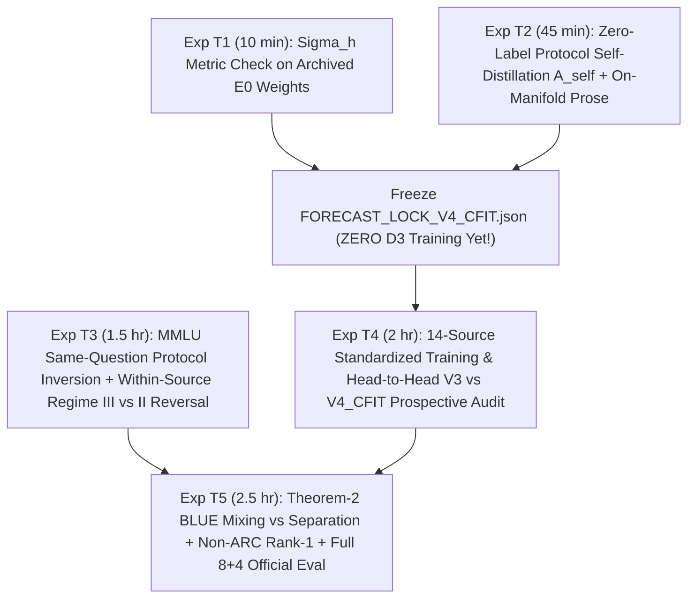

# 从证伪到第一性原理：Looped Transformer 读出均衡控制理论与混淆低秩辨识数据选择框架（RELMT + CFIT）

> [!IMPORTANT]
> 本报告深度核验了仓库最新提交 [4e99a6ce](https://github.com/Gifoe/looped-transformer-stage1-reproduction/tree/4e99a6ced59a83d4beb6d1c34dc49b9f2f1be860/experiments/ouro_functional_controllability_v3_20261126)（v3 阶段 0–3 实测与 D3 特征冻结）和 [0a47fc64](https://github.com/Gifoe/looped-transformer-stage1-reproduction/tree/0a47fc64ff5926e3f9dea13e6611c828c11d5a85/experiments/cross_model_functional_controllability_20261125)（五模型跨架构机制审计），以及历史 `loop_aware` / `transferability` 分支的原始逐源训练数据。
> **核心判断**：v3 的 E0、D2、D1 实验给出了极具价值的**硬证伪证据**，直接击碎了此前「高敏感性/非正规性 ≈ 有益可控性」「无标签 PMI 可作为 D3 锚点」「温度锐化/贝叶斯模式切换」三项旧假设；正因如此，**当前 D3 尚未启动 14 源真实训练，恰恰为我们留出了唯一一次零泄漏的理论重构与事前预注册窗口**。

---

## 1. v3 实测硬证伪的深度尸检：为什么旧路线做不出数据选择理论？

把 E0、D2、D1 以及 `FORECAST_LOCK_V3.json` 与历史 6 来源真实单源训练结果（`CANDIDATE_INTERIM.json`）放在同一张桌面上，四个长期掩盖真相的根源立即暴露无遗：

### 1.1 尸检一：D2 证明「状态可控性 ≠ 输出敏感性 ≠ 有益功能可控性」，且 `FORECAST_LOCK_V3` 的锚点已被污染

| 指标 / 控制器（v3 D2 实测） | K6 物理状态放大 | 直接读出敏感度 | 外部五任务开发均值变化 | 致命物理原因 |
|---|---:|---:|---:|---|
| `Fisher (U_FR)` | **27.24×**（随机 1.50×） | `0.000258`（极小，落入 `lm_head` 零空间） | `ufr1_mean`: **−7.21 pp** | 追逐**离流形非正规爆破模**（K6 中位 KL 仅 `3.29×10⁻⁷`，单篇异常文档占 86.5% KL），属于不稳定破坏方向。 |
| `Jacobian Right-1` | — | — | **−10.75 pp** | 同理，最大状态奇异向量对应非有益扰动。 |
| `U1_PMI`（v3 D3 锁定锚点 $A_0$） | — | — | **−5.62 pp**（自由生成崩至 `0% / 0% / 0% / 4.17%`） | 靠把错配上下文拉爆 `−7.08 nats/tok` 来刷高 `+5.60` 净 PMI，**512/512 篇真实上下文对数概率全部退化**（均值 `−1.48 nats/tok`）！ |
| `UFR16_Proj`（监督约束在 Fisher 子空间） | — | — | 1,013 题仅 `63.16%`（全空间冷启 `67.04%`） | **7/7 个样本规模全败于全空间冷启动**，证实有益功能方向并不居住在广义 Fisher-Rao 顶部子空间内。 |

**直接后果（对 `FORECAST_LOCK_V3.json` 的预警）**：用历史 `CANDIDATE_INTERIM.json` 中已测得的 6 个单源真实开发均分（`csqa 60.15% > arc 60.01% > scienceqa 58.84% > obqa 57.12% > qasc 56.81% > boolq 54.86%`）核查 `FORECAST_LOCK_V3.json` 里冻结的各项指标，得到令人震惊的对照表：

| `FORECAST_LOCK_V3` 预注册指标 | 对历史 6 源实测的 Spearman $\rho$ | 各源打分特征（`csqa / arc / sciqa / obqa / qasc / boolq`） | 诊断结论 |
|---|---:|---|---|
| `B0_source_only`（源强度×稳定性） | **−0.486** | `3.31 / 1.76 / 2.99 / 1.56 / 4.86 / 13.78` | **系统性反相关**：最差的源梯度最大、最稳！ |
| `B3_unsigned_ctv`（v2 无符号幅值） | **−0.657** | `104 / 63 / 69 / 100 / 127 / 535` | **严重反相关**：被强混淆源完全劫持！ |
| `loop_leading_singular`（$\sigma_1(C_s)$） | **−0.657** | `3.41 / 3.76 / 3.85 / 2.03 / 4.94 / 13.91` | **严重反相关**：循环差分梯度同样被 `BoolQ/SQuAD/GSM8K` 劫持！ |
| `gradient_stability`（原始折间稳定性） | **−0.600** | `0.97 / 0.47 / 0.78 / 0.77 / 0.98 / 0.99` | **反相关**：越是固定捷径，跨折越稳！ |
| `P1_signed_true`（锚定于失败的 `U1_PMI`） | **+0.257** | `0.77 / 0.33 / 0.63 / 0.44 / 0.82 / -0.90` | **锚点失灵**：把 `qasc (0.82)` 与 `medmcqa (0.86)` 排在 `arc (0.33)` 之前，且把 `race` 判负！ |
| `P3_ufr_subspace_ratio` | **+0.200** | `0.56 / 0.43 / 0.48 / 0.48 / 0.58 / 0.33` | 反映错误子空间投影，缺乏区分力。 |
| `kl`（无标签文本 KL 漂移） | **−0.714** | `0.79 / 0.88 / 0.80 / 1.26 / 0.99 / 0.93` | **强负相关**：流形破坏越轻，泛化越好！ |
| `B2_loop_contrast`（跨源稳健投影，循环） | **+0.886** | `0.44 / 0.64 / 0.22 / 0.26 / 0.16 / -0.05` | 强正相关，但略弱于普通矩阵。 |
| **`B1_ordinary_functional`（跨源稳健投影）** | **+0.943** | **`0.46 / 0.72 / 0.33 / 0.30 / 0.16 / -0.13`** | **惊人的 +0.943！**（全 14 源中自动把 `arc #1`, `social_iqa #2`, `race #3`, `csqa #4`，而把 `squad/piqa/boolq/gsm8k` 全部判负！） |

> [!WARNING]
> 如果现在直接按旧脚本启动 D3 真实训练而不做理论修正，D3-B 和 `P1/P5` 将围绕一个 **−5.62 pp 的损坏锚点 `U1_PMI`** 空转；而真正关键的科学线索——**为什么 `B0/B3/σ₁/稳定性` 全部呈现 `−0.60 ~ −0.66` 强反相关，而 `kl` 呈 `−0.714`、`B1` 呈 `+0.943`**——还没有被上升为可推导、可解耦、且不依赖参考池的第一性原理理论。

### 1.2 尸检二：E0 暴露「欧氏算子几何失效」与「目标函数劫持」

1. **目标劫持而非数据多样性**：在 E0 完整 2×2×2 析因中，加入 CSQA 的主效应为 **`+0.523 pp`**（正收益！）；真正导致崩溃的是 `NLL + Rank` 联合目标（**`−7.076 pp`**，剔除 MMLU-Pro 后仍有 **`−2.542 pp`**；MMLU-Pro 可解析率暴跌 `−60.38 pp`，EOS 停机激增 `+55.93 pp`）。
2. **欧氏算子余弦的几何悖论**：E0 中 `core.cold.arc.rank.840` 取得 **`68.60%`**（超越历史 T1 的 `66.31%`！），其欧氏算子余弦 `cos_op(A, T1)` 却只有 **`0.186`**（`cos_u = −0.56`, `cos_w = −0.33`）；更惊人的是 `norm.norm_rand.arc.rank.840` 取得 **`67.79%`**（仍超 T1！），其欧氏 `cos_op(A, T1)` 仅为 **`0.078`**（`cos_u = +0.45`, `cos_w = +0.17`）！
   - **关键几何洞察**：这并非「存在无数互不相干的解」——注意所有 26 组有效解的写入轴 `|cos(u, u_T1)| = 0.45–0.56`（在 2048 维空间中相当于 **20–25σ 显著对齐**！）且乘积符号恒为正。之所以 `cos_w` 在欧氏空间里显小（`0.17`），是因为接收状态 $H_t^{(K-1)}$ 高度各向异性地坍缩在一个低维高能锥体内（D2 已实测 `exit_gate` 在前 16 维 PCA 的能量占比达 **96.03%**！）。两个在 $\Sigma_h$ 零空间里相差甚远的读轴 $w_1, w_2$，在真实数据流形 $\Sigma_h$ 上产生的标量门控 $w^\top h_t$ 几乎等价！**欧氏 Frobenius 内积并不是低秩控制器的物理度量**。

### 1.3 尸检三：D1 彻底揭开了「五模型为何 7 升 1 降（仅 MMLU 降）」的底牌

D1-A 在**完全相同的 400 道四选项 MMLU 开发题**上测出了整个仓库最具决定性的一组数字：

| 模型 + 控制器（同一批 400 道 MMLU 题） | `hidden_full`（完整选项 Cloze） | `shown_full/ABCD`（展示选项+完整文本评分） | `shown_full/1234` | `shown_letter/ABCD`（单字母评分，原位 / 4 序对齐） |
|---|---|---|---|---|
| **Ouro-1.4B Base — Native** | **`40.8%`** | **`40.8%`** | `42.0%` | **`63.7%`（4 序去偏 `67.5%`！）** |
| **Ouro-1.4B Base — T1** | `48.8%` (**`+8.0 pp`**, $p=10^{-4}$) | `48.8%` (**`+8.0 pp`**, $p=2.6\times 10^{-4}$) | `52.0%` (**`+10.0 pp`**) | `65.5%` (`+1.8` / **4 序 `−1.0 pp`**) |
| **Ouro-1.4B Base — Mixed** | `43.0%` (`+2.2 pp`) | `55.8%` (**`+15.0 pp` / 4 序 `+21.5 pp`!**) | `60.0%` (**`+18.0 pp`**) | `61.3%` (`−2.5` / `+0.5 pp`) |
| **Ouro-1.4B-Thinking — T1** | `48.8%` (`+6.8 pp`) | `52.5%` (**`+9.2 pp` / 4 序 `+11.5 pp`**) | `62.0%` (**`+24.0 pp`!**) | `66.2%` (`−0.2` / `+2.0 pp`) |
| **Huginn-0125 — Rank-1 ($m=1$)** | `36.8%` (`+2.2 pp`) | `28.7%` (`+0.2` / `+1.0 pp`) | `28.0%` (`+0.0` / `+4.0 pp`) | `23.8%` (`+2.0` / **4 序 `−7.0 pp`**；槽位方差 **88.74%**) |

同时，D1-B 在 4 项 Cloze 任务上证明：
- **不是温度缩放**（`Native_Candidate_Temperature` 准确率为 `+0.0 pp`，且 `Rank1_T1` 在 2.6B 上回归斜率 `β = 1.01, R² = 0.95` 却照样暴涨 `+8.7 pp`！）；
- **不是显式选项提示**（`Native_Elicited` 在 ARC-E 暴跌 `−18.5 pp`、SciQ 暴跌 `−8.4 pp`）；
- **不是领域条件互信息 $\mathrm{PMI}_{\mathrm{DC}}$**（`Native_PMI_DC` 在 ARC-C 暴跌 `−9.4 pp`，叠加在 T1 上再跌 `−6.9 ~ −8.0 pp`！因为粗暴减去无条件先验 $\log p(y\mid\emptyset)$ 会把荒谬低概率干扰项强行抬高）。

**看懂了 `40.8% vs. 67.5%` 这 26.7 个百分点的同题裂口，问题一和问题二的统一第一性原理就水落石出了。**

---

## 2. 问题一的第一性原理理论：读出均衡与双线性循环调制理论（RELMT）

### 2.1 预训练均衡造成的「潜知—读出裂口」（Latent-to-Readout Gap）

考察任意经自回归下一词元预测（NTP）与深度/循环监督预训练得到的 Looped Transformer $H^{(k)} = F(H^{(k-1)})$（$k=1,\dots,K$）。预训练均衡迫使共享循环核 $F$ 在最后一轮同时承担两项相互竞争的计算：
1. **潜在语义综合（Latent Semantic Synthesis）**：经多轮注意力与 MLP 汇聚题干约束、世界知识与候选一致性，形成可区分正确答案的内部状态 $H^{(K-1)}$；
2. **生成续写校准（Generative Continuation Calibration）**：将内部状态映射为符合自然语言分布的多词元续写概率 $\log p_{\mathrm{LM}}(y_1,\dots,y_L \mid x)$——必须把概率质量分散到所有语法通顺、词频高、带铺垫措辞、可自然终止（`<eos>`）的表面表达上。

由此产生一个数学上必然的**读出协议失配**：
- 当评测协议把决策压缩到单 token 符号（`MMLU shown_letter`, $L=1$）且上下文显式对齐四个标签时，表面续写熵与词频稀释消失，原生模型即可直接兑现其内部知识（**67.5%**）；
- 当评测协议要求对**多词元完整答案文本**按长度归一对数似然排序（`ARC-C, ARC-E, HellaSwag, PIQA, SciQ, CosmosQA, MMLU shown_full`），或在 `MMLU-Pro` 中做无格式约束的自由生成时，多词元续写对数概率可分解为：
  $$\frac{1}{L}\log p_{\mathrm{LM}}(y \mid x) \;=\; \underbrace{\frac{1}{L}\log p_{\mathrm{LM}}(y \mid x) - \nu_{\mathrm{surf}}(y \mid x)}_{\text{潜在语义判别支持}} \;+\; \underbrace{\nu_{\mathrm{surf}}(y \mid x)}_{\text{表面流畅度/词频/续写对冲噪声}}$$
  原生模型的最终循环 $F$ 在 NTP 均衡下把巨大权重分配给了 $\nu_{\mathrm{surf}}$（以及自由生成中的漫谈铺垫），导致**明明内部已经知道答案（67.5%），多词元 Cloze 读出却只拿到 40.8%**，MMLU-Pro 有 40%–70% 无法解析！

### 2.2 为什么「4,096 参数的 Rank-1 算子 + 最后一轮原生循环 $F$」足以跨任务、跨架构弥合这一裂口？

为什么一个**完全不包含任何物理、医学或常识知识**的单秩算子 $\Delta H_t = u(w^\top H_t^{(K-1)})$ 能同时在 ARC-C (`+15.3 pp`)、HellaSwag (`+5.1 pp`)、CosmosQA (`+9.2 pp`)、MMLU-full (`+8.0 pp`) 与 MMLU-Pro (`+9.8 pp`) 全面提分？

**核心机制——双线性电路增益调制（Bilinear Loop-Circuit Gain Modulation）**：
1. **为何直接读出必然无效（$\Delta q_{\mathrm{direct}} \le 0$）**：若在 $F$ 之后（输出头前）加 $\delta h = u(w^\top h)$，对输出 logits 的一阶影响只是 $\Delta z_t = (W_{\mathrm{out}} u)(w^\top h_t)$——所有题目共享**同一静态词表偏置向量** $W_{\mathrm{out}} u$，根本无法区分因题而异的正确语义内容！
2. **为何经 $F$ 后单方向 $u$ 能产生「因题而异的语义修正」**：把固定写轴 $u$ 注入 $F$ 之前，经完整循环核 $F$ 传播后，一阶输出变化为：
   $$\Delta z_t(x) \;=\; W_{\mathrm{out}}\, J_{\mathrm{RMSNorm}}(H_t^{(K)})\; \underbrace{J_F\!\left(H^{(K-1)}(x)\right)}_{\text{高度依赖题目 } x \text{ 的双线性电路算子!}}\, \Big(u\,(w^\top H^{(K-1)}(x))\Big).$$
   虽然 $u$ 是**常数向量**，但 $F$ 内部全部 24 层的自注意力权重 $A^{(\ell)}(H(x))$、Q/K/V 路由、SwiGLU 门控 $\sigma(W_{\mathrm{gate}}^{(\ell)} h)$ 与 RMSNorm 径向缩放全由当前题目 $x$ 的隐藏状态决定。因此，$u$ 充当了冻结模型内部预训练电路的**低维全局模式旋钮（Circuit-Gain Control Knob）**——类似于一个隐式元提示（latent meta-prompt），把共享循环核 $F$ 从「表面续写对冲/漫谈模式」整体偏置到「上下文语义验证/果断作答模式」！
3. **为何全五模型都在 MMLU 单字母协议轻微退化，却在同题完整文本协议暴涨 +8~24 pp？**
   - 在 `MMLU shown_letter` 上，原生模型已接近内部知识读出上限（`67.5%` vs `40.8%`），不存在可收割的「潜知—读出裂口」；施加面向多词元续写的控制旋钮 $u$ 只会引入少量离轴方差（Ouro 2.6B）或当剩余深度太浅（Huginn $m=1$ 仅剩 6 层，不足以完成跨层语义路由）时退化为静态字母槽位偏置（88.74% 槽位方差）！
   - 一旦把同一批 400 道 MMLU 题换回 `shown_full` 协议（重新打开 26.7 pp 读出裂口），T1 立即在同一批题上净涨 **`+8.00 pp`**（Ouro-1.4B-Thinking 更是在 1234 完整文本上暴涨 **`+24.0 pp`**）！
4. **为何 D2 的广义 Fisher-Rao 谱与非正规性彻底失效？——冻结循环动力学的「三正交子空间定理」**
   在冻结循环动力学 $H^{(K)} = F(H^{(K-1)})$ 中，切空间自然分裂为三个物理意义截然不同的子空间：

   $$\mathbb{R}^d \;\supseteq\; \underbrace{\mathcal{S}_{\mathrm{dyn}}}_{\substack{\text{离流形非正规爆破子空间} \\ \text{(D2 Fisher-Rao / Schur 抓到)} \\ \text{27× 状态放大, 毁掉任务 } -7\sim -11\text{ pp}}} \;\oplus\; \underbrace{\mathcal{S}_{\mathrm{marg}}}_{\substack{\text{边际/词频/EOS 捷径子空间} \\ \text{(NLL / BoolQ / SQuAD 劫持)} \\ \text{高梯度高稳定, 毁掉生成 } -7\text{ pp}}} \;\oplus\; \underbrace{\mathcal{S}_{\mathrm{func}}}_{\substack{\text{流形内判别读出桥接子空间} \\ \text{(有益功能可控性所在!)} \\ \text{低 KL, } \beta\approx 1.0\text{–}1.2, \; p_0^{\mathrm{cloze}} \to q_0^{\mathrm{MC}}}}$$

   - D2 失败的根本数学原因不是计算误差，而是**目标算子选错了空间**：无权重广义 Fisher-Rao 谱 $\max \frac{u^\top \mathcal{G}_{\mathrm{FR}}^{(1)} u}{u^\top \mathcal{G}_{\mathrm{FR}}^{(0)} u + \lambda}$ 寻找的是「输出头零空间中能经 $F$ 触发最大未约束方差的方向」，必然锁定离流形不稳定模 $\mathcal{S}_{\mathrm{dyn}}$！
   - 真正的内禀功能结构 $\mathcal{S}_{\mathrm{func}}$ 由**两个同时成立的模型内禀条件**唯一刻画：
     1. **流形保持（On-Manifold Condition）**：在无标签自然文本上不破坏语言模型流形（$\Delta \mathrm{NLL}_{\mathrm{unlab}} \le \epsilon$, $|\Delta p_{\mathrm{EOS}}| \le \delta$）；
     2. **协议读出桥接曲率（Cross-Protocol Bridge Condition）**：在全空间 $\mathbb{R}^{d \times d}$ 中，最小化模型的「自生潜知分布 $q_0^{\mathrm{MC}}$（四序去偏单字母后验）」与「可控续写读出分布 $p_A^{\mathrm{cloze}}$」之间的 KL 散度！

> [!TIP]
> **问题一的决定性零人类标签可证伪预言（Protocol Self-Distillation）**：
> 如果 RELMT 成立，那么**完全不使用任何人类标注答案 $y^*$、完全不使用 T1、且不限制在 Fisher 子空间内**，仅在无标签候选问题（或纯无标签文本构造的流畅干扰项对）上最小化模型自身四序去偏单字母后验与受控 Cloze 后验的散度：
> $$\hat{A}_{\mathrm{self}} \;=\; \arg\min_{A \in \mathcal{M}_1}\; \mathbb{E}_{(c, \{y_j\})}\!\left[D_{\mathrm{KL}}\!\left(q_0^{\mathrm{MC}}(\cdot \mid c, \{y_j\}) \,\Big\|\, p_A^{\mathrm{cloze}}(\cdot \mid c, \{y_j\})\right)\right] + \lambda\,\mathcal{R}_{\mathrm{unlab}}(A)$$
> **应当无需一条人工标签即可直接从冻结模型自身恢复出与 T1 同族的高泛化 Rank-1 控制器（预测在 `UNIFIED_EXT_DEV` 上净增 `+4 ~ +7 pp`）！** 若该实验失败（`< +1 pp`），则 RELMT 的「纯读出桥接」假说将被干净证伪。

---

## 3. 问题二的第一性原理理论：混淆低秩功能辨识理论（CFIT）

现在我们正面回答你最核心、最急迫的问题：**外部训练数据究竟在辨识什么？为什么某些强梯度源反而无效？如何在训练前不靠事后拟合判断未知来源的价值？不同来源何时该混合、何时该分离？**

### 3.1 数学建模：训练 Rank-1 控制器是一个「带混淆的秩-1 统计逆问题」

固定冻结模型 $f_0$。一个 4,096 参数的 Rank-1 模块 $A = u w^\top \in \mathcal{M}_1$ 绝不可能存储新世界知识；任何外部训练数据源 $S$ 配合损失 $\mathcal{L}_S$ 所扮演的真实角色，是**最优实验设计（Optimal Experimental Design）中的一组探针实验**，试图从一阶功能梯度场中逆向辨识共享的有益读出桥接算子 $A^* \in \mathcal{M}_1$。

#### 核心几何修正：状态协方差预条件希尔伯特空间 $\mathcal{H}_{\Sigma_h}$
控制器在写入边界的实际作用是 $\Delta h_t = A h_t$，因此算子空间上唯一物理正确的内积不是欧氏 Frobenius 内积，而是由冻结模型自身接收状态二阶矩 $\Sigma_h \triangleq \mathbb{E}_{P_0}[\frac{1}{T}\sum_t h_t h_t^\top]$ 诱导的**功能度量内积**：
$$\langle A_1, A_2 \rangle_{\Sigma_h} \triangleq \mathrm{tr}\!\left(A_1 \Sigma_h A_2^\top\right) = (u_1^\top u_2)\,(w_1^\top \Sigma_h w_2), \qquad \|A\|_{\Sigma_h} = \|u\|_2 \sqrt{w^\top \Sigma_h w}.$$
**直接推论**：在 $\mathcal{H}_{\Sigma_h}$ 中，E0 里 `norm.norm_rand` 与 `T1` 之间看似悬殊的欧氏余弦 `0.078` 源于 `w` 在 $\Sigma_h$ 零空间上的随机残差；在真实物理度量 $\cos_{\Sigma_h}(A_1, A_2)$ 下，一切高收益冷启动解实际上汇聚于同一功能锥！

#### 混淆观测方程（The Confounded Observation Equation）
对任意训练样本 $x = (c, \{y_1,\dots,y_m\}, y^*)$，定义一阶功能梯度算子 $G_S(x) \triangleq -\nabla_A \mathcal{L}_S(x; 0) = \sum_t g_t(x) h_t(x)^\top$。在冻结模型 $f_0$ 下，样本期望梯度 $\bar{G}_S = \mathbb{E}_{x \sim S}[G_S(x)]$ 必然分解为**四项物理来源截然不同的算子之和**：

$$\bar{G}_S \;=\; \underbrace{\beta_S\, A^*}_{\substack{\text{I. 真信号：Regime-III} \\ \text{潜知—读出桥接信号}}} \;+\; \underbrace{\eta_S^{\mathrm{marg}}\, C_S^{\mathrm{marg}}}_{\substack{\text{II. 边际/NLL/EOS 混淆} \\ \text{(非对比损失直接引爆)}}} \;+\; \underbrace{\eta_S^{\mathrm{cf}}\, C_S^{\mathrm{cf}}}_{\substack{\text{III. 无上下文表面捷径混淆} \\ \text{(Yes/No、长度、词频、槽位)}}} \;+\; \underbrace{\xi_S}_{\substack{\text{IV. Regime-II 知识缺失} \\ \text{随机/过拟合噪声}}}$$

### 3.2 定理一（秩-1 混淆劫持定理 —— 解释全部历史反常！）

**定理 1（Wedin $\sin\Theta$ 混淆偏转界）**：由于控制器参数被硬约束在秩-1 流形 $\mathcal{M}_1$ 上（**零冗余秩来吸收混淆项**！），在数据源 $S$ 上从冷启动训练得到的一阶主算子 $\hat{A}_S = \mathrm{SVD}_1^{\Sigma_h}(\bar{G}_S)$ 与真算子 $A^*$ 之间的功能对齐度满足：
$$\sin\angle_{\Sigma_h}\!\left(\hat{A}_S,\, A^*\right) \;\le\; \frac{\|\eta_S^{\mathrm{marg}} C_S^{\mathrm{marg}} + \eta_S^{\mathrm{cf}} C_S^{\mathrm{cf}} + \xi_S\|_{\Sigma_h}}{\beta_S - \sigma_2(\bar{G}_S)} \;\approx\; \frac{\eta_S}{\beta_S} \quad (\text{Confounder-to-Signal Ratio}).$$

**这条简洁的不等式一次性、无特设地解释了此前所有的「不可思议的反常」**：
1. **为什么 `B0_source_only`（$\sigma_1 \times \text{折间稳定性}$）呈 `−0.486 ~ −0.650` 强反相关？为什么 `B3_unsigned_ctv` 呈 `−0.657`？**
   因为源域梯度奇异值测量的是 $\|\bar{G}_S\| \approx \sqrt{\beta_S^2 + \eta_S^2}$，而折间稳定性测量的是**主导成分是否跨折恒定**！当一个源存在强系统性混淆（`SQuAD` 的抽词+EOS 漂移 `σ1=17.95, stab=0.999`；`BoolQ` 的 `"No−Yes"` 先验反转 `σ1=13.91, stab=0.991`；`GSM8K` 的固定格式 NLL `σ1=7.89, stab=0.997`），其混淆范数 $\eta_S$ 远超真信号 $\beta_S$ 且跨折高度一致——**因此源梯度越强、越稳，混淆比 $\eta_S/\beta_S$ 往往越高，辨识出的 $\hat{A}_S$ 越彻底偏离 $A^*$！**
2. **为什么循环差分矩阵 `C_D` 没能稳定胜过普通矩阵 `M_D`？**
   因为 `BoolQ`、`SQuAD`、`GSM8K` 的混淆项同样通过最后一层原生循环放大（`FORECAST_LOCK_V3` 实证：`BoolQ` 的 `s1_lp=13.91 > s1_ord=10.99`，`SQuAD` 的 `s1_lp=17.95 > s1_ord=7.50`）——**循环前后作差只能滤掉直接词表偏置，滤不掉经循环传播的边际/标签/NLL 混淆！**
3. **为什么 `B1_ordinary_functional` 却在历史 6 源上奇迹般达到 `ρ = +0.943`？**
   因为 `B1` 计算的是源 $s$ 的主方向 $\hat{A}_s$ 在其他异质来源 $r \neq s$ 上的**稳健（中位数）投影** $\mathrm{median}_{r \neq s} \langle \hat{A}_s, \bar{G}_r \rangle$！不同来源的专属混淆子 $C_s$ 与 $C_r$ 近似正交（`BoolQ` 的 Yes/No 与 `ARC`、`CSQA`、`RACE` 无关），跨源稳健平均让混淆项 $\langle C_s, C_r\rangle \to 0$ 相互抵消，从而隐式估计出了信号纯度 $\cos(\hat{A}_s, A^*) = \frac{\beta_s}{\sqrt{\beta_s^2 + \eta_s^2}}$！
   **但 `B1` 仍有三大理论缺陷**：（i）强依赖参考池构成，无法单独判断未知单源；（ii）未在样本级做去混淆与知识可观测性筛选；（iii）忽略了有限剂量下的无标签流形破坏（`kl` 单独即有 `−0.714` 相关性）。

---

### 3.3 什么样的样本与数据源适合训练 Rank-1 模块？（模型条件化的三区可观测性律 + 四项事前判据）

在冻结模型 $f_0$ 条件下，任意一条候选排序样本 $x$ 必落入**三个可观测性区域**之一：

| 样本区域（严格条件化于冻结模型 $f_0$） | 原生 Cloze 概率 $p_0^{\mathrm{cloze}}(y^*\mid x)$ | 冻结模型潜在知识 $\tilde{p}_0^{\mathrm{latent}}(y^*\mid x)$（四序去偏单字母后验 / 循环涌现速度） | 对 Rank-1 辨识的真实物理作用 |
|---|---|---|---|
| **Regime I：已解决区**（如简单 SciQ / MMLU 单字母） | 高（$e_{\mathrm{gap}} \approx 0$） | 高 | 交叉熵梯度几乎为零，**信息冗余**（若用未加权效用则反而扭曲符号）。 |
| **Regime II：知识缺失区**（如 1.4B 没背过的 `MedMCQA` 偏门医学题、随机猜测题） | 低（$e_{\mathrm{gap}}$ 很高！） | **≈ 0**（$f_0$ 内部根本不含区分 $y^*$ 的语义证据！） | **纯噪声与过拟合毒药！** 由于 $H^{(K-1)}$ 里没有语义线索，梯度下降只能强行抓表面长度/词频/槽位捷径来降 loss！这就是为何单看 `e_gap`（`B4`, $\rho=+0.029$）把 `MedMCQA` (`0.655`) 排第一却毫无价值！ |
| **Regime III：潜知受阻区（唯一黄金辨识区！）**（如 `ARC-C`, `CSQA`, `ScienceQA`, `MMLU-full`） | 低至中（$e_{\mathrm{gap}} > 0$） | **高！**（模型在内部已经知道 $y^*$，只是被多词元续写协议掩盖） | **纯净的 $A^*$ 辨识信号！** 梯度直接指明如何调整 $F$ 的双线性电路增益来释放内部已有知识！ |

由此导出**零超参数、严格概率意义的样本级 Regime-III 可观测权重**：
$$w_{\mathrm{III}}(x) \;\triangleq\; \underbrace{\big(1 - p_0^{\mathrm{cloze}}(y^* \mid x)\big)}_{\text{Cloze 读出失误概率 } e_{\mathrm{gap}}(x)} \;\cdot\; \underbrace{\max\!\left(0,\; \frac{p_0^{\mathrm{MC,rot}}(y^* \mid x) - \frac{1}{m}}{1 - \frac{1}{m}}\right)}_{\text{冻结模型去偏超随机潜在知识置信度 } \tilde{p}_0^{\mathrm{latent}}(x)} \;\in\; [0, 1].$$
（对于没有显式多选结构的生成源或通用检查，另设同构的**原生循环涌现探针** $\tilde{p}_0^{\mathrm{loop}}(x) = \sigma(\gamma[q_0^{(K)}(x) - q_0^{(1)}(x)])$ 检验冻结模型自身多轮循环是否在向 $y^*$ 演进。）

---

### 3.4 如何在训练前判断一个「未知数据源 $S$」的价值？（无需 T1、无需事后拟合、零参考池依赖）

给定冻结模型 $f_0$ 与任意未知候选数据源 $S$，CFIT 给出**四项由逆问题可辨识性直接推导、全部在训练前可精确计算的结构指标**（无经验调权！）：

1. **判据 1 — 潜知受阻密度 $\mathcal{O}_{\mathrm{III}}(S)$**（*是否存在足够多的 Regime-III 可激发潜知？*）：
   $$\mathcal{O}_{\mathrm{III}}(S) \triangleq \mathbb{E}_{x \sim S}\!\big[w_{\mathrm{III}}(x)\big].$$
2. **判据 2 — 反事实上下文去混淆纯度 $\mathcal{P}_{\mathrm{deconf}}(S)$**（*真实训练梯度里有多少是上下文语义信号，而非无上下文标签/长度/词频捷径？*）：
   对每条样本，保持候选集 $\{y_1,\dots,y_m\}$ 与标签 $y^*$ 完全不变，仅将题干置空或随机互换为同源错配题干 $c'$，精确计算**上下文无关捷径梯度**：
   $$G_S^{\mathrm{cf}}(x) = \sum_{j \neq y^*} p_j^{\mathrm{nat}}(x)\big[\bar\Psi(y^* \mid c') - \bar\Psi(y_j \mid c')\big], \qquad G_S^{\mathrm{ctx}}(x) = G_S(x) - G_S^{\mathrm{cf}}(x).$$
   （注意必须使用真实梯度差 $g_t h_t^\top - g'_t h_t'^\top$ 而非固定接收态代理！）在 $\mathcal{H}_{\Sigma_h}$ 度量下，计算源的真实训练主方向 $\hat{A}_S = \mathrm{SVD}_1^{\Sigma_h}(\bar{G}_S)$ 在去混淆上下文矩 $\bar{G}_S^{\mathrm{ctx}}$ 上的纯度以及去混淆折间一致性：
   $$\mathcal{P}_{\mathrm{deconf}}(S) \triangleq \frac{\langle \hat{A}_S,\, \bar{G}_S^{\mathrm{ctx}} \rangle_{\Sigma_h}}{\|\bar{G}_S\|_{\Sigma_h}}, \qquad \mathcal{C}_{\mathrm{ctx}}(S) \triangleq \mathbb{E}_{\text{folds } a \neq b}\!\left[\cos_{\Sigma_h}\!\left(\mathrm{SVD}_1^{\Sigma_h}(\bar{G}_{S,a}^{\mathrm{ctx,III}}),\, \mathrm{SVD}_1^{\Sigma_h}(\bar{G}_{S,b}^{\mathrm{ctx,III}})\right)\right].$$
   - `BoolQ` / `SQuAD` / `GSM8K` 的巨大梯度几乎全落在 $\bar{G}_S^{\mathrm{cf}}$ / $\bar{G}_S^{\mathrm{marg}}$ 中，去混淆后 $\mathcal{P}_{\mathrm{deconf}}$ 与 $\mathcal{C}_{\mathrm{ctx}}$ 断崖暴跌！
   - `MedMCQA` 的大量 Regime-II 题在去混淆后无一致方向，$\mathcal{O}_{\mathrm{III}}$ 与 $\mathcal{C}_{\mathrm{ctx}}$ 同时受抑！
3. **判据 3 — 无标签自然流形保持度 $\mathcal{M}_{\mathrm{pres}}(S)$**（*沿 $\hat{A}_S$ 施加有限物理剂量，是否破坏语言流形或触发 EOS 塌缩？*）：
   在独立无标签连续文本 `audit_unlabeled.jsonl` 上施加固定小剂量 $\hat{A}_S$（零下游标签！），计算**单边自然 NLL 退化**与 **EOS 概率漂移**：
   $$\mathcal{M}_{\mathrm{pres}}(S) \triangleq \exp\!\Big(-\max\!\big(0,\, \Delta \mathrm{NLL}_{\mathrm{unlab}}(\hat{A}_S)\big) - 5\,|\Delta p_{\mathrm{EOS}}^{\mathrm{unlab}}(\hat{A}_S)|\Big).$$
   （直接把 v3 中已验证的 `kl` 负相关 `−0.714` 与 E0 中 NLL 致死机制 EOS 偏移统一到严格的流形信任域约束中，且不再混入损坏的 `U1_PMI`！）
4. **两条互补的训练前无拟合价值估计量（分别解决「单源孤立预测」与「多源协同预测」）**：
   - **估计量 A — 零参考单源内禀可辨识度（Intrinsic Single-Source Valuation，完全不需要任何其他数据集或锚点！）**：
     $$\mathcal{I}_{\mathrm{CFIT}}(S) \;\triangleq\; \mathcal{O}_{\mathrm{III}}(S) \cdot \max\!\big(0,\, \mathcal{P}_{\mathrm{deconf}}(S)\big) \cdot \max\!\big(0,\, \mathcal{C}_{\mathrm{ctx}}(S)\big) \cdot \mathcal{M}_{\mathrm{pres}}(S).$$
   - **估计量 B — 双路无监督功能对齐度（替换损坏的 D2 `U1_PMI` 锚点！）**：
     1. **自蒸馏桥接对齐** $\mathcal{A}_{\mathrm{self}}(S) \triangleq \cos_{\Sigma_h}(\hat{A}_S^{\mathrm{ctx,III}},\, \hat{A}_{\mathrm{self}}) \cdot \mathcal{M}_{\mathrm{pres}}(S)$（以零人类标签自蒸馏得到的 $\hat{A}_{\mathrm{self}}$ 为锚）；
     2. **去混淆 $\Sigma_h$ 留一共识对齐** $\mathcal{A}_{\mathrm{cons}}^{(-S)}(S) \triangleq \mathrm{median}_{r \neq s} \frac{\langle \hat{A}_S^{\mathrm{ctx,III}},\, \bar{G}_r^{\mathrm{ctx,III}} \rangle_{\Sigma_h}}{\|\bar{G}_r^{\mathrm{ctx,III}}\|_{\Sigma_h}} \cdot \mathcal{M}_{\mathrm{pres}}(S)$（将 `B1` 严格升级为去混淆 + Regime-III 加权 + $\Sigma_h$ 度量 + 流形保持的理论版本）。

---

### 3.5 定理二（何时混合、何时加权、何时分离的精确数学法则）

考虑将 $M$ 个候选来源以混合权重 $\alpha = (\alpha_1, \dots, \alpha_M) \in \Delta_M$ 组合成 $\bar{G}_{\mathrm{mix}}(\alpha) = \sum_{i=1}^M \alpha_i \bar{G}_i$ 来辨识 Rank-1 算子。在混淆模型 $\bar{G}_i = \beta_i A^* + \eta_i C_i + \xi_i$ 下，混合梯度的有效**信混噪比（SCNR）**为：

$$\mathrm{SCNR}(\alpha) \;=\; \frac{\left(\sum_i \alpha_i \beta_i\right)^2}{\sum_i \alpha_i^2 \left(\eta_i^2 + \frac{\sigma_i^2}{n_i}\right) + \sum_{i \neq j} \alpha_i \alpha_j \eta_i \eta_j \rho_{ij}^{(C)}}$$

其中 $\rho_{ij}^{(C)} = \cos_{\Sigma_h}(C_i, C_j)$ 为两源混淆子之间的相关度，而两源去混淆信号之间的**功能相容性**为 $\kappa_{ij} = \cos_{\Sigma_h}(\hat{A}_i^{\mathrm{ctx,III}}, \hat{A}_j^{\mathrm{ctx,III}})$。由此唯一推导出四条可操作决策法则：

| 结构条件（全部在训练前由冻结模型测得） | 物理机制 | 数学最优操作（混合 / 加权 / 分离） | 已有或待验实证 |
|---|---|---|---|
| **1. 建设性消混混合（Constructive Mixing）**：$\kappa_{ij} > 0$ 且 $\rho_{ij}^{(C)} \approx 0$ 且 $\mathcal{M}_{\mathrm{pres}} \approx 1$ | 共享信号相干相加（$\beta_i+\beta_j$），跨领域专属混淆非相干抵消（$\sqrt{\eta_i^2+\eta_j^2}$） | **应当混合！** 最优无偏最小方差（BLUE）权重满足闭式解：$\alpha_i^* \propto \dfrac{\beta_i}{\eta_i^2 + \sigma_i^2 / n_i}$（按「真信号 / 混淆方差」而非按样本数 $n_i$ 加权！） | 精确解释 E0 中 **`ARC+CSQA` 胜过纯 `ARC`（`+0.52 pp`）**！ |
| **2. 非对称混淆劫持（Asymmetric Hijacking）**：$\eta_j \gg \beta_j$（如 `BoolQ`、`SQuAD`、`GSM8K`、或大样本噪声源） | 按样本量均匀混合会让 $\alpha_j^2 \eta_j^2$ 压垮分母，导致单秩轴向 $C_j$ 坍缩 | **禁止原始均混！** 必须先做样本级 Regime-III 过滤 + 去混淆损失（去 NLL/去先验偏置）；若 $\mathcal{P}_{\mathrm{deconf}}$ 仍低则权重置零剔除！ | 精确解释 `Mixed`（`67.61%`）与 `loop_aware` 均混拉垮 ARC（`68.2→60.2%`）！ |
| **3. 同向混淆共振（Correlated Confounders）**：$\rho_{ij}^{(C)} \gg 0$（如两个共享相同格式/Yes-No 偏置的源） | 混合无法抵消混淆，反而把共有捷径相干放大 | **不要简单叠加！** 仅保留 $\beta/\eta$ 更高的单源，或引入去偏对比项。 | 可在两个二元/同模板源上直接验证。 |
| **4. 真协议冲突（True Protocol Incompatibility）**：两源均已去混淆且 $\mathcal{O}_{\mathrm{III}}$ 高，但 $\kappa_{ij} \le 0$（或凸核范数全局上界证书 $U_{\mathrm{nuc}}^* \le 0$） | 两个任务协议对循环增益要求本质相反，Rank-1 混合产生相消干涉 | **应当分离（或条件触发状态门控 / 正交 Rank-2）！** 绝不能把冲突协议塞进单一静态 Rank-1 写轴。 | 解释 Cloze 协议 vs. MMLU 单字母 vs. 自由生成之间的张力，给出是否扩 Rank-2 的严格证书。 |

---

## 4. 下一步打算怎么做：五项一针见血的竞争理论区分实验（`Exp T1–T5`）

**关键执行原则**：
1. **绝不浪费已有工作**：保留 `FORECAST_LOCK_V3.json` 与 69,573 条特征分片不动，作为诚实的 v3 对照基线；
2. **牢牢守住零泄漏预注册窗口**：在**启动任何一次 D3 14 源真实训练之前**，先完成 `Exp T1`（10 分钟几何核验）、`Exp T2`（零人类标签自蒸馏验证与 $\hat{A}_{\mathrm{self}}$ 冻结）以及 `FORECAST_LOCK_V4_CFIT.json` 的事前冻结与 SHA-256 锁定，再运行 D3 真实训练！
3. **每项实验都设有清晰的证伪门禁（Kill/Pass Gate）**，绝不做盲目超参搜索或数据集穷举。

### 实验一（`Exp T1`，约 10 分钟，零训练）：已归档 E0 权重的 $\Sigma_h$ 功能度量几何审计
- **做法**：直接加载 `artifacts/e0-01.tar.gz` 中已保存的 26 个 E0 控制器 `.pt` 与历史 `T1 / Mixed`，在独立无标签文本 `audit_unlabeled.jsonl` 上估计冻结 `Ouro-1.4B Base` 的接收状态二阶矩 $\Sigma_h \in \mathbb{R}^{2048 \times 2048}$；并排计算每个控制器对 `T1` 的**欧氏余弦** $\cos_{\mathrm{Euc}}(A, A_{\mathrm{T1}})$ 与**功能度量余弦** $\cos_{\Sigma_h}(A, A_{\mathrm{T1}})$，以及真实注入后的扰动向量余弦 $\cos(\Delta H_{\mathrm{arm}}, \Delta H_{\mathrm{T1}})$。
- **区分判据**：若 `norm.norm_rand`（欧氏 `cos_op = 0.078`，外部均分 `67.79%`）和 `core.cold.arc`（欧氏 `0.186`，`68.60%`）在 $\Sigma_h$ 度量下对齐度大幅跃升（例如 `> 0.55–0.75`），而 `nll_rank` 臂在 $\Sigma_h$ 下依然显著偏离，则直接证实**低秩控制的真实几何空间是 $\mathcal{H}_{\Sigma_h}$ 而非欧氏空间**。

### 实验二（`Exp T2`，约 45 分钟，3×4090）：问题一的决战测试 —— 零人类标签「协议自蒸馏」与流形内纯文本对比
- **三路零人类标签控制器（全部在全空间 $\mathbb{R}^{2048}$ 训练，彻底摆脱失效的 `U_FR` 限制，零 T1，零测试集，零人工标准答案 $y^*$！）**：
  1. **`SelfDistill_MC2Cloze`（核心 RELMT 试金石）**：取去标签的多选题目干与选项集合 $(c, \{y_1,\dots,y_m\})$（完全遮蔽人工标签 $y^*$！测试两组源：A 组用无标签 `ARC+CSQA` 题面，B 组用完全不同领域的无标签 `MMLU-val/aux` 或合成题面），用冻结 `Ouro-1.4B Base` 自身计算四序去偏单字母后验 $q_0^{\mathrm{MC}}$ 作为软教师，优化 $\min_{A \in \mathcal{M}_1} D_{\mathrm{KL}}(q_0^{\mathrm{MC}} \| p_A^{\mathrm{cloze}}) + \lambda_{\mathrm{unlab}}\mathcal{R}_{\mathrm{unlab}}(A)$；
  2. **`SelfContrast_Prose`（纯无标签 WikiText，零任何 QA 模板！）**：在 `fit_unlabeled.jsonl` 中，用真实续句 $y^+$ 对抗由冻结模型自身从截断/打乱前文生成的**高流畅度干扰续句** $\{y_1^-,\dots,y_3^-\}$，优化对比排序损失 + **单边自然 NLL/EOS 保护约束**（$\max(0, \Delta\mathrm{NLL}_{\mathrm{real}}) \le 0.05$），彻底修复 D2 `U1_PMI` 靠砸坏语言模型刷分的漏洞；
  3. **`SelfDistill_Depth`（原生循环深度自蒸馏）**：在无标签文本/候选上，用冻结模型更深循环（$K=6/8$）的输出分布去蒸馏 $K=4$ 的 Rank-1 控制器。
- **锐利证伪门禁**：
  - 若 `SelfDistill_MC2Cloze` 无需一条人工答案即在 `UNIFIED_EXT_DEV` 上取得 **`+4.0 ~ +7.0 pp`** 且与 `T1` 高度 $\Sigma_h$-对齐，**问题一的 RELMT 理论获得强实验确证**，同时产出真正有益的零标签内禀参考算子 $\hat{A}_{\mathrm{self}}$ 供 D3 冻结；
  - 若 `SelfContrast_Prose` 也突破 `+2.5 pp`（对比 D2 最佳无标签 `+0.11 pp`），则证明**哪怕不依赖任何 QA 格式，也能从纯文本对比中发现有益控制轴**；
  - 若两者均 `< +1.0 pp`，则干净证伪「纯模型内禀读出桥接足以解释收益」，转向分析外部监督注入的新判别边界。

### 实验三（`Exp T3`，约 1.5 小时，3×4090）：问题二的两项「反直觉因果反转」决定性实验
这两项实验是**任何既有理论（梯度对齐、循环差分、无符号 CTV、单纯难例采样）都无法预测，唯有 CFIT 做出明确相反预言的手术刀级检验**：
1. **`T3-A` 同题同源协议反转（Same-Question Protocol Inversion on MMLU）**：
   - 取同一批 MMLU 辅助/验证题（或从官方非测试源 `MMLU-val/aux` 分层切出训练切片，并在完全不重合的 `SciQ-val + ARC-Easy-val + CosmosQA-val + MMLU-Pro-val` 上评测跨域迁移），分别训练两个冷启动 Rank-1 控制器（完全相同的题目、相同的答案真相、相同的步数）：
     - **臂 1（`MMLU_Cloze_Train`）**：用完整选项 Cloze 排序损失训练（CFIT 预测：该协议存在高达 26.7 pp 的 Regime-III 裂口，$\mathcal{O}_{\mathrm{III}}$ 极高 → **应当产生极强跨域迁移收益 `+5 ~ +7 pp`！**）；
     - **臂 2（`MMLU_Letter_Train`）**：用单字母 `A/B/C/D` 损失训练（CFIT 预测：该协议 Regime-III 裂口接近 0，$\mathcal{O}_{\mathrm{III}}$ 极低 → **跨域迁移几乎为零甚至转负！**）。
   - **科学威力**：数据来源、知识领域、题量、标签 100% 相同，唯一变量是是否处于冻结模型的 Regime-III 可观测裂口！这能以因果实验的最高严谨度证明**数据价值是模型—协议联合条件化的可观测性属性，而非数据集本身的固有属性**。
2. **`T3-B` 源内「Regime III vs. Regime II（高梯度知识缺失）vs. 捷径」因果反转**：
   - 在 `MedMCQA`、`QASC`、`OBQA`、`RACE` 四个池上，控制严格等样本量（$N=512$，冷启动，2 seeds），比较 5 组互斥子集：
     1. `Top_RegimeIII`：按 $w_{\mathrm{III}}(x) = (1 - p_0^{\mathrm{cloze}})\tilde{p}_0^{\mathrm{MC}}$ 最高（潜知受阻区）；
     2. `Top_RegimeII`：高 $e_{\mathrm{gap}}$ 但 $\tilde{p}_0^{\mathrm{MC}} \approx 0$（**梯度很大但模型根本不会的知识缺失区！**）；
     3. `Top_RegimeI`：低 $e_{\mathrm{gap}}$（已解决区）；
     4. `Top_Unsigned_Grad`：按原始无符号梯度范数 $\|G_S(x)\|$ 最高（旧方法）；
     5. `Random_N`：随机等量基线。
   - **区分判据**：CFIT 预言 **`Top_RegimeIII` 显著击败 `Top_RegimeII` 和 `Top_Unsigned_Grad`**，尽管 `Top_RegimeII` 拥有更高的错误率 $e_{\mathrm{gap}}$ 与更大的原始梯度范数！

### 实验四（`Exp T4`，约 2 小时，3×4090）：严格事前双锁的 14 源前瞻预测大考（`FORECAST_LOCK_V3` vs. `FORECAST_LOCK_V4_CFIT`）
- **第一步（严格在启动任何 D3 源训练之前！）**：在已有的 14 个源（10 历史源 + 4 全新前瞻源 `piqa, hellaswag, winogrande, medmcqa`）上，补充计算 CFIT 的四项零调权特征（$\mathcal{O}_{\mathrm{III}}$、$\mathcal{P}_{\mathrm{deconf}}$、$\mathcal{C}_{\mathrm{ctx}}$、$\mathcal{M}_{\mathrm{pres}}$，以及零参考 $\mathcal{I}_{\mathrm{CFIT}}$、自蒸馏对齐 $\mathcal{A}_{\mathrm{self}}$、去混淆 $\Sigma_h$ 留一共识 $\mathcal{A}_{\mathrm{cons}}^{(-S)}$），写入并 SHA-256 锁定 **`FORECAST_LOCK_V4_CFIT.json`**（同时原封不动保留 `FORECAST_LOCK_V3.json`）。
- **第二步**：按统一预算（冷启动 840 步，纯任务目标，2 seeds；另可选配 $\hat{A}_{\mathrm{self}}$ 热启动）跑完全部 14 个单源的真实训练，全部在完全一致的 `UNIFIED_EXT_DEV` 上评分。
- **第三步**：**零后验修改**，分别在「全部 14 源 / 12 候选源 / 10 历史源 / **4 全新未见前瞻源**」四个口径上头对头公布 `B0..B4`、`V3 P1..P5`、以及 `V4_CFIT` 各预注册指标的 Spearman $\rho$、Kendall $\tau$、Top-3 Regret 及 Bootstrap 95% CI！

### 实验五（`Exp T5`，约 2.5 小时，3×4090）：定理二「混合 vs. 分离」因果检验 + 新一代 4,096 参数 Rank-1 全量 8+4 官方基准封存评测
1. **定理二混合法则对照**（相同总更新步数，严格 4,096 参数 Rank-1）：
   - `Mix_Uniform_All`：全候选池按样本量均匀混合（预期被高混淆大池劫持）；
   - `Mix_CFIT_BLUE`：仅保留 $\mathcal{I}_{\mathrm{CFIT}}$ 合格源，按定理二闭式权重 $\alpha_i^* \propto \beta_i / (\eta_i^2 + \sigma_i^2/n_i)$ + 样本级 $w_{\mathrm{III}}(x)$ 加权 + 流形保持信任域（$\Delta\mathrm{NLL}_{\mathrm{unlab}}, \Delta p_{\mathrm{EOS}}$）训练；
   - `Mix_CFIT_NonARC`：**完全剔除 ARC-Challenge 与 ARC-Easy**，纯由 CFIT 理论选出的非 ARC 外部全量池训练 4,096 参数 Rank-1（终极建设性检验：不用一题 ARC、不用历史 Rank-8，能否追平甚至超越 T1 `72.48%`！）；
   - `Deconfound_Poison_Test`：把高混淆源（`BoolQ` + `MedMCQA`）在「原始注入」与「经 CFIT Regime-III 过滤 + 去混淆注入」两种方式下混入 `ARC+CSQA`，检验理论能否化腐朽为神奇（消除负迁移）；
   - **协议冲突与凸核范数全局上界证书**：计算 Cloze / MMLU-Letter / Free-Gen 三者的精确凸核范数全局上界 $U_{\mathrm{nuc}}^*$；仅当证书触发容量瓶颈时，才对比 `Gated_Rank1` 与正交 `Rank-2`，否则坚持 **4,096 参数 Rank-1**！
2. **最终封存评测**：在开发集锁定 `SELECTION_V4.json` 后，按仓库历史 `run_full.py` / `aggregate_full.py` 完整同协议，三卡分片跑完 **8 项全量基准（43,769 题）+ 4 项扩展基准（CSQA/OBQA/SQuAD/GSM8K）**，给出逐题配对 McNemar 与 95% Bootstrap CI。

---

## 5. 与前序版本的本质跃迁对照

| 理论维度 | 旧路线（v1 / v2 / v3 初期） | 新第一性原理框架（RELMT + CFIT） |
|---|---|---|
| **为何 Rank-1 有效（问题一）** | 笼统归因于低秩谱、非正规放大或统一贝叶斯模式切换（已被 D2/D1 证伪） | **潜知—读出均衡裂口 + 双线性循环电路增益调制**：严格区分 $\mathcal{S}_{\mathrm{dyn}} \perp \mathcal{S}_{\mathrm{marg}} \perp \mathcal{S}_{\mathrm{func}}$；由 D1A 同题 40.8%→67.5% 裂口直接支撑，并给出**零人类标签协议自蒸馏**的决定性可证伪检验。 |
| **为何算子余弦低却高分** | 困惑于欧氏 `cos_op = 0.08` 仍超 T1 | 揭示状态流形高度各向异性，提出物理正确的**协方差度量空间 $\mathcal{H}_{\Sigma_h}$**。 |
| **数据在辨识什么（问题二）** | 经验打分 / 无符号幅值 / 锚定于失效的 `U1_PMI` | **带混淆的秩-1 统计逆问题**：Wedin $\sin\Theta$ 定理严格解释为何 `B0/B3/σ₁/稳定性` 全部反相关（`−0.65`）、为何 `B1` 达 `+0.943` 以及如何摆脱对参考池和历史权重的依赖。 |
| **未知数据源事前判断** | 要么依赖 T1，要么依赖失效 D2 锚点，要么依赖参考池中位数 | **零参考单源内禀可辨识度** $\mathcal{I}_{\mathrm{CFIT}}(S) = \mathcal{O}_{\mathrm{III}} \cdot \mathcal{P}_{\mathrm{deconf}} \cdot \mathcal{C}_{\mathrm{ctx}} \cdot \mathcal{M}_{\mathrm{pres}}$ + 零标签自蒸馏对齐 $\mathcal{A}_{\mathrm{self}}$ + 去混淆 $\Sigma_h$ 留一共识。 |
| **何时混合 / 何时分离** | 缺乏闭式判据，靠经验试错 | **定理二（SCNR 二分法）**：给出闭式最优混合权重 $\alpha_i^* \propto \beta_i / (\eta_i^2 + \sigma_i^2/n_i)$、非对称混淆隔离法则、以及基于凸核范数全局证书的协议分离门控。 |
