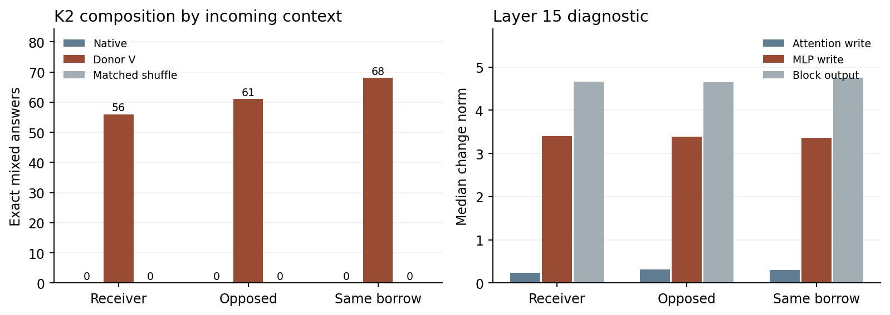

# 在原生注意力权重下交换 K2 操作数 V

冻结 Ouro-1.4B Base。对每个上下文，先获得未干预 K2 注意力权重，再逐层保持这些权重，只交换第一操作数的 V，固定第二操作数各层为该受体背景下原始 V。每个输出 token 重算同一干预，完整整数区分受体答案、原 +100 错答、混合算式和整道供体答案。

300 道确认题中有 74 道原生精确 +100→正答，分布于 51 个答案簇。同答案无借位组为 0/300。

完整分析共 74 道自然修复与 74 道无借位对照。受体分差匹配敏感性队列有 27 对。翻借位供体自己的原生整答为 K1 50、K2 74。

| 条件 | 受体正答 | 原始 +100 | 混合正答 | 翻借位供体 | 同借位供体 | 其他 / 未解析 | 无借位混合正答 |
|---|---:|---:|---:|---:|---:|---:|---:|
| receiver_native | 74 | 0 | 0 | 0 | 0 | 0 | 0 |
| receiver_donor | 0 | 0 | 56 | 0 | 0 | 18 | 67 |
| receiver_shuffle | 66 | 2 | 0 | 0 | 0 | 6 | 0 |
| opposite_native | 73 | 0 | 0 | 0 | 0 | 1 | 0 |
| opposite_donor | 0 | 0 | 61 | 0 | 0 | 13 | 69 |
| opposite_shuffle | 58 | 1 | 0 | 0 | 1 | 14 | 0 |
| same_native | 73 | 0 | 0 | 0 | 0 | 1 | 0 |
| same_donor | 0 | 0 | 68 | 0 | 0 | 6 | 69 |
| same_shuffle | 54 | 2 | 0 | 0 | 1 | 17 | 0 |

## 预设检验

配对区间为按受体答案簇的 97.5% bootstrap。打乱 V 位移在每个 KV 头及操作数 token 保持范数和沿原 V 的投影，接收方的输出路由仍使用同一背景的正常权重。

- receiver_mixed_vs_shuffle 为 +56 道，+75.7 [+62.3, +87.7] 个百分点。

- receiver_safe_mixed_vs_shuffle 为 +67 道，+90.5 [+78.1, +100.0] 个百分点。

- receiver_mixed_vs_native 为 +56 道，+75.7 [+62.3, +87.7] 个百分点。

- opposite_mixed_vs_shuffle 为 +61 道，+82.4 [+70.0, +93.5] 个百分点。

- opposite_safe_mixed_vs_shuffle 为 +69 道，+93.2 [+85.5, +98.7] 个百分点。

- opposite_mixed_vs_native 为 +61 道，+82.4 [+70.0, +93.5] 个百分点。

- same_mixed_vs_shuffle 为 +68 道，+91.9 [+81.8, +100.0] 个百分点。

- same_safe_mixed_vs_shuffle 为 +69 道，+93.2 [+82.2, +100.0] 个百分点。

- same_mixed_vs_native 为 +68 道，+91.9 [+81.8, +100.0] 个百分点。

- opposite_minus_receiver 为 +5 道，+6.8 [-2.6, +17.6] 个百分点。

- same_minus_receiver 为 +12 道，+16.2 [+2.7, +30.0] 个百分点。

- opposite_minus_same 为 -7 道，-9.5 [-24.3, +4.8] 个百分点。

receiver 中真 V 相比打乱 V 的额外混合命中出现在 42/51 个答案簇，单侧 97.5% 上界 91.60%。

opposite 中真 V 相比打乱 V 的额外混合命中出现在 45/51 个答案簇，单侧 97.5% 上界 95.56%。

same 中真 V 相比打乱 V 的额外混合命中出现在 48/51 个答案簇，单侧 97.5% 上界 98.77%。

composition 的预设门槛通过。

context_competition 的预设门槛未通过。

exclude_large_mixture 的预设门槛未通过。

固定诊断子集有 24 道。比较了实际供体 A 的 V 是否随其 B 改变，逐层留存原收受体 B 的 V，并校验固定权重的无变更回放。图中范数来自层 15 数字生成前位置。

三种上下文的注意力权重各取自身的未干预 K2 前向。所有算术混合终点均无需借位，因此整答证据约束可组合的数值读取。对新借位运算的形成和 K2 相对 K1 的独有作用仍需独立检验。固定权重的反事实也保留了正常前向的路由，后续查询可随 V 变化的情况另作判断。

## 独立键值查表任务

固定 128 对独立表格。受体原生 K1 / K2 正答 85/117。混合终点为受体表中与供体查询键配对的数值。

自然 K2 正答队列有 117 道。真 V 与打乱 V 分别得到 0 和 0 道混合正答，配对差 +0 道，+0.0 [+0.0, +0.0] 个百分点。真 V 直接复述供体整答 0 道。预设迁移门槛未通过。
