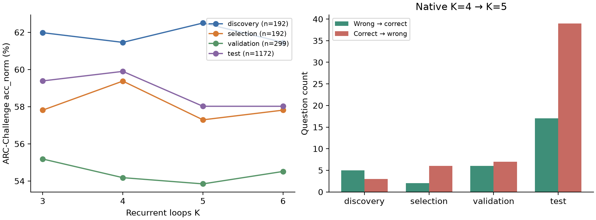
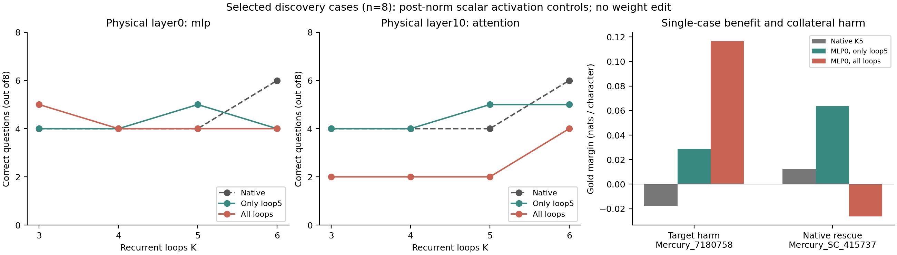

# Ouro weight-space repair v1

**Completed: causal-gate No-Go; no training and no weight edit.**

[Detailed Chinese research report](REPORT_ZH.md) | [Reproduction](REPRODUCE.md) | [Integrity audit](ARTIFACT_AUDIT.json)

Pinned Ouro-1.4B revision `574fa66cb8bf5abdc979642d01cf2b79b16bfab1`; NVIDIA GB10; BF16; lm-eval0.4.9 acc_norm. One fixed seed2021 set of25 demonstrations is shared across every rerun method, as explicitly authorized. This differs from the previous advancing per-query sampler; historical varying-demo accuracies are not mixed in.

| Frozen method | Correct /1172 | acc_norm |
|---|---:|---:|
| native_k3 | 696/1172 | 59.386% |
| native_k4 | 702/1172 | 59.898% |
| native_k5 | 680/1172 | 58.020% |
| native_k6 | 680/1172 | 58.020% |
| loopcd_k4_fixed | 717/1172 | 61.177% |
| loopcd_k4_adaptive | 716/1172 | 61.092% |
| normalized_chord_0.125 | 703/1172 | 59.983% |
| normalized_chord_0.25 | 704/1172 | 60.068% |
| normalized_chord_0.5 | 696/1172 | 59.386% |

Native K4→K5 corrects17 and damages39 questions, net−22 (−1.877pp). K5→K6 corrects21 and damages21 despite identical aggregate accuracy. Fixed/adaptive LoopCD correct41/52 and damage26/38 questions; their net gains15/14 do not reach significance in the reported paired tests. All three chord coefficients were frozen and are reported; no best-test coefficient or K is selected.

Discovery192 contains only3 K4→K5 harms and5 corrections. Forty-eight branch lesions were screened on8 frozen representatives; only2 of6 locally qualified modules received all-loop confirmation. Both failed the shared-invocation gate. MLP0 has a real persistent single-case rescue, but collateral damage offsets its K5 benefit and harms K6. No supervised vector, PCA/SVD direction search, rank1/rank4 weight correction or edited-model primary test was performed. This is a bounded negative decision, not a proof that all projection repairs are impossible.

Data separation: fixed25 demos, disjoint train discovery192/selection192, official validation299, all1172test. Test was opened only after FINAL_LOCK; it is a previously used locked regression benchmark. No post-test method changes. The exact legacy omitted-mask call is required; cached and explicit-ones-mask engineering results are quarantined.

Full code is in scripts/. Readable tables and figures are linked below; the public result archive contains full CSVs, all per-question scoring records, prompt/data manifests, exact completion gates and source hashes. Large BF16 hidden-state vectors are preserved separately in `accepted_diagnostics.tar.gz` (523.7MiB, SHA256 `321fbded9d2958e0aa30e2aeb5abf9bb898f906bcdac63ae254ef7791532e652`) on the local and server experiment directories. They are not Git blobs; the included scripts regenerate them.

- [Evaluation summary](evaluation_summary.csv) and [paired statistics](paired_statistics.csv)
- [Full report](REPORT_ZH.md), [failure mechanisms](failure_mechanisms.csv), [weight manifest](weight_edit_manifest.json)
- [All public result files](artifacts/public_results.zip) and [its checksums](artifacts/PUBLIC_RESULTS_MANIFEST.json)
- [Complete paired transitions, gzip](artifacts/paired_transitions.csv.gz)
- [Accepted hidden-state archive manifest](artifacts/ACCEPTED_DIAGNOSTICS_MANIFEST.json)
- [Independent Astra stop review](astra/independent_stop_go_after_shared.md)

GPU ledger:1.6395/8 loaded-worker hours, including loading, rejected implementations and reruns. The original checkpoint remains unchanged. COMPLETE receipts, not intermediate PROGRESS status strings, determine completion. No old experiment results were overwritten.

Source attribution and data licenses: [NOTICES.md](NOTICES.md).
