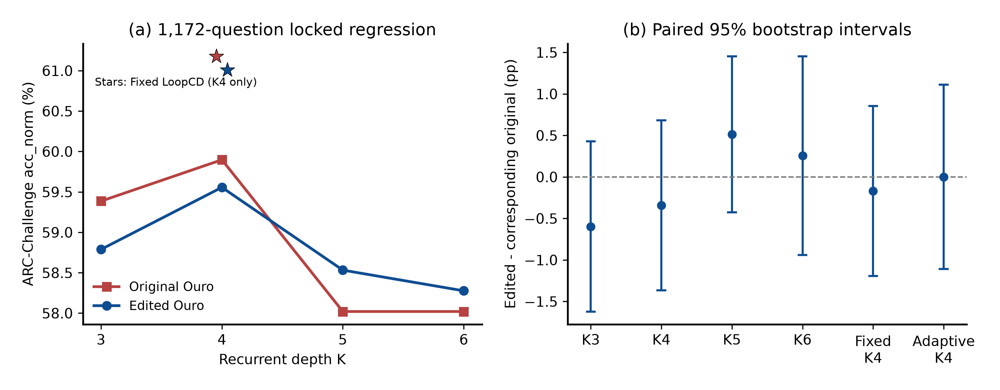

# Ouro V2：实际稀疏列与低秩权重编辑

已完成 14 个真实 BF16 权重候选、独立 selection、官方 validation 选定一个编辑版本，以及全部 **1,172 道 ARC-Challenge 测试题**。最终选择 **B05**。Edited Ouro K4 为 **698/1172（59.556%）**，原始模型为 702/1172（59.898%），差值 **-0.341 pp**，结论：点估计下降，差异不显著；未建立提升。主组合 Edited + Fixed LoopCD 为 **715/1172（61.007%）**，相对原始 Fixed LoopCD **-0.171 pp**，结论：点估计下降，差异不显著；未建立提升。

这里的官方 test 曾在前序研究中使用，是方法冻结后的回归基准；本报告不将它称为新盲测。V1 原始 checkpoint、代码、数据和结果均保留，V2 没有沿用 V1 的“不编辑”停止条件。

## 1. 修改了哪些权重，为什么

从官方 train 的 384 道 discovery 题采集 K3、K4、K5、K6 的 MLP/Attention 输出投影前后统计。每个候选答案仅记录其全文续写的预测位置；先对 token 求均值，再对答案选项等权平均。保留全部题的逐选项循环状态和逐题分数，不只检查 V1 的少数 Correct→Wrong 案例。

独立按 K3→4、K4→5、K5→6 的正确答案 margin 变化排序，每个转移取最低 96 题和最高 96 题，使用固定 SHA256 规则破同分。margin 使用候选全文 log-likelihood 除以字符数后的正确选项分数减最大错误选项分数。各组类别如下：

| 转移 | C→W | W→C | C→C | W→W | 下降组 / 上升组 |
|---|---:|---:|---:|---:|---:|
| K3→K4 | 12 | 13 | 226 | 133 | 96 / 96 |
| K4→K5 | 10 | 7 | 229 | 138 | 96 / 96 |
| K5→K6 | 7 | 6 | 229 | 142 | 96 / 96 |

每层构造下降组与上升组的 raw output 增量均值之差，转移权重预先固定为 0.5、0.25、0.25。以该差向量范数除以全体增量的 RMS 为 site score，选择两个 MLP 层和一个 Attention 层。rank1 是归一化差方向；rank4 在其正交补中加入下降组中心化增量的前三个主成分，再正交化。方向符号固定，退化秩不填充随机向量。这些是使用训练标签构造的统计方向，未使用梯度或优化器；不把它们直接称为已证实的“有害机制”。

MLP 列按“下降/上升组输入二阶矩增量差的正部 × 方向与该权重列的投影平方”排名；若该排名全零才回退到输入能量乘权重列范数，并记录回退情况。实际 site/column 排名、样本 ID、统计文件哈希和方向因子位于 `edited_weights/statistics/`。

本次选出的物理层（从 0 开始）为：mlp_first=14, mlp_second=19, attention_first=17。

稀疏方向编辑为 `W[:,S] -= alpha * u @ (u.T @ W[:,S])`；稠密方向编辑为 `W -= alpha * U @ (U.T @ W)`。另有整列乘 0.5 的稀疏控制候选。Ouro 在输出投影后使用分支 RMSNorm，因此不能把整矩阵统一缩放等同于归一化后的残差阻尼；本轮直接改变列或方向，并在原始 BF16 参数中写入结果。所有循环调用共享同一个修改后的物理参数。未编辑 embedding、LM head、tokenizer 或 norm 权重，未引入 adapter、梯度、backward 或新网络。

这是对 [MIT Weight-Space Programming 公开实现](https://github.com/RikiyaT/lm_understand-logs) 的任务与架构适配，而非其数学基准或 Qwen 配置的逐项复现。原实现使用少量列上的方向分量修改；本轮没有照搬其层号与激进强度，而是用 Ouro 训练统计选层并固定小规模搜索。[公开方法说明](https://rikiyat.github.io/blog/weight-space-programming/)。

## 2. BF16 实际改变参数与精确重放

选定 B05 实际改变 **3,570,385 / 1,434,652,673 = 0.248868%** 个 BF16 坐标。修改的实际 Frobenius 范数为 **3.9742782**。计数比较的是量化后实际 tensor 位值，不把 rank1/rank4 的方向维数当成改变参数量。量化后的实际 delta 不保证仍然严格低秩。

| 物理参数 | shape | 实际改变坐标 | ΔW Frobenius | 相对范数 | max abs ΔW |
|---|---|---:|---:|---:|---:|
| `model.layers.17.self_attn.o_proj.weight` | [2048, 2048] | 3,570,385 | 3.974278 | 0.08982358 | 0.1523438 |

每个候选仅物化一次 BF16 目标张量，后续 screen、selection、validation、test 使用其精确替换 patch；不重复计算低秩 GEMM 后再量化。`selected_edit_manifest.json` 记录原始/编辑 tensor SHA256、文件 SHA256、实际坐标数及选择依据；`edited_weights/selected/` 保存精确替换 patch、完整 BF16 目标张量和方向因子。公开归档可还原这些文件。

真实 A01/B01 检查覆盖非零 BF16 修改、分数变化、精确恢复、K6 中间深度与独立 K3/K4/K5 一致，以及由编辑模型自身 K1/K4 状态独立重算两种 LoopCD，所有要求的分数误差为 0。最终选定 checkpoint 又在训练样本上通过所有参数 tensor 的保护检查、每个编辑参数跨六次循环调用对象/存储一致检查、先前训练分数重放、独立深度及 patch 再载入检查。检查范围和逐项结果见 `results/EDITED_PATH_GATE.json`、`results/SELECTED_CHECKPOINT_AUDIT.json`。

## 3. 数据隔离与验证集选择

固定同一组 25-shot 示范，seed=2021，文件 SHA256：`8cf4b70e7c07c67a589560d5fcbc1fa8feb85a0e7af3b348fa21f147271419da`。384 道 discovery = V1 的 192 题 + 192 道之前未用的训练题；selection 保持独立 192 题；二者及示范按规范化问题文本排除重叠。

所有 14 候选首先在固定 64 道 discovery 子集筛查；按预先声明的家族配额，各家族前两名进入 selection192。selection 中各家族第一名加剩余最佳一名进入官方 validation299。最终验证集三选一，不再修改方向、列、强度或组合。排序严格为 K4 正确题数、K4 平均正确答案 margin、较少实际 BF16 改变数、候选 ID。K3/K5/K6 只记录，不改变选择规则。原模型没有最终选择资格，即使所有编辑都更差也选一个真实编辑模型。

只有写入 `VALIDATION_LOCK.json` 后才复制/读取 validation manifest；只有写入 `FINAL_LOCK.json` 后才复制/读取 test manifest。完整输入 SHA、代码 SHA、方向与实际 BF16 bundle SHA 贯穿每阶段逐题记录和完成收据。测试评估后才读取 V1 的逐题 test baseline，未按 test 反馈选择另一个候选或循环深度。

验证集候选：

| 候选 | K4 正确 / 299 | K4 acc_norm | 实际改变参数 | 是否选定 |
|---|---:|---:|---:|---|
| B05 | 168 / 299 | 56.187% | 3,570,385 | 是 |
| A08 | 163 / 299 | 54.515% | 127,809 | 否 |
| A02 | 161 / 299 | 53.846% | 127,718 | 否 |

## 4. 全量 1,172 题：Edited Ouro 是否改善

下表每格为正确题数（acc_norm）。LoopCD 只报告支持的 K4；NA 不代表估计值。

| 方法 | K3 | K4 | K5 | K6 |
|---|---:|---:|---:|---:|
| Original Ouro | 696 (59.386%) | 702 (59.898%) | 680 (58.020%) | 680 (58.020%) |
| Original Ouro + Fixed LoopCD | NA | 717 (61.177%) | NA | NA |
| Original Ouro + Adaptive LoopCD | NA | 716 (61.092%) | NA | NA |
| Edited Ouro | 689 (58.788%) | 698 (59.556%) | 686 (58.532%) | 683 (58.276%) |
| Edited Ouro + Fixed LoopCD | NA | 715 (61.007%) | NA | NA |
| Edited Ouro + Adaptive LoopCD | NA | 716 (61.092%) | NA | NA |

原始对照复用 V1 已在完全相同固定示范、逐题 prompt 和原生无 cache 调用下生成的 BF16 结果，本轮没有重复运行原始 test baseline。模型 revision、源权重哈希、环境与评分代码路径受记录约束，采集训练统计时对原始分数的两题八方法检查完全一致，最终逐题比较再次核验 ID、gold、prompt SHA、候选字符长度和 token 数。普通推理和 LoopCD 均由一个 K6 轨迹读取对应状态，不能据此声称分别测量了每个 K 的运行延迟。

评分使用 lm-eval 0.4.9 `acc_norm` 协议，完整候选答案的 teacher-forced log-likelihood 除以答案字符数，不是答案字母概率，也不是 token 长度归一化。BF16 的调用细节保留为 `model.model(input_ids=x, use_cache=False)`；不额外传全一 attention mask，以避免在固定 Transformers/SDPA 环境中改变数值路径。

## 5. Edited Ouro + LoopCD 是否胜过原始 LoopCD

主组合是同一份选定权重的 Fixed LoopCD，omega=0.5、K4、参考 K1；Adaptive cap1 是次要比较。二者只使用该编辑模型自身的 normalized K1/K4 状态，经 BF16 LM head 后以 FP32 组合 logits；未混入原始模型缓存，未按测试题调整系数。

| 同方法 Edited − Original | 纠错 | 退化 | 净题数 | Δ accuracy pp | 配对 bootstrap 95% CI pp | exact McNemar p | Holm 两主比较 p |
|---|---:|---:|---:|---:|---|---:|---:|
| native_k4 | 17 | 21 | -4 | -0.341 | [-1.365, 0.683] | 0.6271 | 1 |
| loopcd_k4_fixed | 17 | 19 | -2 | -0.171 | [-1.195, 0.853] | 0.86794 | 1 |
| loopcd_k4_adaptive | 23 | 23 | +0 | +0.000 | [-1.109, 1.109] | 1 | NA |

普通 K4：点估计下降，差异不显著；未建立提升；Fixed 主组合：点估计下降，差异不显著；未建立提升；Adaptive 次要比较差值 +0.000 pp。配对 bootstrap 为 50,000 次题级重采样的 95% percentile 区间，采用与逐题重采样严格等价的纠错/退化/不变类别 multinomial 实现。McNemar 是 discordant pairs 上双侧 exact binomial 检验。两项预定主比较进行 Holm 校正；完整六项比较的校正值另列 `paired_statistics.csv`。区间是逐项区间，不是同时置信带。

## 6. 跨循环深度与选择外样本

| 普通推理深度 | 纠错 / 退化 | 净题数 | Δ accuracy pp | 配对 95% CI pp |
|---|---:|---:|---:|---|
| native_k3 | 16 / 23 | -7 | -0.597 | [-1.621, 0.427] |
| native_k4 | 17 / 21 | -4 | -0.341 | [-1.365, 0.683] |
| native_k5 | 20 / 14 | +6 | +0.512 | [-0.427, 1.453] |
| native_k6 | 27 / 24 | +3 | +0.256 | [-0.939, 1.451] |

各深度没有一致的正向点估计，不能声称跨循环深度稳定提升。

| 数据用途 | n | 普通 K4 Edited / Original | Δ pp | Fixed 组合相对原 Fixed Δ pp |
|---|---:|---:|---:|---:|
| 训练 discovery 筛查 | 64 | 34 / 33 | +1.562 | -3.125 |
| 训练 selection（用于晋级） | 192 | 115 / 114 | +0.521 | +0.000 |
| 官方 validation（用于选定） | 299 | 168 / 162 | +2.007 | +0.334 |
| 历史使用的锁定 test | 1172 | 698 / 702 | -0.341 | -0.171 |

规范化问题文本的跨集合重叠：discovery__test=3, test__validation=2。保留官方全量验证/测试集；重叠题不能视为独立于其来源训练题的新证据。详见 `results/SPLIT_OVERLAP_AUDIT.json`。

discovery 表只表示实际筛查的 64 题，不冒充 384 题编辑后全评；全部 384 题均用于前向方向发现。selection 与 validation 参与了模型选择，其增益不能当成独立泛化证据。test 的冻结后比较可评估此次修改在选择题之外的回归表现，但该集合曾被使用，且只有一个模型和一个任务，不能据此主张跨任务泛化或新失效机制。

## 7. 实际测试了哪些候选，失败幅度是多少

表中 screen 为 64 题、selection 为 192 题、validation 为 299 题。空缺表示未晋级，未补跑或推测结果。完整 K3–K6、两种 LoopCD、实际范数及逐阶段纠错/退化均在 `edit_search_results.csv`。

| 候选 | 家族 | 编辑摘要 | 实际改变 BF16 数 | screen K4 正确 (Δpp) | selection K4 正确 | validation K4 正确 |
|---|---|---|---:|---|---:|---:|
| A01 | A | sparse_directional_projection, Top32 each, alpha=1.0 | 64,308 | 33 (+0.000) | NA | NA |
| A02 | A | sparse_directional_projection, Top64 each, alpha=1.0 | 127,718 | 34 (+1.562) | 114 | 161 |
| A03 | A | sparse_directional_projection, Top128 each, alpha=1.0 | 253,871 | 33 (+0.000) | NA | NA |
| A04 | A | sparse_directional_projection, Top32 each, alpha=1.0 | 63,501 | 33 (+0.000) | NA | NA |
| A05 | A | sparse_directional_projection, Top64 each, alpha=1.0 | 126,253 | 33 (+0.000) | NA | NA |
| A06 | A | sparse_directional_projection, Top128 each, alpha=1.0 | 250,899 | 33 (+0.000) | NA | NA |
| A07 | A | sparse_column_attenuation, Top64 each, alpha=0.5 | 131,072 | 33 (+0.000) | NA | NA |
| A08 | A | sparse_directional_projection_two_layers, Top32 each, alpha=1.0 | 127,809 | 34 (+1.562) | 114 | 163 |
| B01 | B | dense_low_rank_projection, rank1, alpha=0.25 | 6,685,713 | 34 (+1.562) | NA | NA |
| B02 | B | dense_low_rank_projection, rank1, alpha=0.5 | 8,257,663 | 35 (+3.125) | 113 | NA |
| B03 | B | dense_low_rank_projection, rank4, alpha=0.25 | 9,507,579 | 33 (+0.000) | NA | NA |
| B04 | B | dense_low_rank_projection, rank1, alpha=0.25 | 3,207,340 | 33 (+0.000) | NA | NA |
| B05 | B | dense_low_rank_projection, rank1, alpha=0.5 | 3,570,385 | 34 (+1.562) | 115 | 168 |
| B06 | B | dense_low_rank_projection, rank4, alpha=0.25 | 3,633,099 | 34 (+1.562) | NA | NA |

本实验的结论限于这 14 个预先固定的候选及选择过程。无论最终方向是正是负，都不能把本候选集结果升级为“所有稀疏/低秩免训练权重编辑有效或无效”。本轮不设计 Loop，不做新训练，也没有用 observational correlation 替代真实编辑评估。

## 8. 改答案例与交付

`paired_transitions.csv` 包含 1,172×6=7,032 条逐题同方法比较；`changed_answer_cases.csv` 包含所有预测改变，包括 Wrong→不同 Wrong。完整候选分数、字符归一化 margin、ID 和 prompt SHA 可回溯至逐题日志。预测与 gold 均为从 0 开始的选项索引，按源数据选项顺序排列。以下案例只是冻结后结果的展示，不参与参数或候选选择。

- native_k4 退化 `arc_challenge/test/Mercury_415084`：原预测 2 → 编辑预测 1，gold 2，margin 0.22384 → -0.07487。问题：Students observed a turtle in the schoolyard. They measured the distance that the turtle traveled in 30 minutes. If the turtle walked 40 meters in that time, what was its average speed?
- native_k4 退化 `arc_challenge/test/Mercury_7027405`：原预测 0 → 编辑预测 2，gold 0，margin 0.03414 → -0.07919。问题：A student wishes to measure the rate of evaporation of a volatile liquid at room temperature. Which piece of equipment would be best to use in this investigation?
- native_k4 纠错 `arc_challenge/test/NYSEDREGENTS_2013_8_10`：原预测 2 → 编辑预测 1，gold 1，margin -0.00137 → 0.06711。问题：A dialysis machine can be used to remove waste from a patient's blood. Which human body system works in a similar way?
- native_k4 纠错 `arc_challenge/test/NAEP_2000_8_S11+10`：原预测 2 → 编辑预测 0，gold 0，margin -0.00003 → 0.06241。问题：All of the following would be helpful in separating a mixture of sand and salt EXCEPT
- loopcd_k4_fixed 退化 `arc_challenge/test/Mercury_415084`：原预测 2 → 编辑预测 1，gold 2，margin 0.37312 → -0.02741。问题：Students observed a turtle in the schoolyard. They measured the distance that the turtle traveled in 30 minutes. If the turtle walked 40 meters in that time, what was its average speed?
- loopcd_k4_fixed 退化 `arc_challenge/test/Mercury_400091`：原预测 1 → 编辑预测 2，gold 1，margin 0.22514 → -0.02565。问题：A student's mother is heterozygous for attached earlobes, a recessive trait. The student's father is also heterozygous for that trait. What is the percent likelihood that this student has attached earlobes?
- loopcd_k4_fixed 纠错 `arc_challenge/test/Mercury_402563`：原预测 0 → 编辑预测 1，gold 1，margin -0.00342 → 0.25196。问题：If an atom of hydrogen gives up one electron, what is its overall charge?
- loopcd_k4_fixed 纠错 `arc_challenge/test/Mercury_7044328`：原预测 0 → 编辑预测 3，gold 3，margin -0.00390 → 0.07482。问题：Which best explains what scientists are referring to when they use the term conservation?

实际额外 GPU-worker 计费 **2.3411 小时**（8427.876 秒），上限 6 小时；包括前向统计、加载、候选筛查、selection、validation、完整选定模型测试和最终正确性复验。CPU 归档/作图不占 GPU-worker 配额。没有耗费预算重跑 V1 的广泛标量损伤实验。

主要交付：

- `REPORT_ZH.md`、`accuracy_by_loop.pdf` 及可编辑 SVG/PNG。
- `edit_search_results.csv`、`candidate_edit_audit.csv`、`final_comparison.csv`、`paired_statistics.csv`、`paired_transitions.csv`、`changed_answer_cases.csv`、`generalization_by_split.csv`。
- `selected_edit_manifest.json`、冻结设计与阶段锁、实际 BF16 patch/目标张量与方向统计。
- 完整实验与独立重放脚本、逐题评分、完成收据、环境与预算日志、Astra 代码/统计审查。

远端完整原始逐题前向统计及全部候选权重保存在本实验目录。公开归档布局、哪些大文件保留远端以及校验/重放步骤见 `README.md` 和 `ARTIFACT_INDEX.json`；任何未上传的大体积诊断数据都会明确列出，不冒充已发布。

固定模型：[ByteDance/Ouro-1.4B](https://huggingface.co/ByteDance/Ouro-1.4B/tree/574fa66cb8bf5abdc979642d01cf2b79b16bfab1)。数据：[allenai/ai2_arc](https://huggingface.co/datasets/allenai/ai2_arc)。评分协议来源：[EleutherAI/lm-evaluation-harness v0.4.9](https://github.com/EleutherAI/lm-evaluation-harness/tree/v0.4.9/lm_eval/tasks/arc)。本报告中的本地实验数值由公开结果文件生成。
