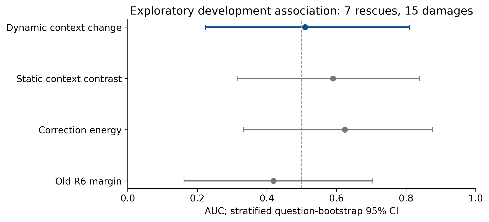

# R15：前缀修正的上下文偏好是否代表纠错价值

**本次测量完成，但预声明信号未通过筛查。** 主信号 AUC=0.5095，精确单侧标签置换p=0.478932，5000次题级配对分层bootstrap95%CI [0.2238,0.8095]。样本小、区间宽，不能断言所有此类变量都无信息；当前证据不足以训练或部署选择门控。

完整58道开发题包括原576题中所有29道R6/M2答案分歧题，以及seed2021抽取的29道一致题。抽取和顺序不使用gold；一致题的第二候选为R6次高分项，只是背景控制，没有混入主AUC。29道分歧中7道救回、15道损害、7道双方均错；主AUC实际单位是22道题，不是657个token位置或105个正负样本对。

## 测量对象

固定q为当前原生Q4分布，n_j为保留同25示例、仅将当前问题改为N/A或Unknown的N1/N2参考分布；所有分布对应相同候选续写前缀的预测位置。对p定义I_j(p)=E_p[log q−log n_j]=KL(p||n_j)−KL(p||q)。比较实际Fixed与实际M2修正后的分布：

DeltaI_j,t=〈p_M2,t−p_Fixed,t, log q_t−log n_j,t〉。

主信号为新提议候选的Σ_t min_j DeltaI_j,t/原字符分母，减去旧R6候选的同一量。每个参考的原值完整保存。逐位置最小值不是单一参考的KL差；它只是预声明的最不利参考变化汇总。

这衡量概率质量是否移向原上下文相对空问题参考更偏好的词，不是互信息、真值或正确语义。前后变化实际为M2对Fixed；R6没有相应token分布，因此关联R6→M2结果仍包含撤销旧R6修正的混杂。

## 结果与控制

| 固定信号 | AUC | 精确单侧置换p |
|---|---:|---:|
| primary | 0.5095 | 0.478932 |
| static | 0.5905 | 0.267456 |
| energy | 0.6238 | 0.188080 |
| old_margin | 0.4190 | 0.732544 |

primary为上述动态上下文偏好；static为同候选同位置的Fixed静态I差；energy为修正Fisher能量差；old_margin为旧R6候选的低置信度信号。均固定正方向，没有翻号或将控制晋级为方法。

主信号对static的AUC差为−0.0810，95%CI [−0.4762,0.3333]；对energy为−0.1143，95%CI [−0.5048,0.2571]。没有超越控制的证据。全部区间对同一题组使用相同重采样，22题内标签置换穷举170544种分配；这些是重复开发数据上的关联描述，并未校正跨轮自适应研究。

按预声明零点只做诊断分组：正信号13题含3道救回、7道损害、3道双方均错，净−4；在同29道分歧中随机选择同样13题的精确机会控制，尾概率p=0.655547。它没有优于相同选择机会的随机分组，此分组未被部署成解码器。

N1/N2在29道分歧题上的汇总信号符号全部一致，但仍不能辨别纠错与损害。两参考只差空问题占位词、共享绝大多数提示，不能当成独立证据。这里只否定将本标量直接作为价值标志的具体提议，不能推广为“参考稳定永远无用”。

## 正确性与缺失信息

完整采集116条候选前缀、657个预测位置。所有主干与参考native/Fixed完整LL、M2完整评分、alpha和修正能量均对历史真实记录精确一致，最大误差为0。199个alpha=0位置的上下文变化也精确为0；模型head/norm前后SHA相同，未更新权重，无训练控制器。

原主干BF16隐状态从已核验缓存读出，参考重新以原始无KV/无显式attention-mask路径运行K4。完整词表统计按位置分块，只保存标量，没有从候选LL伪造词表分布。

独立验收重新汇总全部特征，以动态规划重建精确标签置换和同覆盖率随机分布，且复现全部5000次bootstrap区间。公开数值重放：python -B scripts/r15_verify.py；须先恢复原R6/R7输入和本轮记录，不需要模型或GPU。

构造性反例见r15_context_math.py：交换参考两个非目标坐标的绝对logits，同时保持其循环增量相同，可使原投影数组及目标概率不变，而DeltaI分别为约+0.2131和−0.2131。这是通用logit空间中“摘要不足以唯一恢复该量”的构造证据；未建立固定Ouro输出头空间的完整不可识别性定理，也不声称真实缓存中已找到这种精确坐标对。

## 冻结、资源和停止

最初定义公开于562f02686f78b974d4147f06cec3ecee5fc17497。空闲等待器在GPU持续繁忙时结束，未启动worker、GPU新增用时0。随后仅改调度，在任何新特征前向前于da22d62f002d48798bf36a3f33238a76e014fd14公开修订：CPU nice+15并行运行，不停止或调整已有Ollama；cohort、公式、分析、240秒软期限及15秒退出宽限完全未变，旧锁和源码保留。

本轮实际GPU-worker 176.768秒，原6小时累计17656.166秒（4.9045小时），剩余3943.834秒。所有加载与退出计费；旧账本、锁、测试记录均未修改。原两个完整ARC已实际使用5625.518秒，后续测量仍计入相同21600秒总上限。

采集复用了历史主干状态，且与已有GPU进程共享设备，因此这个时间不是完整独立部署延迟；历史缓存生成成本仍保留于原账本。主分析只在58题完整、无对齐缺失、数值检查全部通过后运行，未分析中途特征或延长GPU期限。

未读confirmation/validation/test逐题数据，未启动另外两个数据集，未选择新方法。完整ARC的742/1172记录不变；751及可靠prefix/reference-stable选择性修正目标仍未达成。当前应停止把上下文相对偏好的增长直接当作正确更新价值，而不是追加阈值或对该信号拟合门控。
