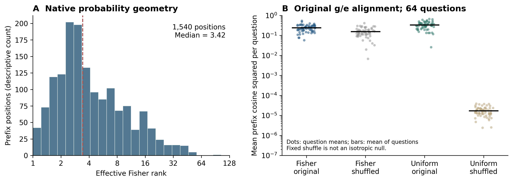

# R18 全词表等权先验投影：保留部分旧收益，但未超过R6

结论：按事前冻结标准停止该度量路线。固定64题中，uniform projection=35/64，旧M2 Fisher=34/64，R6=36/64。相对R6纠错0、损害1；虽然保留了R6相对Fixed的全部2道独有纠错、也高于自身四个控制，但没有超过主要基线，不能晋级。

没有重测完整ARC、打开517确认/299验证/新测试逐题数据，或启动HellaSwag/OpenBookQA等其他任务。完整ARC主记录仍是此前R11的742/1172（R6=736/1172），当时配对p=0.307；本轮没有足够强的新方法或已验证的选择性机制。

## 唯一方法和固定控制

只将投影度量从pQ4概率加权改为完整词表均匀加权。g、N0参考增量e、原始Fixed、系数范围[0,1]、完整候选、字符归一化及Q4-Q5晚期项保持。每个已消费答案前缀按均匀词表中心化g/e，用FP64计算clip(<g,e>/||e||²,0,1)，再形成FP32 logits并执行完整log-softmax。不得再次减旧R6。

这是标准欧氏投影，不是新数学原理；此前R2曾做不同late-update的full-vocabulary Euclidean控制。本轮测试的是原N0先验方向的固定度量变更，不把它当成首次探索这种几何。原R16的seed2021均匀64题原样复用，不称独立验证。

| 方法 | 正确/64 | 对主方法的意义 |
|---|---:|---|
| uniform_projection | 35 | 唯一可晋级候选 |
| matched_guidance_U | 33 | 等权范数幅度控制 |
| matched_guidance_P | 33 | 原生Fisher范数幅度控制 |
| shuffled_correction_U | 32 | 等权修正范数置乱控制 |
| shuffled_correction_P | 32 | 原生Fisher修正范数置乱控制 |
| old_Fisher | 34 | 旧M2前缀方法 |
| R6 | 36 | 主要比较基线 |
| fixed | 34 | 历史Fixed |
| A1 | 33 | Fixed加未变晚期项 |
| native4 | 32 | 历史Native K4 |

相对R6：rescue=0，damage=1，净变化=-1，exact双侧McNemar p=1.000。相对旧M2只救回1题、没有新损害，64题仅1个预测不同；此单题差异不是稳健提升证据。

四个控制均不可晋级。U/P分别用对应度量匹配guidance残差范数或实际修正范数，P度量的rho不截断。829个前缀位置rho_P>1，说明uniform修正可能增强原生Fisher指导范数。所有匹配恒等式只在最终FP32舍入之前成立。

## 新测得的概率几何

本次255个完整候选共1540个位置，真实计算了原生pQ4。令H=diag(p)-ppᵀ，有效秩为tr(H)²/tr(H²)；这不是代数秩或隐藏状态语义维数。采用非负对角/非对角展开及最大概率坐标补和，避免接近集中分布时相减抵消。trace<=1e−8时按预声明规则记undefined，且该量从不控制解码。本次1540位置均可定义。

有效秩五数概括为[1.013914,2.324355,3.417816,7.132113,86.236690]。概率IPR中位数2.627067，最大token概率中位数0.553469。说明这一批原生概率的Fisher有效权重集中，但这不是Fisher计算错误。

| 原始g/e对齐，所有prefix池化描述 | mean cosine² |
|---|---:|
| native | 0.2711123721 |
| native_shuffle | 0.1768124381 |
| uniform | 0.3731786092 |
| uniform_shuffle | 0.0000180184 |

高的概率加权对齐不足以单独证明共享语义先验；固定词表置乱不是各向同性随机方向，有效秩也不是shuffle cosine²的精确预测式。Uniform方法的全局对齐更高、置乱背景更低，但大量低概率词、词表冗余和分词器结构也会主导该度量，不能把这些几何数值等同纠错价值。

本轮测量对象是原始g/e，未重新取得Answer→Response的全词表激活；不能把表格称为R17在uniform度量下的复测，也不能据它解释R17的全部现象。R17本身的e-vN还含共享减项的代数耦合。

新修正的平均P范数能量0.150933，旧Fisher为0.051442；U能量分别0.373792和0.229252。因此修正强度也发生变化；虽然有两套匹配控制，当前单题提升仍不足以证明有效秩造成了旧方法失败。

图A汇总1540位置的有效秩；图B是64题各自的平均逐prefix对齐，黑线为64题均值，无伪独立token置信区间。图B与上表池化位置权重不同，原数据见r18_GEOMETRY_PLOT_DATA.csv。

## 唯一损害案例及停止依据

`arc_challenge/train/Mercury_402569`：问题问sodium与chlorine形成什么，gold为table salt（索引1），R6正确，新/旧M2均选sodium hydroxide（索引3）。R6配对margin=0.115288609，A1=-0.012005883，uniform=-0.002605003。Uniform相对A1的margin改善0.009400880，仍不足以恢复正确排序。
固定gold/修正后rival的target项变化-0.052942145、normalizer项变化-0.062343048；两者之差0.009400903。这是规范依赖的分数核算，不是可以直接删除某项的合法解码器，也不构成隐藏状态语义因果归因。

完整问题、选项和8个候选前缀位置保留于r18_FAILURE_CASES.json及r18_failure_prefixes.csv。该64题上没有R6错而uniform对的题；两套正确集合无互补证据，不能据此继续做择优路由或混合系数搜索。

回查原已公开R7方向oracle：576开发题中R6错216题，固定A1−aE0、a∈[0,1]的路径仅32题可达gold第一名，184题被标为方向受限。此oracle不可部署；它支持停止仅调同一方向系数的路线，也不能保证任一新方向会有收益。

## 复核和预算

本地NumPy/Torch、显式小协方差矩阵秩、零校正恢复Fixed、相同参考、gauge及batch extension检查通过。真实首位置NumPy/GPU核对通过；所有原始主干/N0基线、旧M2系数及完整分数的exact parity误差0。Head/norm哈希前后相同，无训练、权重更新、KV或prompt改变。只读独立重放在本地及原服务器均通过。
四个控制前FP32范数最大误差8.88e-16；保存LP标量重建FP32和的最大差3.22e-06，在明确FP32累加界内，未放宽原路径parity。

R18实际GPU-worker 85.175931秒，含加载/退出。继承七旧账本字节不变；累计17870.323022/21600秒，余3729.676978秒。R17+R18共新增127.570758秒。加载19.457秒，N0前向合计32.895秒，投影及控制15.200秒；主干复用且共享GPU，不能当作独立部署测速。

R18 launcher/supervisor/worker均已退出，其他Ollama未停止。定义及全部运行源码在任何新特征前公开于875686d6697b0d7ffd5c0613060a641a2dad87f8；protocol SHA256=43acdd9ab01345a940ebf7a70111651698e7b16b72031963dbb5c4bcec53c832。没有按结果改公式、温度、尾部截断、符号、参考、系数或赢家。

## 研究结论

新证据证明当前两种度量确实不同，且原生Fisher有效权重在很多前缀高度集中；没有证明这种集中导致准确率损失。等权度量将旧M2提升1题，却仍落后R6；该路线按锁关闭。当前仍未获得可推广的选择性价值信号或达到751/1172的新方法。后续若继续，需要不同的、问题条件下的有效方向证据，不能将这些失败重包装为更强的门控方案。

交付包含完整255候选/1540位置记录、基线parity、四个控制、题级配对结果、有效秩、双度量能量、失败案例、PNG/PDF及图数据、全部源码和执行/预算日志。
