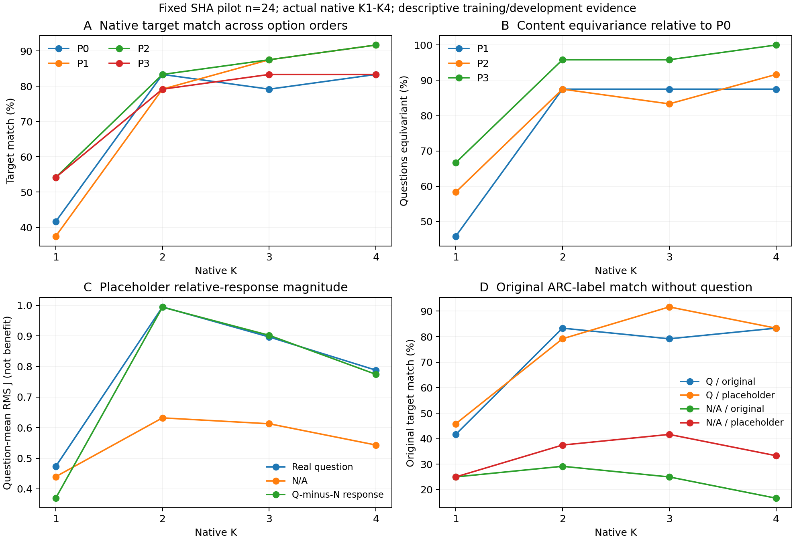

# Experiment B：循环模型的候选输入干预

**完整24题试验已完成。结论支持问题条件相关的候选相对响应，以及更好的答案内容重映射行为；不足以把增益主要归因于H1/H2/H3中的一个内部机制。停止Experiment C，不启动状态干预。** 这不是要求先证明因果才允许因果实验；当前对照尚不能优先选出一个能区分竞争解释的干预方案，收益方向与格式/尺度/长度混淆仍未分开。

## 1. 固定样本、实际覆盖与完整性

从训练/dev的576题按`SHA256(UTF8('2021|'+full_id))`、再ID排序固定64，预算内预声明前24 pilot；不是A的NumPy64。B5、B6和次级matched均固定该序列前4，不按模型结果筛。64完整图需498body，按同一事前成本政策估计998.413秒，超过当时710.673秒余额；24图估计523.956秒。两者均为经验规划，不是物理下界。原始题目、候选、gold、源label、当前display label、原始token与全部映射都可从constructor/audit及任务档恢复。

实际196逻辑groups、784完整候选评分、218次depth4前向、872个native head、1448个head预测位置。P0/P1/P2/P3各24，真实Q及N/A的placeholder配对各24；matched Q/N各4；B5同4的完整2×2；B6同4的lookup/copy。4个自然错误替代独立语义审查通过，另2个候选仅因token长度拒绝，0个语义拒绝；其他20为scope_not_attempted。Q与N/A合计8对matched pair（各4对）均核全prompt长度、替换span位置、前后缀IDs/位置一致。相同shape不等于相同词频、难度或纯语义干预。

原25demo IDs/order不变；B5仅改demo输出格式。所有合法letter/full-answer target均完整评分。模型保持pinned574fa66…、BF16、原noKV/no显式mask路径；native K1..4来自同一个真实depth4轨迹。没有训练、gate、calibration、prior投影或新解码算法。Gold仅供CPU构造/后验评估，worker只读取opaque数值任务与合法prompt/target文本，不反序列化语义/gold sidecar。

全部24个未改P0在任何干预前逐候选严格复现历史native K1/K4/literalFixed；P1历史端点亦逐项strict0。A的两题独立depth2/3校验仅复用为实现证据，不冒充B样本效果。全部218任务、参数前后269hash/cleanup/预算通过后，唯一官方analyzer先验数值、再解封labels。Root另从全部1744原始数组与CSV独立重算548项统计（其中386项要求exact，162项允许跨架构1e−12，实际最大差均0.0）。

FP64normalizer最大重算误差3.55e-15，实际FP32 token LP相对64参考最大差1.02e-06，实际FP32sum相对保存token精确和最大差1.65e-06并满足预定gamma界。主S始终GPU FP32完整log_softmax/gather/sum；64normalizer只是诊断，未替代主分数，也不声称分解bit-exact。

## 2. B2：正确性与标签重映射行为

|条件|K1|K2|K3|K4|分母|
|---|---:|---:|---:|---:|---:|
|P0|10|20|19|20|24|
|P1|9|19|21|22|24|
|P2|13|20|21|22|24|
|P3|13|19|20|20|24|
|Q_placeholder|11|19|22|20|24|
|N_original|6|7|6|4|24|
|N_placeholder|6|9|10|8|24|

P0的相邻救/伤为11/1、0/1、2/1；因此主要净变化在K1→K2，之后不是单调改善。P0 K1→K4准确率差41.667pp，问题级20k paired bootstrap CI[12.5,66.667]pp。P1/P2/P3的差分别54.167[29.167,75]、37.5[12.5,62.5]、29.167[0,54.167]pp。该阶段观察只属于预定24题，不外推完整ARC。

P1是固定shift1循环，P2是正确项与hash选定wrong位置交换，P3按固定非cyclic列表选择未覆盖排列。不是全循环或全排列群。先对显示顺序分数argmax、再映回原内容；exact tie取首个显示label。相对P0的内容equivariance如下：

|条件|K1|K2|K3|K4|
|---|---:|---:|---:|---:|
|P1|11|21|21|21|
|P2|14|21|20|22|
|P3|16|23|23|24|

分母均24；K4−K1分别+41.667[16.667,66.667]、+33.333[12.5,54.167]、+33.333[16.667,54.167]pp。P1/P2的“显示字母不变”反而下降25和29.167pp，不是一直选相同字母。P0预测内容未实际移动的情形不能区分两种invariance，逐K moved-content分母和每题记录另列，主24没有因此删题。P3 K4的24/24内容一致不等于24/24正确（实际20/24）。这些支持binding相关的行为改善，尚未把专门binding计算与内容正确性共同改善分离。

## 3. B3/B4：相对候选响应、问题存在和效用方向

对未改选项定义I=S_original−S_modified；J(i,l)=I_i−I_l消共享normalizer，所有相邻delta、所有未改option/pair均保留。问题级先平均，再bootstrap，不把候选对当独立样本。J大小仍可受输出scale影响。尤其gold-relative J=margin_original−margin_modified，**正值表示替换降低gold margin，不表示有益**。

Placeholder主24的meanabs J(Q−N)为0.333333、0.901042、0.809028、0.699653。三个相邻变化为+0.567708[0.355903,0.800347]、−0.092014[−0.258680,0.067708]、−0.109375[−0.218750,0.001736]。K4 gold-relative DID=+0.617187[0.285156,0.968750]：原问题下把wrong替为“Not a valid answer”，平均反而降低正确项相对其他未改项的margin；Q最终正确数仍20/24。非零响应不是纠错收益。

Matched4的gold-relative DID各K约0、−0.234375、−0.921875、−0.671875；K4 CI[−1.062500,−0.203125]。其Q目标匹配1→3→3→3，N/A为1→1→1→1。该子矩阵方向不同，不能称全24效应反转，也不能精确扣出“长度贡献”；样本、替代和难度均不同。所有个体与区间保留，不能用4题区间作泛化强判。

N/A保留原选项与相同25示例，K4仅4/24，未保留Q原顺序的20/24高匹配；N/A+placeholder为8/24。它衡量选项及格式的信息，不是纯label bias或“推理”评分。Q/N长度和结构不同，因此DID是问题存在条件相关的响应，不是完全隔离语义的因果量。原始target logits与64normalizer诊断俱全；约0.1–1的J不是仅由约1e−6的LP舍入解释，但也未消除尺度/词频/格式解释。

## 4. B5/B6：严格同4题矩阵与早期读出

每格为raw正确数 / 字符归一正确数，分母固定4。L/F分别指letter/full-answer demo输出；目标letter用原raw sum，full-answer预先指定字符归一主读出且raw诊断同时保留，分母为正文长度、无前导space。绝不跨目标格式直接比较raw LL幅度。

|同4题协议|K1 raw/norm|K2 raw/norm|K3 raw/norm|K4 raw/norm|
|---|---:|---:|---:|---:|
|B5_L_letter|1 / 1|2 / 2|2 / 2|2 / 2|
|B5_L_full|2 / 3|2 / 3|2 / 3|1 / 3|
|B5_F_letter|1 / 1|0 / 0|0 / 0|0 / 0|
|B5_F_full|2 / 2|2 / 2|3 / 3|3 / 3|

同4题P0不是主24的10→20。完整same4的逐K正确性、K4−K1及5个固定2×2 paired accuracy contrasts全部报告。例：L-demo/full-target在K4 raw为1/4、字符归一为3/4，必须同时呈现，不能择优。F-demo/letter-target的1→0展示明显协议失配，不代表隐藏知识缺失。四cell都保留joint options，**没有独立no-joint因子**，不能从这个2×2估计“候选内容共同出现”的净效应；N/A仍显示全部choices也不能补该因子，未拿旧R6不同prompt/test作未匹配因果对照。

B6固定color lookup和显式letter-copy两类均4/4→4/4→4/4→4/4。它们说明这几个简单任务K1已能完成，但天花板无力排除复杂ARC的任务依赖读出成熟问题；[0,0]样本增益区间不等于总体效应精确为零。

## 5. 五个问题的结论与停止

1. **是否强关联更好的候选比较？** 有问题条件相关的相对候选响应与真实决策改变；影响并不一致有益，尚不足认定“改进语义比较”主要解释gain。
2. **答案-label绑定是否单独改善？** 内容重映射行为改善明确，且不同于字母固着；内部binding计算没有与内容决策改善独立识别。
3. **一般早期输出不成熟是否解释大部分？** 简单任务K1已天花板，不支持其最强普遍版本；格式失配/复杂任务依赖的更窄H3仍可行，不能量化贡献。
4. **哪些仍混淆？** Placeholder长度/meta-answer语气、matched难度和词频、Q/N长度/结构、输出scale、B5demo/target失配与长度归一，以及缺少no-joint因子。
5. **是否有具体transition与token-position类别足够支持C？** K1→K2是本样本明确的行为区间，但当前比较不能有根据地优先选择question、candidate-content、label或answer-readout哪类位置来区分H1/H2/H3。并非要求先得到因果证明才可设计干预；当前竞争解释尚不足以支持一个有识别力的下一步方案。

**STOP C。** 不因还有预算而做任意状态patch，不把本24/4题描述性结果称为盲测、通用机制或新算法。548行区间未作多重比较校正；完整支持/反证/替代解释见hypothesis_comparison.md，独立范围见ROOT_POSTRUN_REPLAY.json及ASTRA_POSTRUN_REVIEW.md。

## 6. 实际成本与可复现交付

本次GPU-worker实际293.1106862188317秒，包括装载、hash、token审计、全部前向/head/数值检查/导出/退出。累计21账21182.437382869888/21600秒，剩417.5626171301119秒；旧20账原字节保持，组件不重复计入总额。此后未追加模型作业，未启动C、外部benchmark或额外数据集。共享GB10 allocator/耗时只代表本诊断流水线，不代表部署速度或独立显存容量。

所有原始1744向量以标准无损xz容器恢复到VECTORS.npz；源/CSV/日志/收据在小records archive和直接文件中，统一index逐件SHA。公开CPU复验入口root_postrun_replay.py不需要私有transport、模型权重或9个本地模型metadata；它不冒称重新加载checkpoint。官方原服务器验收receipt单独保留。原完成job的输出/冻结协议不可覆盖重跑；未来任何模型复跑须新namespace与完整预算审核。
