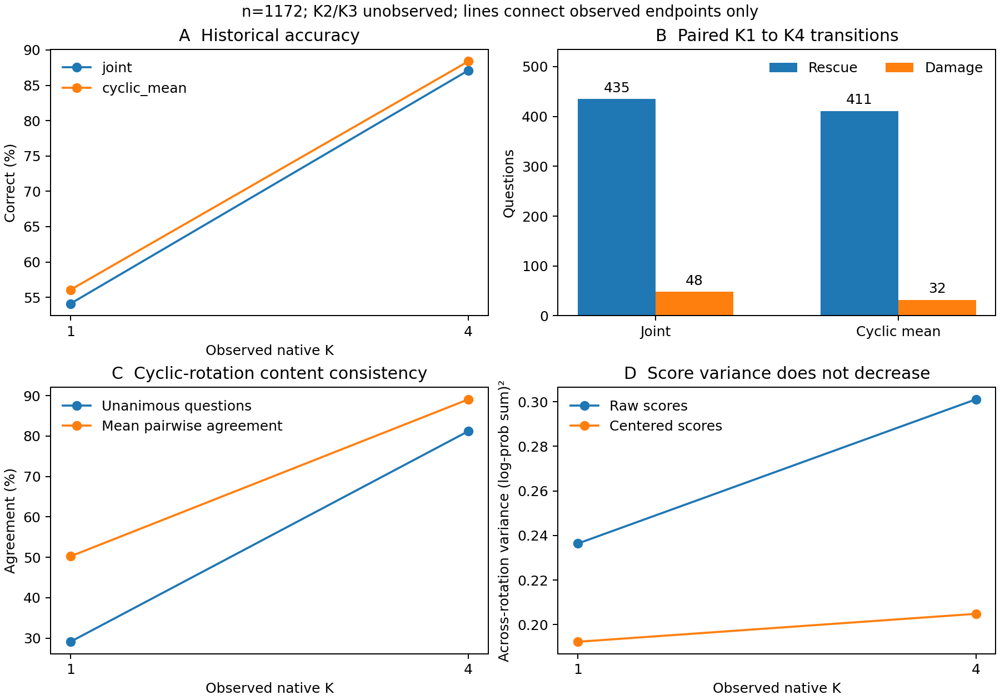

# Experiment A：循环决策形成审计

本轮完成了1172道历史 ARC-Challenge 测试题的 CPU 复现、配对转移、循环选项稳定性和可用深度审计；另完成两题新鲜模型读出的技术校验。**64题中间深度采集未启动**：预先冻结的保守成本准入未通过。没有开发新解码算法，也没有把历史测试当作新的盲测证据。

## 1. 恢复与精确复现

读取基于历史提交`6ce4d5d4...`的实验，保留后续`01443817...`上传补齐的全部文件，新建分支`codex/ouro-decision-audit-20261105`。官方`r11_restore.py --verify-only`验证112个归档成员与现存文件全部字节一致。缺失的继承R7测试原始记录只恢复到本审计目录`recovered/results/`，未修改旧文件；恢复程序绑定公开archive/index/member SHA。

原服务器 CPU 环境执行官方`r11_evaluate.records('test')`，全部14种已存读出的严格重算、预测、正确性、输入与来源校验通过。当前Windows NumPy环境对旧R6投影曾出现1.11e−16级FP64差异并被原strict gate拒绝；失败日志保留，没有降低门槛。本地独立重建四种Joint原始分数/预测与完整1172题请求、prompt、候选顺序、token边界、target数量/hash并通过。来源权重身份由历史manifest和本次pinned文件SHA分别证明，不将只读文件校验冒称模型前向。

Joint评分是完整字母续写的原FP32全词表`log_softmax/gather/sum`，**不除候选正文字符数**；正文长度仍按原协议核验。Cyclic读出是已映回原内容顺序的log-score算术平均，不是投票或概率平均。

| 读出 | K1正确 | K4正确 | 救回 | 损害 | 两端均对 | 两端均错 | 均错但换答 | 答案不变 | 净增 |
|---|---:|---:|---:|---:|---:|---:|---:|---:|---:|
| 原顺序Joint |634|1021|435|48|586|103|46|643|387|
| Cyclic均分 |657|1036|411|32|625|104|33|696|379|

每题ID、gold、两端预测与类别在`k1_k4_paired_transitions.csv`；分数与margin在`loopwise_predictions.csv`。原顺序净增33.0205pp，seed2021/20000次问题级paired bootstrap 95%CI为[29.8635,36.1775]pp，exact McNemar p=4.368765143743369e−79。Cyclic净增32.3379pp，CI[29.3515,35.3242]pp，p=5.575631962000132e−85。这些是历史描述性统计，未作新方法选择证据。

## 2. 循环选项一致性

循环引用不是完整排列群。1172题中1165题有4个选项、4题有3个、3题有5个；每题使用自身全部循环旋转。每个rotation的存储分数已映回原内容顺序。为恢复实际显示顺序的tie规则，本审计先还原displayed scores、按第一个显示label取argmax，再映回内容；没有二次错误映射。K1有169个rotation并列最高、K4有64个；直接mapped argmax会分别在60/26个rotation得到不同内容，两个规则均在逐rotation表中保存。历史cyclic组合的原内容顺序argmax保持不变。

| 问题级指标 | K1 | K4 |
|---|---:|---:|
| 所有rotation内容预测一致的题数 |341/1172|952/1172|
| 平均两两内容预测一致率 |50.2361%|89.0927%|
| 原始mapped分数跨rotation方差均值 |0.236396|0.301099|
| 去每rotation候选均值后的方差均值 |0.192308|0.204844|

两两一致率增加38.8567pp，问题级paired bootstrap CI[36.6296,41.0267]pp。**离散预测一致性显著上升，但分数方差没有下降**；原始方差差的CI[0.04667,0.08326]，中心化方差差CI[−0.00009,0.02553]。分数分离、共同尺度和跨rotation变化不能用一个方差指标混称“稳定性”。原顺序gold相对最佳wrong的平均margin从0.237415升至2.815700，但141题margin下降；Cyclic从0.362958升至2.935209，130题下降。

以原顺序Joint的正确性为准，一致性与正确性相关而不等价：K1一致题正确率269/341=78.89%，不一致题365/831=43.92%；K4为898/952=94.33%与123/220=55.91%。两组准确率差的问题级bootstrap CI分别为[29.39,40.34]pp和[31.62,45.19]pp；这是同一数据内关联，不是校准过的预测器或因果作用。若改用Cyclic组合正确性，不一致题对应388/831与138/220；两种correct目标不能混用。

Cyclic的411次救回中，一致率上升331题、不变62题、下降18题；32次损害为19/7/6。更具体地，**47题在K1已全部rotation一致但答错，K4仍全部一致且改为答对**；反向1题。完整16组交叉表及实际ID均已保存。这表明“从不一致变一致”不能单独覆盖全部收益，但不直接证明内部语义比较机制。

## 3. 中间深度与本次实际模型校验

旧R11辅助调用执行depth4，但`head_logits`只选K1/K4（通用函数选择1/4/5）；没有已落盘的该Joint prompt K2/K3状态。旧原答案正文的native1..6缓存与Joint字母prompt不同，不能替用。R10开发记录另有实际depth5轨迹的K1/K4/K5 scalar，覆盖情况单独记录，不能冒称R11 depth4内的完整轨迹或新depth6校验。

本次一次有界模型作业先对原两题parity、8个循环rotation进行24次原始无KV/no-explicit-mask前向，导出72个native head。16组独立depth2/3的normalized BF16 state、FP32全49152词表head和目标LP与depth4真实中间读出全部bit-exact；旧K1/K4/literalFixed也精确一致。保存48个去重原始vector、269个参数前后hash及全部来源/清理收据；Root独立复核通过。这证明该读出实现的有限技术parity，**不构成64题或1172题中间轨迹的行为结论**。

冻结64题计划使用seed2021从discovery384+selection192无放回抽64，再按原index排序；包含255个rotation/255次depth4前向，486210输入tokens，长度1870..2018。准入估计为1084.6512秒（含60秒收尾），而当时soft deadline剩437.3866秒；因此没有开始任何64题前向，没有部分开发集效果。该预测是含最慢冷启动样本和2倍安全系数的保守经验规划，不是实际64题耗时或物理下界。没有修改规则或重试。

## 4. 明确回答六个问题

1. **+387由435次救回减48次损害构成**；Cyclic为411减32，净379。
2. 现有完整测试集只能把救回定位在**K2至K4之间**，不能确定主要发生在K2、K3还是K4。两题技术校验不能替代整体轨迹。
3. 预测的循环旋转一致性明显改善；分数方差没有相应下降。
4. 一致性与正确性正相关，但仍有一致却错误的题，也有不一致但原顺序正确的题；稳定不等于正确。
5. 最有针对性的后续B动机是47个“已全旋转一致但错误→仍全一致且改对”的案例，结合整体一致性提升，区分内容选择变化与label一致性。它只是行为线索，后续干预与独立验证尚未执行。
6. 不能声称某个具体循环承担语义比较、label修复或成熟化的因果角色；不能从相同K1/K4答案推出K2/K3无reversal；不能将历史暴露测试、两题技术parity或未执行64题计划当成新泛化证据。

H1/H2/H3的逐项证据及局限详见`hypothesis_evidence.md`。历史端点“稳定”固定为相邻可用端点K1/K4同答，确认K4、gap=3；真实中间reversals标unknown。新连续K1..4分析器的局部稳定、持久后缀稳定和后续改变定义事先固定，但未用于不存在的64题数据。

## 5. 成本与交付状态

继承19账20834.389865819365秒；本次新增54.93683083169162秒，合计**20889.326696651056/21600秒**，剩**710.6733033489436秒**。所有装载、hash、校验、保存、退出均由supervisor实际wall计入，没有重复加total字段。其他共享GPU程序未改动。

CPU审计及所有要求文件均已完成；K2/K3整体轨迹因预算准入不足而缺失。`COLLECTION_RESOURCE_PLAN.md`提供原64完整task/恢复方式、观测成本与未来独立授权条件（建议hard1200秒，比现余额至少多489.3267秒），不是本轮执行请求或许可。没有外部benchmark、新解码算法、训练、权重修改、额外模型重跑或新数据集。
