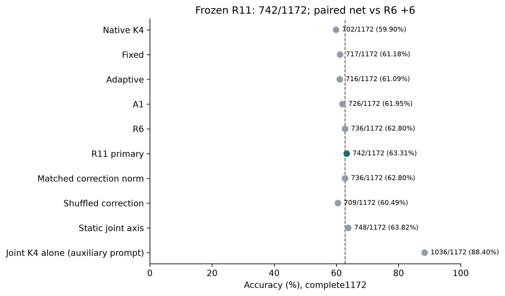
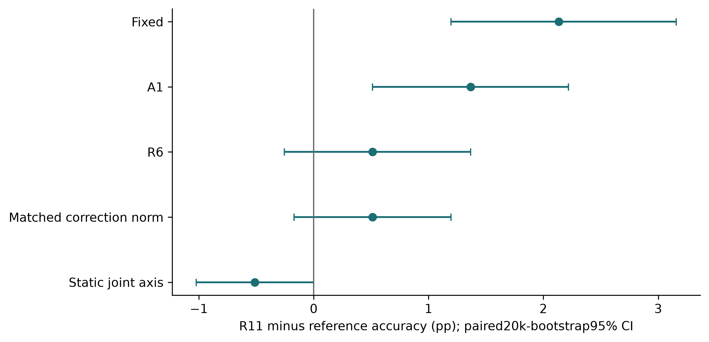
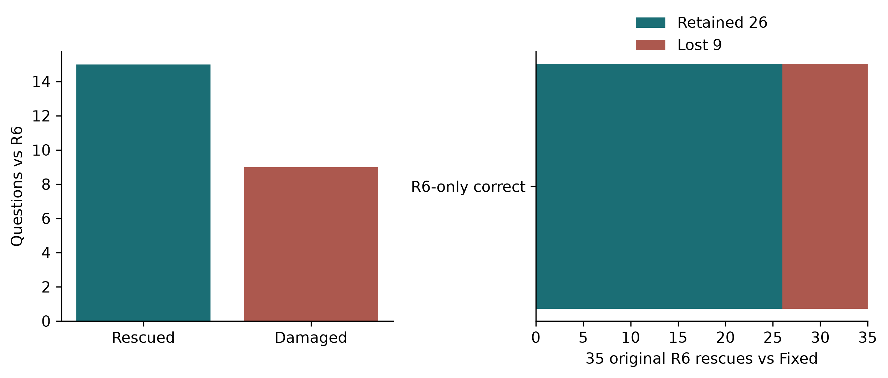

# R11：完整ARC-Challenge实验报告

冻结主方法 **robust_cyclic_loop_axis**：**742/1172（63.3106%）**；R6为736/1172。救回15、误伤9，净变化+6（+0.5119pp）。exact McNemar p=0.307456，20,000次题级配对bootstrap95%CI [-0.2560,1.3652]pp，seed2021。达到751：False。

未证明方向修正具有独立于幅度变化的收益；不能把点估计或随机对照差异当作机制成立。循环差轴未显示相对静态Native轴的可靠优势，循环特有解释仍缺乏证据。 对应的联合视图单独评分为1036/1172，高于R11的742。本轮不能推荐R11作为整体准确率方案；单独联合视图的延迟未单测，不声称其具有已测速度优势。

## 协议、冻结与选择

原始Ouro-1.4B revision574fa66cb8bf5abdc979642d01cf2b79b16bfab1，BF16/GB10，无训练、反向传播、权重更新、adapter或learned gate。原R6主提示、固定25示例、完整答案续写和字符分母保持。辅助视图保留同25个示例身份、顺序、题干和正确答案，但添加完整选项并改为字母答题格式；这属于辅助提示变化。候选按全词表log-softmax的完整目标LL计分，没有把Fixed替换为候选LL线性外推。

R7完成原token词表前缀投影实验，冻结M2为740/1172，未得到显著增益。用户要求继续方法研究、停止外部任务后，R8八种几何保护和R9逆向视图均未过门槛；R10直接联合融合被更强的joint-only诊断支配，明确在开发反馈后增加归因停止规则，未称原数值门槛失败。R11转而保护先验与当前联合循环变化轴的重合部分，不直接加入joint-only分类分数。

R11先在任何效果反馈前冻结两主候选及六控制；数值审查前后协议/源码版本均保留。576开发之后冻结完整实现，再用517确认及299验证。合并训练R6=705，单参考714，稳健716；验证单参考176、稳健178、R6=174、稳健幅度控制179。按公开排序规则选稳健方法，非晋级控制未被换成测试赢家。新完整测试前公开最终锁commit6a7ccf081981377ad2e8f1929d2ecccfd18651d2；最终锁SHA256为`df6a817ffb81e03d2e6d5ef1450b8a665762844936e08baaa72f0fa38a9d2bea`。

## 完整测试：预设主对比为R11对R6

| reference | correct | R11_net | rescue | damage | p | paired95CI_pp |
| --- | --- | --- | --- | --- | --- | --- |
| native4 | 702 | 40 | 59 | 19 | 6.41506e-06 | [1.9625,4.9488] |
| fixed | 717 | 25 | 31 | 6 | 4.12576e-05 | [1.1945,3.1570] |
| adaptive | 716 | 26 | 39 | 13 | 0.000409541 | [1.0239,3.4130] |
| A1 | 726 | 16 | 21 | 5 | 0.00249392 | [0.5119,2.2184] |
| M0_R6 | 736 | 6 | 15 | 9 | 0.307456 | [-0.2560,1.3652] |
| robust_cyclic_loop_axis_prior_norm | 736 | 6 | 11 | 5 | 0.210114 | [-0.1706,1.1945] |
| robust_cyclic_loop_axis_shuffle_update | 709 | 33 | 42 | 9 | 3.38883e-06 | [1.6212,4.0102] |
| robust_cyclic_native_axis | 748 | -6 | 2 | 8 | 0.109375 | [-1.0239,0.0000] |
| joint1_only | 634 | 108 | 306 | 198 | 1.72219e-06 | [5.4608,12.8840] |
| joint4_only | 1021 | -279 | 40 | 319 | 3.98934e-55 | [-26.7065,-20.9044] |
| jointFixed_only | 1012 | -270 | 46 | 316 | 1.14477e-50 | [-25.9386,-20.1365] |
| cyclic_joint1_only | 657 | 85 | 277 | 192 | 0.000100844 | [3.6689,10.8362] |
| cyclic_joint4_only | 1036 | -294 | 34 | 328 | 1.60869e-61 | [-27.9010,-22.2696] |

该表包含主对比和非晋级诊断，未按测试结果择优。历史ARC与开发数据均已暴露；这些条件配对统计未校正跨轮适应性研究，不是新盲测或独立交叉验证。

| stratum | n | new_correct | new_wrong | net_vs_R6 |
| --- | --- | --- | --- | --- |
| Fixed_and_R6_correct | 701 | 701 | 0 | 0 |
| R6_only_correct | 35 | 26 | 9 | -9 |
| Fixed_only_correct | 16 | 10 | 6 | 10 |
| Fixed_and_R6_wrong | 420 | 5 | 415 | 5 |

R6相对Fixed的35道独有纠错保留26道。训练39道、开发21道是不同集合，分别报告。逐题分数/转移及所有预测变化的失败案例完整保存，例子不按margin好看程度挑选。

## 方法与机制的范围

A=F+Q4−Q5，e=Fprior−P4，E=center(e)，g=center(F−Q4)。当前问题的联合选项前缀给出映回原索引的S_j=center(J4_j−J1_j)。保护p=b*mean(S_j)，b=<E,mean(S_j)>/mean(||S_j||²)；剩余v=center(e−p)，alpha=clip(<g,v>/<v,v>,0,1)，输出A−alpha*(e−p)。系数来自当前无标签前向，未用gold或数据集拟合控制器。

单轴是正交保护，稳健版本按参考变异削弱保护，不保证剩余向量正交，也不保证保留R6 margin。零轴精确回到冻结R6，零剩余先验回到A1。计算仍在候选分数空间；循环差是否代表有用语义是待检验假设。对全局S取反，保护子空间本身不区分其质量方向，不能宣称自动识别了改善与损害。

开发集后验审计复用全部真实循环上下文：1728次相关循环扰动中，单参考39次变化、涉及28题；稳健0次，映回分数最大差1.55e-15。仅覆盖循环移位，不能宣称一般排列不变性。参考平均和稳健分母的作用没有在R11单独完全隔离。开发7道稳健救回中，6道保护分量改善固定旧R6对手margin，3道系数分量改善，2道校正范数增加；代数分解有交互/顺序依赖，不是唯一的语义或隐藏状态因果解释。后验诊断未改变冻结方法。

## 正确性、成本与结论

CPU数学/退化情况检查通过；真实两题辅助K4对历史K5相应1/4/Fixed读出以及新CPU评分全零误差。旧权重/词表/示例和原R6数字来源逐SHA绑定；完整test逐候选评分、预测、正确性及配对统计由独立验收重建。旧target哈希只覆盖原始顺序n个候选；全部移位额外核验request哈希、计数和LL，不伪称历史存了n² target哈希。

实际12题独立部署使用mainK5/N0priorK4/auxK4，没有KV、诊断hook或历史状态，完整分数均精确复建。后11题均值R11=4.6320s、R6=1.9607s，比值2.3624；顺序小样本测量不外推硬件通用速度。PyTorch峰值分配2.8037GiB，GB10为统一内存。完整benchmark采集复用原R7主/先验LL、重新前向辅助流，不能把采集耗时当独立部署耗时。

同一新增6小时账本合计GPU-worker 17479.398s（4.8554h），包含所有加载、失败/取消和导出。R7/R9/R10/R11账未重置；更早历史预算单列且不简单相加。完整代码、模型/数据/源码哈希、原始数值、图表、失败案例和重放验收记录保留。另两个数据集按用户要求停止。

本轮是否值得继续，应按对R6、幅度控制和静态轴的实际差异及额外计算判断。未得到支持的机制不作为已完成发现，也不因达到一个正确数门槛而声称新原理或实用优势。
