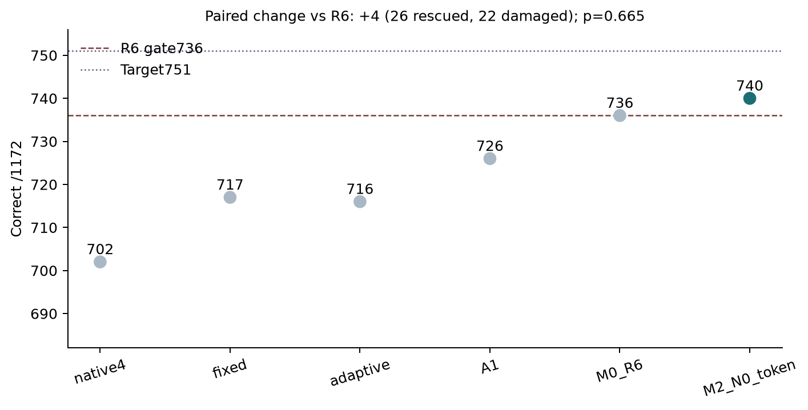
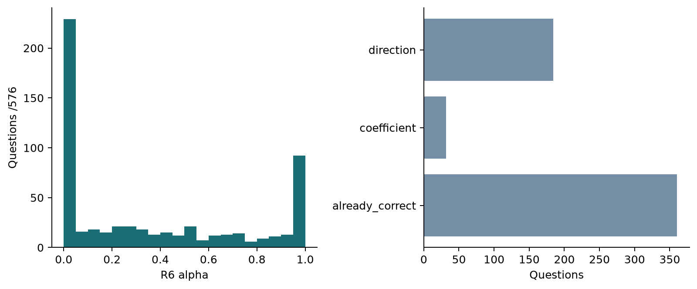
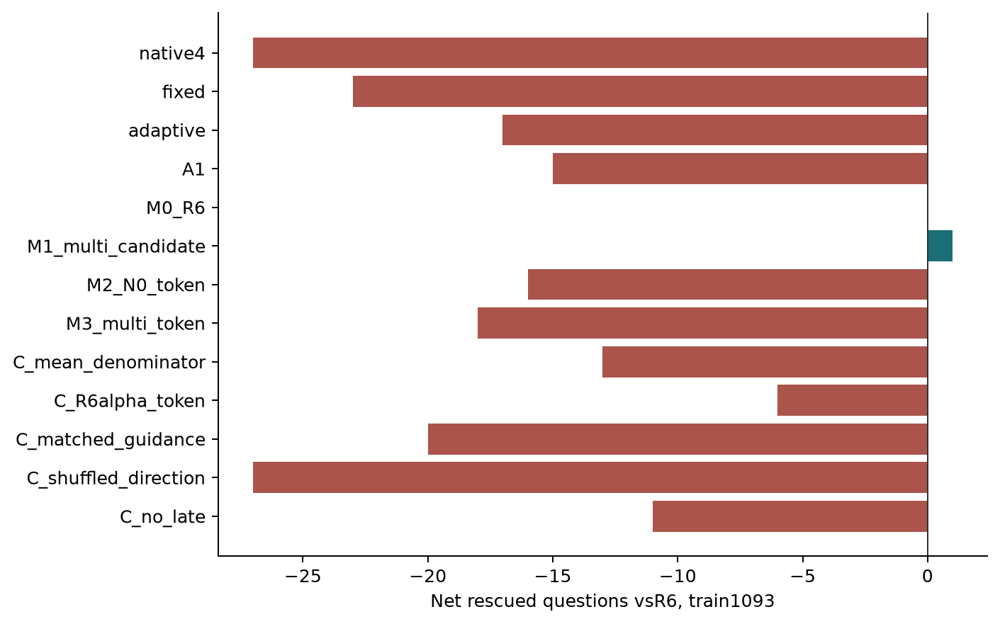

# Ouro R7：完整ARC实验报告

冻结主方法 **M2_N0_token**：**740/1172（63.1399%）**，R6为736/1172；净变化 **+4题**，新增纠错26、误伤22。超过736：是；达到751：否。用户随后要求停止另外两个数据集并继续ARC方法研究：已完成的OpenBookQA负结果保留，HellaSwag部分采集已停止，不报告其完整准确率。R7公式及ARC结果保持冻结。

主要配对差值95% bootstrap区间为[-0.8532, 1.4505]pp（20,000次，seed2021）；exact McNemar p=0.665466。配对检验未提供显著增益证据（p≥0.05）；点估计不能据此解释为稳定提升。这些是历史已暴露test上的条件比较，区间没有校正历轮研究者适应性选择。

## 协议与选择

在原V2文件夹使用r7_命名空间；用户后续同文件夹要求覆盖原附件的子目录要求。固定Git起点81d1c83b79461bf69882a0ffd4cf39b38dc3ba36。原始Ouro-1.4B revision574fa66cb8bf5abdc979642d01cf2b79b16bfab1，BF16、GB10、seed2021、同一25-shot、lm-eval0.4.9 acc_norm、完整续写及原字符分母。

先运行discovery384+selection192，冻结8种定义及排序程序后单次使用confirmation517；按预定train排序只保留两个固定候选进行validation299。最终以validation正确数、全train正确数、对R6误伤、参考数和ID依次排序选出一个主方法。原始数据均有历史使用，不是新盲测或独立交叉验证。

候选锁SHA256：`83ad234cabb12bcb43ad8ebb504de3eec3185ddfa100c071d570a924cbee6554`；最终锁SHA256：`de11c9641b3f9e08575a2806c6686b81051a7064566950e86cf6461550702afb`。所有推理源代码、模型/tokenizer、数据、固定示例、参考和数值常量均被绑定。每个配置任一候选的自身参考前缀对齐失败即整题回退R6；模型/数值错误停止。推理函数不接收gold。

| method | train1093_correct | validation299_correct |
| --- | --- | --- |
| M0_R6 | 705 | 174 |
| M1_multi_candidate | 706 | 174 |
| M2_N0_token | 689 | 178 |
| M3_multi_token | 687 | not evaluated |

选择以预先固定的validation正确数优先，因此训练集最优方法不一定成为最终主方法。M3未晋级时不在validation补算其结果。

最终主方法的整题对齐回退为0/1172，直接使用新公式的覆盖率为100.0000%。回退逐题标记和方法作用范围保存在原始记录中。

## 完整test结果：主要参照R6

| method | correct | accuracy | rescue | damage | net |
| --- | --- | --- | --- | --- | --- |
| native4 | 702 | 59.8976% | 26 | 60 | -34 |
| fixed | 717 | 61.1775% | 16 | 35 | -19 |
| adaptive | 716 | 61.0922% | 23 | 43 | -20 |
| A1 | 726 | 61.9454% | 13 | 23 | -10 |
| M0_R6 | 736 | 62.7986% | 0 | 0 | 0 |
| M2_N0_token | 740 | 63.1399% | 26 | 22 | 4 |

上表的rescue/damage/net统一以R6为参照；以下为冻结主方法分别对五个基线的配对比较，主要检验为最后一行M0_R6。完整指标另存r7_arc_primary_vs_baselines.csv。

| reference | rescue | damage | net | delta_pp | paired_95CI_pp | exact_mcnemar_p |
| --- | --- | --- | --- | --- | --- | --- |
| native4 | 66 | 28 | 38 | +3.2423 | [1.6212, 4.8635] | 0.000111121 |
| fixed | 34 | 11 | 23 | +1.9625 | [0.8532, 3.0717] | 0.000824082 |
| adaptive | 39 | 15 | 24 | +2.0478 | [0.8532, 3.2423] | 0.00149626 |
| A1 | 20 | 6 | 14 | +1.1945 | [0.3413, 2.0478] | 0.00935531 |
| M0_R6 | 26 | 22 | 4 | +0.3413 | [-0.8532, 1.4505] | 0.665466 |

主方法保留R6相对Fixed原有纠错中的20/35题。逐题记录、五组配对转移、候选总分和token诊断保存在原始JSONL及r7_paired_transitions.csv。没有测试后更换赢家。

| stratum | n | new_correct | new_wrong | net_vs_R6 |
| --- | --- | --- | --- | --- |
| Fixed_and_R6_correct | 701 | 694 | 7 | -7 |
| R6_only_correct | 35 | 20 | 15 | -15 |
| Fixed_only_correct | 16 | 12 | 4 | 12 |
| Fixed_and_R6_wrong | 420 | 14 | 406 | 14 |

该分层区分恢复Fixed本来正确而R6损坏的题、救回Fixed/R6都错的题，以及丢失R6独有纠错。新救回与新误伤必须共同解释；当前ARC统计不能证明本方法是更可靠的选择性升级。

| id | transition | gold | R6_prediction | new_prediction | R6_gold_margin | new_gold_margin |
| --- | --- | --- | --- | --- | --- | --- |
| arc_challenge/test/MCAS_2001_8_4 | Wrong->Correct | 3 | 0 | 3 | -0.03262550440881068 | 0.0014161708192055311 |
| arc_challenge/test/MDSA_2008_8_27 | Wrong->Correct | 3 | 0 | 3 | -0.013653019893916707 | 0.011990667940737332 |
| arc_challenge/test/MSA_2013_5_11 | Wrong->Correct | 3 | 1 | 3 | -0.012445083411150581 | 0.035079278643169176 |
| arc_challenge/test/ACTAAP_2007_7_36 | Correct->Wrong | 2 | 2 | 3 | 0.026362790101588263 | -0.10974368182095617 |
| arc_challenge/test/MCAS_2010_5_11984 | Correct->Wrong | 0 | 0 | 3 | 0.017785478731165094 | -0.00868948691972038 |
| arc_challenge/test/MCAS_2013_8_29425 | Correct->Wrong | 0 | 0 | 2 | 0.014059812086997081 | -0.0004917822386089066 |

示例按每类ID字典序取前3题，选项索引从0开始。r7_failure_cases.jsonl保存所有预测变化及完整题干/选项，逐选项分解为目标logit变化、完整归一化项变化和恢复旧R6扣除项，并显式记录FP32累加残差；该代数分解解释分数如何变化，不能单凭它识别唯一因果机制。

## R6瓶颈与参考审计

576题中R6正确360；216道错题中沿A−aE、a∈[0,1]的事后oracle只能救回32题，184题在既有方向空间中无法排第一。这揭示旧方向的容量限制，不意味着token新方向必然有效；oracle不参与推理或方法选择。

N0为字面量Answer:；N1/N2保留原25例和分隔符，仅通过结构化question字段覆盖为N/A或Unknown。当前问题答案及解释不进入参考。每个流独立encode_pair，对齐已消费的续写文本；预测token仍从真实流target索引读取。R6候选复制/删除依赖及oracle逐题记录均公开。删除原赢家的自然变化不计作排名不稳定，使用共享候选限制排名进行区分。

## token粒度、多参考与控制

| contrast | rescue | damage | net | exact_mcnemar_p |
| --- | --- | --- | --- | --- |
| M2_N0_token vs M0_R6 | 12 | 28 | -16 | 0.016589 |
| M3_multi_token vs M2_N0_token | 10 | 12 | -2 | 0.831812 |
| M2_N0_token vs C_R6alpha_token | 16 | 26 | -10 | 0.164149 |
| M3_multi_token vs C_mean_denominator | 0 | 5 | -5 | 0.0625 |
| M3_multi_token vs C_matched_guidance | 8 | 6 | 2 | 0.790527 |
| M3_multi_token vs C_shuffled_direction | 23 | 14 | 9 | 0.187742 |
| M3_multi_token vs C_no_late | 15 | 22 | -7 | 0.324009 |

表中均为完整train1093上的配对比较，属于开发证据。M2对R6同时改变token粒度、系数估计和重新归一化，因此不能把全部差值归因于单一因素；桥接控制固定整题alpha后在token空间重新归一化，提供中间对照。M3对M2比较引入N1/N2的稳健参考作用。M3在训练集正确数的点估计上同时高于两个控制；对应配对p分别为0.790527和0.187742，未作多重比较校正，不能仅凭点估计宣称机制成立。

现有匹配幅度及置乱控制对应M3多参考token修正；若赢家为M1或M2，不能用它比这些J3控制高就隔离其自身方向机制。M1相对R6只检验多参考候选公式，不能归功于token粒度；M2对桥接控制检验其token系数估计，但仍不能独立证明收益来自去除无关先验而非通用幅度变化。该机制归因限制保留在最终结论中。

| method | positions | mean_alpha | alpha0 | alpha1 | mean_delta_target_LP |
| --- | --- | --- | --- | --- | --- |
| C_R6alpha_token | 25364 | 0.3603 | 35.59% | 15.20% | -0.06568 |
| C_matched_guidance | 25364 | 0.3778 | 23.96% | 8.65% | +0.04413 |
| C_mean_denominator | 25364 | 0.4465 | 23.96% | 15.39% | +0.04090 |
| C_shuffled_direction | 25364 | 0.3778 | 23.96% | 8.65% | -0.01897 |
| M2_N0_token | 25364 | 0.3283 | 30.38% | 7.96% | +0.02179 |
| M3_multi_token | 25364 | 0.3778 | 23.96% | 8.65% | +0.03806 |

以上为全部候选的token加权统计，包含错误选项，平均目标log概率增加并不等价于正确答案margin改善。稳健分母将平均alpha从仅平均参考投影的0.4465降到0.3778；正确数仍由实际配对结果判断。全部152,184个模式预测位置的alpha重建误差为0，置乱范数与匹配残差范数最大误差分别为5.55112e-16、2.22045e-16，说明控制确实匹配其定义中的范数。

M1是候选分数空间投影；M2/M3先在完整词表加权内积下解析投影，再完整log_softmax，最后才累加并除一次字符长度。两类归一化不同，不能相互替代。r7_selectivity_diagnostics.csv将实际目标logit位移、log-partition变化和目标log概率变化分开，检查三者恒等式；不把已读标签用于系数。

## 正确性与计算成本

20项CPU数学检查通过；真实模型无干预、N0先验、独立循环深度及各阶段历史基线精确parity见r7_baseline_parity.json。旧KV路径真实BF16单token最大差约0.314，未通过且停用。所有新模型前向使用原无mask、无KV的调用。开发复用历史K6目标状态并逐文件SHA/manifest绑定；这不计作本轮主上下文K5执行时间。

另以真实模型第一道开发题的4个候选执行独立实现检查，最长34token，跨越32位置分块边界：强制零校正后完整候选总似然精确回到Fixed，加入原晚期项后回到A1。常数平移检查的alpha最大差为0，完整词表log概率最大差为0；使用预定FP32舍入容差3e-5。这些额外检查不计入部署计时样本。

新增GPU-worker累计9690.506秒（2.6918小时），包含加载、失败尝试、参考、head和导出；硬上限21600秒，开发阶段预留5400秒。旧预算未修改；完整历史ledger与可识别缓存采集条目单列，不宣称历史缓存免费，也不把包含其他工作的总额误当缓存专属成本。

独立部署测量使用真实主上下文K5与参考K4，不使用历史K6状态、KV或诊断hooks/CPU诊断数组导出。12道固定discovery题与已完成开发分数逐候选精确一致；模型加载20.324秒，首题2.835秒，后11题均值1.968秒/题。PyTorch峰值分配2.846GiB；GB10为统一内存，此值不是独立显存总占用。参考前缀缓存未获批准，缓存预热收益不适用。

同一12题独立R6执行的后11题均值为1.961秒/题，新方法为其1.004倍。两组按顺序测量，结果仅代表该小样本部署路径，不外推为硬件通用速度结论。

## 研究结论

本轮应按完整test的净纠错、保留旧纠错和配对不确定性判断收益。开发方向容量诊断支持“旧候选方向存在局限”，不能单凭它宣称新的隐藏状态失效机制已被验证。token与多参考的实际增量、控制结果和额外成本如上；没有训练、权重更新、控制器、adapter或循环结构改造。用户随后要求停止另外两个数据集并继续ARC方法研究：已完成的OpenBookQA负结果保留，HellaSwag部分采集已停止，不报告其完整准确率。R7公式及ARC结果保持冻结。

后续只有在新数据或预先限定的机制干预下重复观察到“方向优于匹配幅度控制”，才有依据将选择性校正提升为机制结论。本次有限方法比较不构成未见研究的原创性证明。

## 用户停止前已完成的迁移记录

| task | n | correct | reference_correct | rescue | damage | net | exact_mcnemar_p |
| --- | --- | --- | --- | --- | --- | --- | --- |
| openbookqa | 500 | 214 | 219 | 2 | 7 | -5 | 0.1796875 |

该任务在停止指令之前已完成，保留完整负结果。HellaSwag未完成，部分数值只作运行记录，不用于后续选择方法。后续方法仍在原文件夹，以新轮次命名并明确历史数据暴露，不改R7测试赢家。
